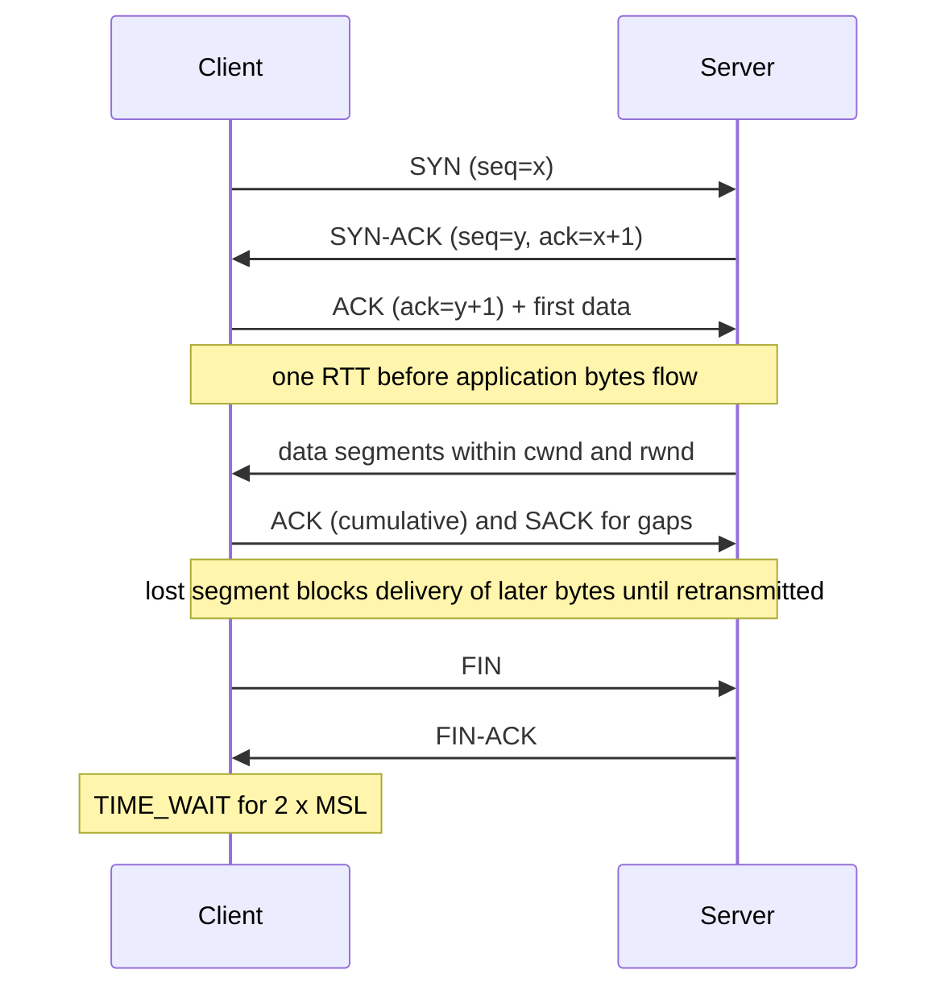

# TCP and UDP

> [!abstract] In one sentence
> TCP turns an unreliable packet network into a reliable, in-order byte stream (handshake, acknowledgements, retransmission, flow and congestion control) and charges you round trips and head-of-line blocking for it; UDP sends independent datagrams with no guarantees, so the application decides what reliability it actually needs.

> [!tip] Deeper treatment in your system-design vault
> `system-design/02 Networking/TCP vs UDP.md` — read it *after* you have written your own explanation below.

**Map:** [[Networking MOC]] → [[HLD MOC]]

## Definition

**TCP** (Transmission Control Protocol) is a connection-oriented transport protocol: two endpoints agree on sequence numbers in a handshake, then exchange a byte stream that is delivered reliably, in order and without duplicates, with the sender's rate bounded by the receiver's window (flow control) and by inferred network capacity (congestion control). **UDP** (User Datagram Protocol) is connectionless: each datagram is addressed, checksummed and sent once; it may arrive late, duplicated, reordered or not at all, and nothing slows the sender down. Both run over IP and are distinguished by port numbers; everything above them — [[HTTP and HTTPS|HTTP]], [[TLS]], [[DNS]], [[gRPC]] — chooses one and inherits its properties.

## Problem solved

IP delivers packets on a best-effort basis across links that drop, reorder and duplicate. Every application needing "send this file intact" would otherwise reimplement sequencing, acknowledgements, retransmission timers and rate control — and get it wrong in ways that collapse shared networks (the 1986 Internet congestion collapse is why congestion control exists). TCP solves that once, in the kernel. UDP solves the opposite problem: for traffic where a late packet is worthless (a voice sample, a game position update, a metric sample) or where the application already has its own reliability (QUIC, DNS retries), TCP's guarantees are pure overhead and its in-order delivery actively harms latency.

## How it works

**TCP**

1. **Three-way handshake.** Client sends `SYN` with an initial sequence number, server replies `SYN-ACK`, client sends `ACK` — one round trip before any data. A [[TLS]] handshake then adds one or two more ([[Latency]] compounds here).
2. **Reliable delivery.** Every byte has a sequence number; the receiver acknowledges the highest contiguous byte received (plus selective acknowledgements for gaps). Unacknowledged data is retransmitted after a timeout derived from the measured RTT, or faster on three duplicate ACKs.
3. **Flow control.** The receiver advertises a window (`rwnd`) of how much it can buffer; the sender never has more than that in flight. A slow consumer applying [[Backpressure]] shows up as a zero window.
4. **Congestion control.** The sender keeps a congestion window (`cwnd`) that starts small (slow start, typically 10 segments) and grows per RTT until loss or delay signals congestion, then shrinks (CUBIC is the Linux default; BBR models bandwidth and RTT instead of reacting to loss). This is why a fresh connection cannot use a fat pipe immediately and why connection reuse matters ([[Keep-Alive Connections]]).
5. **Head-of-line blocking.** Because delivery to the application is strictly in order, one lost segment holds back every byte after it until it is retransmitted — even if those bytes belong to unrelated HTTP/2 streams.
6. **Teardown.** `FIN`/`ACK` in each direction; the side that closes first holds the socket in `TIME_WAIT` for 2×MSL (60 s on Linux), which is why a client opening thousands of short connections exhausts ephemeral ports.

**UDP**

- An 8-byte header (source port, destination port, length, checksum) on top of IP. No handshake, no state, no retransmission, no ordering, no rate control. Datagrams larger than the path MTU get fragmented at the IP layer, and a lost fragment loses the whole datagram — which is why DNS over UDP historically stayed under 512 bytes and why QUIC keeps packets around 1,200 bytes.
- Anything the application needs (acks, sequence numbers, pacing) it builds itself. QUIC does exactly this in user space and adds TLS 1.3, which is how HTTP/3 gets per-stream loss recovery without kernel changes.

```bash
# watch the handshake and retransmissions of one connection
sudo tcpdump -i any 'tcp port 8080 and (tcp[tcpflags] & (tcp-syn|tcp-fin) != 0)'
# socket-level view: cwnd, rtt, retransmits
ss -ti dst :8080
```

## Architecture



## Use cases

- **TCP** whenever the requirement says "every byte must arrive, in order": APIs, database wire protocols, message brokers ([[Kafka]] is TCP), file transfer, anything behind [[TLS]] 1.2/1.3.
- **UDP** when the requirement values freshness over completeness: live voice and video, multiplayer game state, sensor and metrics telemetry where the next sample supersedes the last (StatsD is UDP for this reason).
- **UDP** when a request-response fits in one datagram and the application can retry: [[DNS]] lookups, NTP, DHCP.
- **UDP as a carrier for a smarter transport**: QUIC/HTTP/3 for mobile clients that change networks, WireGuard for VPNs.
- A requirement to support hundreds of thousands of idle long-lived connections per node points at TCP tuning ([[WebSockets]]) and at the memory per socket, not at UDP.

## Limitations

- TCP's handshake and slow start make short-lived connections expensive; without reuse or pooling, latency is dominated by setup ([[Connection Pooling]]).
- TCP head-of-line blocking punishes multiplexed protocols on lossy links; HTTP/2 over a 2% loss path can be slower than HTTP/1.1 with several connections.
- TCP's congestion control is per connection and loss-based by default, so bufferbloat and long fat pipes underuse bandwidth unless tuned (BBR, larger buffers).
- UDP gets no fairness or backpressure: a misbehaving sender floods the network, and middleboxes (NAT, firewalls) often time out UDP "flows" within 30–60 s or block them entirely.
- UDP datagram size is capped by path MTU in practice, so large payloads need application-level fragmentation and reassembly.

## Trade-offs

| You gain | You sacrifice |
|---|---|
| TCP: reliability, ordering and congestion control for free, in the kernel | Round trips to connect, in-order head-of-line blocking, per-connection state and memory |
| TCP: fairness with every other flow on the internet | Throughput ramp-up (slow start) on every new connection |
| UDP: minimal latency, no connection state, multicast and broadcast | You implement any reliability, ordering and pacing yourself |
| UDP: freedom to drop stale data instead of delivering it late | Firewalls and NATs treat it as second class; no built-in backpressure |

## Failure modes

- **Ephemeral port or `TIME_WAIT` exhaustion** on a client that opens a new TCP connection per request: `EADDRNOTAVAIL`/connect timeouts under load; you notice as connection errors only above a certain request rate; blast radius is that whole client pod. Reuse connections.
- **Half-open connections**: the peer died or a NAT dropped the mapping, but no `FIN` arrived; the socket looks connected until the next write times out (minutes with default `tcp_retries2`). Visible as requests hanging far past expected latency; fixed with keep-alive probes and application timeouts ([[Timeouts and Retries]]).
- **SYN backlog overflow** on a server under a connection burst or SYN flood: new connections silently dropped and retried after 1 s, so p99 connect time jumps to seconds; `nstat | grep ListenDrops` shows it.
- **Receive-window collapse** when the application stops reading (GC pause, blocked thread): the sender stalls on zero window, upstream queues fill, and the symptom appears far from the cause ([[Backpressure]]).
- **UDP silent loss** under congestion: metrics or logs vanish with no error anywhere; you notice as gaps in dashboards or counters that do not add up. Blast radius: whatever decisions were made on the missing data.

## Performance

Order of magnitude: an in-datacentre RTT is around 0.5 ms, so a TCP connect costs about that; a cross-continent RTT is ~150 ms, so connect plus TLS 1.3 is ~300 ms before the first HTTP byte. TCP throughput on a single connection is bounded by `window / RTT` (a 64 KiB default window over 100 ms RTT caps at ~5 Mbit/s without window scaling, which modern kernels enable by default) and by congestion-window growth after loss. Per-connection kernel memory is tens of KB of buffers, which is what limits connections-per-node. UDP adds effectively zero per-packet state; its cost is whatever reliability layer you write.

## Scalability

TCP connection count per node is bounded by memory and file descriptors (hundreds of thousands per node is routine with tuning). At 10x connections, the sizing question is buffers × connections; at 10x request rate on short connections, the question is handshake CPU and port churn, which pooling and [[Load Balancers|balancer]] connection reuse solve. UDP services scale per packet, not per connection, which makes them easy to shard by destination port or by consistent hashing of the source ([[Consistent Hashing]]) but gives no natural backpressure when a shard is overloaded.

## Operational impact

Mostly kernel tuning and diagnosis skills: `net.core.somaxconn`, `tcp_tw_reuse`, buffer sizes, keep-alive intervals, and knowing how to read `ss -ti`, `tcpdump` and `nstat` counters. On Kubernetes the extra layers (kube-proxy, conntrack tables, service mesh sidecars) each add a place where connections are tracked and can be dropped; conntrack table exhaustion is a classic cluster-wide incident. UDP traffic needs explicit allow rules on security groups and NLB listeners, and a plan for what the application does when loss is high.

## Alternatives

- **QUIC** — wins when you need multiplexing without HOL blocking, fast resumption and connection migration (mobile), and can run user-space transport; costs CPU (no kernel offload) and UDP reachability.
- **SCTP** — multi-streaming and multi-homing in the kernel; wins in telecom signalling, loses on middlebox support everywhere else.
- **Unix domain sockets or shared memory** — win for same-host communication (sidecar ↔ app) where TCP's stack is pure overhead.
- **Application-level reliability over UDP** (RUDP, custom game protocols) — wins when you want selective reliability per message type.

## Real-world examples

- Google built QUIC over UDP precisely to escape TCP's HOL blocking and handshake cost; it is now HTTP/3 (RFC 9000/9114).
- DNS resolvers use UDP for queries and fall back to TCP only for large answers or zone transfers; this is why resolvers can serve enormous query rates with little state.
- Netflix and Google tuned congestion control (BBR) for video delivery because loss-based control misread deep buffers as capacity.
- In a stack like yours: every hop — ALB to pods, pods to PostgreSQL and [[Redis]], Kafka producers to brokers — is TCP, so connect-time and `TIME_WAIT` behaviour under pod churn, and conntrack limits on nodes, are where transport issues will surface; StatsD-style metrics or OpenTelemetry over UDP would be your first real UDP traffic.

## Practical exercise

1. Start a small HTTP server (Spring Boot or Node) in Docker and a client loop that makes 10,000 requests, first with a new connection per request, then with keep-alive.
2. Measure p50/p99 per request and watch `ss -s` for `TIME_WAIT` counts and `nstat` for retransmits during each run.
3. Add latency and loss with Toxiproxy (or `tc netem delay 50ms loss 1%`) between client and server; observe how throughput per connection drops and how many retransmits appear.
4. Send 100,000 UDP datagrams with a Python or Node script to a receiver that sleeps 1 ms per packet; count what arrives and note that nothing reported the loss.
5. Record: connect time vs RTT, throughput vs loss, and the connection count at which the client starts failing.

## Related concepts

### Prerequisites
- [[Latency]] — round trips are the unit of cost for handshakes
- [[Throughput]] — window and RTT bound per-connection throughput

### Related
- [[HTTP and HTTPS]] — HTTP/1.1 and 2 on TCP, HTTP/3 on UDP via QUIC
- [[TLS]] — adds its own round trips on top of the TCP handshake
- [[Keep-Alive Connections]] — amortising the handshake across requests
- [[Connection Pooling]] — the same amortisation for databases and clients
- [[DNS]] — the canonical UDP request-response protocol
- [[Backpressure]] — TCP flow control is the transport-level version

### Builds on this
- [[HTTP and HTTPS]] — its versions are shaped by TCP's limits
- [[WebSockets]] — a long-lived TCP connection per client
- [[gRPC]] — HTTP/2 streams multiplexed over one TCP connection
- [[Load Balancers]] — L4 balancing works on TCP/UDP flows
- [[Timeouts and Retries]] — timeouts exist because TCP will wait minutes on its own

### Design problems where it applies
- [[Design a Chat System]]
- [[Design a Video Streaming Service]]
- [[Design a Metrics and Monitoring System]]

### Projects where it can be implemented
- [[Chaos Lab]]
- [[Live Ops Dashboard]]

### Resources
- [[Latency Numbers Every Programmer Should Know]] — the RTT figures that make handshake cost concrete
- [[System Design Primer (GitHub)]] — the TCP vs UDP section and its links
- [[Toxiproxy]] — inject latency and loss to see TCP behaviour

## Personal understanding

> [!question] Explain it without the source
> Write your own explanation here, from memory. Then compare it with the sections above and note what you missed.

### Mastery checklist
- [ ] I can explain it without the original resource
- [ ] I can describe the problem it solves
- [ ] I can compare it with its alternatives
- [ ] I can name its limitations and failure modes
- [ ] I can recognise when it is appropriate in a real system
- [ ] I have applied it in a system design
- [ ] I have validated my assumptions with an experiment or implementation

## Open questions

- [ ] What are the conntrack table limits on our EKS nodes, and at what connection churn rate would a node start dropping new flows?
- [ ] How long does a half-open connection to a killed PostgreSQL pod hang before the JDBC driver notices, with and without TCP keep-alive enabled?
- [ ] Would switching nodes to BBR change p99 for large responses to mobile clients, and how would we measure it safely?
