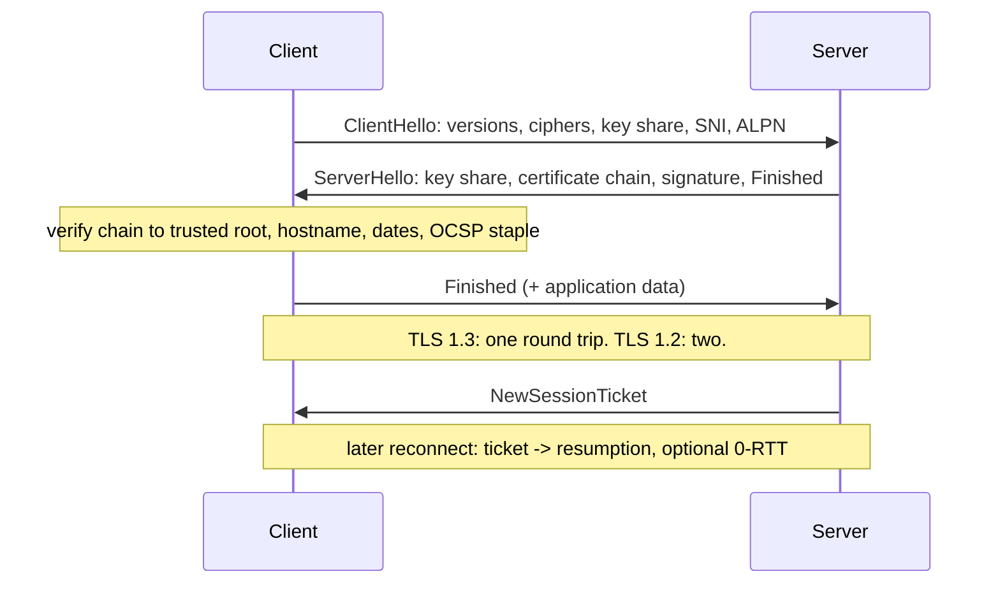

# TLS

> [!abstract] In one sentence
> TLS wraps any TCP stream in an authenticated, encrypted channel: a handshake proves the server's identity through a certificate chain and agrees on session keys, after which bytes are confidential and tamper-evident — and where that handshake happens (edge, sidecar, service) and how often (resumption, reuse) decides most of its cost.

> [!tip] Deeper treatment in your system-design vault
> `system-design/02 Networking/TLS and HTTPS.md` — read it *after* you have written your own explanation below.

**Map:** [[Networking MOC]] → [[HLD MOC]]

## Definition

Transport Layer Security is a protocol layered between [[TCP and UDP|TCP]] and an application protocol such as [[HTTP and HTTPS|HTTP]], gRPC, SMTP or the PostgreSQL wire protocol. A **handshake** authenticates the server via an X.509 certificate signed by a chain of certificate authorities the client trusts, negotiates cipher suites, and derives symmetric session keys with an ephemeral Diffie-Hellman exchange (forward secrecy). The **record layer** then encrypts and authenticates application data. "SSL" is the obsolete predecessor; TLS 1.2 (RFC 5246) and TLS 1.3 (RFC 8446) are what runs today. **mTLS** (mutual TLS) adds a client certificate so both ends are authenticated — the basis of service identity in meshes.

## Problem solved

Plain TCP lets anyone on the path read and modify traffic and lets anyone answer to a name. Three distinct problems are solved at once: **confidentiality** (passwords, tokens, card data cross shared networks), **integrity** (a proxy cannot inject or alter responses), and **authentication** (the client knows it reached the real `api.example.com`, not an impostor at a coffee-shop router). Without server authentication, encryption is pointless — a man in the middle just terminates and re-encrypts. For service-to-service traffic inside a cluster, mTLS solves a fourth problem: **identity** without shared secrets, so [[Authorization|authorisation]] can be based on *which workload* is calling rather than on a network location that is trivially spoofed.

## How it works

1. **ClientHello.** The client sends supported TLS versions, cipher suites, a key share for (EC)DHE, the server name (SNI, so one IP can host many certificates) and ALPN (which application protocol it wants: `h2`, `http/1.1`).
2. **ServerHello + certificate.** The server picks the parameters, sends its key share, its certificate chain (leaf → intermediate(s); the root is already in the client's trust store), and a signature over the handshake proving it holds the private key. In TLS 1.3 everything after ServerHello is already encrypted.
3. **Verification.** The client validates the chain to a trusted root, checks the name matches SNI/hostname, checks validity dates, optionally checks revocation (OCSP stapling is the practical way), and derives the same session keys from the key shares.
4. **Finished.** Both sides confirm with a MAC over the transcript. TLS 1.3 completes in **one round trip**; TLS 1.2 needs **two**. On a 100 ms RTT that is the difference between 100 ms and 200 ms of pure handshake latency on every new connection.
5. **Resumption.** The server issues a session ticket; a reconnecting client presents it and skips certificate verification and most of the handshake. TLS 1.3 even allows **0-RTT** data on resumption — safe only for idempotent requests, since 0-RTT data can be replayed.
6. **Record layer.** Application bytes are split into records (≤ 16 KiB), encrypted with an AEAD cipher (AES-GCM or ChaCha20-Poly1305) and authenticated; hardware AES makes bulk encryption cheap, so the CPU cost concentrates in handshakes.
7. **mTLS.** The server requests a certificate during the handshake; the client sends one and proves possession. Meshes (Istio, Linkerd) and SPIFFE issue short-lived workload certificates automatically and rotate them hourly, turning certificates into identities rather than secrets to manage ([[Secrets Management]]).

```bash
# see the chain, protocol, cipher and handshake timing
openssl s_client -connect api.example.com:443 -servername api.example.com -tls1_3 </dev/null 2>/dev/null | grep -E "Protocol|Cipher|Verify"
curl -w "tcp=%{time_connect} tls=%{time_appconnect} ttfb=%{time_starttransfer}\n" -o /dev/null -s https://api.example.com/health
```

## Architecture



## Use cases

- Anything leaving a trusted network boundary: public APIs, mobile and browser clients, webhooks to customers ([[Design a Webhook Delivery System|webhook delivery]]), partner integrations. Non-negotiable; compliance regimes (PCI DSS) require it.
- "Services must authenticate each other without shared passwords" — mTLS via a mesh or SPIFFE gives workload identity that survives pod rescheduling.
- "Traffic between the balancer and pods must be encrypted" (regulated data, zero-trust requirements) — re-encrypt after edge termination rather than passing plaintext inside the VPC.
- Database and broker connections across accounts or regions: RDS, MSK and ElastiCache all support TLS; cross-VPC peering is not encryption.
- Client-certificate authentication for high-assurance partner APIs, where an [[API Keys|API key]] alone is too weak.

## Limitations

- Handshake latency and CPU: new connections are expensive, so TLS pushes you toward long-lived connections and pools ([[Keep-Alive Connections]], [[Connection Pooling]]).
- Certificates expire; the operational failure of "the cert expired at 03:00" has taken down more systems than any cryptographic weakness.
- Encrypting inside the cluster hides traffic from passive network inspection — your debugging tools (tcpdump) go blind unless you capture at the terminating proxy.
- mTLS identity is per workload, not per user; you still need [[JWT]] or sessions for end-user [[Authentication]].
- Trust stores are a dependency: a client with an outdated root bundle (old Android, embedded devices) fails when you rotate to a new CA, which is what happened to many devices when Let's Encrypt's original root expired.

## Trade-offs

| You gain | You sacrifice |
|---|---|
| Confidentiality and integrity on untrusted paths, with server identity | One (TLS 1.3) or two (TLS 1.2) extra round trips and asymmetric-crypto CPU per new connection |
| mTLS gives cryptographic workload identity for authorisation | A certificate authority, issuance and rotation to operate |
| Terminating at the edge centralises certificates and offloads CPU | Plaintext between edge and service unless you re-encrypt |
| Session resumption and 0-RTT make reconnects nearly free | 0-RTT data is replayable; only safe for idempotent requests |

## Failure modes

- **Expired or wrong certificate**: every client rejects the handshake at once; you notice as a cliff-edge error rate at the exact expiry minute; blast radius is every consumer of that endpoint. Alert on days-to-expiry across all endpoints and automate renewal (ACME/cert-manager).
- **Incomplete chain** (missing intermediate): works in browsers that fetch intermediates via AIA, fails in Java and Go clients — "works on my laptop, fails from the service". Serve the full chain.
- **Handshake storm after a mass reconnect** (balancer restart, deployment): thousands of full handshakes at once peg CPU on the terminating tier and the retry wave makes it worse ([[Retry Storms]]); mitigate with session tickets, connection draining and jittered reconnects.
- **Clock skew** on a node makes valid certificates look not-yet-valid or expired; symptoms are confined to one node and look like a random subset of failures.
- **Trust store drift**: a new internal CA deployed to servers but not to all clients; the subset of clients with old bundles fails after rotation. Roll out roots before leaves.

## Performance

Per new connection: one RTT (TLS 1.3) or two (1.2) plus a few hundred microseconds to low milliseconds of CPU for the ECDHE and signature operations — on a 0.5 ms in-datacentre RTT the CPU dominates, on a 100 ms mobile RTT the round trips do. Bulk encryption with AES-GCM on AES-NI hardware runs at multiple GB/s per core and is rarely the bottleneck. Resumption cuts the handshake to a symmetric-only exchange. Record overhead is small (tens of bytes per 16 KiB record). The practical lever is the ratio of requests to handshakes: a client making 1,000 requests over one connection pays the handshake once.

## Scalability

Termination capacity scales with CPU on the terminating tier; edge balancers (ALB, Envoy, NGINX) are built to do this at hundreds of thousands of handshakes per second per fleet, so the design question is *where* to terminate: at the edge only (cheapest, plaintext inside), edge plus re-encryption to pods (common in regulated setups), or mesh mTLS everywhere (strongest identity, a sidecar's worth of CPU per pod). At 10x services, certificate issuance and rotation must be automated or it becomes the limiting factor; at 10x clients, session resumption and ticket key rotation keep handshake load flat.

## Operational impact

Moderate and mostly about lifecycle: inventory of every certificate (public, internal, client certs), automated issuance (ACME, cert-manager, ACM), rotation before expiry, revocation plan, cipher and protocol policy (disable TLS 1.0/1.1, prefer 1.3), monitoring handshake failures and expiry dates ([[Alerting]]). A mesh moves most of this into a control plane but adds its own upgrade and debugging burden. Keep a way to decrypt at the proxy for incident debugging, and log TLS version and cipher per connection so deprecations are data-driven.

## Alternatives

- **No encryption inside a private network** — wins on simplicity and latency only when the network boundary is genuinely trusted and nothing regulated crosses it; increasingly rejected by zero-trust policies.
- **IPsec/WireGuard at the network layer** — wins for site-to-site tunnels and node-to-node encryption without touching applications; gives no application-level identity.
- **Application-layer signing (HMAC request signatures, signed webhooks)** — wins for integrity and authentication when the transport is already TLS but you need proof that survives proxies and logs; does not give confidentiality.
- **QUIC** — TLS 1.3 fused into the transport; wins for client-facing latency where UDP is reachable ([[HTTP and HTTPS|HTTP/3]]).

## Real-world examples

- Let's Encrypt and the ACME protocol made automated 90-day certificates the norm, and the 2021 expiry of its original root broke clients with stale trust stores — a trust-store lesson at internet scale.
- Google's BeyondCorp and the SPIFFE/SPIRE project made workload-identity-by-certificate (mTLS) the model that Istio and Linkerd implement by default.
- Cloudflare terminates TLS at the edge for millions of sites and publishes detailed data on TLS 1.3 and 0-RTT adoption and its replay caveats.
- In a stack like yours: an ALB or ingress with ACM or cert-manager certificates terminating public TLS, JDBC and the Node `pg`/`ioredis` clients speaking TLS to RDS and ElastiCache, and — if a mesh is adopted — mTLS giving each service an identity that an IAM policy can reference instead of trusting the pod network.

## Practical exercise

1. Generate a private CA, an intermediate and a leaf certificate with `openssl` (or `mkcert`); run NGINX in Docker serving a small endpoint with the leaf.
2. Measure handshake cost: `curl -w` timings over TLS 1.2 vs TLS 1.3, with and without session resumption (`--tls-max`, `--tlsv1.3`, and a second request reusing the session).
3. Serve only the leaf (no intermediate) and call it from a small Java and a Node client; observe which fails and why.
4. Enable client certificates (`ssl_verify_client on`) and call with and without a client cert; inspect the `$ssl_client_s_dn` variable logged by NGINX — this is workload identity in miniature.
5. Expire the leaf (one-minute validity) and watch the exact failure a client sees; then script an expiry alert that reads the cert over the wire.

## Related concepts

### Prerequisites
- [[TCP and UDP]] — TLS rides on a TCP connection and adds round trips to it
- [[Encryption at Rest and in Transit]] — the policy context TLS implements

### Related
- [[HTTP and HTTPS]] — HTTPS is HTTP inside TLS; ALPN selects the version
- [[Reverse Proxies]] — the usual termination point
- [[Authentication]] — mTLS is machine authentication; users still need tokens
- [[Secrets Management]] — private keys are the most sensitive secrets you hold
- [[Load Balancers]] — terminate, pass through, or re-encrypt
- [[Keep-Alive Connections]] — the cheapest handshake is the one you do not repeat

### Builds on this
- [[HTTP and HTTPS]] — HTTPS and HTTP/2 both assume it
- [[gRPC]] — production gRPC runs over TLS with ALPN h2
- [[Reverse Proxies]] — termination and re-encryption are proxy features
- [[API Gateways]] — gateways own public certificates and client-cert policies

### Design problems where it applies
- [[Design an IAM Service]]
- [[Design an API Gateway]]
- [[Design a Webhook Delivery System]]

### Projects where it can be implemented
- [[LLM Gateway]]
- [[Webhook Relay]]

### Resources
- [[OWASP Secrets Management Cheat Sheet]] — handling private keys and rotation
- [[Latency Numbers Every Programmer Should Know]] — RTT figures behind handshake cost

## Personal understanding

> [!question] Explain it without the source
> Write your own explanation here, from memory. Then compare it with the sections above and note what you missed.

### Mastery checklist
- [ ] I can explain it without the original resource
- [ ] I can describe the problem it solves
- [ ] I can compare it with its alternatives
- [ ] I can name its limitations and failure modes
- [ ] I can recognise when it is appropriate in a real system
- [ ] I have applied it in a system design
- [ ] I have validated my assumptions with an experiment or implementation

## Open questions

- [ ] Where exactly does TLS terminate for each of our ingress paths today, and which hops inside the VPC carry plaintext card or token data?
- [ ] What would mesh mTLS cost in CPU and p99 per pod for a chatty service, measured rather than assumed?
- [ ] Which of our clients would break if we rotated the internal CA tomorrow, and do we have an inventory to answer that?
