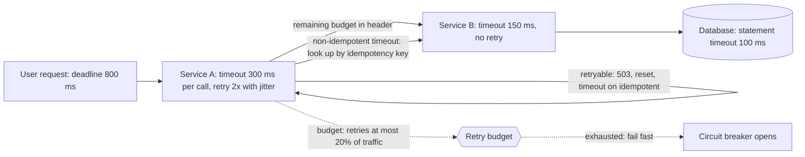

# Timeouts and Retries

> [!abstract] In one sentence
> A timeout converts "this might never return" into a bounded failure you can act on, and a retry with exponential backoff and jitter converts a transient failure into a success — provided you only retry what is safe, keep a budget, and never let layers multiply retries into a [[Retry Storms|retry storm]].

> [!tip] Deeper treatment in your system-design vault
> `system-design/12 Resilience/Timeouts Retries and Exponential Backoff.md` — read it *after* you have written your own explanation below.

**Map:** [[Networking MOC]] → [[HLD MOC]]

## Definition

A **timeout** is the maximum time a caller waits for a step before treating it as failed: connect timeout (establishing the socket), read or response timeout (time between bytes, or total time to a response), and an end-to-end **deadline** for the whole operation that is propagated downstream so each hop knows how much budget remains. A **retry** is a repeat of a failed call, governed by a policy: which errors are retryable, how many attempts, the delay between them (**exponential backoff** — delay doubles each attempt, capped) with **jitter** (randomisation so retries from many clients do not align), and a **retry budget** that caps retries as a fraction of total traffic. Together they are the first line of [[Fault Tolerance]] for any remote call.

## Problem solved

Networks and dependencies fail partially: a packet is dropped, a pod is being terminated, a database is failing over for five seconds, a partner's API hiccups. Without a timeout the caller blocks — the thread, the pooled connection and the user all wait, in the worst case forever (many clients default to *no* timeout), and under load the waiting callers exhaust every pool and thread in the service, so a dependency's slowness becomes your outage ([[Connection Pooling|pool exhaustion]]). Without retries every transient blip becomes a user-visible error, even though trying again 100 ms later would have worked. But naive retries create the opposite problem: thousands of clients retrying immediately and in lockstep against a recovering dependency keep it down ([[Retry Storms]]), and retrying a non-idempotent request after a timeout — where the first attempt may have succeeded — produces duplicate transfers and double emails. The discipline of timeouts plus *disciplined* retries exists to get the benefit without either disaster.

## How it works

1. **Choose timeouts from data, not habit.** Set the per-call timeout from the dependency's latency distribution — commonly around its p99 or p99.9 under normal load, plus margin — so that you cut off only the anomalous tail. A timeout far above p99 (30 s on a 20 ms call) protects nothing; one below p50 turns normal traffic into errors. Separate connect timeout (short: hundreds of milliseconds inside a region) from response timeout (workload-specific).
2. **Propagate a deadline.** The entry point sets a total budget (say 800 ms for a user request). Each downstream call receives the *remaining* budget — [[gRPC]] carries it as `grpc-timeout`, HTTP services use a header such as `X-Request-Deadline` or an absolute timestamp — so hop three does not spend 2 s on a request whose caller gave up after 1 s. Work after the deadline is wasted work that still consumes capacity.
3. **Classify failures.** Retryable: connection refused or reset, `503`, `429` (after `Retry-After`), gRPC `UNAVAILABLE`, timeouts on *idempotent* operations. Not retryable: `400`/`422`/`404`, authentication failures, business errors, and timeouts on non-idempotent operations unless the request carries an [[Idempotency|idempotency key]] that makes a replay safe. Retrying a `400` wastes capacity; retrying a `POST /transfers` without a key moves money twice.
4. **Back off exponentially with jitter.** Attempt `n` sleeps `min(cap, base × 2ⁿ)`; with **full jitter** the actual sleep is `random(0, that)`, which spreads retries evenly in time. Without jitter, every client that failed at the same instant retries at the same instant, repeatedly. The AWS analysis of backoff strategies found full jitter to minimise both total work and completion time; "decorrelated jitter" (`sleep = min(cap, random(base, prev × 3))`) is the other common choice.
5. **Cap attempts and spend a budget.** Two or three attempts total is typical; beyond that, success probability has collapsed and you are mostly adding load. A **retry budget** (Finagle and Envoy style: retries may be at most, say, 20% of the request rate over a window) means that when a dependency is *down* rather than flaky, retries stop amplifying load. [[Circuit Breakers]] are the complementary mechanism: after enough failures, stop calling at all for a while.
6. **Retry at one layer.** If the load balancer retries 3×, the client library retries 3×, the service retries 3× and the user hits refresh, one failure costs 81+ calls. Decide where retries live (usually at the edge of each service boundary, once) and make the others pass failures through.
7. **Hedge for latency, not for failure.** For idempotent reads with a long tail, send a second request after the p95 latency and take whichever answers first ([[The Tail at Scale]]); cap hedges at a few percent of traffic so they never become a storm.
8. **Handle the ambiguous outcome.** A timeout means "unknown", not "failed". For writes, either query the result (`GET /transfers/{idempotency-key}`), replay with the same idempotency key, or surface "pending" to the user — never assume failure.

```java
// Resilience4j: bounded attempts, exponential backoff with jitter, only on retryable errors
RetryConfig cfg = RetryConfig.custom()
    .maxAttempts(3)
    .intervalFunction(IntervalFunction.ofExponentialRandomBackoff(
        Duration.ofMillis(100), 2.0, 0.5))          // 100 ms base, x2, 50% jitter
    .retryExceptions(ConnectException.class, SocketTimeoutException.class)
    .retryOnResult(r -> r.status() == 503 || r.status() == 429)
    .ignoreExceptions(IllegalArgumentException.class)
    .build();
// Pair with an HTTP client timeout: connect 300 ms, response 800 ms, and an end-to-end deadline.
```

## Architecture



## Use cases

- "Every remote call" — there is no network call that should lack a timeout; the only question is the value.
- "Transient failures from a dependency", "pods restart during deploys", "database failover takes a few seconds" — retries with backoff turn these into invisible blips.
- "p99 of a fan-out read is dominated by one slow shard" — hedged requests ([[Fan-Out]]).
- "The user-facing SLO is 1 s" — a deadline budget split across hops is how you honour it ([[SLI SLO and SLA]]).
- "Partner API rate-limits us with `429`" — retry after the indicated delay, with a budget, not immediately.

## Limitations

- Retries only help transient failures; for a dependency that is down or overloaded they add load and delay the honest error.
- Timeouts choose between two bad outcomes under a slow dependency — failing fast or waiting — and the right value changes as latency distributions drift.
- Retrying non-idempotent operations is unsafe without idempotency keys, which require server-side support you may not control (partner APIs).
- Deadline propagation needs every hop to cooperate; one library that ignores the header breaks the budget.
- Backoff adds latency to the retried request: three attempts with 100 ms / 200 ms backoff mean the user waits an extra 300 ms plus two timeouts.

## Trade-offs

| You gain | You sacrifice |
|---|---|
| Bounded waiting: a slow dependency cannot hold your threads and pools forever | Some requests that would have succeeded slightly later are failed |
| Transient failures hidden from users | Added latency and load for the retried fraction |
| Jitter and budgets that keep retries from becoming a storm | Simplicity: policies must be designed per dependency and reviewed |
| Deadlines that stop wasted work downstream | Cross-service agreement on headers and semantics |

## Failure modes

- **No timeout on a client** (JDK `HttpClient`, `fetch`, many database drivers default to infinite): one hung dependency pins every thread; service CPU drops to zero while latency climbs to infinity. Noticed as thread dumps full of `socketRead0`; blast radius is the whole service and everything that calls it.
- **Retry storm**: a dependency slows, every caller retries 3× immediately, load triples, the dependency falls over completely, and it cannot recover because the retries persist. Noticed as request rate at the dependency rising *while* success rate falls ([[Retry Storms]]).
- **Duplicate side effects**: a `POST` times out after the server committed; the client retries; two payments. Noticed in reconciliation; blast radius is money. Fix with idempotency keys and treating timeouts as unknown outcomes ([[Duplicate Message Processing]]).
- **Layered retries multiply**: gateway × client × service × job scheduler retries turn one failure into dozens of calls and minutes of delay. Noticed as a single user action generating many identical log lines across services.
- **Timeout shorter than the dependency's p50 after a latency regression**: everything times out, retries double the load, and the regression is now an outage. Alert on timeout *rate*, not just error rate.

## Performance

Timeouts cost nothing on the happy path; they define the worst case, and the worst case must be budgeted: with 300 ms timeouts and two retries, a single call's worst case is 900 ms plus backoff, which may already blow a 1 s user SLO. Retries add load equal to the retry rate; a healthy system should run with retries at well under 1% of traffic, and a rising retry ratio is a leading indicator of trouble. Hedging adds a few percent of extra requests in exchange for cutting the p99 of fan-out reads substantially (the gains in [[The Tail at Scale]] came from hedging after the 95th percentile). Backoff schedules should be expressed in terms of the dependency's recovery time: there is no point retrying a 5 s failover with 10 ms gaps.

## Scalability

At 10x callers, uncoordinated retries become the dominant risk, because the amplification factor applies to a larger base; retry budgets, circuit breakers and jitter are what keep the aggregate retry load proportional. Deadline propagation becomes more valuable as call graphs deepen, since wasted downstream work grows with depth. Centralising the policy — a shared client library, or a service mesh applying retries and timeouts uniformly per route — is how large organisations avoid each team inventing its own numbers; it also makes the retry layer unambiguous.

## Operational impact

Moderate and ongoing. Every dependency needs documented timeout and retry settings derived from its measured latency, revisited when that latency changes; dashboards need timeout rate, retry rate and retry-budget consumption per dependency; traces should show attempts as child spans so a slow request's retries are visible ([[Distributed Tracing]]). On-call runbooks should treat a rising retry ratio as the early warning it is. Partner integrations need an explicit "ambiguous result" procedure (status lookup, reconciliation). The main organisational hazard is configuration drift: defaults in five libraries across Java and TypeScript services that nobody has reconciled.

## Alternatives

- **[[Circuit Breakers]]** — not an alternative but the complement: stop calling a failing dependency instead of retrying into it; wins when failures are sustained.
- **Asynchronous retries via a queue** ([[Message Queues]], [[Retry Strategies]], [[Dead-Letter Queues]]) — wins when the caller does not need an immediate answer; retries can span minutes or hours with no thread held.
- **[[Graceful Degradation]]** — serve a cached or partial result instead of retrying; wins for reads where staleness beats latency.
- **Hedged and speculative requests** — wins for idempotent reads with a long tail; loses for writes and under capacity pressure.

## Real-world examples

- The AWS Builders' Library article on timeouts, retries and backoff describes how AWS services standardise on bounded attempts, full jitter and retry budgets, after storms taught the lesson the hard way.
- Google's gRPC carries deadlines across every hop and documents retry policies per method, reflecting internal practice where deadline propagation is mandatory.
- Netflix's Hystrix (now superseded by Resilience4j in the Java ecosystem) packaged timeouts, retries, bulkheads and breakers after their 2011–2012 cascading failures.
- In a stack like yours: HTTP client timeouts and Resilience4j retries in Spring services, `undici` or Axios timeouts with a shared retry wrapper in NestJS, idempotency keys on every money-moving call to payment partners so a timeout can be safely replayed, and SQS visibility timeouts plus a DLQ for asynchronous retries ([[Retry Strategies]]).

## Practical exercise

1. In the [[Chaos Lab]] shape: run a NestJS or Spring service calling a dependency through Toxiproxy; the dependency normally answers in 20 ms.
2. Set no timeout, add a 10 s latency toxic to 5% of connections, and drive 100 rps with k6; watch active threads and pool usage climb until the service stops responding.
3. Set connect 200 ms, response 300 ms; repeat and record error rate and p99 — now bounded.
4. Add 3 immediate retries with no jitter and inject 2 s of downtime; plot request rate at the dependency and observe the 3× spike and synchronised bursts. Replace with exponential backoff plus full jitter and a 20% retry budget; compare the plots.
5. Make the dependency a non-idempotent `POST`; cause a timeout *after* commit (server sleeps post-write) and count duplicates; add an idempotency key and repeat.

## Related concepts

### Prerequisites
- [[Latency]] — percentiles are the input to every timeout value
- [[Idempotency]] — the precondition for retrying writes
- [[TCP and UDP]] — connect versus read timeouts map onto connection phases

### Related
- [[Retry Storms]] — what goes wrong when retries are not bounded or jittered
- [[Retry Strategies]] — the asynchronous, queue-based side of retrying
- [[Circuit Breakers]] — stop retrying when failure is sustained
- [[Connection Pooling]] — where missing timeouts do their damage
- [[Backpressure]] — the alternative to retrying into an overloaded system
- [[Fan-Out]] — hedging and deadlines across parallel calls

### Builds on this
- [[Graceful Degradation]] — a timeout is the trigger for a fallback
- [[Saga Pattern]] — compensations depend on knowing when a step has definitively failed
- [[Duplicate Message Processing]] — retries are the main source of duplicates
- [[Bulkheads]] — timeouts bound how long a bulkhead's capacity is held

### Design problems where it applies
- [[Design a Payment System]]
- [[Design a Webhook Delivery System]]
- [[Design a Distributed Job Scheduler]]
- [[Design an API Gateway]]

### Projects where it can be implemented
- [[Chaos Lab]]
- [[Webhook Relay]]
- [[LLM Gateway]]

### Resources
- [[AWS Builders Library - Timeouts Retries and Backoff]] — the practitioner reference
- [[AWS Architecture Blog - Exponential Backoff and Jitter]] — why full jitter wins
- [[Release It!]] — timeouts as the foundational stability pattern
- [[The Tail at Scale]] — hedged requests and tail latency

## Personal understanding

> [!question] Explain it without the source
> Write your own explanation here, from memory. Then compare it with the sections above and note what you missed.

### Mastery checklist
- [ ] I can explain it without the original resource
- [ ] I can describe the problem it solves
- [ ] I can compare it with its alternatives
- [ ] I can name its limitations and failure modes
- [ ] I can recognise when it is appropriate in a real system
- [ ] I have applied it in a system design
- [ ] I have validated my assumptions with an experiment or implementation

## Open questions

- [ ] Which of our HTTP and database clients run with no timeout today, and what is the measured p99 we would set each one from?
- [ ] How many layers retry a single failed call to a payment partner in our stack (SDK, service, gateway, job), and what is the worst-case amplification?
- [ ] For a user-facing 1 s SLO across three hops, how should the deadline be split, and should the last hop be allowed any retry at all?
