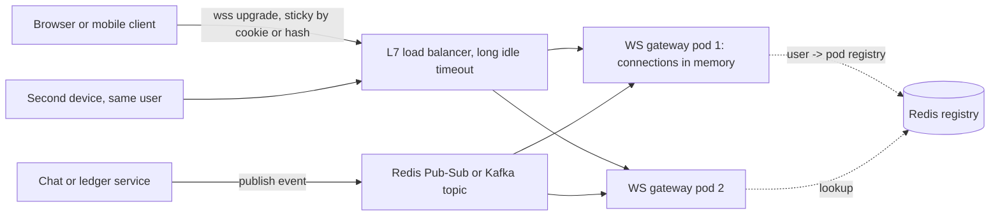

# WebSockets

> [!abstract] In one sentence
> A WebSocket is a long-lived, full-duplex TCP connection negotiated through an HTTP upgrade, giving the server a way to push messages the instant they happen — at the price of a stateful connection tier whose capacity is measured in open sockets rather than requests per second.

> [!tip] Deeper treatment in your system-design vault
> `system-design/02 Networking/WebSockets Server-Sent Events and Long Polling.md` — read it *after* you have written your own explanation below.

**Map:** [[Networking MOC]] → [[HLD MOC]]

## Definition

The WebSocket protocol (RFC 6455) starts as an ordinary [[HTTP and HTTPS|HTTP/1.1]] `GET` with `Upgrade: websocket`; after a `101 Switching Protocols` response the same [[TCP and UDP|TCP]] connection carries framed messages (text or binary) in both directions, with no request-response pairing, until either side closes it. **Server-Sent Events** (SSE) is the one-directional cousin: a normal HTTP response with `Content-Type: text/event-stream` kept open while the server streams `data:` lines. **Long polling** is the pre-push workaround: the client sends a request the server holds until there is something to say (or a timeout), then immediately sends another. All three deliver "server tells client something happened"; they differ in direction, framing, proxy-friendliness and cost per connection.

## Problem solved

HTTP is client-initiated. When state changes on the server — a chat message, a trade fill, a dashboard metric, a token streamed from an LLM — the client cannot find out without asking, and asking every second is both laggy and wasteful: thousands of clients polling at 1 Hz is thousands of requests per second of mostly empty answers, with up to one second of staleness. Long polling fixes the waste but still rebuilds a request per message and inherits HTTP header overhead. WebSockets remove the asking entirely: one handshake, then bytes flow both ways with a few bytes of framing per message and no per-message latency beyond the network. SSE solves the same problem for server-to-client-only data with plain HTTP, which keeps proxies, [[CDNs]] and HTTP/2 multiplexing happy.

## How it works

1. **Handshake.** Client: `GET /ws HTTP/1.1`, `Upgrade: websocket`, `Connection: Upgrade`, `Sec-WebSocket-Key: <random>`; server: `101`, `Sec-WebSocket-Accept: <hash of key>`. Authentication happens here — a cookie, a token in a query string or a first-message auth frame — because there are no headers after the upgrade ([[Authentication]], [[JWT]]).
2. **Framing.** Each message is one or more frames: opcode (text, binary, ping, pong, close), length, and a mask (client-to-server frames are masked to defeat cache poisoning in old proxies). Overhead is 2–14 bytes per frame versus hundreds of bytes of headers per HTTP request.
3. **Heartbeats.** Idle TCP connections die silently behind NATs and [[Load Balancers|load balancers]] (ALB idle timeout defaults to 60 s). Servers send `ping` frames (or application-level heartbeats) every 20–30 s; a missed `pong` means the client is gone and its state should be released. Clients detect a dead server the same way.
4. **The push tier.** A WebSocket server holds every open connection in memory, mapped to a user or session. When an event arrives from the rest of the system — through [[Pub-Sub]] on [[Redis]] or [[Kafka]] — the server looks up which of *its* connections should receive it and writes frames. Because a user may be connected to any of N servers, events are either broadcast to all servers (simple, O(N) fan-out) or routed via a connection registry (user → server) ([[Fan-Out]]).
5. **Backpressure.** Writes go into a per-connection buffer; a slow client (mobile, background tab) fills it. The server must drop, coalesce or disconnect rather than grow memory without bound ([[Backpressure]]).
6. **Close.** Either side sends a close frame with a status code; the client is expected to reconnect with backoff and resume from the last message it saw ([[Client State and Reconnection]]).

**SSE** needs no upgrade: `curl -N https://api/stream` shows `id:`/`event:`/`data:` lines; the browser's `EventSource` reconnects automatically and sends `Last-Event-ID`, which is a resume cursor for free. **Long polling** is just HTTP with a server-side wait; it works through any proxy but costs a request per message and holds a server thread or future per waiting client.

```typescript
// NestJS / ws: heartbeat and auth-at-upgrade in miniature
wss.on('connection', (socket, req) => {
  const user = verifyJwt(new URL(req.url!, 'http://x').searchParams.get('token'));
  socket.isAlive = true;
  socket.on('pong', () => { socket.isAlive = true; });
  registry.add(user.id, socket);          // user -> connection on THIS node
});
setInterval(() => wss.clients.forEach(s => {
  if (!s.isAlive) return s.terminate();   // missed a pong: release state
  s.isAlive = false; s.ping();
}), 30_000);
```

## Architecture



## Use cases

- "Users must see each other's messages instantly" — chat, collaborative editing, multiplayer presence ([[Design a Chat System]], [[Design a Collaborative Document Editor]]).
- "The client sends a high rate of small updates and receives updates too" — live location, trading terminals, games: bidirectional traffic is the WebSocket signal; SSE cannot do the upstream half.
- "Stream a long response as it is produced" — LLM tokens, build logs, progress bars: SSE is usually enough and simpler.
- "Live dashboards for a few hundred operators" — either WebSockets or SSE; the choice is driven by whether operators send commands back ([[Live Ops Dashboard]]).
- Notifications and feed updates in an app that is already open ([[Design a Notification System]], [[Design a Social Feed]]), where polling every few seconds would cost more than the sockets.

## Limitations

- Stateful tier: a server's capacity is open connections × per-connection memory, and a restart drops every client at once (thundering reconnect herd).
- Needs a balancer and proxies that support upgrades and long idle timeouts; some corporate proxies and older middleboxes block or kill WebSockets, so a long-polling fallback is often still required.
- No HTTP caching, no request-level [[Rate Limiting]] by default, no standard status codes — you build your own message-level protocol, versioning and error handling.
- Ordering is per connection only; across reconnects and across servers you need sequence numbers.
- HTTP/2 multiplexing does not apply to classic WebSockets (RFC 8441 bootstraps them over HTTP/2 but support is patchy), so each socket is its own TCP connection.

## Trade-offs

| You gain | You sacrifice |
|---|---|
| Sub-second push with a few bytes of overhead per message | A stateful connection tier that must be sized, drained and rebalanced |
| Full-duplex: the same channel carries client commands | Your own framing protocol, auth, versioning and backpressure handling |
| Far fewer requests than polling at the same freshness | Loss of HTTP tooling: caching, retries, standard observability per request |
| Natural fit for presence and typing indicators | Reconnection and resume logic on every client, or you silently lose messages |

## Failure modes

- **Idle timeout kills quiet sockets**: clients disconnect every 60 s with no error on the server; you notice as periodic reconnect spikes aligned with the balancer's idle timeout. Fix with heartbeats under the timeout and a raised idle timeout.
- **Reconnect storm after a deploy**: all N connections drop together and reconnect within seconds, overloading auth and the registry; p99 of the upgrade path spikes and the new pods crash-loop under the herd ([[Retry Storms]]). Fix with connection draining, jittered client backoff and rolling restarts of a few pods at a time.
- **Slow consumer memory growth**: one background-tab client stops reading, its buffer grows, the pod OOMs and takes thousands of healthy connections with it. Cap per-connection buffers and disconnect laggards.
- **Lost messages across reconnect**: events published while the client was between connections are gone; users see gaps. Blast radius is correctness of whatever the client renders — needs replay from a sequence number ([[Client State and Reconnection]]).
- **Uneven connection distribution**: least-connections balancing at upgrade time still leaves one pod with 3x the sockets after others restarted; the hot pod's GC pauses delay everyone on it. Monitor connections per pod and rebalance by asking clients to reconnect.

## Performance

Per-message latency is network RTT plus serialisation — no handshake, no headers; a push typically arrives within tens of milliseconds of the event. Per-connection cost is kernel socket buffers plus application state (often 10–100 KB with framework overhead in Java, less with Netty or Go), so a single pod holds tens of thousands of idle connections comfortably and a node can hold hundreds of thousands with tuning. Throughput limits come from fan-out, not framing: a message to 100,000 subscribers is 100,000 writes, so batching, coalescing and compression (per-message deflate) matter at scale.

## Scalability

Scale the push tier horizontally by connection count, not request rate; at 10x users you add gateway pods and the question becomes *routing*: broadcasting every event to every gateway stops working when gateways × events exceeds what Pub-Sub can carry, so you move to a user→gateway registry or sharded topics (hash user id to a [[Topic Partitions|partition]], each gateway subscribes to its partitions). Stickiness is needed only for the upgrade itself; afterwards the TCP connection is pinned naturally. Multi-region push needs either regional gateways with cross-region event replication or clients connecting to the nearest region and events routed there.

## Operational impact

High relative to a stateless HTTP service. You own connection draining on deploy (`SIGTERM` → close frames with a retry hint → wait), per-pod connection and buffer [[Metrics]], heartbeat and reconnect-rate dashboards, a registry with TTLs so crashed pods do not leave ghost entries, and load tests that measure connections rather than requests. Debugging means correlating a user's connection to a pod and a sequence number; include both in logs. Balancer and ingress settings (idle timeout, upgrade support) become part of the service's contract.

## Alternatives

- **Server-Sent Events** — wins when data flows only server→client (feeds, dashboards, LLM streaming): plain HTTP, automatic reconnect with `Last-Event-ID`, works over HTTP/2 multiplexing; loses when the client must send frequent messages.
- **Long polling** — wins for low-frequency updates behind hostile proxies, or as a fallback; costs a request per message and a held server resource per waiting client.
- **Short polling** — wins when staleness of several seconds is fine and the data is cacheable; the cheapest to operate.
- **Mobile push (APNs/FCM)** — wins for notifying apps that are *not* open; not a replacement for in-session push.
- **[[gRPC]] bidirectional streaming** — wins for service-to-service or native clients that already speak HTTP/2; browsers need a proxy.

## Real-world examples

- Slack's messaging and presence run over WebSockets through a dedicated gateway tier; Discord likewise, with gateway sharding by guild and documented heartbeat and resume semantics.
- Trading and crypto exchanges publish market data over WebSockets with sequence numbers so clients can detect gaps and request snapshots.
- OpenAI-style chat APIs stream tokens over SSE — one-directional, HTTP-native, and trivially proxied.
- In a stack like yours: a NestJS or Spring WebSocket gateway behind an ALB with the idle timeout raised, [[Redis]] Pub-Sub (or Redis Streams later) fanning ledger or payment-status events to the gateway pods, and a user→pod registry in Redis — with the registry's TTL tied to the heartbeat interval so a crashed pod's entries expire on their own.

## Practical exercise

1. Build a tiny WebSocket server (NestJS gateway or Spring `TextWebSocketHandler`) that assigns each message an incrementing sequence number per channel, and a client that prints gaps.
2. Put NGINX in front with `proxy_read_timeout 10s` and no heartbeats; watch connections die every 10 s. Add 5 s pings and watch them survive.
3. Run two server pods behind NGINX with Redis Pub-Sub between them; publish from a third process and confirm both pods deliver.
4. With k6's WebSocket module, open 20,000 connections against one pod; record memory per connection and the connection count at which the pod degrades.
5. Kill one pod and measure reconnect-storm behaviour on the survivor with and without jittered backoff in the client; count the messages lost without resume.

## Related concepts

### Prerequisites
- [[HTTP and HTTPS]] — the upgrade handshake and why SSE is "just HTTP"
- [[TCP and UDP]] — each socket is a TCP connection with its own buffers and idle behaviour

### Related
- [[Client State and Reconnection]] — the client half of not losing messages
- [[Load Balancers]] — upgrade support, idle timeouts and connection distribution
- [[Pub-Sub]] — how events reach the gateway pods
- [[Fan-Out]] — one event to many sockets is the scaling problem
- [[Backpressure]] — slow consumers and bounded buffers
- [[Keep-Alive Connections]] — heartbeats are keep-alive for a different protocol

### Builds on this
- [[Client State and Reconnection]] — assumes a persistent channel that can drop
- [[Real-Time Systems]] — push transport is the foundation of real-time products
- [[Fan-Out]] — gateway-level fan-out assumes a stateful push tier

### Design problems where it applies
- [[Design a Chat System]]
- [[Design a Collaborative Document Editor]]
- [[Design a Social Feed]]
- [[Design a Notification System]]
- [[Design a Ride-Sharing Service]]

### Projects where it can be implemented
- [[Live Ops Dashboard]]
- [[Presence and Chat Service]]
- [[LLM Gateway]]

### Resources
- [[System Design Primer (GitHub)]] — the push vs pull comparison and real-time primers
- [[Release It!]] — stability patterns for stateful, long-lived connections
- [[Designing Data-Intensive Applications]] — chapter 11 on streams reaching clients

## Personal understanding

> [!question] Explain it without the source
> Write your own explanation here, from memory. Then compare it with the sections above and note what you missed.

### Mastery checklist
- [ ] I can explain it without the original resource
- [ ] I can describe the problem it solves
- [ ] I can compare it with its alternatives
- [ ] I can name its limitations and failure modes
- [ ] I can recognise when it is appropriate in a real system
- [ ] I have applied it in a system design
- [ ] I have validated my assumptions with an experiment or implementation

## Open questions

- [ ] For a payment-status screen that only needs server→client updates, what would SSE save over WebSockets in gateway complexity, and what would it cost in mobile battery?
- [ ] How should the user→pod registry behave during a rolling deploy so that no event is routed to a pod that is draining?
- [ ] At what subscriber count does Redis Pub-Sub broadcast to all gateways stop being viable, and what is the first sharding step?
