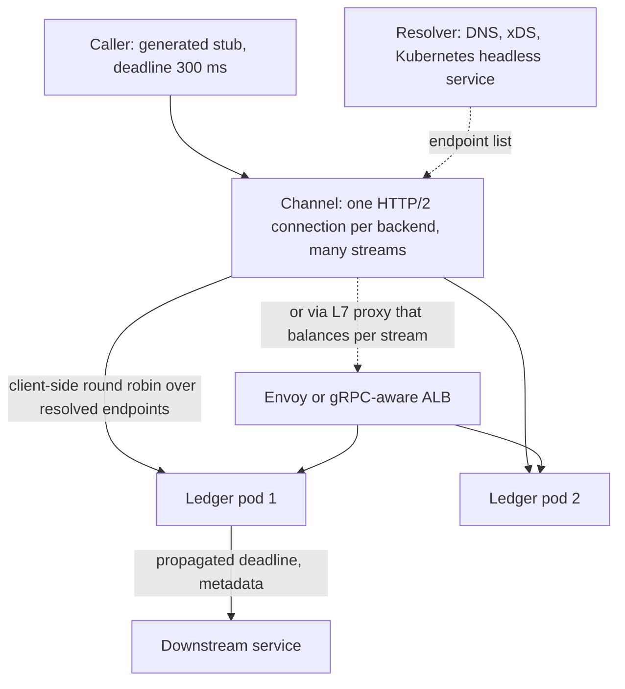

# gRPC

> [!abstract] In one sentence
> gRPC turns a `.proto` contract into typed client and server stubs that exchange compact binary messages over multiplexed HTTP/2 streams — unary or streaming in either direction — which buys low per-call cost and strict contracts for service-to-service traffic at the price of load-balancing and browser complications.

> [!tip] Deeper treatment in your system-design vault
> `system-design/02 Networking/REST vs gRPC vs GraphQL.md` — read it *after* you have written your own explanation below.

**Map:** [[Networking MOC]] → [[HLD MOC]]

## Definition

gRPC is an RPC framework in which a service is defined in an interface definition language (**Protocol Buffers**, `.proto` files), code generators produce client stubs and server skeletons in each language, and calls travel as length-prefixed protobuf messages inside [[HTTP and HTTPS|HTTP/2]] streams. Each call is one HTTP/2 stream on a shared, long-lived connection; metadata (headers) carries auth, deadlines and tracing. Four call shapes exist: **unary** (one request, one response), **server streaming**, **client streaming** and **bidirectional streaming**. Protobuf itself is a schema-driven binary encoding with field numbers that make it compact and evolvable; it is usable without gRPC, and gRPC can in principle carry other encodings, but in practice the two are a pair.

## Problem solved

JSON-over-REST between internal services pays three recurring taxes: hand-written clients that drift from the server, verbose text payloads that cost CPU to parse and bytes to ship, and an awkward fit for streaming. In a fleet of dozens of services calling each other thousands of times per second, those taxes add up to real CPU, latency and integration bugs. gRPC's answer is **contract first**: the `.proto` is the single source of truth, clients are generated (no drift), messages are binary with a fixed schema (cheap to encode and decode, 3–10x smaller than equivalent JSON for numeric-heavy data), HTTP/2 gives multiplexing so one connection carries many concurrent calls, and streaming is native rather than bolted on. Deadlines and cancellation propagate across hops, which REST clients rarely get right ([[Timeouts and Retries]]).

## How it works

1. **Contract.** A `.proto` declares messages (fields with numbers and types) and services (RPC methods with request/response types, optionally `stream`). Field numbers, not names, are on the wire: you can rename a field freely but never reuse a number, and new fields are ignored by old readers — this is what makes protobuf [[Backward Compatibility|backward and forward compatible]] ([[Event Schemas]], [[Event Schema Evolution]]).
2. **Codegen.** `protoc` plus language plugins produce stubs: in Java a `PaymentsGrpc.PaymentsBlockingStub`, in TypeScript/NestJS typed clients via `@grpc/grpc-js` or `ts-proto`.
3. **Transport.** The client opens one HTTP/2 connection (TLS with ALPN `h2` in production, or `h2c` in cleartext) and maps each call to a stream: `POST /payments.Payments/Authorize` with `content-type: application/grpc`, a 5-byte length prefix per message, and trailers carrying the gRPC status code (`OK`, `UNAVAILABLE`, `DEADLINE_EXCEEDED`, `INVALID_ARGUMENT`, …). HTTP status is almost always 200; the real outcome is in the trailer.
4. **Deadlines and metadata.** The client sets a deadline per call; it is sent as `grpc-timeout` and *propagated* by servers that make downstream calls, so a 300 ms budget shrinks hop by hop. Metadata carries tokens and trace context ([[Distributed Tracing]]).
5. **Streaming.** A stream is a sequence of messages on one HTTP/2 stream with flow control per stream (HTTP/2 windows), which gives streaming [[Backpressure]] without application code.
6. **Load balancing.** Because the connection is long-lived and multiplexed, an L4 balancer sees *one* connection per client and pins all calls to one backend. Real balancing needs either an L7 proxy that understands HTTP/2 streams (Envoy, Linkerd, ALB with gRPC support) or client-side balancing: the client resolves all backend addresses (DNS, xDS) and round-robins calls across subchannels ([[Load Balancers]], [[Service Discovery]]).
7. **Retries and health.** Built-in retry policy (per method, for specific status codes) and health checking protocol; keepalive pings keep NATs and balancers from dropping idle connections ([[Keep-Alive Connections]]).

```proto
syntax = "proto3";
package ledger.v1;

service Ledger {
  rpc Transfer (TransferRequest) returns (TransferResponse);
  rpc WatchBalance (WatchRequest) returns (stream BalanceEvent);   // server streaming
}
message TransferRequest {
  string idempotency_key = 1;
  string from_account = 2;
  string to_account = 3;
  int64 amount_minor = 4;
  string currency = 5;      // never reuse a number once released
}
```

## Architecture



> [!example]- Excalidraw version — the same diagram as an editable canvas
> ![[gRPC.excalidraw]]
> [[gRPC.excalidraw|Open in Excalidraw]] — needs the Excalidraw plugin (see [[Plugins to Install]]).


## Use cases

- "Many internal services call each other at high rate with structured data" — the classic signal; contracts and compact encoding pay off in CPU and integration safety ([[Microservices]]).
- "A client needs a continuous feed from a service" (price updates, balance changes, log tailing) — server streaming without inventing a WebSocket protocol.
- "The client uploads a large stream" (telemetry, batches of events) — client streaming with flow control.
- Polyglot teams (Java and TypeScript in the same system) that want one contract and generated clients in both languages.
- Latency-sensitive hops where a few milliseconds and payload bytes matter: matching engines, fraud scoring in the request path ([[Design a Real-Time Fraud Detection Pipeline]]).

## Limitations

- Browsers cannot speak native gRPC (no control over HTTP/2 framing and trailers); you need gRPC-Web with a proxy or a REST/JSON transcoding layer, so public APIs usually stay [[REST]].
- Binary payloads are opaque to `curl`, logs and humans; debugging needs `grpcurl`, reflection or JSON logging of decoded messages.
- Long-lived connections confuse L4 balancers and autoscaling: new pods receive no traffic until clients reconnect, and one hot connection pins a client to one backend.
- Ecosystem gaps for HTTP niceties: caching, conditional requests and browser-style content negotiation do not exist.
- Protobuf's compatibility rules are strict and easy to violate under deadline pressure (reusing a field number, changing a type), and the failure is silent data corruption rather than an error.

## Trade-offs

| You gain | You sacrifice |
|---|---|
| Contract-first, generated clients in every language | A build step and a shared proto repository to govern |
| Compact binary encoding and multiplexed calls: lower CPU and bytes per call | Human readability; `curl`-level debugging |
| Native streaming with per-stream flow control and propagated deadlines | HTTP/2-aware balancing and keepalive tuning become mandatory |
| Rich status codes and retry policy built in | Browser reach and HTTP caching, which REST gives for free |

## Failure modes

- **All traffic pinned to one backend** after an L4 balancer or a Kubernetes `ClusterIP` service: one pod at 100% CPU while others idle; new pods after scale-out get nothing. Noticed via per-pod request-rate skew. Fix with a headless service plus client-side `round_robin`, or an L7 proxy.
- **Deadline not set** (infinite by default in several languages): a stuck downstream holds streams and threads forever; symptom is slowly rising in-flight calls and eventual exhaustion ([[Connection Pooling|pool exhaustion]] shape). Make deadlines mandatory in a shared interceptor.
- **Idle connection silently dropped by a NAT or balancer**: the next call fails with `UNAVAILABLE` after a long hang; fix with keepalive pings under the idle timeout and a retry policy for `UNAVAILABLE` on idempotent methods.
- **Message exceeds the default 4 MB receive limit**: `RESOURCE_EXHAUSTED` on exactly the large requests, often only in production data. Decide on streaming or chunking rather than raising the limit blindly.
- **Schema break**: a reused field number makes old clients decode garbage; noticed as nonsensical values rather than errors, and the blast radius is every consumer on the old version. Enforce `buf breaking` or similar in CI.

## Performance

Per-call overhead is small: a few hundred bytes of HTTP/2 framing and HPACK-compressed headers, protobuf encoding measured in microseconds for typical messages, and no connection setup per call. Versus JSON over HTTP/1.1, CPU per call commonly drops by a large factor for structured, numeric payloads, and payload sizes shrink several-fold — order-of-magnitude claims that depend heavily on message shape, so measure your own. Latency is bounded by the network RTT plus server work; streaming avoids per-message request latency entirely. Servers typically default to around 100 concurrent streams per connection, so a chatty client may need several connections to avoid stream queuing.

## Scalability

Calls scale with backend pods *provided balancing is per stream or client-side*. At 10x call volume the levers are more connections per client (to spread streams), connection re-resolution on a timer so new pods get traffic (`MAX_CONNECTION_AGE` on servers forces periodic reconnects), and an L7 mesh when client-side balancing becomes too much per-language configuration. Streaming workloads scale by partitioning streams across servers by key, as with any stateful connection ([[WebSockets]] has the same shape).

## Operational impact

Moderate. You need: a proto repository with ownership and CI compatibility checks, gRPC-aware ingress or mesh, `grpcurl`/reflection enabled for debugging, dashboards keyed by gRPC status code rather than HTTP status (everything is 200), and deadline/keepalive settings standardised in a shared client library so every team does not rediscover them. Observability integrates well: interceptors are a clean place for [[Distributed Tracing]], [[Metrics]] and auth. Upgrading the gRPC library across many services is a recurring chore because the ecosystem moves fast.

## Alternatives

- **[[REST]] with JSON** — wins for public and browser-facing APIs, for human debuggability and for anything that benefits from HTTP caching and the universal tooling.
- **GraphQL** — wins for client-shaped reads aggregated across many sources; loses for service-to-service RPC and streaming.
- **Messaging ([[Kafka]], [[Message Queues]])** — wins when the call need not be synchronous; buffering and retries come from the broker ([[Synchronous vs Asynchronous Communication]]).
- **Thrift or Connect** — same idea with different ecosystems; Connect speaks gRPC's protocol while also working over HTTP/1.1 and plain JSON, which closes the browser gap.

## Real-world examples

- Google built gRPC from its internal Stubby and uses it for most service-to-service traffic; Google Cloud APIs are published as protos with REST transcoding.
- Netflix adopted gRPC for internal services after years of REST and Ribbon-based client balancing; the move was explicitly about contracts and generated clients.
- Kubernetes components (etcd, kubelet, container runtimes via CRI) communicate over gRPC; etcd's API is protobuf-defined.
- In a stack like yours: a Java IAM service exposing `IssueToken`/`Introspect` over gRPC to NestJS and Spring services through a headless Kubernetes service with client-side round robin, deadlines set in a shared interceptor, and public clients still served REST through the gateway.

## Practical exercise

1. Define a `Ledger` service in a `.proto` with a unary `Transfer` and a server-streaming `WatchBalance`; generate a Java server and a TypeScript client (or the reverse).
2. Run three server replicas behind a Kubernetes `ClusterIP` service (or a Docker network with one DNS name) and send 10,000 calls from one client; count calls per replica. Then switch to a headless service with `round_robin` and repeat.
3. Set no deadline, make the server sleep forever on one call, and watch in-flight streams grow; then set a 300 ms deadline and observe `DEADLINE_EXCEEDED` propagate.
4. Compare payload bytes and client CPU for 100,000 `Transfer` calls versus an equivalent JSON/REST endpoint with the same server logic (k6 for both).
5. Change a field's number in the proto, redeploy only the server, and observe the client's decoded garbage — then add `buf breaking` to catch it.

## Related concepts

### Prerequisites
- [[HTTP and HTTPS]] — HTTP/2 streams, HPACK and trailers are what gRPC rides on
- [[REST]] — the alternative you are choosing against

### Related
- [[Load Balancers]] — why long-lived multiplexed connections need L7 or client-side balancing
- [[Service Discovery]] — the resolver that feeds client-side balancing
- [[Event Schemas]] — protobuf is also a common event encoding
- [[Designing APIs and Contracts]] — contract-first design in practice
- [[Backward Compatibility]] — field-number rules and breaking-change checks
- [[Timeouts and Retries]] — deadlines and retry policy are first-class here

### Builds on this
- [[Microservices]] — internal RPC at scale usually ends up here
- [[Service Discovery]] — client-side balancing assumes an endpoint source
- [[API Gateways]] — transcoding gRPC to REST at the edge

### Design problems where it applies
- [[Design a Ride-Sharing Service]]
- [[Design an IAM Service]]
- [[Design a Real-Time Fraud Detection Pipeline]]

### Projects where it can be implemented
- [[Lock Service with Fencing Tokens]]
- [[Mini-KV Store]]

### Resources
- [[gRPC Core Concepts]] — the official explanation of channels, streams, deadlines and status codes
- [[Building Microservices]] — chapter on communication styles and choosing RPC

## Personal understanding

> [!question] Explain it without the source
> Write your own explanation here, from memory. Then compare it with the sections above and note what you missed.

### Mastery checklist
- [ ] I can explain it without the original resource
- [ ] I can describe the problem it solves
- [ ] I can compare it with its alternatives
- [ ] I can name its limitations and failure modes
- [ ] I can recognise when it is appropriate in a real system
- [ ] I have applied it in a system design
- [ ] I have validated my assumptions with an experiment or implementation

## Open questions

- [ ] For our Java-to-NestJS calls, would gRPC's CPU savings be measurable against the cost of running a proto repo and gRPC-aware ingress, given our current call volumes?
- [ ] How should a deadline budget be split across a three-hop chain so that the user-facing p99 stays under its SLO?
- [ ] Which of our internal endpoints would benefit from server streaming instead of the polling they do today?
