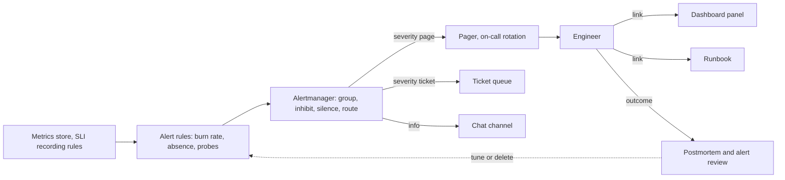

# Alerting

> [!abstract] In one sentence
> Alerting is the decision rule that turns monitoring data into interruptions, and done well it pages a person only for user-visible symptoms that are consuming the error budget fast enough that waiting until morning would breach the SLO — with multi-window burn-rate rules for precision, tickets for slow burns and causes, and a runbook on every alert so the page is actionable.

> [!tip] Deeper treatment in your system-design vault
> `system-design/13 Observability/Alerting and On-Call Design.md` — read it *after* you have written your own explanation below.

**Map:** [[Observability & Reliability MOC]] → [[HLD MOC]]

## Definition

An **alert** is a rule evaluated continuously against telemetry that, when its condition holds, notifies someone through a channel with an urgency: a **page** (wake a human now), a **ticket** (handle within a working day), or a **notification** (informational, no action required). **Symptom-based alerts** fire on user-visible effects (error ratio, slow responses, missing data); **cause-based alerts** fire on internal conditions (CPU, disk, queue depth). A **burn-rate alert** fires when the [[Error Budgets|error budget]] is being consumed at a multiple of the rate that would exhaust it exactly at the end of the SLO window; **multi-window** rules pair a long window (to require sustained impact) with a short window (to stop alerting once the problem is resolved). **On-call** is the rotation of people who receive pages; **alert fatigue** is the degradation of response that follows from too many, too noisy or non-actionable alerts.

## Problem solved

Monitoring that only shows dashboards relies on someone watching them; alerting is what makes 3 a.m. outages end at 3:10 instead of 9:00. But the naive version — alert on every threshold anyone thought of — produced the opposite problem: teams paged dozens of times a night for CPU spikes, single-pod restarts and disk at 80%, none of which affected users, and the pages that did matter were acknowledged without being read. Pager overload also burns out engineers and makes on-call a reason to leave. The SRE insight is that an alert is a *cost* (a human's attention and sleep) that must be justified by *user impact* and *actionability*: if users are not affected, it is not a page; if nothing can be done, it is not an alert. SLO-based burn-rate alerting makes that principle mechanical: the SLO defines "affected", the burn rate defines "fast enough to matter now", and the budget defines "how much we can tolerate before acting" ([[SLI SLO and SLA]]).

In a stack like yours, "payment success ratio burning the monthly budget at 14x" is a page with an obvious meaning; "pod `payments-7f9c` restarted" is a dashboard annotation.

## How it works

1. **Start from the SLO.** For each service, the SLI (good events / total) and objective (say 99.9% over 30 days) define the error budget: 0.1% of events, equivalent to 43.2 minutes of total outage per 30 days. Alerts are expressed in terms of budget consumption, not raw error rate.
2. **Compute burn rate.** Burn rate = (observed error ratio) / (1 − SLO). A burn rate of 1 consumes exactly the whole budget over the window; 14.4 consumes 2% of a 30-day budget in one hour. The SRE Workbook's standard recipe for a 30-day SLO: page if burn rate ≥ 14.4 over 1 hour *and* over the last 5 minutes (2% of budget in an hour); page if ≥ 6 over 6 hours and over 30 minutes (5% in 6 hours); ticket if ≥ 1 over 3 days and over 6 hours (10% in 3 days). The long window ensures the impact is significant; the short window ensures the alert resolves promptly when the problem stops.
3. **Classify every alert by urgency.** Page: user impact now and getting worse, needs a human within minutes. Ticket: budget is being consumed slowly, or a cause condition that will become a symptom (disk full in 3 days, certificate expiring in 2 weeks). Notification: deploys, autoscaling events, informational. Anything that cannot be assigned a human action is deleted.
4. **Make every alert actionable.** The alert payload carries: what is affected (service, SLI, region), how badly (current burn rate, budget remaining), since when, a link to the dashboard panel showing the symptom, and a link to a **runbook** with first diagnostic steps and known remediations. An alert without a runbook is a research assignment at 3 a.m.
5. **Reduce noise mechanically.** Group related alerts (one page per service per incident, not one per pod); inhibit cause alerts while the corresponding symptom alert is firing; add `for` durations so transient blips do not page; silence during known maintenance; route by team ownership. Alertmanager and vendor equivalents implement all of these.
6. **Cover the silent failures.** Alert on absence: no traffic where traffic is expected (an SLI with zero events), no data from a scraper or probe, no alerts delivered in a test cycle (a weekly synthetic page to verify the pager path).
7. **Run the loop.** Track pages per shift, acknowledge-to-resolve time, and the fraction of pages that led to action; review every page in a weekly on-call handover; every incident postmortem asks "did we alert, how fast, and was the alert useful" ([[Production Incident Analysis]]).

```yaml
# Prometheus rule: multi-window, multi-burn-rate page for a 99.9% / 30-day availability SLO
- alert: PaymentsAvailabilityBurnFast
  expr: |
    ( sli:payments_errors:ratio_rate1h  > (14.4 * 0.001) )
    and
    ( sli:payments_errors:ratio_rate5m  > (14.4 * 0.001) )
  labels: { severity: page, team: payments }
  annotations:
    summary: "Payments availability burning 2% of monthly budget per hour"
    dashboard: "https://grafana/d/payments-slo"
    runbook: "https://runbooks/payments/availability-burn"
```

## Architecture



> [!example]- Excalidraw version — the same diagram as an editable canvas
> ![[Alerting.excalidraw]]
> [[Alerting.excalidraw|Open in Excalidraw]] — needs the Excalidraw plugin (see [[Plugins to Install]]).


## Use cases

- Any service with an SLO and an on-call rotation: burn-rate pages are the default paging policy, replacing per-threshold alerts ([[SLI SLO and SLA]], [[Error Budgets]]).
- "Detect the outage before customers tweet" — symptom alerts on availability and latency plus black-box probe failures ([[Monitoring]]).
- "Warn us before the slow-moving problem becomes an outage" — tickets for disk, certificate expiry, consumer lag trend, quota approaching ([[Capacity Planning]]).
- "Pipeline freshness" — alert when data is older than the freshness SLO (an absence-style alert on event timestamps).
- Automated responses triggered from alerts: rollback on canary SLI breach, scale-out on saturation — alerts as inputs to automation, not only to humans ([[Deployment and Rollback Strategies]]).

## Limitations

- Burn-rate alerting needs a sound SLI and enough traffic: at very low request rates a handful of errors is a huge ratio, and the short windows become noisy; low-traffic services need longer windows or minimum-event guards.
- Latency SLIs expressed as "fraction under threshold" alert well; a sudden change in the *shape* of latency that stays under threshold does not alert, by design.
- Alerts detect the known; a novel failure that does not move the SLI (wrong data returned successfully) is invisible until a correctness SLI exists.
- Paging policy is organisational as much as technical: without agreement on what a page means and who owns the response, good rules still produce fatigue.
- Multi-window rules are harder to explain than "errors above 1%"; teams need to understand burn rate to trust the page.

## Trade-offs

| You gain | You sacrifice |
|---|---|
| Pages that correspond to real user impact and resolve when it stops | Up-front SLO definition and recording rules per service |
| Far fewer pages, so each one is read and acted on | Cause conditions that no longer page and must be caught by tickets and reviews |
| Detection time proportional to severity (fast burn pages in minutes, slow burn in days) | Some delay for moderate problems versus a hair-trigger threshold alert |
| A consistent, reviewable policy across teams | Discipline to maintain runbooks, routing and inhibition rules |

## Failure modes

- **Alert fatigue** — too many pages, mostly non-actionable; on-call acknowledges by reflex and misses the real incident. You notice in page counts per shift above a handful, acknowledge-without-action rates, and postmortems that say "the alert fired but nobody looked"; blast radius is every incident's response time.
- **The silent outage** — the SLI query broke (renamed label, retired metric), returns empty, and the alert never fires; or the pager integration failed. Noticed from customers; mitigated by absence alerts and a scheduled test page.
- **Flapping** — a rule with no `for` duration or no short window fires and resolves every minute; the on-call engineer is paged repeatedly for one problem. Noticed as alert storms; fixed with `for`, grouping and the short-window guard.
- **Paging the wrong team** — routing by cluster rather than by service ownership; the platform team is paged for a payments bug. Noticed as pages bounced between teams; fix routing labels at the source.
- **Alert on the cause, miss the symptom** — CPU alert fires for a batch job with no user impact at 2 a.m.; a 5% error rate on checkout has no alert. Noticed in the postmortem; the fix is the symptom-first policy.

## Performance

Rule evaluation is cheap (seconds every evaluation interval over recording-rule outputs) and scales with the number of rules and the cost of their queries; SLIs should be pre-computed as recording rules so alert queries are trivial. Detection latency is determined by the short window and the evaluation interval: a 5-minute short window with 1-minute evaluation detects a fast burn within about 2–6 minutes of onset; a black-box probe failure can page in under a minute. Paging latency (delivery to a phone) is seconds to a minute via a paging service. The human part dominates: acknowledge-to-action time is what on-call practice optimises.

## Scalability

Alerting scales by templating: a declarative SLO per service generates its recording rules and multi-window alerts (tools like Sloth and Pyrra do this for Prometheus), so 100 services do not mean 100 hand-written rule sets. Routing scales by labelling every rule with its owning team from a service catalogue. Noise scales with the fleet unless alerts are grouped by service and inhibited hierarchically (a region-wide outage should produce one page, not one per service). The metrics backend's rule-evaluation capacity is rarely the limit; human capacity is — a rotation can absorb only a few pages per shift sustainably ([[Design a Metrics and Monitoring System]]).

## Operational impact

Alerting *is* the on-call experience. Set explicit targets: pages per shift (low single digits), time to acknowledge, fraction of pages with a runbook, fraction that were actionable; review them weekly. Every page gets a short note (what it was, what was done, whether the alert should change) and every postmortem reviews detection. Runbooks live next to the rules in version control and are revised after use. Rotations need enough people, follow-the-sun or compensated nights, and a clear escalation path. Test the pager path on a schedule and keep a manual out-of-band way to page if the monitoring stack is down ([[Site Reliability Engineering (Google)]]).

## Alternatives

- **Static threshold alerts** — "error rate > 1% for 5 minutes"; win for simplicity and for services without SLOs, and are what most teams start with; they page too often for small blips and too late for slow burns.
- **Anomaly detection** — statistical models that page on deviations from learned baselines; win for metrics without obvious thresholds (traffic drops), lose on explainability and on false positives after legitimate changes.
- **Ticket-only with periodic review** — no pages; wins for internal or batch systems where hours of delay are acceptable, and is the honest choice when nobody would act on a page anyway.
- **Automated remediation first** — the alert triggers rollback, failover or scaling and pages only if that fails; wins once remediations are reliable, and is where mature teams go ([[Graceful Degradation]]).

## Real-world examples

- The **Google SRE Workbook** chapter on alerting on SLOs is the source of the multi-window, multi-burn-rate recipe and its numbers (14.4, 6, 1), derived from the goal of paging only when a significant fraction of the budget is at stake ([[Google SRE Workbook - Implementing SLOs]]).
- **Prometheus Alertmanager** encodes the mechanics of grouping, inhibition, silencing and routing that make symptom-based alerting workable across many teams.
- **PagerDuty and Opsgenie** built products around on-call rotations, escalation and acknowledgement metrics, and their published guidance on alert fatigue mirrors the SRE position: fewer, actionable, symptom-based pages.
- In a stack like yours: an SLO per customer-facing flow (payment authorisation success and latency, login success) with burn-rate pages routed to the owning team, consumer-lag and disk alerts as tickets, probe failures from outside AWS as pages, a weekly test page, and a rule that no alert is merged without a runbook link.

## Practical exercise

1. Using the service and Prometheus from the [[Monitoring]] exercise, define a 99.9% availability SLO and write recording rules for the error ratio over 5 m, 30 m, 1 h, 6 h and 3 d.
2. Implement the three multi-window burn-rate rules (page 14.4×/1 h+5 m, page 6×/6 h+30 m, ticket 1×/3 d+6 h) and route them through Alertmanager to a webhook receiver that logs the page.
3. Inject a 5% error rate with [[Toxiproxy]] and record when each rule fires; stop the fault and record when the page resolves; then inject a 0.2% error rate and confirm only the ticket fires after a long period (simulate with a shortened window scale).
4. Add a static "error rate > 1% for 5 m" rule alongside and compare its behaviour on a 90-second blip versus a sustained 0.5% error rate.
5. Break the SLI recording rule (rename a label), confirm the burn-rate page goes silent, and add an absence alert that catches it; finally, measure pages generated per hour across the experiment for each policy.

## Related concepts

### Prerequisites
- [[Monitoring]] — the signals alerts are computed from
- [[SLI SLO and SLA]] — the definition of "users are affected"
- [[Error Budgets]] — the quantity burn rate measures against
- [[Metrics]] — recording rules and histograms behind every SLI

### Related
- [[Logging]] — where the on-call engineer goes after the dashboard
- [[Health Checks]] — platform-level detection that should rarely page a human directly
- [[Distributed Tracing]] — the diagnostic step for a symptom alert
- [[Capacity Planning]] — the source of ticket-grade saturation warnings
- [[Graceful Degradation]] — automated responses that can precede a page

### Builds on this
- [[Production Incident Analysis]] — every postmortem reviews detection and alert quality
- [[Disaster Recovery]] — regional failover is triggered by alerts with explicit criteria
- [[Deployment and Rollback Strategies]] — canary analysis and automated rollback consume alert signals

### Design problems where it applies
- [[Design a Metrics and Monitoring System]]
- [[Design a Payment System]]
- [[Design a Notification System]]
- [[Design a Real-Time Fraud Detection Pipeline]]

### Projects where it can be implemented
- [[Personal Notification Hub]]
- [[Live Ops Dashboard]]
- [[Chaos Lab]]

### Resources
- [[Google SRE Workbook - Implementing SLOs]] — the burn-rate alerting recipe
- [[Site Reliability Engineering (Google)]] — on-call, being on-call, and the philosophy of paging
- [[Google SRE Book - Monitoring Distributed Systems]] — symptoms versus causes and what deserves a page

## Personal understanding

> [!question] Explain it without the source
> Write your own explanation here, from memory. Then compare it with the sections above and note what you missed.

### Mastery checklist
- [ ] I can explain it without the original resource
- [ ] I can describe the problem it solves
- [ ] I can compare it with its alternatives
- [ ] I can name its limitations and failure modes
- [ ] I can recognise when it is appropriate in a real system
- [ ] I have applied it in a system design
- [ ] I have validated my assumptions with an experiment or implementation

## Open questions

- [ ] For a low-traffic but critical flow (a few hundred payouts per hour), what windows and minimum-event guards make burn-rate alerting reliable, and when is a probe-based page the better primary signal?
- [ ] Of the alerts currently configured for a service I know, how many have a runbook, how many are symptom-based, and what would the page count per week be under a pure SLO policy?
- [ ] How should alerts be designed for asynchronous flows (webhook delivery, settlement batches) where "user impact" is a delay rather than an error — a freshness SLI, a lag threshold, or both?
