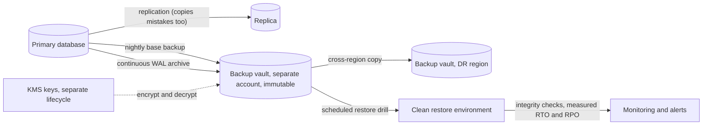

# Backups and Restoration

> [!abstract] In one sentence
> Backups are point-in-time copies of data kept somewhere the original's failure modes cannot reach — full, incremental and continuous (WAL-based point-in-time recovery) — and the discipline that matters is restoration: a backup you have not restored recently, in the time your RTO allows, with its integrity checked, is a hope rather than a control.

> [!tip] Deeper treatment in your system-design vault
> `system-design/12 Resilience/Disaster Recovery.md` — read it *after* you have written your own explanation below.

**Map:** [[Observability & Reliability MOC]] → [[HLD MOC]]

## Definition

A **backup** is a copy of data taken at a point in time and stored independently of the live system, so that the data can be **restored** after loss or corruption. A **full backup** copies everything; an **incremental** backup copies changes since the last backup (block-level diffs, or snapshot deltas); **continuous** backup captures every change as it happens — for databases, by archiving the write-ahead log (WAL, binlog, oplog) alongside a base backup — enabling **point-in-time recovery (PITR)** to any moment within the retention window. **Logical** backups export records (`pg_dump`, `mongodump`); **physical** backups copy files or blocks (`pg_basebackup`, EBS snapshots). The **[[Recovery Point Objective|RPO]]** achievable is bounded by backup frequency (or WAL archiving lag); the **[[Recovery Time Objective|RTO]]** by restore time. A **restore drill** is the periodic exercise of restoring a backup into a clean environment and verifying it.

## Problem solved

[[Replication]] keeps copies in sync; that is exactly why it does not protect against the most common data disasters. A `DELETE` without a `WHERE`, a migration that truncates a column, an application bug that overwrites records for a week, a compromised credential that drops tables, a ransomware encryption — every one of these replicates to every replica within seconds, and the replicas are then identical and equally ruined. Backups are copies that *stop following* the primary at a point in time, kept where the primary's blast radius ends: a different account, region, and set of credentials. The historical failure is not the absence of backups but their quality: jobs that silently stopped months ago, dumps of the wrong database, backups encrypted with a key that was rotated away, restores that take 30 hours against a 4-hour RTO, and backup storage reachable with the same credentials that deleted the primary. The GitLab 2017 incident made the pattern famous: several backup mechanisms, none of which had been verified, failed in sequence. Treating restoration — not backup — as the deliverable fixes the discipline ([[Disaster Recovery]]).

In a stack like yours, the ledger in PostgreSQL, object storage holding documents, Kafka or SQS as transient transport, and Redis as a cache each have a different backup answer, and "RDS does automated backups" is the start of the answer, not the end.

## How it works

1. **Decide per dataset what must be restorable and to what point.** Source-of-truth data (ledger, orders, users) needs PITR with retention long enough to notice slow corruption (weeks, not days). Derived data (search indexes, caches, read models) can be rebuilt from the source and needs no backup, only a tested rebuild procedure ([[Search Indexing Pipelines]], [[CQRS]]). Transient data (queues) is not backed up; its durability comes from replication and idempotent replay.
2. **Database continuous backup.** A base backup (`pg_basebackup`, or a storage snapshot) plus continuous WAL archiving to object storage gives PITR: restore the base, replay WAL to the chosen timestamp or transaction. RDS automated backups implement this with a retention window of up to 35 days; tools like pgBackRest and WAL-G do it for self-managed PostgreSQL; MySQL uses binlogs, MongoDB the oplog. The WAL archive lag is the RPO.
3. **Snapshots and incrementals for volumes and objects.** EBS and RDS snapshots are block-level incrementals after the first; S3 versioning plus replication keeps object history; lifecycle rules tier old versions to colder storage ([[Object Storage]], [[Block Storage]]).
4. **Isolate the copies.** Backups live in a separate account (or project) with separate credentials, cross-region, and with **immutability** (S3 Object Lock, vault lock, write-once retention) so that neither the application's credentials nor an attacker who has them can delete or encrypt the backups. Follow the 3-2-1 shape: three copies, two media or systems, one off-site.
5. **Encrypt and manage keys.** Backups are encrypted at rest with keys managed separately from the data store's keys; the key must outlive the backup's retention and be available in the DR region — a restored backup whose key is gone is lost ([[Encryption at Rest and in Transit]], [[Secrets Management]]).
6. **Restore on a schedule and measure.** A restore drill: restore the latest backup into a clean environment, run integrity checks (row counts against the primary at the same timestamp, checksums, application smoke tests, a reconciliation query for a ledger), record the elapsed time (the achieved RTO) and the data recency (the achieved RPO), and alert if either exceeds the objective. Automate it; a monthly manual drill decays into a yearly one.
7. **Retention and deletion.** Keep daily backups for weeks, weekly for months, monthly for years as regulation requires; delete on schedule to control cost and to honour data-retention obligations — a backup is also a copy of personal data ([[Data Retention and Archival]]).

```bash
# PostgreSQL PITR with WAL-G (self-managed): base backup + continuous WAL archiving
wal-g backup-push /var/lib/postgresql/data            # nightly base backup to S3
# postgresql.conf: archive_mode=on, archive_command='wal-g wal-push %p'
# Restore to a point in time before the bad DELETE:
wal-g backup-fetch /restore LATEST
# recovery settings: restore_command='wal-g wal-fetch %f %p', recovery_target_time='2026-10-19 10:41:00+00'
```

## Architecture



## Use cases

- Any source-of-truth datastore: ledgers, orders, accounts, documents — PITR with isolated, immutable copies ([[Design a Payment System]], [[Design a Digital Wallet and Ledger]]).
- Protection against operator and application error: "undo the last hour" is a PITR request, and a delayed replica is the fast path for it.
- Ransomware and account-compromise resilience: immutability and credential separation are the requirement, not just copies ([[Least Privilege]]).
- Regulatory retention: backups as the mechanism for keeping records for years, with encryption and documented deletion ([[Audit Logs]]).
- Environment cloning: restoring production backups into staging for realistic testing (with PII masking) exercises the restore path as a side effect.

## Limitations

- Restore time scales with data volume; at terabytes, a full restore takes hours regardless of RTO wishes, pushing critical systems toward replication-based standby with backups as the second line ([[Disaster Recovery]]).
- Backups capture one system at a time; restoring a database to 10:41 while object storage and a second database stay at 10:50 produces cross-system inconsistency that must be reconciled.
- Logical backups are slow to restore and may not capture everything (sequences, extensions, permissions); physical backups are tied to the engine version and platform.
- A backup contains personal data; retention, access and deletion obligations apply to it, and a long-retained backup can conflict with a right-to-erasure request.
- Backups cost money proportional to volume times retention; without lifecycle rules the bill grows without bound.

## Trade-offs

| You gain | You sacrifice |
|---|---|
| Recovery from deletion, corruption and malicious action that replication cannot provide | Restore times of minutes to hours, far slower than failover to a replica |
| Point-in-time precision to undo a specific bad change | Storage for WAL and backups, growing with write volume and retention |
| Independence from the primary's credentials, region and failure modes | A second system to secure, monitor, key-manage and pay for |
| Evidence for compliance and confidence from measured drills | Engineering time for automated restore testing |

## Failure modes

- **Silent backup failure** — the job stopped, credentials expired, disk filled; dashboards show the last *attempt*, not the last *success*. You notice at restore time; blast radius is everything since the last good backup. Alert on backup age and on restore-drill failure, not on job scheduling ([[Alerting]]).
- **Untestable restore** — the backup exists but restoring needs a tool version, a key or a person no longer available; or it takes 30 hours against a 4-hour RTO. Noticed in the first real drill or the real disaster; the drill is the only cure.
- **Backups in the blast radius** — same account, same region, same credentials as production; the deletion or ransomware event takes them too. Noticed when the restore source is gone; isolation and immutability are the control.
- **Replica mistaken for backup** — "we have a standby" offered as the data-loss answer; the bad `DELETE` is on the standby within a second. Noticed during the incident; a delayed replica partially mitigates, PITR fully does.
- **Key loss** — the KMS key was scheduled for deletion or lives only in the failed region; backups are unreadable. Noticed at restore; key lifecycle must be tied to backup retention and replicated with the backups.

## Performance

Base backups read the whole dataset — I/O and network proportional to size, usually run from a replica or via storage snapshots to avoid loading the primary. WAL archiving streams the write volume continuously (small per-segment uploads, typically 16 MB files for PostgreSQL) with lag of seconds; that lag is the RPO. Restore throughput is bounded by object-storage download and disk write speed — on the order of hundreds of megabytes per second on good infrastructure, so a 1 TB restore is tens of minutes to a few hours before WAL replay, and replay time depends on the write rate since the base backup (a reason to take base backups frequently). Snapshots restore faster (lazy block loading) but with degraded initial performance until blocks are hydrated.

## Scalability

At 10x data, full backups become impractical daily; move to incremental or snapshot-based base backups and keep WAL archiving continuous. Restore time becomes the dominant RTO component, which argues for replication-based standby for critical systems with backups as corruption protection, and for partitioning data so that a restore can be scoped to one tenant or one time range rather than everything ([[Partitioning]]). Backup storage cost scales with volume times retention; tiering old backups to archival storage classes and deduplicating at the block level keep it bounded. Drills must scale too — automated restore verification per dataset, not one heroic quarterly exercise ([[Design File Storage]] for object-level versioning at scale).

## Operational impact

Backups are owned infrastructure with monitoring: age of last successful backup, WAL archive lag, backup size trend, restore-drill success and duration, key health. The restore runbook is executed automatically on a schedule into an isolated environment with integrity checks, and manually in drills with a stopwatch. Access to the backup account is separate from production access and audited ([[Audit Logs]]). Retention is documented against regulation and privacy obligations, and deletion is automated. Every incident involving data loss or corruption produces a review of whether backups would have, or did, meet the objective ([[Production Incident Analysis]]).

## Alternatives

- **Delayed replica** — a replica that applies changes an hour late, giving a window to stop a bad change before it lands; wins on recovery speed for operator-error cases and does nothing for corruption older than the delay or for regional loss ([[Replication]]).
- **Soft deletes and versioned records** — the application never destroys data, so "undo" is a query; wins for user-level mistakes, not for schema-level or storage-level disasters ([[Data Modeling]]).
- **Event sourcing with a replayable log** — rebuild state from the event log; wins when the log itself is durably stored and backed up, and shifts the backup problem to the log ([[Event Sourcing]], [[Kafka]] tiered storage).
- **Provider-managed backups only** — RDS automated backups and snapshots; win as the baseline, and still need cross-account copies, immutability and tested restores to be a complete answer.

## Real-world examples

- **GitLab's 2017 database incident** — hours of data loss after an accidental deletion, with multiple backup mechanisms found not to work — was written up publicly and became the reference for restore testing.
- **AWS Backup, RDS automated backups and S3 Object Lock** package continuous backup, cross-account and cross-region copies and immutability as managed features, reflecting how common ransomware and account-compromise scenarios have become.
- **pgBackRest and WAL-G** are the standard open-source tools for PostgreSQL PITR to object storage, with documented restore procedures that double as drill scripts.
- In a stack like yours: RDS automated backups with the maximum retention, snapshots copied to a separate backup account in another region with vault lock, KMS keys with a lifecycle tied to retention, S3 versioning plus replication for documents, Redis treated as rebuildable, Kafka or SQS as transient with idempotent consumers, and a weekly automated restore of the ledger into an isolated environment that runs the reconciliation job and reports achieved RTO and RPO.

## Practical exercise

1. Run PostgreSQL in Docker Compose with WAL archiving to a MinIO bucket using WAL-G or pgBackRest; take a base backup and generate continuous writes with a small script that inserts ledger-style rows with timestamps.
2. Execute a destructive mistake (`DELETE FROM ledger_entries WHERE created_at > now() - interval '10 minutes'`); note the exact time.
3. Restore into a second container to a `recovery_target_time` one minute before the delete; verify row counts and a checksum against the expected state; record the elapsed restore time (RTO) and the gap between the last archived WAL and the delete (RPO).
4. Add a streaming replica and show the delete replicating instantly; then configure `recovery_min_apply_delay = '15min'` on a second replica and show that it still holds the rows for a window.
5. Simulate backup isolation failure: delete the bucket with the application's credentials; then recreate it with Object Lock (MinIO supports it) and show the deletion is refused; finally, write the automated weekly drill as a script that restores, checks and emits metrics.

## Related concepts

### Prerequisites
- [[Replication]] — what backups complement and why replicas are not backups
- [[Object Storage]] — where backups and WAL archives live
- [[Transactions]] — WAL and durability are the basis of point-in-time recovery

### Related
- [[Encryption at Rest and in Transit]] — backups are encrypted and keys must outlive them
- [[Data Retention and Archival]] — retention schedules and deletion obligations
- [[Secrets Management]] — key and credential separation for the backup account
- [[File Systems]] and [[Block Storage]] — snapshot mechanics for volumes
- [[Relational Database Internals]] — the WAL that makes PITR possible

### Builds on this
- [[Disaster Recovery]] — the backup-restore tier and the corruption-protection layer of every tier
- [[Recovery Point Objective]] — bounded by backup and WAL-archive frequency
- [[Recovery Time Objective]] — bounded by restore throughput and replay time

### Design problems where it applies
- [[Design File Storage]]
- [[Design a Payment System]]
- [[Design a Digital Wallet and Ledger]]
- [[Design a Logging System]]

### Projects where it can be implemented
- [[Double-Entry Ledger Service]]
- [[Durable Job Scheduler]]

### Resources
- [[Designing Data-Intensive Applications]] — durability, replication and why copies are not enough
- [[Site Reliability Engineering (Google)]] — the data-integrity chapter on backups versus archives and restore testing
- [[Database Internals]] — WAL and recovery mechanics

## Personal understanding

> [!question] Explain it without the source
> Write your own explanation here, from memory. Then compare it with the sections above and note what you missed.

### Mastery checklist
- [ ] I can explain it without the original resource
- [ ] I can describe the problem it solves
- [ ] I can compare it with its alternatives
- [ ] I can name its limitations and failure modes
- [ ] I can recognise when it is appropriate in a real system
- [ ] I have applied it in a system design
- [ ] I have validated my assumptions with an experiment or implementation

## Open questions

- [ ] For the databases I know, when was a backup last restored end to end, how long did it take, and could the same credentials that run the application delete the backups?
- [ ] How should a point-in-time restore of the ledger be reconciled with object storage, Kafka or SQS state and downstream systems that moved on, and what does the runbook say about replaying or discarding events from the gap?
- [ ] Which backups contain personal data subject to erasure requests, and how is deletion from backups handled without breaking PITR integrity?
