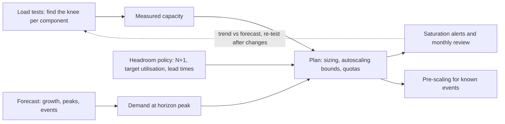

# Capacity Planning

> [!abstract] In one sentence
> Capacity planning answers "how much load can this system take, how much will it need to take, and what must be true for the second number to stay below the first" — by measuring the knee of each component under load, applying queueing arithmetic to understand why latency explodes near saturation, forecasting peaks rather than averages, and keeping deliberate headroom for failure and growth, because autoscaling and cloud elasticity have limits that are discovered at the worst time.

> [!tip] Deeper treatment in your system-design vault
> `system-design/13 Observability/Capacity Planning.md` — read it *after* you have written your own explanation below.

**Map:** [[Observability & Reliability MOC]] → [[HLD MOC]]

## Definition

**Capacity planning** is the practice of determining the resources (compute, memory, connections, storage, network, quotas, licensed throughput) a system needs to meet its performance and availability objectives under expected and peak load, over a planning horizon, with margin for failure and growth. Its inputs are **measured capacity** (the throughput at which a component's latency or error rate leaves its objective — the *knee*), **demand forecasts** (traffic growth, seasonal and daily peaks, planned launches), and **headroom policy** (how much spare capacity to hold, for example N+1 or N+2 instances per failure domain, or running at no more than 50–60% utilisation at peak). Its outputs are sizing decisions, autoscaling bounds, quota requests, and the thresholds behind saturation alerts ([[Monitoring]]). **Little's Law** (`L = λ × W`: items in the system equal arrival rate times time in system) is the basic tool for converting between concurrency, throughput and latency.

## Problem solved

Systems do not degrade gracefully by default as load rises; they are fine until a threshold and then they fall over, and the threshold is usually found in production during the event you most needed to survive — a product launch, a marketing push, Black Friday, an incident elsewhere that redirects traffic. The classic failures: a connection pool sized for last year's traffic ([[Connection Pooling]]); a database at 85% CPU on an ordinary day with no room for a failover's cache-cold load; an autoscaler that needs five minutes to add nodes against a spike that peaks in sixty seconds; a cloud quota (instances, IPs, IOPS) hit mid-scale-out; a Kafka cluster whose partition count caps consumer parallelism ([[Topic Partitions]]). The cost side fails too: fleets provisioned for a peak that never comes, or for the average when the peak is 5x. Capacity planning replaces "we will scale when it hurts" with measured ceilings, forecast demand and explicit headroom, so the response to growth is a planned change rather than an outage ([[Scalability]], [[Performance vs Cost Trade-offs]]).

In a stack like yours, the knees are in specific places — HikariCP pool size against RDS connections, JVM heap against pod memory limits, Node event-loop saturation, RDS IOPS, Redis single-thread CPU, Kafka consumer count against partitions, PSP rate limits — and each has a different measurement and a different lead time to change.

## How it works

1. **Find the ceiling of each component by load testing.** Drive realistic traffic (request mix, payload sizes, data volume) with k6 or Gatling, increasing load in steps, and record throughput, p50/p99 latency, error rate and resource utilisation. The *knee* is where latency starts rising non-linearly or errors appear; the *maximum* is where throughput stops increasing. Capacity is the knee, not the maximum — beyond the knee, latency objectives are already breached ([[Load Test and Latency Lab]], [[Bottleneck Analysis]]).
2. **Understand why with queueing.** A server with utilisation `ρ` has queueing delay that grows roughly as `ρ / (1 − ρ)` times the service time for simple models: at 50% utilisation, wait ≈ service time; at 80%, 4×; at 90%, 9×; at 95%, 19×. This is why the knee appears at 70–80% and why "we have 20% CPU left" is not 20% capacity. Little's Law sizes pools and threads: at 500 requests per second with 40 ms average time in the database, you need `500 × 0.04 = 20` connections on average, and bursts need more ([[Latency]], [[Throughput]]).
3. **Forecast demand for the peak, not the average.** Characterise traffic: daily and weekly cycles, seasonal peaks, peak-to-average ratio, growth rate, planned events. Plan for the forecast peak over the horizon (quarter, year) plus a surge factor; a system sized for average load is under-provisioned most of the time it matters ([[Back-of-the-Envelope Estimation]]).
4. **Add headroom for failure and operations.** Losing an AZ with three AZs sends 50% more load to each survivor; losing one of four pods sends 33% more to each. N+1 (survive one failure at peak) or N+2 for critical systems, plus headroom for deploys (`maxSurge` and warm-up), cache-cold restarts, and the autoscaler's reaction time. Target utilisation at peak is typically well below the knee — 50–60% is a common policy for stateful components that cannot scale quickly.
5. **Account for scaling lead time and limits.** Horizontal pod autoscaling reacts in tens of seconds to minutes (metrics interval plus stabilisation); cluster node provisioning takes minutes; database vertical scaling takes minutes to hours with a failover; quota increases take days; a new region takes months. Pre-scale for known events, keep buffers proportional to lead time, and know every quota (instances, ENIs, IOPS, API rate limits, PSP limits) before it is hit ([[Horizontal vs Vertical Scaling]]).
6. **Monitor and iterate.** Saturation metrics per component with alerts at a planning threshold (ticket) well before the knee (page), monthly review of utilisation trends against forecast, and a re-test after any significant change in code, data or instance type ([[Metrics]], [[Alerting]]).

```text
Little's Law sizing: L = λ × W
  Target 500 req/s, p50 DB time 40 ms, p99 120 ms
  average connections in use = 500 × 0.040 = 20
  at p99 burst                = 500 × 0.120 = 60   -> pool of 20 saturates; size for the burst or shed
Queueing intuition (M/M/1): wait ≈ service_time × ρ / (1 - ρ)
  ρ = 0.5 -> 1x    ρ = 0.8 -> 4x    ρ = 0.9 -> 9x    ρ = 0.95 -> 19x
Headroom: 3 AZs, lose one -> survivors take 1.5x; plan peak utilisation ≤ 0.6 so 0.6 × 1.5 = 0.9 stays under the cliff
```

## Architecture



> [!example]- Excalidraw version — the same diagram as an editable canvas
> ![[Capacity Planning.excalidraw]]
> [[Capacity Planning.excalidraw|Open in Excalidraw]] — needs the Excalidraw plugin (see [[Plugins to Install]]).


## Use cases

- Before any launch, campaign or seasonal peak: measure, forecast and pre-scale ([[Design a Ticket Booking System]]).
- Sizing stateful components that cannot autoscale quickly — databases, caches, brokers — where headroom must be bought in advance ([[Database Scaling]], [[Distributed Caching]]).
- Setting autoscaler bounds and the saturation thresholds that drive them ([[Horizontal vs Vertical Scaling]]).
- Budgeting: the forecast becomes the infrastructure cost plan, and the headroom policy is a visible line item ([[Performance vs Cost Trade-offs]]).
- Designing shedding and rate limits: the limits enforced by [[Graceful Degradation]] and [[Rate Limiting]] are the measured capacities from this process.

## Limitations

- Load tests approximate production: data distribution, cache warmth, user behaviour and dependency behaviour differ, and the knee moves with code and data; results decay quickly.
- Queueing models are simplifications; real systems have multiple resources, variable service times and feedback (retries), so use the models for intuition and the load test for numbers.
- Forecasts are wrong, especially for growth and events; headroom is the hedge, and it costs money.
- Elasticity has limits that are invisible until hit: quotas, instance availability in a region, licensed throughput, partner rate limits; "the cloud scales" is not a plan.
- Shared resources (a database serving many services, a Kafka cluster) make per-service planning insufficient; the shared component's capacity must be allocated across tenants.

## Trade-offs

| You gain | You sacrifice |
|---|---|
| Known ceilings and a plan to stay under them, instead of discovery by outage | Load-testing infrastructure and time, repeated after changes |
| Headroom that absorbs failures, deploys and surges | Idle capacity paid for most of the time |
| Autoscaling bounds and alerts based on measurement | Ongoing review as traffic, code and data evolve |
| Budget forecasts tied to demand | Forecast error, in both directions |

## Failure modes

- **Knee hit during a peak** — the system was fine at 60% of the event's traffic and collapses at 100%; latency goes vertical and retries finish the job. You notice as a sharp cliff in goodput at a specific throughput; blast radius is the whole service for the duration ([[Retry Storms]]).
- **Headroom consumed by failure** — an AZ loss or a bad node removes capacity and the survivors cross the knee; a single-component failure becomes a full outage. Noticed when a routine failure causes an outage; N+1 at peak is the control.
- **Autoscaler too slow or capped** — HPA at its maximum replicas, or nodes unavailable in the AZ; load rises faster than capacity. Noticed as pending pods and saturation at the maximum; pre-scale for known events and raise limits with margin.
- **Quota wall** — scale-out fails on instance, IP or IOPS quota mid-incident. Noticed as provisioning errors at the worst time; audit quotas against the plan quarterly.
- **Shared dependency under-planned** — ten services each sized correctly share one database sized for last year; the database is the bottleneck for all of them. Noticed as correlated latency across unrelated services; plan the shared resource's allocation explicitly ([[Bulkheads]]).

## Performance

Capacity planning is the discipline that keeps components in the flat part of their latency curve: below the knee, p99 is close to its unloaded value; above it, p99 grows with queue length until timeouts. The arithmetic matters for sizing pools and parallelism (Little's Law), for choosing utilisation targets (queueing growth), and for estimating failover load (surviving-capacity ratio). Load-test results should be recorded as capacity per unit (requests per second per pod at the knee, with its CPU and memory profile) so that scaling math is multiplication, and re-measured when the unit changes (instance type, JVM settings, pod resources).

## Scalability

At 10x demand, planning shifts from per-service to system-wide: the bottleneck moves to shared, slow-to-scale components (databases, brokers, caches, external partners), and the plan must include architectural changes (sharding, read replicas, partition increases) with lead times of weeks or months ([[Database Scaling]], [[Sharding]]). Forecasting becomes a model with uncertainty bands rather than a number, and headroom policy becomes tiered by component scaling speed. Autoscaling covers minute-scale variation; capacity planning covers everything slower. Organisations at scale run regular capacity reviews across teams and treat quota and hardware procurement as a pipeline ([[Design a Metrics and Monitoring System]] for the data that feeds it).

## Operational impact

Own a capacity model per service (requests per second per unit, dependency fan-out, resource per request), kept in version control with the load-test results that produced it; review utilisation trends monthly and before events; keep saturation dashboards with the knee marked and ticket alerts at the planning threshold ([[Monitoring]], [[Alerting]]). Load tests run on a schedule or on significant changes, in an environment representative enough to trust. Quotas are audited and raised ahead of need. Pre-scaling for known events is a runbook with dates. After incidents involving capacity, the postmortem updates the model ([[Production Incident Analysis]]).

## Alternatives

- **Reactive autoscaling only** — scale on CPU or queue depth and hope lead times suffice; wins for stateless services with gentle traffic ramps, fails for spikes, stateful components and quota walls ([[Horizontal vs Vertical Scaling]]).
- **Gross over-provisioning** — run everything at 20% utilisation; wins when infrastructure is cheap relative to engineering time and outage cost, and is the honest default for small systems until the bill matters ([[Performance vs Cost Trade-offs]]).
- **Load shedding as the plan** — accept overload and shed to protect the core; necessary regardless, but as the *only* plan it means routinely rejecting users during peaks ([[Graceful Degradation]]).
- **Serverless and managed elastic services** — delegate capacity to the provider within its limits; wins for spiky, stateless workloads, with the limits (concurrency quotas, cold starts, downstream capacity) still needing a plan.

## Real-world examples

- Google's SRE book devotes chapters to capacity planning and load balancing, with the principle that capacity is planned for the forecast peak with N+2 redundancy and validated by load tests, not inferred from averages ([[Site Reliability Engineering (Google)]]).
- The Amazon Builders' Library article on load shedding frames capacity as the measured goodput ceiling and argues for keeping servers below it through admission control — the operational twin of planning ([[AWS Builders Library - Load Shedding]]).
- Retailers' Black Friday preparations are published annually as capacity exercises: months of load testing against production-like environments, pre-scaled fleets, and quotas raised in advance.
- In a stack like yours: a k6 profile per service producing requests per second per pod at the knee; HikariCP and RDS connection budgets derived with Little's Law; RDS and Redis sized at ≤ 60% peak utilisation with N+1 across AZs; HPA maximums set from the model with node headroom pre-provisioned for known events; Kafka partitions planned for consumer parallelism a year ahead; PSP rate limits recorded as external capacity; and a quarterly quota audit on the AWS account.

## Practical exercise

1. Take a small service with a PostgreSQL dependency (from any earlier exercise) and run a k6 ramp test from 50 to 2,000 requests per second in steps of 100, recording throughput, p50/p99, error rate, CPU, pool usage and database CPU at each step.
2. Plot latency against throughput and mark the knee; compute the capacity per pod and compare the pool size you would derive from Little's Law with the pool saturation you observed.
3. Run three pods and kill one at 60% of the knee's aggregate capacity; observe whether the survivors stay below their knee; repeat at 80% and record the difference — this is the headroom argument in numbers.
4. Enable an HPA (or a scripted scaler) with a 60 s reaction time and send a spike that doubles in 15 s; measure the error window; then pre-scale and repeat.
5. Write a one-page capacity model: capacity per pod, forecast peak (invent a 3x event), headroom policy, resulting replica count and pool sizes, quotas required, and the saturation alert thresholds you would set.

## Related concepts

### Prerequisites
- [[Throughput]] — the unit capacity is measured in
- [[Latency]] — the objective that defines the knee
- [[Back-of-the-Envelope Estimation]] — the arithmetic of demand forecasting
- [[Horizontal vs Vertical Scaling]] — the levers and their lead times

### Related
- [[Bottleneck Analysis]] — finding which component's knee comes first
- [[Metrics]] and [[Monitoring]] — saturation signals and trend reviews
- [[Backpressure]] — what components do when planning was insufficient
- [[Hot Keys]] — skew that defeats average-based capacity math
- [[Connection Pooling]] — the pool sizes Little's Law produces

### Builds on this
- [[Graceful Degradation]] — shedding limits are the measured capacities
- [[Rate Limiting]] — per-client limits derived from capacity allocation
- [[Performance vs Cost Trade-offs]] — the cost plan follows the capacity plan

### Design problems where it applies
- [[Design a Metrics and Monitoring System]]
- [[Design a Ticket Booking System]]
- [[Design a Video Streaming Service]]
- [[Design a Social Feed]]

### Projects where it can be implemented
- [[Load Test and Latency Lab]]
- [[Chaos Lab]]

### Resources
- [[Site Reliability Engineering (Google)]] — capacity planning, N+2 and load balancing chapters
- [[AWS Builders Library - Load Shedding]] — goodput, the knee and keeping servers below it
- [[Latency Numbers Every Programmer Should Know]] — the constants behind estimates

## Personal understanding

> [!question] Explain it without the source
> Write your own explanation here, from memory. Then compare it with the sections above and note what you missed.

### Mastery checklist
- [ ] I can explain it without the original resource
- [ ] I can describe the problem it solves
- [ ] I can compare it with its alternatives
- [ ] I can name its limitations and failure modes
- [ ] I can recognise when it is appropriate in a real system
- [ ] I have applied it in a system design
- [ ] I have validated my assumptions with an experiment or implementation

## Open questions

- [ ] For a typical service of mine, what is the measured requests-per-second-per-pod at the knee, when was it last measured, and how does it change with pod CPU requests and JVM or Node settings?
- [ ] Which shared components (RDS instances, Redis, Kafka or SQS, the IAM service, PSP rate limits) are the first to saturate at 3x current peak, and what is the lead time to raise each one's ceiling?
- [ ] What are the AWS quotas and instance-availability constraints that would stop a scale-out in the primary region during a regional event elsewhere, and are they audited?
