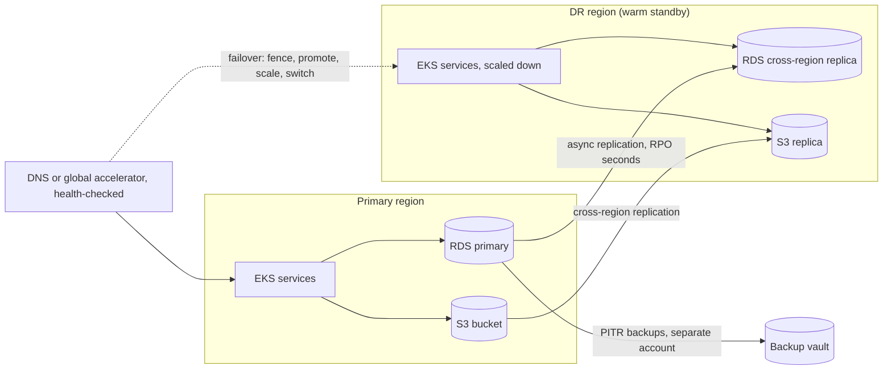

# Disaster Recovery

> [!abstract] In one sentence
> Disaster recovery is what you do when the normal redundancy is gone — a whole region unreachable, a database deleted, a ransomware event — and it works only if the recovery tier (backups to restore, a pilot light to scale up, a warm standby to promote, or an active-active second site) was chosen to meet an explicit RTO and RPO, the failover and fencing steps are written down, and the whole thing has been rehearsed recently enough that it still works.

> [!tip] Deeper treatment in your system-design vault
> `system-design/12 Resilience/Disaster Recovery.md` — read it *after* you have written your own explanation below.

**Map:** [[Observability & Reliability MOC]] → [[HLD MOC]]

## Definition

**Disaster recovery (DR)** is the set of policies, architecture and procedures for restoring a system after a disaster — an event beyond the failures normal high availability absorbs: loss of a region or data centre, loss or corruption of data (operator error, software bug, malicious action), loss of a critical third party. Two numbers govern it: the **[[Recovery Time Objective|RTO]]** (how long until service is restored) and the **[[Recovery Point Objective|RPO]]** (how much recent data may be lost). The standard **DR tiers**, in increasing cost and decreasing RTO/RPO: **backup and restore** (rebuild from backups in a new place), **pilot light** (data replicated continuously, minimal compute kept running, scaled up on failover), **warm standby** (a scaled-down but fully functional copy taking a trickle of traffic or none), and **multi-site active-active** (traffic served from several regions at once, failover is removal of one). High availability within a region ([[Replication]], multi-AZ) handles component failure; DR handles the loss of the whole thing.

## Problem solved

Multi-AZ redundancy protects against a server, rack or zone failing. It does not protect against a regional outage (they happen, for hours, at every provider), a `DROP TABLE` that replicates faithfully to every replica, a bug that corrupts data for a week before anyone notices, an account compromise that deletes resources, or a regulator asking how long you would be down if your primary site burned. Before DR was treated as engineering, the answer was a binder nobody had opened and backups nobody had restored; the well-known pattern is an organisation discovering during the disaster that the backups are incomplete, the standby is three versions behind, the DNS change needs a person on holiday, and the failover has never been attempted. DR as a discipline makes the recovery path a tested, owned, measured capability with cost proportional to the business impact of being down ([[Availability]], [[Reliability]]).

In a stack like yours — EKS clusters, RDS, Redis, Kafka or SQS and object storage in one AWS region, with money and regulatory obligations attached — DR is both an engineering question (which tier per system) and a compliance one (demonstrated RTO/RPO for the ledger).

## How it works

1. **Classify systems by impact.** Not everything needs the same tier. The ledger and payment APIs might justify an RTO of minutes and RPO of seconds; internal reporting might tolerate a day and a restore from last night's backup. Tier per system, from the business impact of downtime and data loss, with cost estimates per tier so the choice is explicit ([[Recovery Time Objective]], [[Recovery Point Objective]]).
2. **Protect the data first.** Data is the part you cannot redeploy. Continuous cross-region replication for low RPO (Aurora Global Database, cross-region read replicas, S3 cross-region replication, MirrorMaker or cluster linking for Kafka), *plus* point-in-time backups in a separate account or region for the failures replication does not protect against — deletion, corruption and ransomware replicate perfectly ([[Backups and Restoration]]). Delayed replicas (`recovery_min_apply_delay` in PostgreSQL) give a window to stop a bad change before it applies.
3. **Make compute reproducible.** Infrastructure as code, images in a registry replicated across regions, secrets and configuration available in the DR region ([[Secrets Management]]), and deployment pipelines that can target the DR region. A pilot light keeps the data replicating and a minimal footprint deployed; warm standby keeps a scaled-down full stack running and verified.
4. **Design the failover.** Who declares the disaster and on what criteria (regional outage confirmed by the provider plus internal symptoms, or a data-loss event). The steps, in order: fence the old primary (stop writes — promote only after you are sure the old region cannot keep accepting them, or accept a reconciliation job), promote the data tier (replica promotion, which breaks replication from the old primary), scale and verify compute, switch traffic (DNS with low TTLs and health-checked routing, or a global accelerator), validate with synthetic transactions, communicate ([[Split-Brain]] is the failure to fence; [[DNS]] TTLs bound the traffic switch).
5. **Plan the failback.** Returning to the original region is a second migration: re-establish replication in reverse, reconcile any writes accepted in both places during the overlap, repeat the switch. Many organisations run on the DR region until the next planned window rather than failing back under pressure.
6. **Rehearse.** Game days that execute the runbook end to end on a schedule (quarterly is common for critical systems): restore a backup into a clean account and verify data integrity; promote the standby and route a slice of traffic; measure actual RTO and RPO against the objectives; fix what broke. The measured numbers, not the design, are what you report.

```text
Tier            RTO (typical)    RPO (typical)        Keeps running in DR region
Backup/restore  hours to a day   backup interval      nothing (restore on demand)
Pilot light     tens of minutes  seconds to minutes   data replication, minimal compute
Warm standby    minutes          seconds              scaled-down full stack
Active-active   seconds to none  near zero            full stack, serving traffic
(figures are order-of-magnitude; measure your own in drills)
```

## Architecture



> [!example]- Excalidraw version — the same diagram as an editable canvas
> ![[Disaster Recovery.excalidraw]]
> [[Disaster Recovery.excalidraw|Open in Excalidraw]] — needs the Excalidraw plugin (see [[Plugins to Install]]).


## Use cases

- Regulatory or contractual requirements that state RTO and RPO (financial services, healthcare, SLAs with recovery clauses) — the tier is chosen to satisfy them demonstrably ([[Design a Payment System]], [[Design a Digital Wallet and Ledger]]).
- Systems whose downtime cost per hour exceeds the cost of a standby region — the arithmetic usually favours warm standby for revenue-critical paths.
- Data that must survive operator error and malicious deletion, independent of replication: isolated, immutable backups with tested restores ([[Backups and Restoration]]).
- Dependence on a single provider region for everything, including the control plane that would run the recovery (CI/CD, secrets, DNS): DR planning surfaces those circular dependencies.
- Products with users in several geographies where active-active also improves latency, making DR a side effect of the architecture ([[Coordination vs Availability]] for the data design this requires).

## Limitations

- Cost scales steeply with tier: active-active roughly doubles infrastructure and demands a data architecture that tolerates multi-region writes ([[Eventual Consistency]] or per-key homing); most systems cannot justify it.
- Asynchronous cross-region replication means a non-zero RPO; synchronous cross-region replication for RPO zero costs tens of milliseconds per write and is rarely acceptable.
- Replication does not protect against corruption or deletion; backups do, with a worse RTO. Both are needed, and teams often have only one.
- Failover is a risky operation in itself; a botched failover during a partial outage has turned degraded service into total outage. Automatic regional failover is uncommon for stateful systems for this reason.
- DR plans decay with every architecture change; an untested plan is a hypothesis.

## Trade-offs

| You gain | You sacrifice |
|---|---|
| Survival of regional loss, data destruction and provider incidents | Standby infrastructure cost proportional to the tier |
| Explicit, measured RTO and RPO per system | Engineering effort for replication, reproducible deploys and runbooks |
| Confidence from rehearsed procedures | Regular game days that consume engineering time and carry their own risk |
| Compliance evidence and a defensible answer to "what if" | A second region's worth of operational surface, secrets and drift to manage |

## Failure modes

- **Backups that do not restore** — backups ran but were incomplete, encrypted with a lost key, or never tested; discovered during the disaster. You notice only at restore time; blast radius is the entire dataset. GitLab's 2017 database incident, where several backup mechanisms turned out not to work, is the canonical public example ([[Backups and Restoration]]).
- **Standby drift** — the DR region runs older code, missing secrets, a schema version behind; promotion succeeds and the application fails. Noticed at failover; prevented by deploying to both regions in the same pipeline and verifying the standby continuously.
- **Dual-primary after failover** — the old region recovers and resumes writes while the new one is primary; data diverges. Noticed as replication errors or reconciliation breaks; the fencing step exists to prevent it ([[Split-Brain]]).
- **Circular dependency** — the failover runbook needs the CI/CD system, secrets store or identity provider that lives only in the failed region. Noticed when the runbook step cannot execute; DR of the control plane must precede DR of the workloads ([[Design an IAM Service]]).
- **DNS and client caching** — TTLs of an hour, clients that cache resolved addresses for the process lifetime; traffic keeps going to the dead region long after the switch. Noticed as a slow, partial failover; use low TTLs on failover records and health-checked routing ([[DNS]], [[Client State and Reconnection]]).

## Performance

Cross-region asynchronous replication adds no latency to the primary's writes but accumulates lag under load; typical lag for managed cross-region database replicas is sub-second to seconds, which is the RPO you will actually get. Synchronous cross-region replication adds the inter-region round trip (tens to hundreds of milliseconds) to every write. Failover time is dominated by promotion (seconds to minutes), compute scale-up (minutes for a pilot light, seconds for a warm standby), DNS propagation (bounded by TTL) and human decision time, which is usually the largest component. Restore from backup is bounded by data volume and restore throughput — terabytes take hours.

## Scalability

At 10x data, replication bandwidth and restore time grow linearly, pushing systems from backup-restore toward continuous replication because the restore RTO becomes unacceptable; backups themselves move to incremental and snapshot-based approaches. At 10x services, the cost of keeping every service deployable in two regions is dominated by consistency of practice: one deployment pipeline, one infrastructure-as-code pattern, one DR runbook template, with per-system tiers declared in a service catalogue rather than negotiated individually. Active-active across regions requires data partitioning by region or conflict-tolerant data types, which is an application architecture decision, not an infrastructure one.

## Operational impact

DR is owned, scheduled work: a named owner per system, the tier and objectives recorded, replication health and backup success monitored with ticket-grade alerts ([[Alerting]]), the standby verified by continuous synthetic checks, and game days on the calendar with the measured RTO/RPO fed back into the plan. Runbooks must be executable by someone other than their author, from outside the failed region, with access that does not depend on it. Each drill produces a postmortem-style review ([[Production Incident Analysis]]). Cost reviews should show DR spend per tier so leadership sees what the RTO they asked for costs.

## Alternatives

- **Multi-AZ high availability only** — accept regional outage as downtime; wins for systems whose cost of a rare multi-hour outage is below the cost of a standby region, which is many internal and early-stage systems.
- **Provider-managed multi-region services** — Aurora Global Database, DynamoDB global tables, S3 replication, Route 53 health checks; win by making the data tier's DR a configuration rather than a project, at the cost of lock-in and of still owning the application failover.
- **Active-active by design** — all regions serve, no failover procedure; wins for latency and availability when the data model permits it, and is the most expensive and most demanding option ([[Eventual Consistency]]).
- **Cold restore from immutable backups only** — the minimum for data survival; wins for archives and low-impact systems and is the floor every system should have ([[Backups and Restoration]]).

## Real-world examples

- AWS's Well-Architected guidance defines the four DR strategies (backup and restore, pilot light, warm standby, multi-site active/active) with their RTO/RPO expectations, and its own regional incidents are the reason customers plan for regional loss.
- **GitLab's 2017 incident** — an accidental deletion of production data followed by the discovery that multiple backup mechanisms were not working — is documented publicly in detail and remains the reference case for "backups you have not restored are not backups".
- **Netflix** runs active-active across AWS regions and regularly evacuates a region as an exercise, treating regional failover as routine rather than a disaster.
- In a stack like yours: a ledger on RDS with a cross-region replica and PITR backups in a separate account, EKS workloads deployed to both regions by the same pipeline with the DR region scaled down, Kafka topics mirrored or SQS queues recreated per region with idempotent consumers, Redis treated as rebuildable cache, and a quarterly game day that promotes the replica, routes a canary slice of traffic and measures the real RTO and RPO.

## Practical exercise

1. In two Docker Compose "regions" (separate networks), run a small service with PostgreSQL primary in region A streaming to a replica in region B, plus a scheduled `pg_basebackup` with WAL archiving to a shared "backup bucket" directory.
2. Write a runbook for failover: stop writes in A (fence), promote B (`pg_ctl promote`), point the service at B, verify with a synthetic write; then execute it with a stopwatch and record RTO; compare the last committed transaction in A with the first in B to compute the RPO.
3. Simulate a data disaster: run `DELETE FROM ledger_entries` in A and watch it replicate to B; recover using point-in-time restore from the backup to a timestamp before the delete, and measure that RTO.
4. Simulate standby drift: deploy a newer schema to A only, then fail over to B and observe the application failure; fix by deploying migrations to both in one pipeline step.
5. Add [[Toxiproxy]] on the replication link with 30 s of delay before failing over and measure the RPO you actually get; document the tier, objectives and measured results as if for an audit.

## Related concepts

### Prerequisites
- [[Replication]] — continuous data copying is the basis of every tier above backup-restore
- [[Backups and Restoration]] — the protection replication cannot provide
- [[Recovery Time Objective]] — the downtime target that selects the tier
- [[Recovery Point Objective]] — the data-loss target that selects the replication mode

### Related
- [[Availability]] — DR is the extension of availability to whole-site loss, the largest fault domain
- [[Leader Election]] — promotion is election with humans in the loop
- [[Split-Brain]] — the failure of an unfenced failover
- [[DNS]] — the traffic-switching mechanism and its TTL limits
- [[Data Retention and Archival]] — what must survive and for how long
- [[Secrets Management]] — secrets must be available in the DR region

### Builds on this
- [[Capacity Planning]] — the surviving region must absorb the failed region's load
- [[Deployment and Rollback Strategies]] — pipelines that target both regions
- [[Production Incident Analysis]] — game days and real failovers reviewed the same way

### Design problems where it applies
- [[Design a Payment System]]
- [[Design a Digital Wallet and Ledger]]
- [[Design File Storage]]
- [[Design a Distributed Key-Value Store]]

### Projects where it can be implemented
- [[Double-Entry Ledger Service]]
- [[Chaos Lab]]

### Resources
- [[Site Reliability Engineering (Google)]] — data integrity, backups and the practice of recovery
- [[Designing Data-Intensive Applications]] — replication, lag and what asynchronous copies can and cannot promise
- [[Release It!]] — stability patterns and the operational view of recovery

## Personal understanding

> [!question] Explain it without the source
> Write your own explanation here, from memory. Then compare it with the sections above and note what you missed.

### Mastery checklist
- [ ] I can explain it without the original resource
- [ ] I can describe the problem it solves
- [ ] I can compare it with its alternatives
- [ ] I can name its limitations and failure modes
- [ ] I can recognise when it is appropriate in a real system
- [ ] I have applied it in a system design
- [ ] I have validated my assumptions with an experiment or implementation

## Open questions

- [ ] For the systems I know, which DR tier does each actually have today (not on paper), and when was the last time a backup was restored or a standby promoted?
- [ ] Which parts of the recovery path — CI/CD, secrets, IAM, DNS control, the on-call tooling — live only in the primary region, and what is the order in which they would have to be recovered?
- [ ] For SQS-based flows, what happens to in-flight and queued messages during a regional failover, and what does an idempotent consumer need in order to make replaying them safe?
