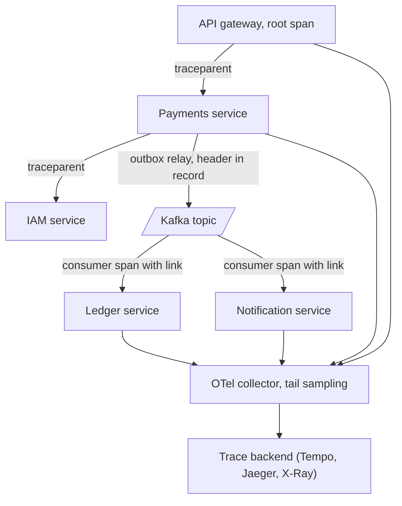

# Distributed Tracing

> [!abstract] In one sentence
> Distributed tracing extends tracing across service boundaries by propagating a standard context (W3C `traceparent`) through HTTP, gRPC and message headers, so a request that touches a gateway, four services, a Kafka topic and a consumer appears as one waterfall — the only signal that shows *which* service in a chain is slow or failing for a specific request, at a cost controlled by head or tail sampling in an OpenTelemetry collector.

> [!tip] Deeper treatment in your system-design vault
> `system-design/13 Observability/Distributed Tracing.md` — read it *after* you have written your own explanation below.

**Map:** [[Observability & Reliability MOC]] → [[HLD MOC]]

## Definition

**Distributed tracing** is [[Tracing]] whose spans come from many processes, joined into one trace by **context propagation**: the caller serialises its trace id, current span id and sampling decision into the outgoing request (the W3C Trace Context `traceparent` header, or gRPC metadata, or a Kafka/SQS message attribute), and the callee deserialises it and makes its first span a child of the caller's. **Correlation ids** are the older, simpler form of the same idea — one opaque id passed along and logged everywhere — which gives reassembly but not timing or structure. **OpenTelemetry** (OTel) is the vendor-neutral standard for the API, SDKs, propagators, the OTLP wire protocol and the **collector** — a pipeline process that receives spans, samples, enriches and exports them to a backend (Jaeger, Tempo, Zipkin, X-Ray, Datadog). **Head sampling** decides at the root whether to record the trace; **tail sampling** buffers complete traces in the collector and keeps the interesting ones.

## Problem solved

In a monolith, a slow request is a slow function somewhere in one process; in a service architecture it is somewhere across a dozen processes owned by five teams, and each team's dashboard says "we are fine". Per-service [[Metrics]] cannot say which service was slow *for this request*, and per-service logs can be joined only if everyone logged a shared id, which is exactly what tracing automates. Correlation ids were the first fix — generated at the edge, passed in a header, written into every log — and they still matter, but they give a bag of log lines, not a timeline, and nothing for asynchronous hops: a message consumed two seconds after it was produced has no obvious relationship to the request that produced it unless the context rode in the message. Distributed tracing turns "which of these eight services is responsible" into a picture, including the asynchronous parts, and OpenTelemetry made it possible to instrument Java, Node and Go services the same way and send them to any backend ([[Microservices]]).

In a stack like yours, a webhook from a PSP enters the gateway, hits a payments service, writes an outbox row, is relayed to Kafka or SQS, and is consumed by a ledger service and a notification service — five processes and two asynchronous hops; the trace is what lets you answer "the customer's notification arrived 40 s late, where did the time go".

## How it works

1. **Propagate on every outbound call.** The HTTP client interceptor injects `traceparent: 00-<32-hex trace id>-<16-hex parent span id>-<2-hex flags>` (flags bit 0 = sampled) and optionally `tracestate` for vendor data; gRPC does the same in metadata; the Kafka producer interceptor writes the same fields into record headers, and the SQS client into message attributes. Auto-instrumentation handles all of these; the only requirement is that the context be *current* when the call is made (see [[Tracing]] for in-process propagation).
2. **Extract on every inbound boundary.** Server middleware reads `traceparent`, creates a server span whose parent is the remote span, and sets it current. A consumer creates a consumer span linked to the producer span; because the consumer may run seconds later and process a batch, OTel uses a **span link** (a reference to the producing span) rather than a strict parent, so the trace shows the asynchronous relationship honestly ([[Message Queues]]).
3. **Export via the collector.** Each service's SDK batches finished spans and sends them over OTLP (gRPC or HTTP) to a collector running as a sidecar, a DaemonSet, or a gateway deployment. The collector pipeline has receivers (OTLP, Zipkin, Jaeger), processors (batching, attribute redaction, resource enrichment with Kubernetes metadata, tail sampling) and exporters (to one or more backends). Centralising this in the collector keeps services ignorant of the backend.
4. **Sample deliberately.** Head sampling: the root decides (`parentbased_traceidratio` at, say, 5%) and the decision propagates in the flags, so a trace is either fully recorded or not at all. Tail sampling: every service exports every span to a collector that holds traces for a decision window (seconds) and keeps those matching policies — any error span, latency above a threshold, specific routes, plus a percentage of the rest. Tail sampling needs all spans of a trace to reach the *same* collector instance (load-balance by trace id) and memory for the window.
5. **Correlate with logs and metrics.** Print `trace_id` and `span_id` into every log record so logs can be found from a trace and traces from a log ([[Logging]]); attach exemplars to latency histograms so a p99 spike on a dashboard links to a representative trace ([[Metrics]]).
6. **Name and attribute consistently.** Resource attributes (`service.name`, `service.version`, `deployment.environment`, `k8s.pod.name`) identify who emitted a span; semantic conventions (`http.route`, `messaging.system`, `peer.service`) let backends build service maps and RED-per-service views from spans alone.

```text
traceparent: 00-4bf92f3577b34da6a3ce929d0e0e4736-00f067aa0ba902b7-01
             ^^ version  ^^ trace id (16 bytes)             ^^ parent span id   ^^ flags: sampled
Kafka record headers: traceparent=<same format>, tracestate=<vendor data>
```

## Architecture



## Use cases

- "Find which service in the chain is slow or failing for a given request" — the core use, for any system with more than two hops ([[Microservices]], [[API Gateways]]).
- "Follow a request across an asynchronous hop" — outbox to broker to consumer, with the delay visible ([[Outbox Pattern]], [[Event-Driven Architecture]]).
- "Measure the real latency budget per hop" — validate that timeouts and deadlines are set from observed span durations ([[Timeouts and Retries]]).
- "Build a service dependency map from reality" — backends derive it from span parent–child relationships, which is more accurate than architecture diagrams.
- "Support a customer complaint with a trace id" — return the trace id in a response header (`x-trace-id`) so support can find the exact request.

## Limitations

- Everything hinges on propagation; one uninstrumented hop (a legacy service, a hand-rolled HTTP client, a message produced without headers, a batch job) breaks the chain, and partial traces are hard to interpret.
- Sampling discards most traces; aggregate analysis from traces is biased unless sampling is uniform, and tail sampling's "keep errors" policy makes traces unrepresentative of normal traffic by design.
- Asynchronous and batch processing do not fit the tree model cleanly; links help, but a consumer that aggregates 500 messages into one write has 500 parents, and the UI will not show that well.
- Cost scales with spans retained; high fan-out services produce many spans per request, and backends charge by volume.
- Cross-organisation boundaries (partners, PSPs) rarely propagate context; the external call is a black box span.

## Trade-offs

| You gain | You sacrifice |
|---|---|
| One timeline across services and queues for a single request | Propagation discipline on every client, server and messaging library in every language |
| A collector pipeline that decouples services from the backend | Another stateful-ish component to run, especially for tail sampling |
| Error- and latency-aware sampling that keeps the traces you need | Representativeness of traces for aggregate questions |
| Service maps and per-hop latency derived from real traffic | Attribute and resource hygiene, and a backend bill proportional to span volume |

## Failure modes

- **Trace breaks at a hop** — a service strips unknown headers (a proxy with a header allow-list), a client library is not instrumented, or a message is produced without headers; downstream spans form new traces. You notice as traces that end at the same hop every time and a flood of root spans in a downstream service; blast radius is visibility for every request through that hop.
- **Sampling mismatch** — one service forces 100% sampling while the root sampled at 1%; the backend receives orphaned subtrees. Noticed as partial traces; fix with parent-based samplers everywhere.
- **Collector overload** — tail sampling buffers exceed memory during a traffic spike; the collector drops traces or is OOM-killed, exactly during the incident. Noticed as a gap in traces at the worst time; size the window and memory, and alert on collector drop metrics.
- **Clock skew between hosts** — child spans appear to start before their parents across services. Noticed as negative gaps in waterfalls; usually small with NTP, confusing when it is not ([[Clocks and Time]]).
- **PII in propagated baggage or attributes** — OTel **baggage** (key–values that propagate with the context) used to carry a user email; it is sent to every downstream service and exported. Noticed in a security review; keep baggage minimal and attributes redacted at the collector.

## Performance

Propagation adds one header (about 55 bytes for `traceparent`) per call and a few microseconds of injection and extraction. Per-span overhead is as in [[Tracing]]: around a microsecond each, batched and exported asynchronously. The collector adds a network hop for telemetry (not for requests) and CPU proportional to span volume; a tail-sampling collector holds every in-flight trace for the decision window, so memory is roughly span rate × window × bytes per span — at 20,000 spans per second, a 10 s window and 500 bytes per span, about 100 MB plus overhead. Backend query latency is fast by trace id and slow by attribute search over large ranges.

## Scalability

Scale the collector tier horizontally with trace-id-aware load balancing (the OTel load-balancing exporter) so tail sampling sees whole traces; run agent collectors per node for batching and a gateway tier for sampling and export. Reduce span volume with sampling and by keeping auto-instrumentation coarse; derive RED metrics from spans at the collector (span metrics connector) so dashboards need no raw traces. Backends like Tempo scale by indexing only trace ids and storing spans in object storage; search by attribute is bounded by time range. At 10x services, the main risk is inconsistency of instrumentation across teams, solved by a shared OTel setup library per language ([[Design a Metrics and Monitoring System]]).

## Operational impact

Make the OpenTelemetry SDK or agent part of the base image or platform library so every service propagates context by default; test propagation in CI with a two-service integration test that asserts a shared trace id. Run the collector as a platform service with its own dashboards (received, dropped, exported spans; queue sizes; sampling decisions). Return the trace id in response headers and print it in logs. Define tail-sampling policies as code with an owner, and review retention and cost monthly. During incidents, the workflow is alert → dashboard → exemplar or log → trace; make sure each link in that chain works before the incident ([[Monitoring]], [[Alerting]]).

## Alternatives

- **Correlation ids in logs only** — a request id in a header and in every log line, joined at query time; wins for small systems with few hops and no asynchronous flows, and is still a necessary baseline when tracing is sampled ([[Logging]]).
- **Service-mesh tracing** — Envoy sidecars emit spans for every hop without application changes; wins for quick coverage of HTTP traffic, but spans stop at the sidecar (no database or in-process detail) and the application must still forward headers for the mesh spans to join.
- **Vendor agents (APM)** — commercial agents with their own propagation; win on time-to-value, lose on portability unless they speak W3C Trace Context and OTLP (most now do).
- **Metrics with per-hop histograms and exemplars** — enough for "which service's p99 moved" without per-request detail; wins when tracing cost is not justified ([[Metrics]]).

## Real-world examples

- **W3C Trace Context** became a W3C Recommendation in 2020, replacing incompatible proprietary headers (Zipkin's B3, X-Ray's trace header) with `traceparent`/`tracestate`, which is why Java, Node and Go services from different vendors can now share a trace.
- **OpenTelemetry** is the second most active CNCF project after Kubernetes and the default instrumentation choice in most cloud providers' guidance; its collector's tail-sampling processor is the standard way to keep error traces at scale ([[OpenTelemetry Observability Primer]]).
- **Uber's Jaeger** was built to trace thousands of microservices and documented the practical problems — propagation gaps, sampling strategies, storage cost — that OTel later standardised answers to.
- In a stack like yours: the OTel Java agent on Spring Boot and the Node SDK on NestJS propagate `traceparent` over HTTP and into Kafka or SQS message headers automatically; an OTel collector DaemonSet batches to a gateway collector that tail-samples (all errors, all traces over SLO thresholds, 5% of the rest) and exports to Tempo or X-Ray; `trace_id` appears in every log line and in the `x-trace-id` response header from the gateway.

## Practical exercise

1. In Docker Compose, run a gateway (NestJS), a payments service (Spring Boot), a Kafka or Redpanda broker, a ledger consumer (either stack), an OTel collector and Jaeger; enable auto-instrumentation in each service and point exporters at the collector.
2. Send `POST /payments` through the gateway; open the trace in Jaeger and confirm spans from all three services plus the producer and consumer spans joined by a link; note the asynchronous gap between produce and consume.
3. Break propagation on purpose: remove the Kafka producer interceptor (or send with a raw client without headers) and show the consumer's spans as a separate trace; restore it.
4. Switch the collector to tail sampling with policies "status = error", "latency > 300 ms", "5% otherwise"; inject errors and slow responses with [[Toxiproxy]] and verify every error trace is retained while volume drops.
5. Measure: added request latency with tracing on versus off (expect microseconds), spans per second exported, collector memory with a 10 s decision window, and the trace-id lookup time in the backend.

## Related concepts

### Prerequisites
- [[Tracing]] — spans and in-process context propagation
- [[Logging]] — the records that carry trace ids
- [[HTTP and HTTPS]] — headers as the propagation carrier
- [[Message Queues]] — asynchronous hops need headers and links

### Related
- [[Metrics]] — exemplars connect histograms to traces
- [[Monitoring]] — the alert-to-trace workflow
- [[Microservices]] — the architecture that makes this necessary
- [[API Gateways]] — where the root span and the response trace id live
- [[Kafka]] — record headers as the propagation carrier for events
- [[gRPC]] — metadata propagation

### Builds on this
- [[Production Incident Analysis]] — timelines of failing requests across services
- [[Bottleneck Analysis]] — per-hop latency attribution from real traffic
- [[Monitoring User-Facing Performance]] — browser and mobile spans joined to backend traces

### Design problems where it applies
- [[Design an API Gateway]]
- [[Design a Payment System]]
- [[Design a Notification System]]
- [[Design a Workflow Orchestrator]]
- [[Design a Ride-Sharing Service]]

### Projects where it can be implemented
- [[Webhook Relay]]
- [[LLM Gateway]]
- [[Chaos Lab]]

### Resources
- [[OpenTelemetry Observability Primer]] — context propagation, the collector and sampling
- [[The Tail at Scale]] — why per-hop latency in fan-out systems needs per-request visibility
- [[Site Reliability Engineering (Google)]] — tracing in the incident workflow
- [[Building Microservices]] — observability across service boundaries

## Personal understanding

> [!question] Explain it without the source
> Write your own explanation here, from memory. Then compare it with the sections above and note what you missed.

### Mastery checklist
- [ ] I can explain it without the original resource
- [ ] I can describe the problem it solves
- [ ] I can compare it with its alternatives
- [ ] I can name its limitations and failure modes
- [ ] I can recognise when it is appropriate in a real system
- [ ] I have applied it in a system design
- [ ] I have validated my assumptions with an experiment or implementation

## Open questions

- [ ] Do the SQS and Kafka clients in the codebases I work on propagate `traceparent` in message attributes or headers by default, and does the outbox relay copy the context from the originating transaction into the published message?
- [ ] What is the right tail-sampling policy for a payments platform — which routes at 100%, which thresholds — and what span budget does that imply for the collector and backend?
- [ ] How should a trace be modelled for a consumer that batches 500 messages into one ledger write: links to all producers, one representative link, or a separate batch trace with a reference?
