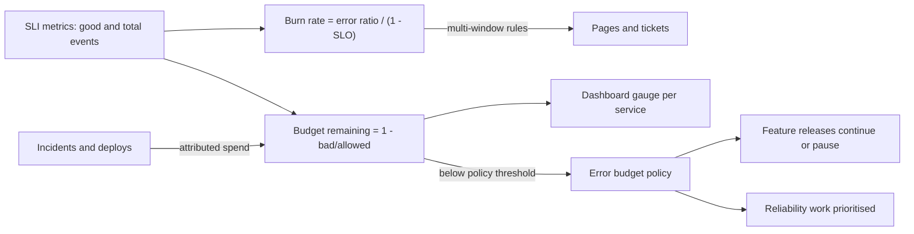

# Error Budgets

> [!abstract] In one sentence
> An error budget is 1 − SLO applied to the window — the amount of failure you are allowed before the objective is breached — and treating it as a budget to be spent on releases, experiments and risk turns the perennial argument between velocity and reliability into arithmetic with an agreed policy for what happens when the budget runs out.

> [!tip] Deeper treatment in your system-design vault
> `system-design/01 Foundations/SLA SLO SLI and Error Budgets.md` — read it *after* you have written your own explanation below.

**Map:** [[Observability & Reliability MOC]] → [[HLD MOC]]

## Definition

Given an [[SLI SLO and SLA|SLO]] of `S` over a window `W` (for example 99.9% of requests successful over a rolling 30 days), the **error budget** is `(1 − S) × (total events in W)` — the number of bad events permitted — or, for time-based SLOs, `(1 − S) × W` of downtime. **Budget remaining** is the budget minus bad events observed so far in the window. **Burn rate** is the ratio of the observed bad-event rate to the rate that would consume the budget exactly over the window: burn rate 1 spends the budget precisely at the window's end; burn rate 10 spends it in a tenth of the window. An **error budget policy** is the written agreement about what the organisation does at different levels of remaining budget — for example, feature releases continue while budget remains and pause in favour of reliability work when it is exhausted.

## Problem solved

Reliability targets stated as "as reliable as possible" give product and engineering no way to negotiate. Product wants to ship; engineering wants to harden; every incident becomes an argument about blame rather than a data point. 100% reliability is also the wrong target: each extra nine costs disproportionately more, and users cannot distinguish 99.99% from 99.999% behind a mobile network that is itself at 99%. The error budget reframes the question: the SLO says how reliable is reliable enough, the budget says how much failure that leaves to spend, and the burn rate says how fast it is being spent. Shipping a risky change, running a chaos experiment, deferring a fix, tolerating a flaky dependency — each is a spend against the budget, with a visible balance. When the budget is gone, the policy — agreed in calm times — says what changes, so nobody has to win an argument during an incident ([[Prioritizing Reliability Performance Cost and Time to Market]]).

In a stack like yours, the budget is also what makes a question like "should we take the PSP integration live on Friday" answerable: how much budget remains this month, and what is the burn rate right now.

## How it works

1. **Compute the budget from the SLO.** 99.9% over 30 days: 0.1% of events. For a service doing 10 million requests a month, 10,000 failed requests; in time terms, 30 days × 24 h × 60 min × 0.001 = 43.2 minutes of total outage, or proportionally longer partial outages (a 10% error rate for 432 minutes spends the same budget). 99.95% gives 21.6 minutes; 99.99% gives 4.32 minutes; 99.5% gives 3.6 hours.
2. **Measure consumption continuously.** From SLI metrics: `bad_events_in_window / budget_events` is the fraction spent; `1 − that` is remaining ([[Metrics]]). Display it as a gauge on the service and product dashboards ([[Monitoring]]). Use a rolling window so the budget replenishes gradually rather than resetting on the first of the month (calendar windows invite "it is the 28th, we can take risks").
3. **Alert on burn rate, not on remaining budget alone.** Burn rate = `error_ratio / (1 − SLO)`. The multi-window rules in [[Alerting]] (14.4× over 1 h, 6× over 6 h, 1× over 3 d for a 30-day window) are derived from how much budget each rate consumes in its window (2%, 5%, 10%). Remaining-budget thresholds (50%, 10%, 0%) drive *policy* decisions, not pages.
4. **Write the policy.** Typical clauses: while budget remains, releases proceed at normal cadence and experiments are allowed; below a threshold (often 0%), feature releases pause except reliability fixes, the team prioritises the postmortem action items that would have saved the most budget, and the pause lifts when the rolling budget is positive again; repeated exhaustion triggers an SLO review (is the target wrong, or the system?). The policy is signed off by product and engineering leadership so that invoking it is routine ([[Google SRE Workbook - Implementing SLOs]]).
5. **Attribute spend.** Tag incidents and deploys with the budget they consumed. Over a quarter this shows where the budget goes — a flaky dependency, a deploy practice, a specific component — and makes the case for the fix that returns the most budget ([[Production Incident Analysis]]).
6. **Use the budget deliberately.** Budget is for spending: canary releases, chaos experiments, load tests in production, dependency upgrades. A service that never spends its budget is probably over-invested in reliability or has an SLO that is too loose.

```text
SLO 99.9% over 30 days, steady 100 rps -> 259,200,000 requests in the window
  budget             = 0.001 × 259,200,000 = 259,200 bad requests  (= 43.2 min of full outage)
  incident A: 0.8% errors for 40 min  = 0.008 × 100 × 2,400 = 1,920   -> 0.7% of budget
  incident B: full outage for 6 min   = 100 × 360           = 36,000  -> 13.9% of budget
  burn rate during A = 0.008 / 0.001 = 8      (pages under the 6x over 6 h rule if sustained)
  burn rate during B = 1.0 / 0.001   = 1,000  (pages under the 14.4x over 1 h rule within minutes)
```

## Architecture



> [!example]- Excalidraw version — the same diagram as an editable canvas
> ![[Error Budgets.excalidraw]]
> [[Error Budgets.excalidraw|Open in Excalidraw]] — needs the Excalidraw plugin (see [[Plugins to Install]]).


## Use cases

- Any service with an SLO: the budget is the operational meaning of the SLO, and the policy is what makes the SLO more than a number ([[SLI SLO and SLA]]).
- Release gating: "may we deploy" answered by budget remaining and the current burn rate; canary promotion blocked when the canary burns faster than baseline ([[Deployment and Rollback Strategies]]).
- Prioritisation between feature and reliability work, especially across a product–engineering boundary ([[Prioritizing Reliability Performance Cost and Time to Market]]).
- Dependency management: a dependency whose failures consume most of your budget is a candidate for isolation, a fallback or replacement ([[Graceful Degradation]]).
- Risk-taking with a limit: chaos experiments and production load tests scheduled when budget is plentiful ([[Chaos Lab]]).

## Limitations

- The budget is only as meaningful as the SLI: an SLI that misses what users care about produces a budget that is spent or preserved for the wrong reasons.
- Window and traffic effects: a low-traffic service's budget in events is small and one bad hour can exhaust it; a service with strong daily cycles burns unevenly; rolling windows mean a big incident depresses the budget for a month.
- Policy without authority is theatre: if leadership overrides the release pause whenever it bites, the budget stops informing behaviour.
- Budgets do not capture severity distribution: 1,000 users fully broken for an hour and 1% degradation for everyone can spend the same budget and have different consequences; keep per-segment SLIs for critical cohorts.
- The budget says nothing about *why* it was spent; attribution requires incident discipline.

## Trade-offs

| You gain | You sacrifice |
|---|---|
| A numeric, shared decision rule for velocity versus reliability | SLO definition work and an agreed policy that must be honoured |
| Permission to take risks while the balance is positive | The need to actually pause features when it is not |
| Burn-rate alerts that page on real impact ([[Alerting]]) | Extra rules and recording logic per service |
| Attribution of unreliability to its sources over time | Incident and deploy tagging discipline |

## Failure modes

- **Policy ignored** — budget exhausted, releases continue by exception, the SLO is breached repeatedly, and the budget becomes a dashboard nobody consults. You notice when the number has no effect on any decision; blast radius is the credibility of the whole SLO practice.
- **Budget hoarding** — a team never spends budget, deploys rarely, avoids experiments, and the service stagnates while competitors ship; or the SLO is simply too loose to constrain anything. Noticed as a budget that sits at 100%; review the SLO.
- **Wrong window arithmetic** — a calendar month with reset on the 1st; risky changes cluster at month end and budget-based pages are suppressed by the reset. Noticed by incident timing; use rolling windows.
- **One incident, whole budget** — a 45-minute outage on a 99.9% service exhausts the month on day 2; the policy pauses features for four weeks over a single event. Noticed as policy fatigue; policies usually include an incident-size clause or an SLO review trigger.
- **Dependency spends your budget** — an upstream (IAM, a PSP) fails and your SLI counts it against you. Noticed in attribution; the response is isolation or fallbacks, and an explicit conversation about the dependency's own SLO ([[Bulkheads]], [[Circuit Breakers]]).

## Performance

Budget computation is a handful of recording rules over SLI counters — negligible load on the metrics system. The window length determines how much history the query must cover; 30-day ratios are precomputed incrementally rather than queried raw. Burn-rate alert evaluation runs every minute over short-window ratios. The "performance" that matters is organisational latency: how quickly a budget breach changes behaviour, which depends on the policy being automated where possible (a release pipeline that checks remaining budget before promoting).

## Scalability

Budgets scale across services by generating them from declarative SLO definitions (one YAML per service producing recording rules, burn-rate alerts and a dashboard), and across products by rolling up per-service SLIs into user-journey SLIs (a checkout SLI that spans gateway, payments and IAM), with the journey budget as the one product leadership watches. Large organisations maintain a small number of SLO tiers (99.5%, 99.9%, 99.95%) so budgets are comparable and policies reusable. The attribution process scales only if incident tooling records budget impact automatically ([[Design a Metrics and Monitoring System]]).

## Operational impact

Someone owns each SLO and its budget, usually the team that is paged for it. The budget gauge appears on the service dashboard and in the weekly review; the policy is a short document linked from the dashboard and invoked by a defined person (the team lead or an SRE) when thresholds are crossed. Release tooling reads the budget: a pipeline step that warns or blocks promotion when the budget is negative. Postmortems record budget consumed per incident. Quarterly, review SLOs against budget history: consistently unspent budget suggests a stricter SLO or more risk-taking; consistently exhausted budget suggests reliability investment or a looser, honest SLO ([[Site Reliability Engineering (Google)]]).

## Alternatives

- **Fixed change freezes and release calendars** — no deploys on Fridays or during peak season; win on simplicity, lose on responsiveness and on connecting restrictions to actual reliability.
- **Incident-count targets** — "no more than N sev-1 incidents per quarter"; win for executive communication, lose because they ignore duration and impact.
- **Pure SLA-driven management** — act only when the contractual SLA is at risk; wins for vendor relationships, and is too late for users since the SLA is looser than the SLO by design ([[SLI SLO and SLA]]).
- **Qualitative risk review per release** — a change-advisory board judges each deploy; wins where change volume is tiny, and becomes the bottleneck everywhere else ([[Deployment and Rollback Strategies]]).

## Real-world examples

- **Google SRE** introduced error budgets as the mechanism that aligns SRE and product development teams, with the policy that development velocity is throttled when the budget is exhausted, and the SRE Workbook gives worked examples of budgets, burn rates and policies ([[Site Reliability Engineering (Google)]]).
- **SLO tooling** such as Sloth and Pyrra for Prometheus, and SLO features in Datadog, New Relic and Grafana, all compute remaining budget and burn rate from an SLI definition, which shows how standardised the arithmetic has become.
- Many organisations publish availability SLAs with service credits (cloud providers at 99.9–99.99% per service) that are, in effect, externally priced error budgets; the internal SLO and budget sit above them.
- In a stack like yours: a 99.9% monthly SLO on payment authorisation success gives about 43 minutes of budget; a policy that pauses non-urgent releases when the rolling budget is negative, with an exception process requiring a named approver, and a dashboard showing budget by PSP and by region so spend attributable to a partner is visible in the next vendor review.

## Practical exercise

1. Using the SLI recording rules from the [[Alerting]] exercise, add recording rules for budget remaining over a rolling 30-day window and for burn rate over 5 m, 1 h, 6 h and 3 d (scale the windows down by 100× for a quick experiment).
2. Build a dashboard panel showing budget remaining as a gauge and burn rate as a time series; drive baseline traffic with k6.
3. Inject incidents of known size with [[Toxiproxy]] (0.5% errors for 10 minutes, then a 2-minute full outage) and verify the budget consumed matches the arithmetic you computed by hand.
4. Write a one-page error budget policy for the service and implement a release-gate script that queries Prometheus for remaining budget and exits non-zero when it is negative; wire it into a mock deploy pipeline.
5. Simulate a month: a deploy that causes a 1% error rate for an hour, a dependency outage, a chaos experiment; tag each with its spend and produce the attribution table that would go into a quarterly review.

## Related concepts

### Prerequisites
- [[SLI SLO and SLA]] — the budget is derived directly from the SLO
- [[Availability]] — the most common SLI the budget is measured on
- [[Metrics]] — the counters and recording rules behind consumption and burn rate

### Related
- [[Reliability]] — what the budget quantifies as "enough"
- [[Monitoring]] — where the budget gauge lives
- [[Capacity Planning]] — headroom decisions informed by budget history
- [[Feature Flags]] — the mechanism for spending budget safely and reverting fast
- [[Prioritizing Reliability Performance Cost and Time to Market]] — the trade the budget makes explicit

### Builds on this
- [[Alerting]] — burn-rate pages are defined in budget terms
- [[Deployment and Rollback Strategies]] — release gates and canary analysis consume budget state
- [[Prioritizing Reliability Performance Cost and Time to Market]] — the policy is the prioritisation rule
- [[Production Incident Analysis]] — postmortems attribute budget spend

### Design problems where it applies
- [[Design a Payment System]]
- [[Design a Metrics and Monitoring System]]
- [[Design a Feature Flag Service]]
- [[Design an API Gateway]]

### Projects where it can be implemented
- [[Live Ops Dashboard]]
- [[Load Test and Latency Lab]]

### Resources
- [[Google SRE Workbook - Implementing SLOs]] — budgets, burn rates and policies with worked examples
- [[Site Reliability Engineering (Google)]] — the chapter on embracing risk and the origin of the idea

## Personal understanding

> [!question] Explain it without the source
> Write your own explanation here, from memory. Then compare it with the sections above and note what you missed.

### Mastery checklist
- [ ] I can explain it without the original resource
- [ ] I can describe the problem it solves
- [ ] I can compare it with its alternatives
- [ ] I can name its limitations and failure modes
- [ ] I can recognise when it is appropriate in a real system
- [ ] I have applied it in a system design
- [ ] I have validated my assumptions with an experiment or implementation

## Open questions

- [ ] For the services I know, what SLO would honestly reflect what users tolerate today, and how much budget did the last quarter's incidents consume against it?
- [ ] How should a dependency's failures (IAM, a PSP) count against a service's budget, and what does that imply for whether the dependency needs its own SLO and an isolation strategy?
- [ ] What would an error budget policy need to say to survive its first collision with a release deadline, and who would have to sign it?
