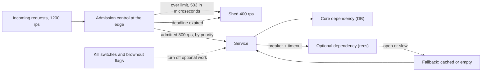

# Graceful Degradation

> [!abstract] In one sentence
> Graceful degradation is the deliberate design of what a service does when it cannot do everything — reject the excess immediately so the rest succeeds, serve the important requests first, fall back to cached, stale or simplified responses when a dependency is gone — because a server at 1,200 requests per second with capacity for 800 either serves 800 well or serves nobody, and without explicit design it serves nobody.

> [!tip] Deeper treatment in your system-design vault
> `system-design/12 Resilience/Load Shedding and Graceful Degradation.md` — read it *after* you have written your own explanation below.

**Map:** [[Observability & Reliability MOC]] → [[HLD MOC]]

## Definition

**Graceful degradation** is the property of a system that reduces its functionality or quality in a controlled way under stress — overload, partial failure, dependency outage — rather than failing completely. Its main techniques: **load shedding** (rejecting requests beyond capacity, as early and cheaply as possible, usually with `503` or `429`), **admission control** (bounding in-flight work with concurrency limits or queues with deadlines), **prioritisation** (serving critical request classes before best-effort ones), **fallbacks** (a cached or stale value, a default, a simplified computation, a degraded feature when a dependency is unavailable), and **brownout** (switching off optional features — recommendations, personalisation, non-essential writes — to reclaim capacity for the core). A **feature kill switch** is the operational handle that turns a fallback on by hand ([[Feature Flags]]).

## Problem solved

The default behaviour of a server under overload is collapse, and the arithmetic is unforgiving. A service with capacity for 800 requests per second receives 1,200. Without shedding, it accepts all 1,200: each request queues, the queue grows by 400 per second, latency climbs with queue length, and within seconds every request exceeds its client's timeout. The server is still working flat out — on requests whose callers have gone — and its goodput falls toward zero; the clients retry, and the offered load rises further ([[Retry Storms]]). With shedding, it accepts 800, rejects 400 in microseconds each, and the 800 complete with normal latency: a third of users see a fast error, two thirds see success, instead of everyone seeing a timeout. The same logic applies to dependency failure: a product page that cannot fetch recommendations can render without them, or it can wait for the timeout and return an error for a page that was 95% available. Systems that are not designed to degrade degrade anyway — catastrophically and all at once — which is why [[Fault Tolerance]] in practice is largely the engineering of degradation.

In a stack like yours, "the recommendation service is slow" and "the fraud-scoring dependency is down" should be two different, pre-decided answers: render without recommendations; queue the payment for scoring or apply a conservative rule — not a 30 s timeout on checkout.

## How it works

1. **Know the capacity and bound the work.** Measure the throughput at which latency starts to climb (the knee) and the concurrency at which goodput peaks, under load tests ([[Capacity Planning]]). Enforce a bound at the edge of the service: a concurrency limit (in-flight requests) or a bounded queue with a short maximum wait. Beyond the bound, reject immediately. Adaptive concurrency limiters (Netflix's concurrency-limits library, Envoy's adaptive concurrency filter) derive the bound from observed latency gradients rather than a static number.
2. **Shed early and cheaply.** The cost of rejecting a request should be a tiny fraction of serving it: reject at the gateway or the first middleware, before authentication, deserialisation or database work. Prefer `503` with `Retry-After` for overload and `429` for per-client limits, so well-behaved clients back off ([[Rate Limiting]]). Rejecting the request that has already exceeded its deadline is free goodput: check the propagated deadline first and drop expired work ([[Timeouts and Retries]]).
3. **Prioritise.** Classify requests (interactive versus batch, payment versus analytics, paying customer versus free tier, health checks versus everything) and shed the lowest class first. Separate pools per class so a flood of low-priority work cannot occupy the capacity reserved for high priority ([[Bulkheads]]). The CoDel-style rule of thumb for queues: if the minimum queueing delay over a window exceeds a target, start dropping.
4. **Fall back per dependency.** For each dependency decide, in advance, the behaviour when it fails or exceeds its timeout: serve from cache (possibly stale — [[Cache-Aside]] with extended TTL), return a default (empty recommendations, a conservative risk score), use a cheaper algorithm, queue the work for later ([[Message Queues]]), or fail only the part of the response that needed it. Wrap the dependency call in a [[Circuit Breakers|circuit breaker]] so that once it is known to be failing, the fallback is used instantly instead of after a timeout.
5. **Brownout optional features.** Identify work that is valuable but not essential (personalisation, non-critical writes, detailed analytics, high-resolution images) and put it behind switches that can be flipped automatically on saturation or manually during an incident. Reclaimed capacity goes to the core path.
6. **Test the degraded modes.** A fallback that has never run in production is a second outage waiting to happen (the AWS Builders' Library argues for avoiding untested fallbacks entirely and preferring always-on degraded paths). Exercise degraded modes continuously — a fraction of traffic always takes the fallback, or regular game days turn dependencies off ([[Chaos Lab]]).

```java
// Resilience4j: bulkhead + circuit breaker + fallback on a non-critical dependency
Supplier<List<Item>> recs = () -> recommendationClient.forUser(userId);
Supplier<List<Item>> guarded = Decorators.ofSupplier(recs)
    .withBulkhead(Bulkhead.of("recs", BulkheadConfig.custom().maxConcurrentCalls(50).build()))
    .withCircuitBreaker(CircuitBreaker.ofDefaults("recs"))
    .withFallback(List.of(CallNotPermittedException.class, BulkheadFullException.class, TimeoutException.class),
                  e -> cachedOrEmptyRecommendations(userId))   // degraded, never blocking the page
    .decorate();
```

## Architecture



> [!example]- Excalidraw version — the same diagram as an editable canvas
> ![[Graceful Degradation.excalidraw]]
> [[Graceful Degradation.excalidraw|Open in Excalidraw]] — needs the Excalidraw plugin (see [[Plugins to Install]]).


## Use cases

- Any user-facing service with a hard capacity and bursty traffic (flash sales, marketing pushes, incident-driven retries): shedding is what keeps the site up for most users ([[Design a Ticket Booking System]]).
- Composite responses assembled from several dependencies (feeds, product pages, dashboards): degrade the parts rather than fail the whole ([[Design a Social Feed]], [[Fan-Out]]).
- Payment and checkout flows with optional enrichments (fraud scoring tiers, loyalty, recommendations): define the conservative fallback for each ([[Design a Payment System]]).
- Platforms with tenants or request classes of different value: priority shedding protects the important work ([[Design an API Gateway]], [[Design a Rate Limiter]]).
- Dependencies with their own rate limits (PSPs, partner APIs): shedding your own excess before it reaches them avoids being throttled entirely.

## Limitations

- Degradation must be designed per feature; there is no generic fallback, and the wrong fallback (a stale balance, a default "approved") can be worse than an error.
- Shedding requires knowing capacity, which changes with code, data and hardware; static limits go stale, and adaptive ones need tuning.
- Fallbacks that run rarely rot; the AWS argument that fallbacks are a source of outages is borne out by incident history.
- Prioritisation needs a trustworthy classification of requests, which may be gamed or wrong, and it adds complexity to routing and pools.
- Users still see failures or reduced functionality; product owners must agree in advance which experiences are acceptable degraded.

## Trade-offs

| You gain | You sacrifice |
|---|---|
| Most users served under overload instead of nobody | A fraction of users deliberately rejected, visible in SLOs |
| Core functionality preserved when optional dependencies fail | Per-feature design and testing of degraded modes |
| Protection of dependencies from your own excess load | Capacity measurement and limit maintenance as ongoing work |
| Operational levers (kill switches, brownout) during incidents | Complexity in request classification, pools and feature flags |

## Failure modes

- **Collapse without shedding** — queue grows, every request times out, goodput near zero, retries amplify. You notice as 100% errors with the service fully busy; blast radius is every user and every caller ([[Retry Storms]]).
- **Fallback that fails** — the degraded path depends on something also down (a cache in the same failure domain) or has a bug nobody saw because it never ran. Noticed only during the incident; radius is the feature the fallback was meant to save ([[AWS Builders Library - Avoiding Fallback]]).
- **Wrong fallback semantics** — serving a stale balance or defaulting a risk check to "allow" during a scoring outage. Noticed by reconciliation or fraud losses; radius is every decision made on the fallback. Conservative defaults for anything with money or safety.
- **Shedding the wrong requests** — limits applied per instance without priority; health checks and payments shed alongside analytics. Noticed as readiness failures during overload (the probe was shed) and critical-path errors; separate pools and never shed probes.
- **Limit set too low or too high** — too low sheds under normal peaks; too high never sheds before collapse. Noticed as rejections at moderate load or as collapse despite "having shedding"; recalibrate from load tests after each significant change.

## Performance

A rejection at admission costs on the order of microseconds (a counter check and a small response) against milliseconds to seconds for a full request, so shedding converts wasted capacity into goodput almost for free. Bounded concurrency keeps latency near the unloaded value for admitted requests because queueing is capped; the trade is a higher error rate under overload instead of a higher latency. Fallbacks served from local or Redis cache return in sub-millisecond to low-millisecond time versus the dependency's timeout. Circuit breakers make the failing-dependency path cost nothing after they open. Brownout reclaims whatever the switched-off work consumed, which should be measured in advance so operators know what each switch buys.

## Scalability

Shedding and admission control are per-instance mechanisms that scale with the fleet; the capacity each instance protects should be set per instance and re-derived when instance sizes change. At 10x traffic, priority classes and per-tenant fairness become necessary because a single large client can consume the shed-free capacity; the gateway becomes the natural place for global admission and fair-share decisions ([[API Gateways]], [[Rate Limiting]]). Fallback sources (caches) must scale with the traffic they will absorb during a dependency outage, which is often *all* of it; a cache sized for a 90% hit rate in normal operation is not sized for serving 100% of reads.

## Operational impact

Expose shed counts, rejection reasons, breaker states, fallback-served counts and brownout flag states as metrics with dashboards and ticket-grade alerts; a rising shed rate is the earliest signal of capacity trouble ([[Monitoring]]). Kill switches need an owner, documentation of what each one turns off, and a drill schedule. Capacity limits are configuration that must be revisited after load tests and after changes to instance types or code. Incident runbooks should list the degradation levers in order of impact. Product and support need to know what degraded behaviour looks like so they can recognise it rather than report it as a bug.

## Alternatives

- **Over-provisioning and autoscaling** — enough headroom that overload never happens; wins when capacity is cheap and spikes are predictable, fails on the first unanticipated 3x surge or during the minutes autoscaling takes ([[Capacity Planning]], [[Horizontal vs Vertical Scaling]]).
- **Queue everything** — accept all requests into a durable queue and process at capacity; wins for asynchronous work where latency can become lag, loses for interactive requests that cannot wait ([[Backpressure]], [[Message Queues]]).
- **Fail completely and fast** — no degraded modes, just fast errors beyond capacity; wins for simple internal services where partial service has no value, and is still better than collapse.
- **Strict per-client rate limits** — prevent overload by capping each client; wins when the clients are known and few, and complements shedding rather than replacing it ([[Rate Limiting]]).

## Real-world examples

- The Amazon Builders' Library articles on load shedding and on avoiding fallback describe how AWS services bound work, shed excess at the front door and prefer always-exercised degraded paths over rarely run fallbacks ([[AWS Builders Library - Load Shedding]], [[AWS Builders Library - Avoiding Fallback]]).
- **Netflix** built Hystrix (later superseded by Resilience4j in the Java ecosystem) around bulkheads, circuit breakers and fallbacks, and its fault-tolerance write-up documents serving degraded personalisation rather than failing playback ([[Netflix - Fault Tolerance in a High Volume Distributed System]]).
- **Google** describes graceful degradation in search — returning results from fewer shards under overload — as a core design principle in its SRE material, and the "brownout" term comes from the same tradition.
- In a stack like yours: a concurrency limit per pod derived from load tests, enforced at the first middleware; a breaker and cached fallback around recommendation and loyalty calls; a conservative "hold for review" path when fraud scoring is unavailable; and feature flags that switch off statement generation and non-critical notifications during an incident — each with a metric showing how often it is active.

## Practical exercise

1. Build a service with a known capacity (a handler that does 10 ms of CPU-bound work per request, single worker or a fixed thread pool) in Java or TypeScript, and drive it with k6 at 1.5× capacity for two minutes.
2. Record throughput, goodput (responses within a 200 ms deadline), p99 latency and error rate with no shedding; observe latency climbing and goodput collapsing.
3. Add admission control (an in-flight counter with a limit set at the measured knee) that rejects with `503` immediately; repeat and compare goodput and latency for admitted requests.
4. Add an optional dependency (a mock recommendations service behind [[Toxiproxy]]); add a timeout, a circuit breaker and a cached fallback; inject 5 s latency and show the page still rendering within budget with recommendations marked degraded.
5. Add two request classes with separate limits and show that a flood of low-priority requests leaves the high-priority class unaffected; finally, run the fallback continuously for 1% of traffic and verify it keeps working after a code change.

## Related concepts

### Prerequisites
- [[Fault Tolerance]] — degradation is how fault tolerance looks from the user's side
- [[Timeouts and Retries]] — bounded waits are the precondition for any fallback
- [[Retry Storms]] — the collapse that shedding prevents
- [[Backpressure]] — the producer-side counterpart to shedding

### Related
- [[Capacity Planning]] — the limits shedding enforces come from here
- [[Cache Stampedes]] — stale-while-revalidate is a degradation technique
- [[Cache-Aside]] — serving stale cached data as a fallback
- [[SLI SLO and SLA]] — degraded responses need their own quality SLI
- [[Fan-Out]] — partial results from fan-out are degradation in action
- [[Feature Flags]] — kill switches and brownout controls

### Builds on this
- [[Circuit Breakers]] — the mechanism that routes to fallbacks quickly
- [[Bulkheads]] — isolating pools so degradation is per feature, not global
- [[Rate Limiting]] — per-client shedding with the same goal
- [[API Gateways]] — the natural place for global admission control

### Design problems where it applies
- [[Design a Social Feed]]
- [[Design a Payment System]]
- [[Design an API Gateway]]
- [[Design a Rate Limiter]]
- [[Design a Ticket Booking System]]

### Projects where it can be implemented
- [[Chaos Lab]]
- [[Load Test and Latency Lab]]
- [[LLM Gateway]]

### Resources
- [[AWS Builders Library - Load Shedding]] — the front-door shedding argument with the goodput arithmetic
- [[AWS Builders Library - Avoiding Fallback]] — why untested fallbacks are dangerous
- [[Release It!]] — stability patterns including fail fast and steady state
- [[Netflix - Fault Tolerance in a High Volume Distributed System]] — bulkheads, breakers and fallbacks at scale

## Personal understanding

> [!question] Explain it without the source
> Write your own explanation here, from memory. Then compare it with the sections above and note what you missed.

### Mastery checklist
- [ ] I can explain it without the original resource
- [ ] I can describe the problem it solves
- [ ] I can compare it with its alternatives
- [ ] I can name its limitations and failure modes
- [ ] I can recognise when it is appropriate in a real system
- [ ] I have applied it in a system design
- [ ] I have validated my assumptions with an experiment or implementation

## Open questions

- [ ] For each dependency of a checkout flow (IAM, fraud scoring, PSP, notifications, loyalty), what is the pre-agreed degraded behaviour, and which of them is a conservative default versus a cached value versus a queued deferral?
- [ ] What concurrency limit per pod would a load test suggest for a typical Spring Boot service of mine, and how does it change with the pod's CPU request and the JVM's thread pool size?
- [ ] Which fallbacks in the services I know have ever executed in production, and how would I make the untested ones exercise continuously on a slice of traffic?
