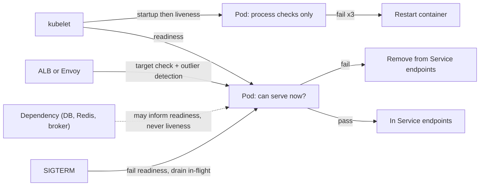

# Health Checks

> [!abstract] In one sentence
> A health check is a cheap question the platform asks each instance — "should I send you traffic?" (readiness) and "should I restart you?" (liveness) — and the whole craft is answering each question with exactly the right scope: readiness may consider whether the instance can currently do useful work, liveness must only consider whether the process itself is wedged, because a liveness check that fails on a dependency outage restarts every healthy pod at once.

> [!tip] Deeper treatment in your system-design vault
> `system-design/03 Traffic Management/Health Checks and Service Discovery.md` — read it *after* you have written your own explanation below.

**Map:** [[Observability & Reliability MOC]] → [[HLD MOC]]

## Definition

A **health check** is a probe — an HTTP endpoint, a TCP connect, a gRPC `Health/Check` call, or a command — executed periodically by an orchestrator, load balancer or service registry to decide how to treat an instance. Kubernetes distinguishes three: the **startup probe** gates the other two until the application has finished initialising; the **readiness probe** controls whether the pod receives traffic (it is added to or removed from Service endpoints); the **liveness probe** decides whether the container is restarted. Load balancers and service meshes run their own target health checks for routing ([[Load Balancers]]); registries use heartbeats or checks for deregistration ([[Service Discovery]]). A **shallow** check tests the process (it answers HTTP); a **deep** check tests dependencies (database, cache, broker reachable). Each probe has a period, a timeout, and success and failure thresholds — Kubernetes defaults are a 10 s period, 1 s timeout, 1 success, 3 failures.

## Problem solved

Something must decide when an instance should stop receiving traffic and when it should be replaced, and before explicit probes that decision was made by users hitting errors or by a human watching. Probes automate it: a crashed or wedged process is restarted, a pod still warming its caches or waiting for a connection pool is kept out of rotation, a pod being terminated drains gracefully, a rolling deploy advances only when new pods are ready ([[Deployment and Rollback Strategies]]). The pattern's own failure is as instructive as its purpose. Teams reason "if the database is down this pod is useless, so fail the health check", wire that into liveness, and then watch an RDS failover restart every pod in the deployment simultaneously, lose all warm state, and extend a 30-second blip into a ten-minute outage as the fleet restarts, re-establishes pools and thunders at the recovering database ([[Retry Storms]]). Health checks are a form of [[Failure Detection]] and inherit its central caveat: the action must be safe to take on a false positive.

In a stack like yours, every Spring Boot (Actuator) and NestJS (Terminus) service exposes health endpoints, every Deployment has probes, and the ALB has its own target checks; whether those agree with each other, and what each one includes, is decided per service and rarely reviewed.

## How it works

1. **Liveness: "is the process wedged?"** The check must be *internal only*: the HTTP server answers, the event loop is not blocked, no deadlock is detected (Actuator can wire a deadlock detector; a Node service can test that a timer fires). It must never depend on a database, cache, broker or other service. A failing liveness probe restarts the container, so a false positive costs a restart and a correlated false positive across the fleet costs an outage. Set generous thresholds (several failures over tens of seconds) and a timeout larger than the worst GC pause.
2. **Readiness: "can this instance do useful work right now?"** It may consider dependencies, but with care: fail readiness when the pod cannot serve *any* request usefully (no database connection pool at all, configuration not loaded, cache warming in progress), not when one optional dependency is slow. Readiness removes the pod from endpoints; if every pod fails readiness because a shared dependency is down, the Service has no endpoints and *all* traffic fails fast — which may be exactly right (fail fast rather than time out) or exactly wrong (the service could have served cached or degraded responses). Decide explicitly, and consider returning degraded responses with the pod still ready ([[Graceful Degradation]]).
3. **Startup: "has initialisation finished?"** A startup probe with a long failure budget (`failureThreshold × periodSeconds` covering the slowest cold start — JVM warm-up, large cache loads) protects slow starters from being killed by liveness before they are up, and lets liveness thresholds stay tight afterwards.
4. **Graceful shutdown.** On `SIGTERM`, the pod should fail readiness immediately (or rely on the endpoint removal) and keep serving in-flight requests until they finish or `terminationGracePeriodSeconds` elapses; a `preStop` sleep of a few seconds covers the propagation delay between endpoint removal and load balancers actually stopping new connections. Spring Boot's `server.shutdown=graceful` and NestJS's `enableShutdownHooks` implement the application side ([[Keep-Alive Connections]] complicate this: long-lived connections must be closed by the server).
5. **Load balancer and mesh checks.** The ALB or Envoy checks a target independently (a path, an interval, healthy and unhealthy thresholds), and additionally uses **passive** health (outlier detection: eject a host after consecutive 5xx responses from real traffic). Keep the LB check aligned with readiness semantics and make the path cheap and unauthenticated.
6. **Make checks cheap and honest.** A health endpoint hit every 10 s by several probers per pod must not run a heavy query or allocate; it must not be cached so long that it lies; it must not require authentication; and it should expose *detail* for humans (which component is down) only on an internal endpoint, with the probe endpoint returning just the status (Spring Boot Actuator's `/actuator/health/liveness` and `/readiness` groups follow this split).

```yaml
# Kubernetes probes: liveness is internal-only; readiness may consider dependencies; startup covers cold start
startupProbe:
  httpGet: { path: /actuator/health/liveness, port: 8080 }
  periodSeconds: 5
  failureThreshold: 36          # up to 3 minutes to start
livenessProbe:
  httpGet: { path: /actuator/health/liveness, port: 8080 }
  periodSeconds: 10
  timeoutSeconds: 3             # above worst-case GC pause
  failureThreshold: 3
readinessProbe:
  httpGet: { path: /actuator/health/readiness, port: 8080 }
  periodSeconds: 5
  failureThreshold: 2
```

## Architecture



> [!example]- Excalidraw version — the same diagram as an editable canvas
> ![[Health Checks.excalidraw]]
> [[Health Checks.excalidraw|Open in Excalidraw]] — needs the Excalidraw plugin (see [[Plugins to Install]]).


## Use cases

- Every service on Kubernetes or behind a load balancer: probes are how the platform knows what to do with an instance ([[Load Balancers]]).
- Rolling and canary deployments: readiness gates traffic to new pods and `maxUnavailable` relies on accurate readiness ([[Deployment and Rollback Strategies]]).
- Slow-starting services (JVM with large heaps, cache-warming, model loading): startup probes prevent restart loops.
- Draining for zero-downtime deploys and node maintenance: readiness-off plus graceful shutdown ([[Connection Pooling]] on the client side must also tolerate server-initiated close).
- Stateful or singleton workloads where readiness means "I hold the lease" — only the leader is ready ([[Leader Election]]).

## Limitations

- A probe sees one moment every few seconds from one vantage point (the kubelet on the same node); it does not see what clients experience across the network ([[Failure Detection]] on gray failure).
- Readiness is binary; a service that is 50% capable (one dependency degraded) must choose between "ready and partially failing" and "not ready and fully unavailable" — degraded modes need application logic, not probes.
- Deep readiness checks against shared dependencies are correlated across the fleet; they convert a dependency outage into complete unavailability, which may be worse than partial service.
- Probes consume request capacity on the health path and can mask problems if the health path is simpler than real traffic (the process answers `/health` while every real request times out).
- Liveness restarts are a blunt tool: they fix wedged processes and make everything else worse (lost warm caches, pool re-establishment, cascading load).

## Trade-offs

| You gain | You sacrifice |
|---|---|
| Automatic removal of broken instances from traffic and automatic restart of wedged ones | Correlated false positives that can take the whole fleet out at once |
| Safe rolling deploys gated on readiness | Deploy duration bounded by startup and readiness timing |
| A platform-level answer to "is this instance usable" | Nuance: degraded states need application logic beyond a boolean |
| Clean draining with graceful shutdown | Shutdown complexity: in-flight requests, long-lived connections, propagation delays |

## Failure modes

- **Liveness restart storm** — liveness checks a dependency; the dependency blips; every pod is restarted within one probe window; the fleet comes back cold and overloads the dependency again. You notice as a wave of container restarts (`kube_pod_container_status_restarts_total`) correlated with a dependency event; blast radius is the whole service and the dependency ([[Retry Storms]]).
- **Readiness blackout** — deep readiness fails on a shared dependency; the Service has zero endpoints; the gateway returns 503 for everything including requests that would have been served from cache. Noticed as 100% errors with all pods running; decide per dependency whether it belongs in readiness.
- **Liveness timeout under GC pause** — a 2 s stop-the-world pause exceeds a 1 s timeout; the pod is killed mid-request. Noticed as restarts correlated with GC logs; raise timeout and thresholds above observed pauses.
- **Non-graceful shutdown** — pod terminated while in-flight requests run; clients see connection resets during every deploy. Noticed as error spikes aligned with rollouts; fix with readiness-off, `preStop`, and graceful shutdown.
- **Health path lies** — `/health` returns 200 from a tiny handler while the request path is deadlocked on a pool; the LB keeps routing. Noticed from client errors with "healthy" targets; add a check of the actual request path (a self-request through the real middleware) or rely on passive outlier detection.

## Performance

A probe is a small HTTP request every few seconds per prober; with kubelet probes plus an ALB check plus a mesh check, a pod might answer one health request per second — negligible if the handler is trivial, harmful if it queries a database each time. Cache dependency check results for a few seconds inside the health endpoint if readiness includes them. Detection latency is `periodSeconds × failureThreshold` plus propagation: with the defaults (10 s × 3) an unready pod can receive traffic for about 30 s; shorter periods detect faster at the cost of more probe traffic and more false positives. Endpoint removal propagates to kube-proxy and load balancers in seconds, hence the `preStop` sleep.

## Scalability

Probe load scales with pods times probers, which is fine up to very large fleets if handlers are cheap. The risk at scale is correlation: a check that depends on something shared (a database, a config service, DNS) produces fleet-wide transitions at once; at 10x pods, a readiness flap re-sends endpoint updates to every node and every load balancer, which is itself load on the control plane. Keep readiness local where possible and let [[Graceful Degradation]] handle shared-dependency outages. Passive health (outlier detection from real traffic) scales better than active probes for catching request-path failures ([[Service Discovery]]).

## Operational impact

Define the three probes for every service from a template, with liveness internal-only enforced by code review; keep the detailed health view (per-component status) on an internal endpoint for humans and dashboards ([[Monitoring]]). Alert on restart rate and on readiness flapping, not on individual failures. Review probe timeouts against observed GC and event-loop pauses after JVM or heap changes. Test shutdown behaviour under load in staging (deploy while a load test runs and count errors). Document, per dependency, whether its outage should make the service unready or degraded, and make the health endpoint reflect that decision.

## Alternatives

- **Passive health only (outlier detection)** — eject instances based on real-traffic errors and latency; wins for catching request-path failures that probes miss, and is complementary rather than a replacement on Kubernetes ([[Circuit Breakers]] are the client-side form).
- **Heartbeats to a registry** — instances push "I am alive" to a service registry which deregisters on silence; wins for non-Kubernetes fleets and for services behind client-side discovery ([[Service Discovery]], [[Failure Detection]]).
- **No liveness probe** — only readiness and startup; a surprisingly good default for services that do not wedge, since it eliminates the restart-storm class entirely; add liveness only for known deadlock or leak behaviour.
- **Synthetic end-to-end checks** — external probes of real user paths; win for knowing the service works, not for per-instance routing decisions ([[Monitoring]]).

## Real-world examples

- **Kubernetes** documentation explicitly warns against liveness probes that depend on other services and recommends startup probes for slow starters — guidance written after many restart-storm incidents.
- **Spring Boot Actuator** separates liveness and readiness into distinct health groups (`/actuator/health/liveness`, `/readiness`) with Kubernetes-aware defaults, and its readiness state is wired to the application lifecycle so it flips during graceful shutdown.
- **Envoy** implements both active health checking and outlier detection (consecutive 5xx, success-rate ejection) and documents the interaction between them, which is the model most service meshes follow.
- In a stack like yours: Actuator and NestJS Terminus liveness groups with no dependency indicators, readiness including the PostgreSQL pool and configuration load but not Redis (serve without cache) or the PSP (fail individual requests, not the pod), startup probes sized for JVM cold start, a 5 s `preStop` sleep with graceful shutdown enabled, and ALB target checks pointed at the readiness path.

## Practical exercise

1. Deploy a small Spring Boot or NestJS service to a local Kubernetes (kind or minikube) with PostgreSQL, three replicas, and probes that check the database in *both* liveness and readiness.
2. Stop PostgreSQL for 60 s and watch `kubectl get pods -w`: observe all pods restarting, the time to recover after the database returns, and the error burst from pool re-establishment.
3. Move the database check out of liveness; repeat and observe pods staying up but unready (Service with zero endpoints, 503s from the gateway); then make the service return cached or degraded responses with readiness still passing and compare the user-visible behaviour.
4. Run a k6 load test and trigger a rolling deploy: count errors with and without `preStop` sleep and graceful shutdown; measure how long a terminating pod keeps receiving requests.
5. Induce a 2 s pause (`kill -STOP`, then `-CONT`, or a GC-heavy allocation burst) and tune `timeoutSeconds` and `failureThreshold` until no false restarts occur; record the detection time for a genuinely wedged process (block the event loop or deadlock a thread).

## Related concepts

### Prerequisites
- [[Load Balancers]] — the consumer of target health
- [[Failure Detection]] — probes are detectors with a timeout's false positives
- [[Fault Tolerance]] — what probes are meant to provide and can undermine

### Related
- [[Service Discovery]] — registries and endpoints driven by readiness
- [[Monitoring]] — the richer view of health that probes summarise to a boolean
- [[Alerting]] — restart rate and readiness flapping as ticket-grade alerts
- [[Circuit Breakers]] — client-side passive health for dependencies
- [[Timeouts and Retries]] — probe timeouts versus real-path timeouts
- [[Connection Pooling]] — pools and warm state lost on every restart

### Builds on this
- [[Service Discovery]] — endpoint membership is readiness
- [[Deployment and Rollback Strategies]] — rollouts advance on readiness and drain on shutdown
- [[Graceful Degradation]] — the alternative to "unready" when a dependency is down

### Design problems where it applies
- [[Design an API Gateway]]
- [[Design a Distributed Cache]]
- [[Design a Chat System]]
- [[Design a Distributed Job Scheduler]]

### Projects where it can be implemented
- [[Chaos Lab]]
- [[Presence and Chat Service]]
- [[Webhook Relay]]

### Resources
- [[Site Reliability Engineering (Google)]] — health, load balancing and the cost of correlated failure
- [[Release It!]] — stability patterns including the dangers of coupled health checks
- [[Understanding Distributed Systems]] — failure detection and the limits of a probe's view

## Personal understanding

> [!question] Explain it without the source
> Write your own explanation here, from memory. Then compare it with the sections above and note what you missed.

### Mastery checklist
- [ ] I can explain it without the original resource
- [ ] I can describe the problem it solves
- [ ] I can compare it with its alternatives
- [ ] I can name its limitations and failure modes
- [ ] I can recognise when it is appropriate in a real system
- [ ] I have applied it in a system design
- [ ] I have validated my assumptions with an experiment or implementation

## Open questions

- [ ] Which services I know include a database, Redis or IAM check in their liveness probe today, and what happened to them during the last dependency failover?
- [ ] For a service whose main dependency is a PSP, is it better for readiness to ignore the PSP and fail requests individually, or to pull the pod when the PSP is unreachable — and does the answer change when a fallback PSP exists?
- [ ] How long does ALB target deregistration actually take compared with Kubernetes endpoint removal on EKS, and what `preStop` delay makes deploys error-free under load?
