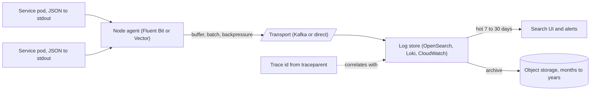

# Logging

> [!abstract] In one sentence
> Logging records what a process did as structured, leveled, correlated events that a central system can search, which makes it the tool for answering "what happened to request X" — provided you log the right fields, never the wrong ones (secrets, PII), control the volume with levels and sampling, and keep metrics and traces for the questions logs answer badly.

> [!tip] Deeper treatment in your system-design vault
> `system-design/13 Observability/Logs Metrics and Traces.md` — read it *after* you have written your own explanation below.

**Map:** [[Observability & Reliability MOC]] → [[HLD MOC]]

## Definition

A **log** is an append-only sequence of timestamped event records emitted by a process. **Structured logging** emits each record as a machine-parseable object (usually one JSON object per line) with a fixed set of fields — timestamp, level, service, message, and context such as `request_id`, `trace_id`, `user_id`, `order_id` — instead of free text. **Levels** (`DEBUG`, `INFO`, `WARN`, `ERROR`) classify severity and gate volume. **Correlation** means every record from one request, across threads and services, carries the same identifier so the records can be reassembled. **Centralisation** ships records from every instance to a store (Elasticsearch/OpenSearch, Loki, CloudWatch Logs, a data lake) where they are indexed, searched and retained for a defined period. Logs are one of the three observability signals alongside [[Metrics]] (aggregated numbers) and [[Tracing]] (causal timing per request).

## Problem solved

Before structured, centralised logging, debugging production meant `ssh` into one of thirty pods, `grep` a text file for a user's id, hope the request hit that pod, and parse messages whose format differed per developer. Logs rotated away before the incident was investigated; a pod that was restarted took its evidence with it; multi-service requests could not be followed because nothing tied the lines together. Structured fields make "show me every event for `order_id=42` in the last hour across all services" a query rather than a hunt; correlation ids make a request traceable through a fleet; central retention survives pod churn. At the same time, logging done badly is a production risk in its own right: synchronous writes that block the request thread, `DEBUG` left on in production generating gigabytes per hour, a stack trace per failed request during an outage that fills the disk, and — the one with legal consequences — card numbers, tokens and personal data written to a store with a different access policy from the database ([[Secrets Management]], [[Audit Logs]]).

In a stack like yours, a payment that failed is explained by the log line that carries its `payment_id`, the PSP's response code and the trace id — and nothing else needs to be in that line.

## How it works

1. **Emit structured records.** Use a logger that outputs JSON with consistent keys (Logback with the logstash encoder or Log4j2 JSON layout in Spring Boot; pino in NestJS). Put context in fields, not in the message string: `{"msg":"payment captured","payment_id":"p_42","amount_minor":1999,"psp":"adyen","latency_ms":212}` rather than `"Captured payment p_42 for 19.99 via adyen in 212ms"`. Field names should be shared across services (`trace_id`, `request_id`, `user_id`) so queries work fleet-wide.
2. **Propagate context.** Set the request id and trace id once at the edge (or accept the incoming `traceparent`) and attach them to every record in that request via MDC (Java) or `AsyncLocalStorage` (Node). Carry the ids into message headers so consumers' logs join the same story ([[Distributed Tracing]]).
3. **Choose levels deliberately.** `ERROR` is something a human should look at; `WARN` is something unexpected but handled; `INFO` is business-level milestones (request completed, payment captured, consumer rebalanced); `DEBUG` is for development and must be off by default in production, with a runtime switch per service or per request. One record per request at `INFO` with the outcome, status, latency and ids is the backbone; everything else is optional.
4. **Never log secrets or PII.** Enforce with a deny-list in the encoder (mask fields named `password`, `authorization`, `card_number`, `pan`, `cvv`, `token`), structured logging so fields can be masked by name, and a review rule that request and response bodies are never logged wholesale. Logs are copied, retained and shared more widely than databases; treat anything in them as exposed ([[Encryption at Rest and in Transit]] does not help once the data is in a search index).
5. **Write to stdout, ship asynchronously.** Containers write JSON lines to stdout; a node-level agent (Fluent Bit, Vector, the CloudWatch agent) tails container logs and ships them with buffering and backpressure, so the application never blocks on a remote log store ([[The Twelve-Factor App]] treats logs as event streams). In-process async appenders with a bounded queue drop or block when the queue is full — choose drop for `DEBUG`/`INFO`, never silently drop `ERROR`.
6. **Control volume.** Sample high-volume `INFO` records (keep 1 in N for successful requests, 100% of errors), rate-limit repeated identical errors (log the first, then a count), and set per-service retention by value (7 days hot for most, 30–90 days for payment flows, archived to object storage after). Cost scales linearly with bytes ingested and indexed; cloud log services bill per GB ingested and per GB-month retained, with list prices on the order of tens of cents per GB ingested, so a service emitting 1 KB per request at 1,000 requests per second produces about 7 TB a month ([[Data Retention and Archival]]).
7. **Query by fields, not by regex.** Indexed fields make `service=payments AND level=ERROR AND psp=adyen` fast; full-text search over the message is the fallback ([[Inverted Indexes]]).

```json
{"ts":"2026-10-19T10:42:07.113Z","level":"INFO","service":"payments","env":"prod",
 "trace_id":"4bf92f3577b34da6a3ce929d0e0e4736","request_id":"req_8f1","user_id":"u_17",
 "msg":"payment captured","payment_id":"p_42","amount_minor":1999,"currency":"GBP",
 "psp":"adyen","psp_status":"Authorised","latency_ms":212}
```

## Architecture



> [!example]- Excalidraw version — the same diagram as an editable canvas
> ![[Logging.excalidraw]]
> [[Logging.excalidraw|Open in Excalidraw]] — needs the Excalidraw plugin (see [[Plugins to Install]]).


## Use cases

- "We need to explain exactly what happened to this request / payment / job" — the per-event detail that aggregates cannot give ([[Production Incident Analysis]]).
- "Support must see a customer's recent activity and errors" — field-indexed logs by `user_id`, with PII rules satisfied.
- "Regulators require a record of who did what" — this is an [[Audit Logs|audit log]], a separate stream with stricter integrity and retention, built on the same mechanics.
- "Consumers process events asynchronously and we must follow one event across services" — correlation ids through message headers.
- Debugging rare, data-dependent failures where metrics show a 0.1% error rate and nothing else: the log line with the error, the input shape and the trace id is the only lead.

## Limitations

- Logs do not tell you whether the system is healthy: counting `ERROR` lines is a poor availability metric (one bad request can log ten errors, a hung request logs nothing). Use [[Metrics]] for health and logs for explanation.
- Volume and cost grow with traffic, verbosity and retention, and the bill arrives after the fact; logging is the easiest observability cost to let run away.
- Unstructured or inconsistently named fields make cross-service queries impossible; the value of centralisation depends on discipline that is hard to retrofit.
- Logs are a security and privacy liability by default; every field is a potential leak, and access control on log stores is usually weaker than on databases.
- Latency attribution across services is awkward in logs (you reconstruct timing from timestamps on different clocks); [[Tracing]] exists for that.

## Trade-offs

| You gain | You sacrifice |
|---|---|
| Per-event detail that explains any specific failure | Bytes ingested and retained, which is the largest observability cost line |
| Cross-service reconstruction of one request via correlation ids | Discipline in naming, propagation and level hygiene across every team |
| A query interface instead of `ssh` and `grep` | A log pipeline (agents, transport, store) to run and protect |
| A permanent record for support, audit and postmortems | A data store full of sensitive fields that needs masking, access control and retention policy |

## Failure modes

- **Log flood during an outage** — every failing request logs a stack trace; disk fills on nodes, the agent falls behind, the log store rejects writes or the bill spikes. You notice as missing logs exactly when you need them, or as a cost alert days later; blast radius is observability for the whole cluster during the incident. Rate-limit repeated errors and sample.
- **Blocking appender** — a synchronous appender to a slow sink (or a full bounded queue configured to block) stalls request threads; the service's latency rises because logging is slow. Noticed as latency correlated with log-store health; radius is the service.
- **Secret in the logs** — a request body with a card number or an `Authorization` header logged at `DEBUG`, shipped and indexed. Noticed in a security review or a breach; radius is every environment that received the logs plus their backups. Requires rotation of exposed credentials and a purge.
- **Lost correlation** — a thread pool or async hop drops the MDC context; records from the downstream half of a request have no `trace_id`. Noticed when a query returns half a story; fixed by context-propagating executors and instrumented message clients.
- **Clock skew across services** — ordering log lines by timestamp across machines shows effects before causes. Noticed as confusing timelines; use trace ids and span ordering for causality ([[Clocks and Time]]).

## Performance

A structured log record costs microseconds to serialise and is written to a buffer; the cost that matters is bytes. At 1 KB per record, 1,000 records per second per pod is 1 MB/s per pod and tens of terabytes per month across a fleet, which drives agent CPU, transport bandwidth, store indexing CPU and retained storage. Indexing cost in search-based stores scales with the number of indexed fields; label-based stores (Loki) index only labels and grep the rest, which is cheaper to ingest and slower to search. Sampling successful request logs at 1–10% typically removes most of the volume while keeping every error and every traced request.

## Scalability

Log volume scales with request rate times verbosity, so it grows faster than the business unless verbosity is actively reduced. At 10x, the levers are: sampling at the source, moving per-request detail into traces (sampled by design) and keeping logs for errors and milestones, tiered retention (hot search for days, cold object storage for months), and a buffered transport (Kafka or a disk-buffered agent) so a slow store does not back up into applications ([[Design a Logging System]]). Field cardinality (high-cardinality fields like `user_id`) is fine in logs — that is their role — and is the reason they cost more than metrics.

## Operational impact

The pipeline is a production system: monitor agent lag, dropped records, store ingestion errors and disk usage, and alert on "no logs received from service X" because silence usually means the pipeline broke, not that the service is quiet. Enforce a schema (shared field names, a masking deny-list, level guidelines) through a shared logging library per language rather than a wiki page. Retention and access control need an owner: who can read payment logs, for how long, and how PII is purged on request. During incidents, know how to raise a service's level at runtime (an actuator endpoint or a config flag) and how to lower it again ([[Feature Flags]] for log verbosity is a legitimate use).

## Alternatives

- **Metrics** — aggregated counters and histograms; win for health, alerting and dashboards, at a tiny fraction of the cost ([[Metrics]]).
- **Distributed traces** — per-request timing and causality with built-in sampling; win for latency attribution and cross-service flow, and can carry events as span attributes, replacing much `INFO` logging ([[Distributed Tracing]]).
- **Wide events / canonical log lines** — emit exactly one rich record per request with every relevant field, instead of many lines; wins by making volume predictable and queries simple, and is the direction most observability vendors push.
- **Event sourcing / audit streams** — when the record is a business artefact rather than a debugging aid, store it as domain events with integrity guarantees ([[Event Sourcing]], [[Audit Logs]]).

## Real-world examples

- **The Twelve-Factor App** codified "treat logs as event streams": write to stdout, let the environment route and store them, which is exactly how containers and Kubernetes work today ([[The Twelve-Factor App]]).
- **Stripe** popularised the "canonical log line" — one structured record per request carrying every important field — as the primary debugging and analytics artefact, reducing log volume and making queries predictable.
- **OpenTelemetry** defines a logs data model and bridges existing loggers so that logs, metrics and traces share resource attributes and trace context, which is what makes correlation work across vendors ([[OpenTelemetry Observability Primer]]).
- In a stack like yours: Spring Boot services with Logback's logstash encoder and NestJS services with pino, both emitting the same field names, propagating `trace_id` from the gateway through Kafka or SQS headers, masking `authorization` and PAN-like fields at the encoder, and shipped by Fluent Bit to OpenSearch or CloudWatch with 14 days hot and an S3 archive — with one `INFO` line per request and errors sampled at 100%.

## Practical exercise

1. Build a two-service chain (NestJS with pino, or Spring Boot with the logstash encoder) where service A calls service B, both logging JSON to stdout with `trace_id` propagated via `traceparent`.
2. Run them in Docker Compose with Fluent Bit shipping to OpenSearch (or Loki with Grafana); query by `trace_id` and show both services' records for one request.
3. Add a message hop (Redis Streams or Kafka) between A and B carrying the trace id in a header; confirm the consumer's records join the same query, then remove the header and observe the broken correlation.
4. Log a fake `Authorization` header at `DEBUG`, enable `DEBUG`, and find it in the store; then add a masking rule in the encoder and verify it is redacted at the source.
5. Load-test at 500 requests per second for 10 minutes with and without 10% sampling of successful-request logs; measure bytes ingested, store disk growth and query latency, and compute the monthly cost at a public per-GB price.

## Related concepts

### Prerequisites
- [[Throughput]] — log volume is request rate times bytes per record
- [[Latency]] — synchronous logging adds to the request path

### Related
- [[Metrics]] — the signal for health; logs are for explanation
- [[Tracing]] — the signal for timing and causality within a request
- [[Distributed Tracing]] — correlation ids and context propagation across services
- [[Monitoring]] — dashboards and alerts should rarely be built on log counts
- [[Secrets Management]] — what must never appear in a log line
- [[Data Retention and Archival]] — tiering and purging log storage

### Builds on this
- [[Audit Logs]] — a tamper-evident, access-controlled stream built with the same mechanics
- [[Distributed Tracing]] — assumes structured records that carry trace context
- [[Production Incident Analysis]] — postmortem timelines are reconstructed from logs
- [[Monitoring]] — log-derived metrics and alerts for conditions metrics cannot express

### Design problems where it applies
- [[Design a Logging System]]
- [[Design a Payment System]]
- [[Design a Metrics and Monitoring System]]
- [[Design an IAM Service]]

### Projects where it can be implemented
- [[Live Ops Dashboard]]
- [[Chaos Lab]]
- [[Webhook Relay]]

### Resources
- [[OpenTelemetry Observability Primer]] — the logs data model and how it correlates with traces
- [[Site Reliability Engineering (Google)]] — logs' place among the signals and in incident response
- [[The Twelve-Factor App]] — logs as event streams
- [[Google SRE Book - Monitoring Distributed Systems]] — why logs are not the monitoring signal

## Personal understanding

> [!question] Explain it without the source
> Write your own explanation here, from memory. Then compare it with the sections above and note what you missed.

### Mastery checklist
- [ ] I can explain it without the original resource
- [ ] I can describe the problem it solves
- [ ] I can compare it with its alternatives
- [ ] I can name its limitations and failure modes
- [ ] I can recognise when it is appropriate in a real system
- [ ] I have applied it in a system design
- [ ] I have validated my assumptions with an experiment or implementation

## Open questions

- [ ] What fraction of a typical service's log bytes are successful-request `INFO` lines that a 5% sample or a per-request canonical line would replace, and what would that save per month?
- [ ] How does MDC or `AsyncLocalStorage` context survive Kafka consumer threads, `@Async` executors and NestJS queue workers in the codebases I work on, and where is correlation silently lost today?
- [ ] Which log fields in a payments service would a data-protection review classify as PII, and is the masking enforced at the encoder or left to developer discipline?
