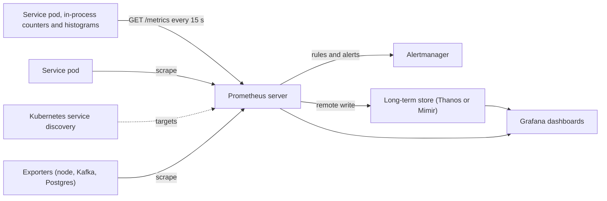

# Metrics

> [!abstract] In one sentence
> Metrics are numbers sampled over time — request counts, error counts, latency histograms, queue depths, saturation — aggregated in the process and stored as labelled time series, which makes them the cheapest signal for dashboards and alerts and the one that answers "is it healthy, and how healthy" rather than "what happened to request X".

> [!tip] Deeper treatment in your system-design vault
> `system-design/13 Observability/Logs Metrics and Traces.md` — read it *after* you have written your own explanation below.

**Map:** [[Observability & Reliability MOC]] → [[HLD MOC]]

## Definition

A **metric** is a named numeric measurement recorded over time, identified by its name plus a set of **labels** (key–value dimensions such as `service`, `route`, `status`, `pod`), each unique combination forming a **time series**. The core instrument types: a **counter** only increases (requests served, bytes sent, errors), and its value is useful only as a rate over a window; a **gauge** goes up and down (queue depth, in-flight requests, memory in use, temperature); a **histogram** counts observations into predefined buckets (latency under 5 ms, 10 ms, 25 ms, …) plus a sum and a count, so percentiles can be estimated and *aggregated across instances*; a **summary** computes quantiles in-process and cannot be aggregated. Metrics are collected by pull (Prometheus scrapes `/metrics`) or push (StatsD, OTLP to a collector) and stored in a [[Time-Series Databases|time-series database]].

## Problem solved

A system with no numbers is run by anecdote: "it feels slow", "we had some errors last night". Logs can be counted, but counting logs at scale is slow and expensive, and a hung request logs nothing. Metrics give every instance a cheap way to say *how many*, *how fast* and *how full*, pre-aggregated so a thousand pods' worth of data is a few thousand series rather than a billion events, queryable in milliseconds for dashboards and evaluated every few seconds for alerts ([[Monitoring]], [[Alerting]]). They also solve a subtler problem: averages hide tails. The mean latency of a service with 99% of requests at 10 ms and 1% at 5 s is about 60 ms, which looks fine and is not; histograms make the p99 visible and, crucially, make it possible to compute the p99 *across* a fleet, which averaging per-pod p99s cannot do ([[Latency]]).

In a stack like yours, the request rate, error rate and latency histogram per route on every service, plus consumer lag and connection-pool saturation, are the numbers an on-call engineer reads first; everything else is a follow-up.

## How it works

1. **Instrument with the right type.** Count events with counters (`http_requests_total{route,method,status}`), measure levels with gauges (`db_pool_in_use`), measure distributions with histograms (`http_request_duration_seconds` with buckets chosen to bracket your SLO thresholds). Spring Boot's Micrometer and Node's `prom-client` expose these with a few lines, and auto-instrumentation covers HTTP, JDBC, Kafka clients and the JVM or event loop.
2. **Follow a method so the set is complete.** **RED** for request-driven services: Rate (requests per second), Errors (failed per second), Duration (latency distribution). **USE** for resources: Utilisation (fraction of time busy), Saturation (queue length or waiting work), Errors. The **four golden signals** — latency, traffic, errors, saturation — are the same idea phrased for any service. Every service should have RED per endpoint; every resource it depends on (pool, queue, disk, CPU) should have USE.
3. **Choose labels for aggregation, not identification.** A label's values should be a small, bounded set: route templates (`/orders/{id}`, not `/orders/42`), status classes, pod names, regions. The number of series is the product of all label cardinalities, and each series costs memory and storage in the TSDB; a `user_id` label on a request counter creates a series per user and takes down the metrics system. High-cardinality context belongs in logs and traces ([[Logging]], [[Tracing]]).
4. **Compute rates and percentiles at query time.** Counters are stored as monotonic totals and turned into rates with `rate(counter[5m])`, which survives restarts (resets are detected). Percentiles come from histogram buckets: `histogram_quantile(0.99, sum by (le) (rate(http_request_duration_seconds_bucket[5m])))` sums the bucket counts across all pods first and then interpolates — the only correct way to get a fleet-wide p99. Never average percentiles; a mean of per-pod p99s is not a p99 of anything.
5. **Collect and store.** Prometheus scrapes each instance every 15–60 s (discovery from Kubernetes endpoints), stores locally with compression (about 1–2 bytes per sample is typical with Gorilla-style encoding), and is paired with a long-term store (Thanos, Cortex/Mimir, or a managed service) for retention beyond weeks ([[Gorilla Time-Series Paper]]). OpenTelemetry's metrics SDK can push the same data via a collector to any backend.
6. **Derive SLIs.** `sum(rate(requests{status!~"5.."}[5m])) / sum(rate(requests[5m]))` is an availability SLI; the fraction of histogram observations under a threshold (`bucket{le="0.3"} / count`) is a latency SLI. Metrics are the raw material of [[SLI SLO and SLA|SLOs]] and burn-rate alerts.

```promql
# fleet-wide p99 latency per route, correctly aggregated from histogram buckets
histogram_quantile(0.99,
  sum by (le, route) (rate(http_server_requests_seconds_bucket{service="payments"}[5m])))

# error ratio SLI over 5 minutes
sum(rate(http_server_requests_seconds_count{service="payments",status=~"5.."}[5m]))
  / sum(rate(http_server_requests_seconds_count{service="payments"}[5m]))
```

## Architecture



> [!example]- Excalidraw version — the same diagram as an editable canvas
> ![[Metrics.excalidraw]]
> [[Metrics.excalidraw|Open in Excalidraw]] — needs the Excalidraw plugin (see [[Plugins to Install]]).


## Use cases

- "We need dashboards and alerts for every service" — RED per endpoint and USE per resource is the baseline for any production service ([[Monitoring]]).
- "Define SLOs and alert on burn rate" — SLIs are ratios of metrics ([[SLI SLO and SLA]], [[Error Budgets]]).
- "Know our capacity ceiling and when we approach it" — saturation gauges and utilisation trends feed [[Capacity Planning]] and autoscaling.
- "Find the bottleneck" — per-component latency histograms and saturation locate where time goes before you reach for traces ([[Bottleneck Analysis]]).
- "Track consumer lag, queue depth, pool usage, cache hit ratio" — operational gauges that reveal problems before users do ([[Consumer Groups]], [[Connection Pooling]]).

## Limitations

- Metrics are aggregates: they tell you that 0.3% of requests failed, not which ones or why; you need logs or traces for the specific case.
- Label cardinality is a hard constraint, so metrics cannot carry per-user, per-order or per-session dimensions.
- Scrape intervals (15–60 s) and rate windows (1–5 min) smooth spikes; a 2 s outage may be invisible, and the first alert is minutes after onset.
- Histogram bucket boundaries are fixed at instrumentation time; a p99 that falls between buckets is interpolated, and a distribution that moves outside the bucket range is lost (native/exponential histograms in Prometheus and OpenTelemetry address this).
- Metrics about a process stop when the process hangs; absence of data must itself be alerted on.

## Trade-offs

| You gain | You sacrifice |
|---|---|
| Cheap, pre-aggregated numbers queryable in milliseconds across the fleet | Per-event detail and any high-cardinality dimension |
| Correct fleet-wide percentiles from histograms | Bucket boundaries chosen up front and interpolation error between them |
| A stable basis for SLOs, alerts and capacity trends | Discipline about label sets, naming and cardinality in every service |
| Low storage cost per sample with time-series compression | Smoothing from scrape intervals and rate windows that hides short spikes |

## Failure modes

- **Cardinality explosion** — a label with unbounded values (user id, raw URL, error message) creates millions of series; Prometheus memory climbs until it is OOM-killed and every dashboard goes dark. You notice as TSDB memory alerts and `scrape_samples_scraped` jumping; blast radius is all monitoring. Relabel or drop at scrape, and lint instrumentation.
- **Averaged percentiles** — a dashboard shows `avg(p99)` across pods and the fleet p99 looks healthy while one route is at 5 s. Noticed when users complain while graphs are green; the fix is histogram aggregation by `le`.
- **Scrape failures hidden** — targets are down or the `/metrics` endpoint times out under load; graphs show gaps or stale values, and rate-based alerts silently stop firing. Noticed only if `up == 0` is alerted; radius is every alert on that service.
- **Counter reset misread** — a dashboard graphs a raw counter instead of a rate; restarts look like drops to zero and growth looks like a trend. Noticed as sawtooth graphs; always use `rate` or `increase`.
- **Metric endpoint as an attack or load surface** — `/metrics` exposed publicly or scraped too often with huge histograms; CPU spent serialising. Noticed as periodic CPU spikes aligned to scrape intervals; restrict and tune.

## Performance

In-process, incrementing a counter or observing a histogram is a few nanoseconds to tens of nanoseconds (an atomic add; histograms add a bucket lookup), negligible at any request rate. Serialising `/metrics` costs milliseconds per scrape proportional to the number of series exposed — thousands of series per pod is fine, hundreds of thousands is not. Storage: Prometheus compresses to on the order of 1–2 bytes per sample, so a million series scraped every 15 s is about 5–10 GB per day before long-term downsampling. Query cost scales with series matched times samples in the range; dashboards over millions of series need pre-computed recording rules.

## Scalability

Series count, not request rate, is the scaling dimension: 10x traffic costs nothing extra in metrics, but 10x services or 10x label values does. Scale by sharding scrape targets across Prometheus instances, federating or remote-writing to a horizontally scalable store (Thanos, Mimir, Cortex), using recording rules to pre-aggregate hot queries, and downsampling old data. Keep per-pod labels out of long-term aggregates where fleet-level numbers suffice. Exemplars (a trace id attached to a histogram bucket sample) let metrics point at traces without carrying cardinality ([[Design a Metrics and Monitoring System]]).

## Operational impact

Own a naming and labelling convention (`<component>_<unit>_<suffix>`, base units — seconds, bytes — with `_total` for counters) and enforce it through shared instrumentation libraries. Alert on the metrics pipeline itself: targets down, scrape duration, TSDB memory, remote-write lag. Review cardinality per service regularly; one new label in one service can double the series count. Dashboards should be built from the RED/USE questions, not from whatever metrics exist, and each alert should reference a dashboard panel and a runbook ([[Alerting]]). Retention policy: high resolution for weeks, downsampled for a year or more for capacity trends.

## Alternatives

- **Logs with aggregation at query time** — count and bucket from structured logs (Loki's LogQL, log-based metrics in CloudWatch); wins for low-volume services or ad-hoc questions, loses on cost and latency at scale ([[Logging]]).
- **Traces with span metrics** — derive RED metrics from spans in the tracing backend; wins when tracing is universal and sampling is acceptable for counts, but sampled data makes poor SLIs ([[Distributed Tracing]]).
- **Push-based StatsD/StatsD-style aggregation** — clients push increments to an aggregator; wins for short-lived jobs and serverless where there is nothing to scrape (Prometheus's Pushgateway covers that case too).
- **Events-based observability (wide events with arbitrary dimensions)** — store every request as a rich event and compute aggregates on demand (Honeycomb's model); wins for high-cardinality exploration, costs more per event than metrics.

## Real-world examples

- **Prometheus** grew out of Google's Borgmon ideas at SoundCloud and became the CNCF standard; its data model (labels, counters, histograms, `rate`) is now what most of the industry means by metrics.
- **Facebook's Gorilla** paper describes the in-memory time-series store and compression that made storing billions of samples economical; its encoding is used by Prometheus and others ([[Gorilla Time-Series Paper]]).
- **Google's SRE book** defines the four golden signals and argues for symptom-based monitoring built on exactly these numbers ([[Google SRE Book - Monitoring Distributed Systems]]).
- In a stack like yours: Micrometer in Spring Boot and `prom-client` in NestJS exposing `http_server_requests_seconds` histograms per route and status, JVM and event-loop gauges, HikariCP pool and Kafka or SQS consumer lag, scraped by a Prometheus on EKS with Kubernetes discovery, remote-written to a managed long-term store, with recording rules for the SLIs behind each service's SLO.

## Practical exercise

1. Add Prometheus metrics to a small Spring Boot (Micrometer) or NestJS (`prom-client`) service: a request counter with `route` and `status` labels and a latency histogram with buckets at 5, 10, 25, 50, 100, 250, 500, 1000 and 2500 ms.
2. Run three replicas and Prometheus in Docker Compose with a scrape config; drive traffic with k6 where one route has a 1% slow path (2 s sleep).
3. In Grafana, plot (a) the average latency, (b) `avg` of per-pod p99s, and (c) the correctly aggregated `histogram_quantile` p99 by `le`; compare what each shows about the slow path.
4. Add a `user_id` label to the counter, run 10,000 distinct users, and watch Prometheus's series count and memory; then remove it and use a log line for the user id instead.
5. Write a recording rule for the availability SLI and an alert for `up == 0`; kill a replica and confirm the alert fires; restart it and verify the `rate` graph shows no artefact from the counter reset.

## Related concepts

### Prerequisites
- [[Latency]] — distributions and percentiles are what histograms exist to measure
- [[Throughput]] — rates derived from counters

### Related
- [[Logging]] — where high-cardinality detail belongs instead
- [[Tracing]] — per-request timing that metrics summarise
- [[Monitoring]] — dashboards built on these numbers
- [[Capacity Planning]] — utilisation and saturation trends over months
- [[Error Budgets]] — computed from SLI metrics
- [[Bottleneck Analysis]] — per-component saturation points at the constraint

### Builds on this
- [[SLI SLO and SLA]] — SLIs are ratios of metric series
- [[Monitoring]] — the golden-signal dashboards
- [[Alerting]] — burn-rate and symptom alerts evaluate metric queries
- [[Time-Series Databases]] — the storage engine metrics require
- [[Bottleneck Analysis]] — assumes per-component RED and USE metrics exist

### Design problems where it applies
- [[Design a Metrics and Monitoring System]]
- [[Design a Rate Limiter]]
- [[Design an API Gateway]]
- [[Design a Logging System]]

### Projects where it can be implemented
- [[Load Test and Latency Lab]]
- [[Live Ops Dashboard]]
- [[LLM Gateway]]

### Resources
- [[Google SRE Book - Monitoring Distributed Systems]] — the four golden signals and why
- [[Gorilla Time-Series Paper]] — how time-series storage and compression work
- [[OpenTelemetry Observability Primer]] — the metrics data model and instrument types
- [[Site Reliability Engineering (Google)]] — SLIs built from metrics

## Personal understanding

> [!question] Explain it without the source
> Write your own explanation here, from memory. Then compare it with the sections above and note what you missed.

### Mastery checklist
- [ ] I can explain it without the original resource
- [ ] I can describe the problem it solves
- [ ] I can compare it with its alternatives
- [ ] I can name its limitations and failure modes
- [ ] I can recognise when it is appropriate in a real system
- [ ] I have applied it in a system design
- [ ] I have validated my assumptions with an experiment or implementation

## Open questions

- [ ] What are the histogram bucket boundaries in the services I run today, and do they bracket the latency SLO thresholds closely enough that the interpolated p99 is trustworthy?
- [ ] Which dashboards average percentiles across pods, and what would the correctly aggregated p99 for the payment-capture route show instead?
- [ ] How many time series does one Spring Boot pod with default Micrometer auto-configuration expose, which labels drive it, and what is the series budget per service before the TSDB needs sharding?
