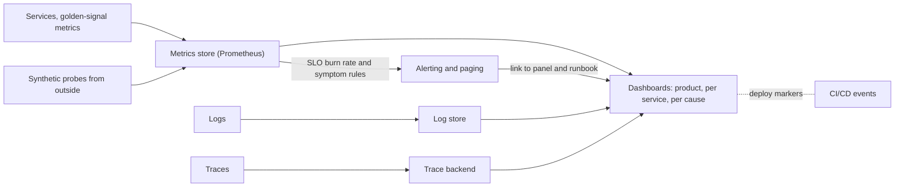

# Monitoring

> [!abstract] In one sentence
> Monitoring turns telemetry into the continuous answer to "is the service working for users, and if not, where do I look" by tracking latency, traffic, errors and saturation for every service, combining outside-in probes with inside-out metrics, and arranging dashboards as a path from symptom to cause — so that the system tells you it is sick before a customer does.

> [!tip] Deeper treatment in your system-design vault
> `system-design/13 Observability/Alerting and On-Call Design.md` — read it *after* you have written your own explanation below.

**Map:** [[Observability & Reliability MOC]] → [[HLD MOC]]

## Definition

**Monitoring** is the collection, processing, display and alerting of quantitative data about a system to determine whether it is meeting its goals and, when it is not, to guide diagnosis. It is built from [[Metrics]], [[Logging|logs]], [[Tracing|traces]] and probes, but it is a practice rather than a data type: choosing *what* to watch, *from where*, and *how* to present it. **White-box monitoring** uses data the system exposes about itself (metrics, logs, internal state); **black-box monitoring** probes the system from outside as a user would (synthetic requests, uptime checks). The **four golden signals** — **latency**, **traffic**, **errors**, **saturation** — are the minimum white-box set for any service; **symptom-based** monitoring watches what users experience (error ratio, slow responses), **cause-based** monitoring watches internal conditions (CPU, queue depth, replication lag) that explain symptoms.

## Problem solved

Without monitoring, the first signal of an outage is a customer, a partner or a revenue dip, and the first hour of the incident is spent finding out what is broken. The two historical failure modes are opposite: no visibility (a service with no metrics and no probes, running until someone notices) and too much of the wrong visibility (hundreds of dashboards and thousands of cause-based alerts — "CPU above 80%" — that page people for conditions users never notice and miss the ones they do). Monitoring as a discipline answers the questions that matter in order: *are users affected* (symptoms), *how badly and since when* (SLIs over time), *which component* (per-service golden signals), *why* (cause metrics, logs, traces). Black-box probes catch what internal metrics cannot — DNS broken, certificate expired, load balancer misconfigured — because they see what a user sees ([[Health Checks]], [[DNS]], [[TLS]]).

In a stack like yours, "payments are failing" should be a single panel on a single dashboard whose neighbours show the gateway, the payments service, the IAM dependency, the database and the PSP, so the on-call engineer walks from symptom to cause in minutes.

## How it works

1. **Define what healthy means per service.** For each service, choose the user-facing SLIs — availability (good responses / total), latency (fast responses / total), and for pipelines freshness and correctness — and the objectives ([[SLI SLO and SLA]]). These are the *symptoms* you monitor first and alert on.
2. **Instrument the four golden signals.** *Latency* as a histogram per route, separating successful and failed requests (a fast 500 is not good latency). *Traffic* as requests per second (or messages, sessions, bytes). *Errors* as a rate, explicit (5xx, exceptions) and implicit (wrong content, too slow). *Saturation* as how full the constrained resource is — CPU, memory, connection pool, queue depth, disk, consumer lag — including a leading indicator of hitting the limit ([[Metrics]]).
3. **Probe from outside.** Synthetic checks hit real endpoints (login, a read, a write to a sandbox) from outside the cluster on a schedule, measuring availability and latency as a user would, and verifying certificates and DNS. These are the only checks that catch "the service is fine and nobody can reach it".
4. **Build dashboards as a hierarchy of questions.** A top-level dashboard per product surface shows SLIs and error budget state. One dashboard per service shows its golden signals and its dependencies' health. Deeper dashboards show cause metrics (JVM heap, GC pauses, pool usage, Kafka lag, database locks). Each panel answers a specific question, uses the correct aggregation (fleet p99 from histograms, not averaged), shows deploy markers, and is linked from the alert that would bring someone there.
5. **Separate symptoms for paging from causes for diagnosis.** Page on SLO burn rate and on symptoms with user impact ([[Alerting]], [[Error Budgets]]); display causes on dashboards and, at most, raise tickets for them (disk 80% full, certificate expiring in 14 days). A cause alert that does not correspond to a symptom should be downgraded or removed.
6. **Monitor the monitoring.** Alert on missing data (no scrape, no probe results, no logs from a service), on the health of the collection pipeline, and on alert-delivery failures. A quiet monitoring system is more often broken than healthy.
7. **Keep it current.** Review dashboards and alerts after every incident ([[Production Incident Analysis]]) and every architectural change; delete panels nobody looks at and alerts nobody acts on.

```yaml
# Example black-box probe (Prometheus blackbox exporter) for an API's health and a real read
modules:
  api_read:
    prober: http
    timeout: 5s
    http:
      method: GET
      valid_status_codes: [200]
      fail_if_body_not_matches_regexp: ['"status":"ok"']
      fail_if_ssl: false
      tls_config: { insecure_skip_verify: false }   # certificate expiry is monitored via probe_ssl_earliest_cert_expiry
```

## Architecture



## Use cases

- Every production service: golden signals, an SLO, a dashboard and symptom alerts are the entry ticket, not an enhancement ([[Operational Simplicity]]).
- "We must know before customers do" — synthetic probes plus SLO burn-rate alerts give minutes of warning ([[Alerting]]).
- "On-call needs to find the broken component fast" — the symptom-to-cause dashboard hierarchy and dependency panels.
- "Is the deploy safe" — golden signals with deploy markers, canary comparison, automated rollback triggers ([[Deployment and Rollback Strategies]]).
- "Are we approaching capacity" — saturation trends over weeks ([[Capacity Planning]]).

## Limitations

- Monitoring shows known unknowns; it watches what you decided to watch. Novel failures appear as unexplained symptom changes and need exploratory tools (logs, traces, ad-hoc queries).
- Aggregates hide small populations: 0.5% of users fully broken is invisible in a 99.9% availability SLI unless you slice by the right dimension (region, client version, tenant).
- Dashboards decay; without ownership they accumulate stale panels and lose meaning.
- Black-box probes are coarse (a few endpoints, every minute) and can themselves be flaky; they confirm reachability, not correctness of every path.
- Symptom-based monitoring tells you users are hurt, not why; the diagnostic depth must exist too or the alert just starts a scavenger hunt.

## Trade-offs

| You gain | You sacrifice |
|---|---|
| Detection of user-impacting problems in minutes, from the user's point of view | Instrumentation and SLO definition work for every service |
| A diagnostic path from symptom to cause that shortens incidents | Dashboard and alert upkeep as a permanent chore |
| Fewer, more meaningful pages by alerting on symptoms | Cause conditions that go unpaged and must be reviewed on a schedule |
| Early warning of capacity and dependency problems | A monitoring stack to run, scale and monitor |

## Failure modes

- **Green dashboards, broken product** — the SLI measures the wrong thing (health-check traffic counted as requests, errors returned as HTTP 200 with an error body, latency measured only for successes). You notice from customers; blast radius is the trust in monitoring itself. Define SLIs from the user's path and validate them against incidents.
- **Alert fatigue from cause alerts** — pages for CPU, memory and queue depth without user impact; on-call stops reading them and misses the real one. Noticed by acknowledgement-without-action rates; radius is every incident that gets a slow response ([[Alerting]]).
- **Monitoring outage during the incident** — the metrics store or the dashboard is in the same failure domain as the services (same cluster, same region, same database). Noticed when the dashboard is blank at the worst time; run monitoring in a separate failure domain and keep a minimal external probe.
- **Hidden partial failure** — one region, one shard or one client version is fully down while the global SLI dips 2%. Noticed late; slice SLIs by the dimensions along which failures are correlated.
- **Silent data gap** — a scrape config change or a label rename stops a series; the alert's query returns empty and never fires. Noticed only by alerting on absent data.

## Performance

The monitoring path must be cheaper than the system it monitors: metrics are the backbone because they cost nanoseconds to record and a few bytes per sample to store ([[Metrics]]). Synthetic probes add a small, constant load (a request per endpoint per minute per probe location). Dashboard queries over long ranges can be expensive; use recording rules for SLIs and fleet-level aggregates so an incident-time dashboard renders in seconds. Alert rule evaluation runs every 15–60 s and should stay well under the interval. Detection latency is bounded by scrape interval plus rate window plus alert `for` duration — typically 2–10 minutes for a burn-rate page, seconds to a minute for a black-box outage.

## Scalability

At 10x services, the challenge is consistency: every service must expose the same golden signals with the same labels so dashboards and alerts can be templated rather than hand-built. Platform-provided instrumentation, dashboard-as-code (Grafana provisioning, jsonnet) and alert-as-code per service from a shared template keep the practice uniform. The metrics backend scales as in [[Metrics]]; dashboards scale by hierarchy (product → service → cause) rather than by adding panels. SLO tooling (Sloth, Pyrra, vendor SLO features) generates burn-rate rules from a declarative SLO definition so the alert logic is not rewritten per team ([[Design a Metrics and Monitoring System]]).

## Operational impact

Monitoring is the on-call engineer's primary interface, so it should be designed with them: every page links to the dashboard panel that shows the symptom and the runbook for it; dashboards show deploy and config-change markers; the dependency panel shows the health of each upstream (IAM, database, broker, PSP) as the service sees it (client-side error and latency), not only as they report themselves. Ownership: each service's dashboard and alerts belong to the team that is paged. Review cadence: after every incident and quarterly. Run the monitoring stack in a separate failure domain, with an external uptime check on the monitoring itself ([[Site Reliability Engineering (Google)]]).

## Alternatives

- **Log-based monitoring** — alerts and dashboards computed from log queries; wins for low-volume services or conditions metrics cannot express (a specific error message), loses on latency and cost at scale ([[Logging]]).
- **Vendor APM with automatic dashboards** — agents that produce golden-signal dashboards and service maps out of the box; wins on time-to-value and loses on cost and portability if not OTel-based.
- **Deep health checks as monitoring** — relying on readiness endpoints that test dependencies; wins for simple services, and is dangerous as the only signal because deep checks cause cascading restarts ([[Health Checks]]).
- **User-side monitoring (RUM, client telemetry)** — measures what the browser or app experienced, including CDN and network; wins for user-facing latency and complements server-side monitoring ([[Monitoring User-Facing Performance]]).

## Real-world examples

- Google's SRE book chapter on monitoring distributed systems defined the four golden signals and the symptom-versus-cause distinction, and its guidance on paging only for user-visible symptoms is the basis of most modern alerting practice ([[Google SRE Book - Monitoring Distributed Systems]]).
- **Prometheus plus Grafana** became the de facto open-source monitoring stack for Kubernetes, with the `kube-prometheus` project shipping golden-signal dashboards and alert rules for the platform itself.
- **Netflix** popularised dashboards and automated canary analysis that compare golden signals between a canary and a baseline during deploys, turning monitoring into a deploy gate.
- In a stack like yours: per-service Grafana dashboards generated from a template (RED per route, JVM or event-loop saturation, HikariCP and Kafka or SQS consumer lag, dependency panels for IAM, PostgreSQL, Redis and each PSP), a product dashboard of payment-success SLIs by region and PSP, blackbox probes from outside AWS against the gateway, and SLO burn-rate alerts as the only pages.

## Practical exercise

1. Take the service from the [[Metrics]] exercise and add a dependency (a mock IAM service) and PostgreSQL; run Prometheus, Grafana and the blackbox exporter in Docker Compose.
2. Build three dashboards as code: product (availability and latency SLIs with a 30-day error budget gauge), service (four golden signals per route, dependency client-side error and latency, pool saturation) and cause (JVM or event-loop, GC, pool wait time, database connections).
3. Add a blackbox probe against the service's real read endpoint every 15 s; break DNS for the service in the probe's network (or expire a self-signed certificate) and confirm the probe catches what internal metrics miss.
4. Inject three faults with [[Toxiproxy]] — latency on the database, errors from the mock IAM, and pool exhaustion via a slow query — and for each, time how long it takes to walk from the product dashboard to the cause using only the panels and links.
5. Write a burn-rate alert and a "no data" alert; rename a metric label to break the SLI query and confirm the "no data" alert fires while the burn-rate alert goes silent.

## Related concepts

### Prerequisites
- [[Metrics]] — the signal monitoring is mostly built from
- [[Logging]] — the detail behind the numbers
- [[SLI SLO and SLA]] — the definition of healthy

### Related
- [[Alerting]] — when and how monitoring pages a human
- [[Tracing]] and [[Distributed Tracing]] — the diagnostic step after the dashboard
- [[Health Checks]] — the platform's own narrow form of monitoring
- [[Latency]] — percentiles and tails on every dashboard
- [[Error Budgets]] — the product-level health gauge

### Builds on this
- [[Alerting]] — symptom-based paging assumes the golden signals exist
- [[Capacity Planning]] — saturation trends from monitoring data
- [[Production Incident Analysis]] — timelines and detection gaps found in dashboards
- [[Error Budgets]] — budget consumption is monitored continuously
- [[Monitoring User-Facing Performance]] — the client-side extension of the same practice

### Design problems where it applies
- [[Design a Metrics and Monitoring System]]
- [[Design a Payment System]]
- [[Design a Rate Limiter]]
- [[Design a Video Streaming Service]]

### Projects where it can be implemented
- [[Live Ops Dashboard]]
- [[Load Test and Latency Lab]]
- [[Chaos Lab]]

### Resources
- [[Google SRE Book - Monitoring Distributed Systems]] — golden signals, symptoms versus causes
- [[Site Reliability Engineering (Google)]] — the surrounding practice of monitoring and on-call
- [[Google SRE Workbook - Implementing SLOs]] — making SLIs the centre of monitoring

## Personal understanding

> [!question] Explain it without the source
> Write your own explanation here, from memory. Then compare it with the sections above and note what you missed.

### Mastery checklist
- [ ] I can explain it without the original resource
- [ ] I can describe the problem it solves
- [ ] I can compare it with its alternatives
- [ ] I can name its limitations and failure modes
- [ ] I can recognise when it is appropriate in a real system
- [ ] I have applied it in a system design
- [ ] I have validated my assumptions with an experiment or implementation

## Open questions

- [ ] For the last three incidents I remember, what was the first signal (customer, alert, probe, someone looking at a dashboard) and which dashboard panel would have shown it earliest?
- [ ] Which alerts in a typical service's rule set are cause-based without a corresponding user symptom, and what would happen if they became tickets instead of pages?
- [ ] Is the monitoring stack for the EKS clusters in a separate failure domain from the workloads, and what external check exists if the cluster's own Prometheus is down?
