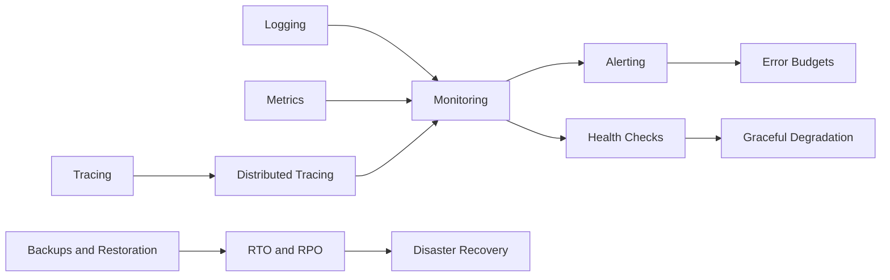

# Observability & Reliability

> [!abstract] You cannot fix what you cannot see — and you cannot promise what you do not measure.
> The three signals (logs, metrics, traces), what to alert on, how reliability targets turn into error budgets, and the disaster-recovery vocabulary (RTO, RPO, backups). Graceful Degradation is the single most useful note here for design interviews.

**Map:** [[HLD MOC]] → this · [[Start Here]] for the reading plan · [[Engineering Dashboard]] for progress

## Start with these

[[Metrics]] → [[Logging]] → [[Distributed Tracing]] → [[Alerting]] → [[Health Checks]] → [[Graceful Degradation]] → [[Error Budgets]]

## How the ideas connect



## Concepts

### Core — know these cold for SDE-2

- [[Logging]] — Logs are timestamped, structured records of discrete events, correlated by request and trace ids and shipped to a central store
- [[Metrics]] — Metrics are cheap, pre-aggregated numeric time series — counters, gauges and histograms with a bounded set of labels — that answer how the system is behaving right now…
- [[Monitoring]] — Monitoring is the practice of continuously answering whether the system is healthy from the user's point of view
- [[Alerting]] — Alerting interrupts a human only when users are being hurt fast enough to need one, using SLO burn-rate rules over multiple windows for pages and tickets for everything…
- [[Distributed Tracing]] — Distributed tracing carries a trace id and parent span id across every process boundary
- [[Health Checks]] — Health checks are the endpoints and probes by which load balancers and orchestrators decide whether to send traffic to an instance (readiness) or restart it (liveness)
- [[Graceful Degradation]] — Graceful degradation keeps a system serving something useful under overload or dependency failure by shedding excess load early, prioritising important work
- [[Production Incident Analysis]] — Production incident analysis is the structured, blameless reconstruction of what happened, why the system allowed it

### Important — read once, revisit when a design needs it

- [[Tracing]] — Tracing records one request as a tree of timed spans — each operation with its start, duration, parent and attributes — so you can see where a request's time went and why
- [[Error Budgets]] — An error budget is the unreliability an SLO permits over its window, expressed as a quantity you can spend
- [[Disaster Recovery]] — Disaster recovery is the planned, rehearsed ability to restore service after losing a zone, a region or a dataset, choosing among backup-restore, pilot light, warm…
- [[Backups and Restoration]] — A backup is a copy of data isolated from the failures that threaten the original
- [[Recovery Time Objective]] — The recovery time objective is the maximum tolerable time from the start of a disruption to restored service, set per system from business impact
- [[Recovery Point Objective]] — The recovery point objective is the maximum acceptable amount of data loss, measured as time, after a disaster
- [[Capacity Planning]] — Capacity planning is knowing each component's ceiling before traffic finds it

## Where it shows up

**Design problems that lean on this category:** [[Design a Payment System]], [[Design a Metrics and Monitoring System]], [[Design an API Gateway]], [[Design a Digital Wallet and Ledger]], [[Design a Logging System]], [[Design an IAM Service]], [[Design a Rate Limiter]], [[Design a Notification System]]

**Projects that exercise it:** [[Chaos Lab]], [[Live Ops Dashboard]], [[Load Test and Latency Lab]], [[LLM Gateway]], [[Double-Entry Ledger Service]], [[Webhook Relay]]

## Progress in this category

Status and confidence come from each note's properties — update them in the note, the table updates itself (native Bases, no plugin).

```base
filters:
  and:
    - file.hasTag("concept")
    - category == "Observability & Reliability"
formulas:
  rank: 'if(priority == "high", 1, if(priority == "medium", 2, 3))'
properties:
  file.name:
    displayName: Concept
  formula.rank:
    displayName: "#"
views:
  - type: table
    name: Tracker
    order:
      - file.name
      - priority
      - status
      - confidence
      - last_reviewed
      - next_review
    sort:
      - property: formula.rank
        direction: ASC
      - property: file.name
        direction: ASC
    summaries:
      confidence: Average
```
