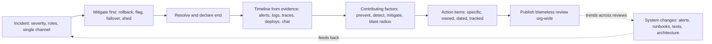

# Production Incident Analysis

> [!abstract] In one sentence
> Incident analysis turns an outage into knowledge by reconstructing the timeline from logs, metrics and chat, asking why the system — not a person — let the failure happen and spread, naming the several contributing factors rather than one root cause, and committing to specific, owned, tracked changes; done blamelessly it is the mechanism by which an organisation's reliability actually improves over time.

> [!tip] Deeper treatment in your system-design vault
> `system-design/13 Observability/Alerting and On-Call Design.md` — read it *after* you have written your own explanation below.

**Map:** [[Observability & Reliability MOC]] → [[HLD MOC]]

## Definition

**Production incident analysis** (a **postmortem** or **incident review**) is the process that follows an incident of sufficient severity: a written document reconstructing the **timeline** (detection, diagnosis, mitigation, resolution, with timestamps from evidence), the **impact** (users, duration, error budget consumed), the **contributing factors** (the conditions and decisions that together produced and prolonged the failure), what went well and what was lucky, and **action items** (specific changes with owners and deadlines). **Blameless** means the analysis assumes everyone acted reasonably given what they knew and the tools they had, and asks what in the system — code, tooling, process, information — made the bad outcome possible. **Severity levels** classify incidents by impact and decide the response and whether a review is required; **incident roles** (incident commander, communications lead, operations lead) structure the response itself so that the review has something coherent to analyse.

## Problem solved

Incidents are the most expensive source of information an organisation has, and most of it is wasted. Without a structured review, the outage ends with a fix, a sigh and a vague resolve to be more careful; the same class of failure recurs in a few months with different details. With a blame-oriented review, people learn to hide information — the engineer who ran the command does not mention the misleading documentation, the on-call engineer does not admit the alert was ignored because it fires nightly — and the review produces a scapegoat and a training reminder instead of the fix to the documentation and the alert. Root-cause thinking produces a single "cause" (a typo, a bad deploy) that stops the analysis at the first human action, when the interesting questions are why the typo could reach production, why it took 40 minutes to notice, why the rollback did not work and why three other systems fell over. The blameless, contributing-factors approach, with action items tracked to completion, is the only form of review that reliably changes the system ([[Reliability]], [[Site Reliability Engineering (Google)]]).

In a stack like yours, where an incident may involve a deploy, a PSP, a Kafka or SQS consumer and a regulator's reporting deadline, the review is also the artefact that satisfies compliance — and it is far more useful when it is honest.

## How it works

1. **During the incident, create the record.** Declare severity by impact criteria (users affected, money at risk, data integrity, regulatory exposure). Assign roles: an **incident commander** who coordinates and decides, a **communications lead** who updates stakeholders on a cadence, **operations leads** who investigate and mitigate. Keep a single timestamped channel; every observation, hypothesis, command and decision goes there. Mitigate first (rollback, failover, feature flag off, shed load), diagnose fully later ([[Graceful Degradation]], [[Deployment and Rollback Strategies]]).
2. **Within days, reconstruct the timeline from evidence.** Pull timestamps from alerts, dashboards, deploy logs, chat and traces rather than memory; align clocks and note the gaps: time to detect (onset to first alert or report), time to acknowledge, time to diagnose, time to mitigate, time to resolve. Each gap is a candidate improvement ([[Alerting]], [[Monitoring]], [[Logging]], [[Distributed Tracing]]).
3. **Quantify impact.** Requests failed, users affected, transactions delayed or lost, error budget consumed, SLA exposure, money moved wrongly ([[Error Budgets]], [[SLI SLO and SLA]]).
4. **Analyse contributing factors, not a root cause.** For each step of the causal chain ask what made it possible and what made it worse: why could the change reach production (no canary, no test for that path), why was detection slow (cause-based alert, missing SLI), why was diagnosis slow (no trace id in logs, dashboard without dependency panels), why did mitigation fail (rollback untested, runbook stale), why did it spread (no bulkhead, retries amplified). Techniques such as "five whys" are fine as prompts, dangerous as a template that stops at one answer. Include what went well and what was luck (someone happened to be awake).
5. **Decide action items that will actually be done.** Each is specific (not "be more careful"), owned by a named person, prioritised against the impact and the error budget spent, with a due date, and tracked in the normal work system; a review with twenty actions produces zero. Distinguish *prevent* (the class of failure), *detect* (faster), *mitigate* (faster, safer), and *reduce blast radius*.
6. **Review, share, follow up.** A short meeting to agree the analysis — blameless by rule, facilitated so it stays on the system — then publish the document to the whole engineering organisation; a periodic review of action-item completion and of incident trends (recurring factors across reviews are the most valuable finding of all) ([[Technical Debt]]).

```text
Timeline (example skeleton — every row cites its evidence)
10:41:07  Deploy v2.31 of payments completes (ArgoCD event)
10:43:20  p99 latency on POST /authorise rises from 180 ms to 2.4 s (Grafana panel, histogram)
10:47:00  Burn-rate page fires: 14.4x over 1 h and 5 m (Alertmanager)      <- detect: 6 min
10:49:15  On-call acknowledges; opens dashboard; sees PSP client timeouts (chat)
11:02:30  Hypothesis: new connection-pool setting; confirmed from trace spans (Tempo)  <- diagnose: 13 min
11:04:10  Rollback to v2.30 initiated (ArgoCD)                                <- mitigate: 2 min
11:06:40  Latency and errors recover; page resolves 11:12 (Alertmanager)
Impact: 25 min, ~8% of authorisations failed, 31% of monthly budget consumed
```

## Architecture



## Use cases

- Every incident above a severity threshold (user-visible outage, data integrity issue, security event, SLA breach) — the review is mandatory, not optional ([[Design a Payment System]]).
- Near misses and "lucky" events (a failover that worked by chance, a bug caught in canary that would have been severe): cheaper to analyse than the incident they almost were.
- Game days and DR drills: analysed with the same template so that practice produces the same learning ([[Disaster Recovery]], [[Chaos Lab]]).
- Recurring minor incidents: a review of the *pattern* across many small events often finds the systemic factor a single review misses.
- Regulatory and customer reporting: the honest internal analysis is the source for the external report, not a separate story.

## Limitations

- Blamelessness is a culture, not a template; in an organisation that punishes, the document will be sanitised and the real factors will stay hidden.
- Reviews cost senior time; without a severity threshold they either become perfunctory or crowd out the work they recommend.
- Action items compete with roadmap work; without an error-budget policy or leadership support they are deprioritised and the review becomes theatre ([[Error Budgets]]).
- Hindsight bias makes the chain look obvious; a good facilitator keeps the analysis on what was knowable at each moment.
- Analysis after the fact cannot recover evidence that was not captured; observability gaps found during a review are themselves action items ([[Logging]], [[Distributed Tracing]]).

## Trade-offs

| You gain | You sacrifice |
|---|---|
| Permanent, system-level fixes instead of individual blame | Engineering time for the review and for the action items it produces |
| Faster detection and mitigation next time, from measured gaps | Discomfort of publishing failures openly across the organisation |
| A record that satisfies customers and regulators honestly | The temptation to reduce findings to a tidy single cause |
| Trend data on recurring factors that justifies architectural work | Discipline to track and close actions long after the incident is forgotten |

## Failure modes

- **Blame in disguise** — the review names "human error" as the root cause and the action is "retraining". You notice as the same incident class recurring and as people reluctant to speak in reviews; the blast radius is the organisation's ability to learn.
- **Action items that die** — twenty items, no owners, no dates; six months later none are done and the next incident cites the same factors. Noticed in the follow-up review that was never scheduled; cap the list, assign owners, track in the work system.
- **Timeline from memory** — timestamps are reconstructed from recollection, the detection gap is understated, and the analysis of why detection was slow is skipped. Noticed when evidence contradicts the document; build timelines from logs and alert history.
- **Single root cause** — the analysis stops at "bad deploy"; nothing changes about canaries, alerts, rollback or blast radius. Noticed when a different bad deploy causes a longer outage; use the prevent/detect/mitigate/radius framing.
- **Review without roles during the incident** — chaotic response, no record, conflicting actions; the review cannot reconstruct what happened. Noticed as a thin timeline; incident roles and a single channel are prerequisites.

## Performance

The incident's own performance is the set of gaps the review measures: time to detect (driven by [[Alerting]] design — minutes with burn-rate pages, hours with cause-based alerts), time to diagnose (driven by observability — trace ids in logs, dependency panels), time to mitigate (driven by tooling — rollback in minutes, feature flags in seconds, failover as drilled). Tracking these across incidents, as medians and tails, shows whether the practice is working; a falling time-to-detect after alerting changes is the clearest evidence a review produced value. The review itself should be written within days and discussed in under an hour.

## Scalability

At 10x teams and services, incident analysis scales through a shared template, a severity scheme everyone uses, trained facilitators, a searchable repository of reviews, and periodic cross-team analysis of recurring factors (the same five contributing factors appear in most organisations: untested changes, missing symptom alerts, stale runbooks, untested rollback, unbounded blast radius). Automation helps: tooling that assembles the timeline from alerts, deploys and chat; dashboards of incident metrics (count by severity, time-to-detect trends, action-item completion). Reviews of reviews — a monthly meeting on trends — are where architectural investments such as [[Bulkheads]] and [[Circuit Breakers]] get justified.

## Operational impact

An on-call rotation without incident analysis is a treadmill; with it, every page should make the next one less likely or shorter. Operationally this requires: severity criteria and roles documented and practised; a review template and a repository; a facilitator pool; action-item tracking integrated with normal work; error-budget policy giving the actions priority ([[Error Budgets]]); and leadership that reads the reviews and asks about trends rather than about who. Runbooks, alerts, dashboards and tests are the usual outputs and must be owned by the teams that are paged ([[Alerting]], [[Monitoring]], [[Testing Strategies]]).

## Alternatives

- **Root-cause analysis with corrective action** — the traditional single-cause method; wins for simple mechanical failures and loses on complex socio-technical incidents, where it stops too early.
- **No formal review, fix and move on** — the default in small teams; wins on speed and loses the systemic learning; acceptable only for low-severity events.
- **External audit or regulator-driven report** — a narrative for outsiders; necessary but not a substitute, since it optimises for defensibility rather than learning.
- **Continuous learning reviews (incident-free)** — analysing near misses and surprising successes on a cadence; a complement that catches factors before they produce an incident.

## Real-world examples

- Google's SRE book chapter on postmortem culture — blameless, written, shared, with tracked action items — is the most widely adopted model, and Google publishes a postmortem template that many organisations copied ([[Site Reliability Engineering (Google)]]).
- **Etsy** popularised blameless postmortems in industry and published a debriefing facilitation guide that treats the review as an investigation into how work actually happens rather than a search for who erred.
- Public postmortems from cloud providers (AWS, Google Cloud, Cloudflare) are written in this style — timeline, contributing factors, actions — and are worth reading as examples of the form applied to large systems.
- In a stack like yours: a severity scheme tied to payment impact and regulatory reporting, incident roles rehearsed in game days, a template that forces timeline evidence from Alertmanager, ArgoCD, logs and traces, action items tracked in the team backlog with error-budget priority, and a monthly trend review that turned "PSP timeouts during deploys" into a canary-plus-breaker project.

## Practical exercise

1. Using the [[Chaos Lab]] or any earlier exercise environment, stage an incident: deploy a change that mis-sizes a connection pool, let the burn-rate alert fire, and respond as if real — one person as commander, one as operations lead — in a timestamped chat log.
2. Mitigate by rollback; then reconstruct the timeline from Alertmanager history, Grafana, deploy logs and traces only (no memory); compute time to detect, diagnose, mitigate.
3. Write the review using a blameless template: impact, timeline with evidence, contributing factors organised as prevent/detect/mitigate/blast radius, what went well, what was luck, action items with owners and dates (cap at five).
4. Run a 30-minute facilitated review with a second person; rewrite any sentence that attributes cause to a person's choice into a statement about what the system allowed.
5. Implement at least one detection action (a better alert or a dashboard panel) and one mitigation action (a feature flag or a faster rollback), rerun the staged incident, and measure the improvement in the gaps.

## Related concepts

### Prerequisites
- [[Monitoring]] — the dashboards and signals that provide the evidence
- [[Alerting]] — detection time is the first gap every review measures
- [[SLI SLO and SLA]] — impact is quantified against the objective

### Related
- [[Error Budgets]] — budget consumed per incident and priority for actions
- [[Logging]] and [[Distributed Tracing]] — the evidence base for timelines and diagnosis
- [[Audit Logs]] — who changed what, for the timeline
- [[Disaster Recovery]] — drills reviewed with the same template
- [[Deployment and Rollback Strategies]] — the most common mitigation and the most common contributing factor

### Builds on this
- [[Technical Debt]] — recurring contributing factors are the most credible debt inventory
- [[Testing Strategies]] — tests added for the paths incidents exposed
- [[Designing for Maintainability]] — runbooks, flags and observability as outputs of reviews

### Design problems where it applies
- [[Design a Payment System]]
- [[Design a Metrics and Monitoring System]]
- [[Design a Notification System]]
- [[Design an IAM Service]]

### Projects where it can be implemented
- [[Chaos Lab]]
- [[Live Ops Dashboard]]

### Resources
- [[Site Reliability Engineering (Google)]] — the postmortem culture chapter and template
- [[Google SRE Workbook - Implementing SLOs]] — tying incident impact to budgets and priorities
- [[Release It!]] — case studies of outages analysed as systems, not as blame

## Personal understanding

> [!question] Explain it without the source
> Write your own explanation here, from memory. Then compare it with the sections above and note what you missed.

### Mastery checklist
- [ ] I can explain it without the original resource
- [ ] I can describe the problem it solves
- [ ] I can compare it with its alternatives
- [ ] I can name its limitations and failure modes
- [ ] I can recognise when it is appropriate in a real system
- [ ] I have applied it in a system design
- [ ] I have validated my assumptions with an experiment or implementation

## Open questions

- [ ] For the last few incidents I was close to, what were the measured time-to-detect and time-to-mitigate, which contributing factors recurred, and what fraction of the action items were completed?
- [ ] What severity criteria and roles would make sense for a payments platform with regulatory reporting deadlines, and how would a review feed the external report without being distorted by it?
- [ ] What evidence would have been missing from a timeline today — trace ids in logs, deploy events on dashboards, alert history retention — and which gap is cheapest to close first?
