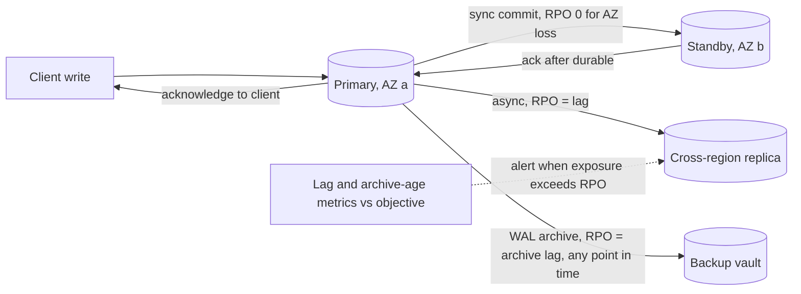

# Recovery Point Objective

> [!abstract] In one sentence
> The RPO is how much recent data you are willing to lose when the primary copy is destroyed — a day if you restore last night's backup, seconds if an asynchronous replica survives, zero only if every acknowledged write already existed on a copy outside the blast radius — and because zero means synchronous replication across failure domains, the RPO is where the business decides what a lost transaction is worth against the latency and availability of every write.

> [!tip] Deeper treatment in your system-design vault
> `system-design/12 Resilience/Disaster Recovery.md` — read it *after* you have written your own explanation below.

**Map:** [[Observability & Reliability MOC]] → [[HLD MOC]]

## Definition

The **Recovery Point Objective (RPO)** is the maximum acceptable interval between the last recoverable state and the moment of a disaster, expressed as time ("no more than 5 minutes of data"); the **actual recovery point** after an event is the age of the copy that was used to recover. The RPO is determined by the freshness of the most recent copy that survives the scenario: for restore-from-backup it is the backup interval plus the archive lag ([[Backups and Restoration]]); for asynchronous [[Replication]] it is the replication lag at the moment of failure; for synchronous replication to a copy outside the failure domain it is zero. RPO pairs with the [[Recovery Time Objective|RTO]] to define a recovery tier ([[Disaster Recovery]]). Note that a database's local durability (fsync of the WAL on commit — [[Transactions]]) gives RPO zero for a *process* crash, not for loss of the machine, zone or region.

## Problem solved

"We replicate, so we will not lose data" conflates two different things: the copy exists, and the copy is *current*. Asynchronous replication acknowledges a write to the client before the replica has it; if the primary's region is lost a second later, that acknowledged write is gone, and a payment the customer was told succeeded has no record. Nightly backups make the exposure a full day. Before the RPO was a stated requirement, these windows were discovered after the loss, and the argument about whether seconds of data mattered was had with angry customers. The RPO makes the decision explicit per dataset: for a ledger, an acknowledged transfer cannot be lost, so the architecture must make the write durable in a second failure domain before acknowledging — at the cost of latency on every write; for a product catalogue, minutes of loss are a re-import. The RPO is also what the RTO trades against: a fast failover to an asynchronous replica meets a tight RTO precisely by accepting the replica's lag as the recovery point ([[Recovery Time Objective]]).

In a stack like yours, Kafka with `acks=all` across brokers in three AZs, RDS Multi-AZ with synchronous standby, and a cross-region replica with asynchronous lag give three different RPOs for three different scenarios, and the ledger's requirement is the one that decides which scenarios must be RPO zero.

## How it works

1. **State the scenario with the RPO.** RPO is per failure domain: process crash (local WAL — zero), instance or AZ loss (synchronous standby in another AZ — zero; asynchronous replica — lag), region loss (cross-region replication — lag; backup — interval), logical corruption (PITR — archive lag, restored to a chosen point). Write the RPO per dataset *per scenario*; "RPO zero" without a scenario is meaningless.
2. **Match the replication mode.** Synchronous replication waits for the copy to confirm before acknowledging the client: PostgreSQL `synchronous_commit = on` with `synchronous_standby_names`, RDS Multi-AZ, Kafka `acks=all` with `min.insync.replicas ≥ 2`, a [[Quorums|quorum]] write. The acknowledged write exists in at least two failure domains; RPO zero for the loss of one. Asynchronous replication (cross-region replicas, [[Read Replicas]], MirrorMaker) acknowledges locally and ships later; RPO equals the lag, which is seconds normally and minutes or more under load or during a replication stall ([[Replication]]).
3. **Measure the lag continuously.** The achievable RPO is a live metric: `pg_last_wal_replay_lsn` versus the primary's LSN, Aurora Global Database replication lag, Kafka replica lag and ISR membership, WAL archive age. Alert when the lag exceeds the objective, because at that moment the RPO is already breached in potential ([[Monitoring]], [[Alerting]]).
4. **Cover the scenarios replication does not.** Replication propagates deletes and corruption; the RPO for *logical* disasters comes from PITR: continuous WAL archiving gives a recovery point at any second within retention, with the archive lag as the floor ([[Backups and Restoration]]).
5. **Design for the gap.** Where RPO is not zero, design for reconciliation after recovery: idempotent replays of upstream events from a durable log (Kafka retention as a replay source), reconciliation jobs against partners (the PSP's record of the lost transactions), and customer-facing handling of "your transaction may need to be re-submitted". Where RPO must be zero for region loss, accept cross-region synchronous commit latency (tens to hundreds of milliseconds per write) or restructure so that the critical write is small and the rest is asynchronous.
6. **Verify in drills.** After a failover or restore drill, compute the actual recovery point: the last transaction on the recovered copy versus the last acknowledged on the lost primary (from application logs or the primary's WAL if recoverable). Compare with the objective and record it ([[Production Incident Analysis]]).

```sql
-- PostgreSQL: RPO zero for loss of the primary host requires a synchronous standby
-- postgresql.conf on the primary
synchronous_commit = 'on'              -- or 'remote_apply' for read-your-writes on the standby
synchronous_standby_names = 'ANY 1 (standby_az_b, standby_az_c)'
-- Measure the live RPO exposure on an asynchronous replica (seconds behind):
SELECT now() - pg_last_xact_replay_timestamp() AS replica_lag;
```

## Architecture



> [!example]- Excalidraw version — the same diagram as an editable canvas
> ![[Recovery Point Objective.excalidraw]]
> [[Recovery Point Objective.excalidraw|Open in Excalidraw]] — needs the Excalidraw plugin (see [[Plugins to Install]]).


## Use cases

- Ledgers, payments and anything where an acknowledged write is a promise: RPO zero for host and AZ loss via synchronous replication, and an explicit, small RPO for region loss with reconciliation designed in ([[Design a Payment System]], [[Design a Digital Wallet and Ledger]]).
- Message and event systems where loss means lost business events: `acks=all` and `min.insync.replicas` for RPO zero within the cluster, mirroring with a known lag across regions ([[Design a Message Queue]], [[Kafka]]).
- User-generated content and documents: versioning and cross-region replication of objects with lag measured ([[Design File Storage]]).
- Data that can be regenerated (caches, search indexes, derived views): RPO is "whatever the rebuild takes", and the design question is rebuild speed rather than replication ([[Search Indexing Pipelines]]).
- Compliance: stated RPOs with evidence from lag metrics and drills.

## Limitations

- RPO zero across regions costs the inter-region round trip on every write and makes the primary unavailable for writes when the remote copy is unreachable; most systems choose a non-zero cross-region RPO and zero only within the region.
- The RPO assumes the surviving copy is *usable*; a replica that is current but corrupted by the same bug has an RPO of zero and a value of nothing — PITR covers that scenario with a worse RPO.
- Lag is variable; the RPO you can promise is the *worst-case* lag during the failure, which is typically when lag is highest (load spikes, partial partitions before the full outage).
- Multi-system consistency: a database at RPO zero and a queue at RPO 30 s recover to different points; cross-system reconciliation is still needed.
- Local durability settings interact: `synchronous_commit = off` for throughput makes even single-host RPO non-zero.

## Trade-offs

| You gain | You sacrifice |
|---|---|
| A stated bound on data loss per scenario, with evidence | Analysis per dataset and per failure domain |
| RPO zero where it matters via synchronous replication | Write latency equal to the slowest synchronous copy, and write unavailability when it is unreachable |
| A measured, alertable exposure (lag) instead of an assumption | Monitoring and alerting on replication and archive health |
| Reconciliation designed up front for the non-zero cases | Application logic and partner processes for replaying the gap |

## Failure modes

- **Acknowledged writes lost on failover** — asynchronous replica promoted after regional loss; the last seconds of writes exist nowhere. You notice as customers with confirmations for transactions that do not exist; blast radius is the lag's worth of writes, which for a ledger is unacceptable at any size unless reconciled.
- **Lag silently exceeding the objective** — replication stalled for an hour (a long transaction, a network issue); the RPO exposure is an hour while dashboards show "replicating". Noticed only if lag is alerted against the objective; radius grows with the stall.
- **Synchronous standby down, writes blocked** — the price of RPO zero: with a single synchronous standby unavailable, the primary stops acknowledging; or, with `ANY 1 (a, b)` configured, it degrades to RPO zero via the other. Noticed as write latency climbing to timeouts; use quorum-style configurations and know the behaviour.
- **Backup-only RPO misunderstood** — "nightly backup" presented as "we can recover" without stating the 24-hour loss window. Noticed during the restore; stating the RPO forces the conversation earlier ([[Backups and Restoration]]).
- **Replicated corruption** — the "RPO zero" copy faithfully contains the bad migration; recovery needs PITR to before it, with an RPO equal to the time since the corruption began. Noticed by reconciliation; retention must cover the detection delay.

## Performance

Synchronous replication adds the round trip to the standby plus its fsync to every commit: within an AZ sub-millisecond, across AZs typically 1–2 ms, across regions tens to hundreds of milliseconds; throughput is unaffected if commits pipeline but per-transaction latency rises. Asynchronous replication adds no commit latency; its lag is a function of write volume versus replica apply speed and network capacity, so it grows exactly under the load spikes that often precede failures. WAL archiving lag is typically seconds (segment-based) and can be reduced with streaming archivers. Kafka `acks=all` with `min.insync.replicas=2` adds the follower fetch and fsync to produce latency — a few milliseconds — which is why it is the default for anything that must not be lost.

## Scalability

At 10x write volume, asynchronous lag becomes harder to keep small (replica apply is often single-threaded or limited), pushing cross-region RPO upward unless the data is partitioned so each partition replicates independently ([[Sharding]]). Synchronous replication scales with partitions as well, since each partition's commit waits only for its own copies. Backup-based RPO scales with archive throughput, which object storage handles well. At scale the RPO conversation shifts from infrastructure to data design: separating the small set of writes that need RPO zero (ledger entries, authorisations) from the bulk that does not (events, logs, derived data), so the expensive guarantee is paid only where it is required ([[Coordination vs Availability]]).

## Operational impact

Lag and archive age are first-class metrics with alerts set at the objective ([[Alerting]]); replication configuration (synchronous standby names, `min.insync.replicas`) is reviewed as a correctness setting, not a tuning knob. Drills compute the achieved recovery point and record it. Runbooks for failover state the expected data-loss window and the reconciliation steps (replay from Kafka retention, partner reconciliation, customer communication). Changes that affect lag — long-running migrations, bulk loads, replica resizing — are scheduled with RPO exposure in mind. Retention of WAL archives and event logs must exceed the longest plausible detection delay for corruption.

## Alternatives

- **Accept loss and reconcile from an external source of truth** — the PSP, the partner, the upstream system holds the authoritative record and you re-import after recovery; wins when such a source exists and the volume is manageable.
- **Event log as the durable truth** — write events to a replicated log (Kafka with `acks=all`, cross-region mirrored) first and derive state from it; the database's RPO matters less because state is rebuildable from the log ([[Event Sourcing]], [[Change Data Capture]]).
- **Client-side durability** — clients hold unacknowledged work (offline queues, idempotent retries with the same key) and resubmit after recovery, so the server's lost writes are re-created; wins for mobile and partner integrations with idempotent APIs ([[Idempotency]]).
- **Globally synchronous databases** — Spanner-style multi-region commits give RPO zero for region loss at the cost of cross-region latency on every write; wins only for systems whose write volume and budget permit it ([[Spanner Paper]]).

## Real-world examples

- **RDS Multi-AZ** replicates synchronously to a standby in another AZ, giving RPO zero for instance or AZ loss, while **cross-region read replicas and Aurora Global Database** replicate asynchronously with documented, typically sub-second but unbounded lag — the two RPOs most AWS users actually have.
- **Kafka's** durability model — `acks=all`, `min.insync.replicas`, unclean leader election disabled — is an RPO-zero design within a cluster, and its documentation explains exactly which combinations can lose acknowledged messages ([[Kafka Design Documentation]]).
- **PostgreSQL's** `synchronous_commit` levels (`off`, `local`, `remote_write`, `on`, `remote_apply`) are a precise menu of RPO versus latency choices per transaction, including the option to set it per session for low-value writes.
- In a stack like yours: the ledger on RDS Multi-AZ (RPO zero for AZ loss) with a cross-region replica whose lag is alerted at 10 s and a stated regional RPO of one minute with PSP reconciliation designed in; Kafka topics at `acks=all`, RF 3, `min.insync.replicas=2`; S3 with versioning and replication; and Redis declared RPO-irrelevant because it is rebuilt from the database.

## Practical exercise

1. Run a PostgreSQL primary with two replicas in Docker Compose: one configured as a synchronous standby (`synchronous_standby_names`), one asynchronous with [[Toxiproxy]] on its replication link.
2. Drive 200 inserts per second with a client that logs each acknowledged transaction id; add 5 s of latency on the asynchronous link; kill the primary; promote each replica in turn and compute the recovery point (last acknowledged id present) — expect zero loss on the synchronous one and about 1,000 rows lost on the asynchronous one.
3. Measure commit latency at the client with synchronous replication on and off, and with 20 ms of injected latency on the synchronous standby link to simulate cross-region.
4. Stop the synchronous standby and observe the primary's behaviour (writes block); reconfigure with `ANY 1 (a, b)` and a second standby and observe the difference.
5. Add WAL archiving to MinIO; delete rows "accidentally"; restore to a point in time and compute that scenario's recovery point; write a one-page RPO statement per scenario with the measured numbers.

## Related concepts

### Prerequisites
- [[Replication]] — synchronous versus asynchronous copying is what sets the RPO
- [[Backups and Restoration]] — the recovery point for backup-based recovery and PITR
- [[Transactions]] — local durability (WAL and fsync) as the baseline

### Related
- [[Recovery Time Objective]] — the other axis; fast failover to a lagging replica trades RPO for RTO
- [[Quorums]] — quorum writes as RPO zero for the loss of a minority of copies
- [[Kafka]] — `acks` and `min.insync.replicas` as the queue's RPO settings
- [[Event Sourcing]] — a durable event log as the source from which state is rebuilt
- [[Data Retention and Archival]] — retention must exceed corruption-detection delay
- [[Block Storage]] — snapshot-based recovery points for volumes

### Builds on this
- [[Disaster Recovery]] — tier selection depends on the RPO per scenario
- [[Data Ownership and Lifecycle]] — each dataset's owner declares its RPO and its rebuild path

### Design problems where it applies
- [[Design a Payment System]]
- [[Design a Digital Wallet and Ledger]]
- [[Design a Message Queue]]
- [[Design File Storage]]

### Projects where it can be implemented
- [[Double-Entry Ledger Service]]
- [[Mini-KV Store]]

### Resources
- [[Designing Data-Intensive Applications]] — replication lag, synchronous versus asynchronous, and what "durable" means
- [[Site Reliability Engineering (Google)]] — data integrity and recovery objectives
- [[Kafka Design Documentation]] — the durability guarantees behind `acks` and ISR

## Personal understanding

> [!question] Explain it without the source
> Write your own explanation here, from memory. Then compare it with the sections above and note what you missed.

### Mastery checklist
- [ ] I can explain it without the original resource
- [ ] I can describe the problem it solves
- [ ] I can compare it with its alternatives
- [ ] I can name its limitations and failure modes
- [ ] I can recognise when it is appropriate in a real system
- [ ] I have applied it in a system design
- [ ] I have validated my assumptions with an experiment or implementation

## Open questions

- [ ] For each datastore in a payments flow, what is the RPO for AZ loss, region loss and logical corruption today, and which of those is measured by a live metric with an alert?
- [ ] What would it cost in write latency and availability to make the ledger's cross-region RPO zero, and is a one-minute RPO with PSP reconciliation a better engineering answer?
- [ ] For SQS (managed, multi-AZ) versus a self-managed Kafka cluster versus Redis Streams, what are the actual durability guarantees for an acknowledged message in each failure scenario, and where does each fall short of the ledger's RPO?
