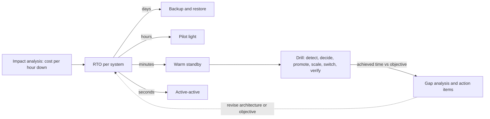

# Recovery Time Objective

> [!abstract] In one sentence
> The RTO is the answer to "how long can this system be down before the damage is unacceptable", and it is useful because each answer implies a different architecture and price — a day means restore from backup, an hour means a pilot light, minutes mean a warm standby you can promote, seconds mean active-active — so setting it per system, and then measuring the real recovery time in drills, is how recovery capability gets matched to need rather than to hope.

> [!tip] Deeper treatment in your system-design vault
> `system-design/12 Resilience/Disaster Recovery.md` — read it *after* you have written your own explanation below.

**Map:** [[Observability & Reliability MOC]] → [[HLD MOC]]

## Definition

The **Recovery Time Objective (RTO)** is the maximum acceptable duration between the onset of a disruption and the restoration of service to an agreed level, for a given system and disaster scenario. It is a *target* set by the business; the **actual recovery time** (sometimes called RTA) is what a drill or a real event measures. RTO covers the whole chain: detection, decision, execution of the recovery procedure, verification and the return of traffic — not just the technical failover step. It is paired with the **[[Recovery Point Objective|RPO]]** (acceptable data loss); together they define the recovery tier within a [[Disaster Recovery]] strategy. RTO is distinct from the availability SLO: the SLO bounds total downtime over a window across all causes, while the RTO bounds the duration of a single disaster-class event ([[SLI SLO and SLA]]).

## Problem solved

Without an explicit RTO, recovery capability is whatever happened to be built, and the first time it is tested is during the disaster, when the business discovers that the four-hour outage it could have tolerated has become a two-day rebuild. The opposite failure is also common: every system is given the gold-plated standby because nobody asked what downtime actually costs, and the budget is spent on reporting tools while the ledger shares the same tier. An RTO per system forces the conversation — what does an hour of this system being down cost, in money, in regulatory exposure, in customer trust — and converts the answer into a tier with a known cost. It also makes recovery *measurable*: a drill that takes 90 minutes against a 60-minute RTO is a finding with an owner, whereas "we have a DR plan" is not ([[Availability]], [[Reliability]]).

In a stack like yours, a payment authorisation path, a back-office reconciliation tool and an analytics warehouse should not have the same RTO, and the ledger's RTO is a number an auditor will ask to see evidence for.

## How it works

1. **Derive the RTO from impact.** For each system and scenario (regional loss, data corruption, dependency loss), estimate cost per unit of downtime: lost transactions, SLA penalties, regulatory thresholds, manual workaround capacity. Set the RTO where the cost curve becomes unacceptable, rounding to a tier (minutes, an hour, a business day). Document the dependency chain: a system's RTO cannot be shorter than that of anything it needs to recover (identity, DNS, secrets, CI/CD) ([[Design an IAM Service]]).
2. **Map the RTO to an architecture.** Days: backups and documented rebuild. Hours: pilot light — data replicated, infrastructure as code ready, compute scaled up on demand. Tens of minutes to minutes: warm standby — a running, verified, scaled-down copy to promote and scale. Seconds or no interruption: active-active with health-checked global routing. Each step up costs roughly the standby's share of production spend plus engineering for replication and failover ([[Disaster Recovery]]).
3. **Decompose the recovery timeline.** Detection (monitoring and alerting latency — minutes), decision (who declares, on what evidence — often the longest and least engineered step), execution (promotion, scale-up, traffic switch — bounded by tooling and by DNS TTLs), verification (synthetic transactions, data checks), and communication. The sum must fit the RTO with margin; usually the human steps dominate and the architecture is not the bottleneck ([[Alerting]], [[DNS]]).
4. **Engineer the slow steps.** Automate what can be automated (promotion scripts, pipeline targets, DNS updates via API), pre-authorise decisions with explicit criteria so declaration is fast, keep runbooks executable by whoever is on call, and keep the recovery tooling outside the failure domain.
5. **Measure in drills.** Execute the procedure end to end on a schedule, with a stopwatch, in conditions as realistic as the business allows (real promotion of a standby, a canary slice of real traffic). Record the achieved recovery time per step; compare with the objective; treat shortfalls as incidents with action items ([[Production Incident Analysis]]).
6. **Revisit.** RTOs change with the business (a new regulated product), and achieved times change with data growth and architecture drift; review both at least annually and after major changes.

```text
RTO budget worked example (warm standby, objective 30 minutes):
  detection (alert on regional symptoms)        ~ 5 min
  decision (criteria met, incident lead declares) ~ 5 min
  fence old region + promote replica            ~ 3 min
  scale standby compute to full capacity        ~ 5 min
  DNS or routing switch (TTL 60 s) + drain      ~ 3 min
  verification (synthetic transactions)         ~ 4 min
  total                                         ~ 25 min  (margin 5 min; measure in drills)
```

## Architecture



> [!example]- Excalidraw version — the same diagram as an editable canvas
> ![[Recovery Time Objective.excalidraw]]
> [[Recovery Time Objective.excalidraw|Open in Excalidraw]] — needs the Excalidraw plugin (see [[Plugins to Install]]).


## Use cases

- Regulated or contractual systems where an RTO must be stated and evidenced — payments, ledgers, identity ([[Design a Payment System]], [[Design a Digital Wallet and Ledger]]).
- Portfolio decisions: tiering dozens of services so DR investment goes where downtime is most expensive ([[Prioritizing Reliability Performance Cost and Time to Market]]).
- Vendor and dependency evaluation: a dependency's RTO bounds yours; a PSP or identity provider with a longer RTO needs a fallback ([[Build vs Buy Decisions]]).
- Capacity planning for the surviving region: the RTO's scale-up step must be feasible within quotas and instance availability ([[Capacity Planning]]).
- Rollback planning: the RTO for a bad deploy is a smaller cousin of the same question and is met by rollback tooling ([[Deployment and Rollback Strategies]]).

## Limitations

- RTO is a single number for a messy reality: partial outages, degraded modes and dependency chains do not fit "down then up"; define what "restored service" means (full, or a degraded core).
- The stated RTO is often aspirational; without drills the achieved time is unknown, and the gap tends to be large.
- Human steps (detection, decision) dominate and are the hardest to engineer; an RTO of five minutes for a stateful system implies automation that most organisations are not prepared to trust.
- Shorter RTO costs more, non-linearly; the business must see the price per tier, or every system will be assigned the shortest RTO.
- RTO and RPO are partly independent: a fast failover to an asynchronous replica meets a tight RTO while losing data, which the business must have accepted explicitly ([[Recovery Point Objective]]).

## Trade-offs

| You gain | You sacrifice |
|---|---|
| A recovery capability sized to actual business impact | Analysis and negotiation effort per system |
| A clear architecture choice (tier) with a known cost | Standby infrastructure spend that rises steeply as RTO shrinks |
| Measurable, auditable recovery performance from drills | Regular drills, which cost time and carry risk |
| Fast, pre-authorised decisions during a disaster | Pre-committed criteria that may not fit the actual event |

## Failure modes

- **Unmeasured RTO** — the plan says 30 minutes; the first real failover takes six hours because a step was never automated. You notice during the disaster; blast radius is the full outage plus credibility. Drills are the control.
- **Dependency chain longer than the RTO** — the service can fail over in 10 minutes, but identity, DNS or secrets live in the failed region and take two hours. Noticed when a runbook step cannot proceed; order the recovery of foundations first.
- **Decision paralysis** — no clear criteria or authority to declare; the team waits for the provider to recover, and a 45-minute regional event becomes a four-hour outage. Noticed in the timeline; pre-authorised criteria and a named role fix it.
- **Scale-up blocked** — the standby region lacks quota or instance capacity during a regional event when everyone else is also failing over. Noticed as a stuck scale step; reserve capacity or run the standby closer to full size.
- **Traffic stuck on the old region** — long DNS TTLs and clients caching addresses; service is "restored" but users still hit the dead region. Noticed as a slow partial recovery; low TTLs on failover records and health-checked routing ([[DNS]], [[Client State and Reconnection]]).

## Performance

Each tier's achievable RTO is bounded by its slowest technical step: restore throughput for backup-restore (hours per terabyte), compute provisioning for pilot light (minutes to tens of minutes for clusters and node groups), replica promotion and routing for warm standby (seconds to a few minutes), and health-check and routing convergence for active-active (seconds). DNS propagation is bounded by TTL (60 s is common for failover records); global accelerators and anycast avoid DNS entirely. Verification time depends on having synthetic transactions ready. In practice the human path — alert to decision — is the largest and most variable term and is improved by automation of evidence gathering, not by faster infrastructure.

## Scalability

At 10x data, restore-based RTOs grow linearly and become infeasible for critical systems, forcing replication-based tiers; at 10x services, RTOs must be declared in a service catalogue and the recovery pipeline must be templated so each service's failover is the same procedure with different parameters. Dependency ordering becomes a graph problem: recovery waves (foundations, data tier, core services, everything else) with the RTO of each wave constraining the next. Drills at scale are automated game days that fail over subsets of services on a rotation rather than everything at once ([[Design a Metrics and Monitoring System]] for the observability to verify each wave).

## Operational impact

RTO ownership sits with the service owner and is reviewed with the DR owner; the objective, the tier, the runbook and the last measured recovery time are recorded in the service catalogue. Drills are scheduled, their results are reviewed like incidents, and shortfalls get prioritised ([[Production Incident Analysis]]). Monitoring covers the readiness of the recovery path — standby health, replication lag, pipeline ability to deploy to the DR region, quota headroom — with ticket-grade alerts ([[Alerting]]). Changes to architecture trigger an RTO re-check, especially new dependencies, which silently lengthen the chain.

## Alternatives

- **Availability SLO only** — bound total downtime over a window without a per-event recovery target; wins for simplicity and is what most non-regulated services use, but it does not force a recovery architecture or a drill ([[SLI SLO and SLA]]).
- **Maximum tolerable downtime set by the business with no engineering tiering** — a policy number that engineering then meets ad hoc; wins as a starting point and fails at the first audit of actual capability.
- **Active-active everything** — no RTO because nothing fails over; wins where the data architecture allows it and the budget covers it, which is rare outside the largest platforms ([[Coordination vs Availability]]).
- **Manual rebuild from documentation** — the honest tier for low-impact systems; wins when the RTO is genuinely days and the cost of anything more is not justified ([[Backups and Restoration]]).

## Real-world examples

- Financial regulators in several jurisdictions require firms to set and evidence recovery time objectives for important business services, which is why ledgers and payment systems carry explicit RTOs with drill evidence.
- AWS's DR strategy guidance ties each of its four strategies to indicative RTO ranges — hours for backup and restore, tens of minutes for pilot light, minutes for warm standby, near zero for multi-site — which is the mapping most teams adopt.
- **Netflix's regional evacuation exercises** regularly measure the time to move all traffic out of a region, treating the achieved time as a metric to drive down rather than a plan to file.
- In a stack like yours: a 30-minute RTO for payment authorisation met by a warm standby (cross-region RDS replica, scaled-down EKS deployment kept current by the same pipeline, Route 53 failover records with 60 s TTLs, synthetic transactions ready), a 4-hour RTO for reconciliation tooling met by a pilot light, and a next-business-day RTO for analytics met by backups — with a quarterly drill log showing achieved times for each.

## Practical exercise

1. Using the two-region Docker Compose setup from the [[Disaster Recovery]] exercise, write an RTO budget table for a 10-minute objective with the five steps (detect, decide, promote, scale, switch, verify) and estimated durations.
2. Instrument each step with timestamps in the runbook script; run a full failover three times and record the achieved time per step and in total; identify the slowest step.
3. Automate the slowest step (for example, promotion plus service reconfiguration via a script instead of manual commands) and repeat; measure the improvement.
4. Introduce a dependency in the failed region (a mock identity service the application needs at startup) and observe the failover stalling; reorder the runbook to recover the dependency first and measure the new total.
5. Set a DNS-like switch with a 5-minute "TTL" (a client that caches the address) and measure how long traffic keeps hitting the old region after the switch; reduce the TTL and compare. Document the achieved RTO against the objective as a drill report.

## Related concepts

### Prerequisites
- [[Availability]] — downtime cost is the input to the objective
- [[SLI SLO and SLA]] — the related but distinct window-based reliability target
- [[Backups and Restoration]] — the slowest tier's mechanics and its time bound

### Related
- [[Recovery Point Objective]] — the other axis of the recovery trade
- [[Replication]] — what makes short RTOs possible
- [[Leader Election]] — promotion as the technical core of failover
- [[Health Checks]] — routing switch and verification depend on them
- [[DNS]] — the TTL bound on traffic switching
- [[Capacity Planning]] — the surviving region must have the headroom

### Builds on this
- [[Disaster Recovery]] — tier selection is driven by RTO and RPO
- [[Deployment and Rollback Strategies]] — rollback time is an RTO for bad changes

### Design problems where it applies
- [[Design a Payment System]]
- [[Design a Digital Wallet and Ledger]]
- [[Design an IAM Service]]
- [[Design a Chat System]]

### Projects where it can be implemented
- [[Chaos Lab]]
- [[Double-Entry Ledger Service]]

### Resources
- [[Site Reliability Engineering (Google)]] — recovery, drills and the data-integrity chapter's framing of objectives
- [[Designing Data-Intensive Applications]] — replication and failover mechanics that bound recovery time

## Personal understanding

> [!question] Explain it without the source
> Write your own explanation here, from memory. Then compare it with the sections above and note what you missed.

### Mastery checklist
- [ ] I can explain it without the original resource
- [ ] I can describe the problem it solves
- [ ] I can compare it with its alternatives
- [ ] I can name its limitations and failure modes
- [ ] I can recognise when it is appropriate in a real system
- [ ] I have applied it in a system design
- [ ] I have validated my assumptions with an experiment or implementation

## Open questions

- [ ] For the systems I know, what RTO is stated, what has been measured, and which step in the chain (detection, decision, execution, verification) would dominate a real regional failover?
- [ ] Which foundations — IAM, DNS control, secrets, CI/CD, the observability stack — would have to recover before the payment path could, and what is their own RTO?
- [ ] How does the RTO for a bad deploy (rollback) compare with the RTO for regional loss in practice, and are both covered by tooling that has been exercised this quarter?
