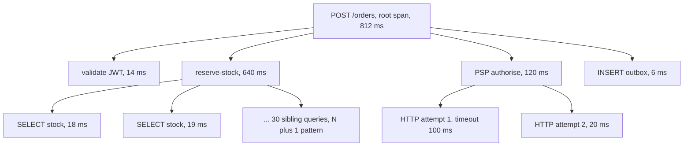

# Tracing

> [!abstract] In one sentence
> A trace follows a single request through the code as a tree of spans, each span a timed operation with a parent, so that "this request took 800 ms" becomes "620 ms of it was one SQL query inside the third retry of a downstream call" — the causal, per-request timing picture that metrics aggregate away and logs leave for you to reconstruct.

> [!tip] Deeper treatment in your system-design vault
> `system-design/13 Observability/Logs Metrics and Traces.md` — read it *after* you have written your own explanation below.

**Map:** [[Observability & Reliability MOC]] → [[HLD MOC]]

## Definition

A **trace** is the record of one request's execution as a directed tree of **spans**. A span represents a unit of work — an HTTP handler, a database query, a cache lookup, a function you chose to instrument — and carries a name, a start time and duration, a **span id**, the id of its **parent span**, the shared **trace id**, a status (ok or error), and **attributes** (key–value context such as `http.route`, `db.statement`, `peer.service`). The root span has no parent; the tree's structure encodes causality (the child ran *because of* the parent) and the timings encode where latency accrued, including gaps where no child was active. **Trace context** is the pair `(trace id, parent span id)` plus sampling flags that must travel with the request — across threads, async boundaries and processes — so new spans attach to the right tree. This note covers tracing within a process; [[Distributed Tracing]] covers carrying context across services and queues.

## Problem solved

Latency questions are causal questions, and the other two signals cannot answer them. [[Metrics]] say the p99 of `POST /orders` is 800 ms and the p99 of the database is 20 ms — and both are true while one request runs that 20 ms query thirty times in a loop. [[Logging|Logs]] with timestamps can be lined up by hand, but only if every interesting step logged, on one clock, with the right ids, and someone has an hour. Before tracing, "why was this slow" was answered by adding timing logs, redeploying, and reasoning from fragments. A trace shows the whole request at once: the fan-out that was supposed to be parallel but ran sequentially, the retry you did not know the client library did, the 300 ms gap where the request waited for a connection from a pool, the N+1 query pattern as thirty sibling spans. It also attaches the *reason* — the attributes — to the timing, so the slow span says which SQL statement and which downstream host.

In a stack like yours, a payment authorisation spans a handler, a JWT validation against the IAM service, two or three database calls, a Redis lookup, an outbound PSP call with retries and an outbox insert; the trace is the only artefact that shows all of them in one picture with their durations.

## How it works

1. **Start a root span at the entry point.** The HTTP server middleware (OpenTelemetry's Spring Boot starter or NestJS instrumentation does this automatically) creates a span named by the route template, records method, route, status code and the client's trace context if one arrived.
2. **Create child spans around operations worth timing.** Auto-instrumentation wraps HTTP clients, JDBC/`pg`, Redis clients, Kafka producers and consumers; manual spans wrap business steps (`validate-order`, `reserve-stock`). Each child records its parent from the *current context* at creation and ends when the operation returns, exceptions marking the status as error with the exception recorded as a span event.
3. **Propagate context within the process.** The "current span" lives in a context that must follow the request through thread pools and async callbacks: `ThreadLocal`-based `Context` with context-propagating executors in Java, `AsyncLocalStorage` in Node. Where propagation breaks (a bare `new Thread`, a non-instrumented queue), spans attach to the wrong parent or become orphan traces.
4. **Attach attributes, not logs.** Span attributes carry the high-cardinality context (order id, SQL statement, retry attempt) that would bloat metrics; span **events** are timestamped notes inside a span (cache miss, lock acquired). Follow the semantic conventions so tools can interpret `http.status_code`, `db.system`, `messaging.destination` uniformly.
5. **Sample.** Tracing every request is too expensive at scale; a **sampler** decides per trace. Head sampling decides at the root (keep 1%, or 100% of a specific route); tail sampling decides after the trace completes (keep every error and every trace slower than 500 ms), which needs a collector that buffers whole traces ([[Distributed Tracing]]). The sampling decision travels in the context so every service agrees.
6. **Export and view.** Finished spans are batched and exported (OTLP) to a collector and then a backend (Jaeger, Tempo, Zipkin, X-Ray, a vendor); the UI reconstructs the tree from parent ids and renders a waterfall. Linking a trace id into logs ([[Logging]]) and into metric exemplars connects the three signals.

```java
// Manual span with OpenTelemetry (Java); auto-instrumentation handles HTTP, JDBC, Redis, Kafka
Span span = tracer.spanBuilder("reserve-stock")
    .setAttribute("order.id", orderId)
    .setAttribute("sku.count", skus.size())
    .startSpan();
try (Scope ignored = span.makeCurrent()) {        // children created here attach to this span
    inventoryClient.reserve(orderId, skus);
} catch (Exception e) {
    span.recordException(e);
    span.setStatus(StatusCode.ERROR);
    throw e;
} finally {
    span.end();
}
```

## Architecture



> [!example]- Excalidraw version — the same diagram as an editable canvas
> ![[Tracing.excalidraw]]
> [[Tracing.excalidraw|Open in Excalidraw]] — needs the Excalidraw plugin (see [[Plugins to Install]]).


## Use cases

- "Find where the time goes in a slow endpoint" — the waterfall shows the dominant span, sequential-versus-parallel structure and idle gaps ([[Bottleneck Analysis]]).
- "Find N+1 queries, hidden retries and accidental serialisation" — patterns that are invisible in aggregates and obvious in a span tree ([[Query Execution and Optimization]]).
- "Attribute latency to a dependency" — per-span timings of database, cache and downstream calls for one request, which also validates timeout budgets ([[Timeouts and Retries]]).
- "Debug a single failed request with full context" — the error span, its exception, its attributes and every step before it, found by trace id from a log line or an error report.
- "Understand an unfamiliar codebase's runtime behaviour" — a trace of one request is often a better map than the code.

## Limitations

- Sampling means the specific request you are asked about may not have been traced; tail sampling on errors and latency helps, but a "slow but under threshold" request may be gone.
- Context propagation is fragile: every thread hop, async boundary and queue must be instrumented, and one gap silently splits traces.
- Traces measure *time*, not *resource use*: a span that waited on a lock or a pool shows as a gap with no explanation unless you add events; CPU profiling is a different tool.
- Per-span overhead and export bandwidth are real at high request rates; tracing is never "on for everything" in a large system.
- A single trace is an anecdote; conclusions about typical behaviour need aggregation (span metrics, trace analytics) or many traces.

## Trade-offs

| You gain | You sacrifice |
|---|---|
| Causal, per-request timing with context attached | Per-span overhead and export cost, forcing sampling |
| Instant visibility of N+1, retries and serialised fan-out | Instrumentation and context-propagation discipline across every async boundary |
| A shared vocabulary (spans, attributes) across languages via OpenTelemetry | Semantic-convention upkeep and attribute hygiene (no PII in attributes) |
| A bridge between logs and metrics via trace ids and exemplars | A tracing backend to run or buy, with its own retention and cost |

## Failure modes

- **Broken traces** — spans from the second half of a request appear as separate traces with no parent; the waterfall ends at the thread-pool hop. You notice as many tiny traces and root spans named after internal operations; blast radius is the usefulness of tracing for that service until the propagation gap is fixed.
- **Sampling hides the incident** — head sampling at 1% during a low-rate error; no trace of the failing requests exists. Noticed when the on-call engineer searches by trace id from a log and finds nothing; fix with tail sampling on error status.
- **Attribute leak** — `db.statement` with bound parameter values, or a `user.email` attribute, exported to a vendor. Noticed in a security review; the same rules as logs apply ([[Secrets Management]]).
- **Span explosion** — a loop creates a span per iteration (100,000 spans in one trace); the exporter queue fills, the backend rejects the trace, and the service spends CPU on instrumentation. Noticed as dropped spans and CPU spikes; instrument the loop, not the iteration.
- **Clock-skewed waterfall** — spans across processes on skewed clocks show children starting before parents. Noticed as negative gaps in the UI; harmless within one process, a reason to prefer durations over absolute offsets across hosts ([[Clocks and Time]]).

## Performance

Creating a span costs on the order of a microsecond (allocation, timestamp, context switch); a request with 20 spans adds tens of microseconds of CPU, negligible against a millisecond-scale request. Export is batched asynchronously; the bandwidth is roughly span count times a few hundred bytes — at 1,000 requests per second with 20 spans each and 10% sampling, about 2,000 spans per second and under 1 MB/s. Context propagation through `ThreadLocal` or `AsyncLocalStorage` adds small per-hop overhead (measurable in Node for very hot paths). The backend cost scales with retained spans, which is why sampling rate and retention are the two cost knobs.

## Scalability

At 10x request rate, trace volume is controlled by lowering the sampling rate, moving from head to tail sampling so the *interesting* 1% is kept, and deriving aggregate metrics from spans at the collector so dashboards do not need raw traces. Backends scale horizontally on ingestion and index by trace id and a small set of attributes; searching by arbitrary attributes is the expensive operation and is often restricted to recent data. Trace volume per request also grows with the number of hops, which is a reason to keep auto-instrumentation spans coarse (one per client call, not one per internal function).

## Operational impact

Adopt OpenTelemetry's auto-instrumentation first (agent or SDK) so every service has HTTP, database, cache and messaging spans with no code changes, then add manual spans for business steps where the auto spans leave gaps. Enforce semantic conventions and an attribute deny-list through a shared setup library. Monitor the exporter (dropped spans, queue size) and the collector; configure tail sampling rules as code and review them. Link traces into logs by printing `trace_id` on every record and into metrics via exemplars, so an alert leads to a dashboard that leads to a trace ([[Monitoring]]). Retention of a few days is usually enough for traces; incidents older than that are investigated from logs and metrics.

## Alternatives

- **Timing logs** — manual `elapsed_ms` fields in log records around key steps; wins for a small service or a single hot path, and is what people do before adopting tracing ([[Logging]]).
- **Profilers (CPU, allocation, async profilers)** — show where CPU and memory go across all requests; win for compute-bound hot spots and complement tracing, which shows waiting rather than computing.
- **Metrics with fine-grained histograms per step** — a histogram per internal stage; wins for aggregate questions ("which stage dominates on average") at the cost of losing per-request causality ([[Metrics]]).
- **Database-side query analysis** — `EXPLAIN ANALYZE`, `pg_stat_statements`; wins for understanding why a specific query is slow once tracing has shown it is the one that matters ([[Query Execution and Optimization]]).

## Real-world examples

- **Google's Dapper** paper (2010) described production tracing with sampling, annotations and context propagation, and is the design every later system copied.
- **OpenTelemetry** merged OpenTracing and OpenCensus into the vendor-neutral standard for spans, context and semantic conventions, with auto-instrumentation for Java (an agent), Node, Go, Python and others ([[OpenTelemetry Observability Primer]]).
- **Jaeger** (originally Uber) and **Zipkin** (originally Twitter) are the open-source backends that made trace waterfalls a normal debugging tool outside Google; Grafana Tempo stores traces cheaply by indexing only trace ids.
- In a stack like yours: the OpenTelemetry Java agent on Spring Boot and the Node SDK with NestJS auto-instrumentation give spans for HTTP, JDBC/`pg`, Lettuce/ioredis and Kafka or SQS clients; a tail-sampling collector keeps every error and every trace over the route's SLO threshold plus 5% of the rest, exported to Tempo or X-Ray, with `trace_id` in every log line.

## Practical exercise

1. Add the OpenTelemetry Java agent to a Spring Boot service (or the Node SDK with auto-instrumentations to a NestJS service) that handles `POST /orders` by validating a token, running a query per line item, and calling a mock PSP; export to Jaeger in Docker Compose.
2. Send a request with 30 line items and view the trace: identify the N+1 pattern as sibling spans; rewrite with a single `WHERE id = ANY(...)` query and compare the waterfall.
3. Make the mock PSP time out on the first attempt; observe the client library's retry as two child spans and measure the latency the retry added.
4. Move the PSP call to a thread pool (`CompletableFuture.supplyAsync` or a Node worker without context propagation) and show the broken trace; fix with a context-propagating executor or `AsyncLocalStorage` and show it rejoined.
5. Configure a tail-sampling collector that keeps errors and traces over 300 ms plus 5% of others; load-test with k6 and measure exported span rate, collector memory, and whether every injected error is findable by trace id.

## Related concepts

### Prerequisites
- [[Logging]] — the per-event record tracing structures into a tree
- [[Latency]] — what a span measures, and why tails matter

### Related
- [[Metrics]] — the aggregate view that traces explain
- [[Monitoring]] — the alert-to-dashboard-to-trace workflow
- [[Bottleneck Analysis]] — reading a waterfall to find the constraint
- [[Connection Pooling]] — a common source of unexplained gaps between spans
- [[Query Execution and Optimization]] — what to do once a query span is the culprit

### Builds on this
- [[Distributed Tracing]] — the same spans carried across services and queues
- [[Production Incident Analysis]] — traces of failing requests as postmortem evidence
- [[Monitoring User-Facing Performance]] — browser and mobile spans joined to backend traces

### Design problems where it applies
- [[Design a Payment System]]
- [[Design an API Gateway]]
- [[Design a RAG Knowledge Assistant]]
- [[Design a Ride-Sharing Service]]

### Projects where it can be implemented
- [[LLM Gateway]]
- [[Vault RAG Assistant]]
- [[Load Test and Latency Lab]]

### Resources
- [[OpenTelemetry Observability Primer]] — spans, context and semantic conventions
- [[The Tail at Scale]] — why per-request timing of fan-out and retries matters
- [[Google SRE Book - Monitoring Distributed Systems]] — where tracing sits among the signals

## Personal understanding

> [!question] Explain it without the source
> Write your own explanation here, from memory. Then compare it with the sections above and note what you missed.

### Mastery checklist
- [ ] I can explain it without the original resource
- [ ] I can describe the problem it solves
- [ ] I can compare it with its alternatives
- [ ] I can name its limitations and failure modes
- [ ] I can recognise when it is appropriate in a real system
- [ ] I have applied it in a system design
- [ ] I have validated my assumptions with an experiment or implementation

## Open questions

- [ ] In the services I run, which async boundaries (`@Async`, reactive chains, NestJS queues, Kafka consumer threads) propagate trace context today and which produce orphan spans?
- [ ] What tail-sampling policy would keep every failed payment trace and every trace over the SLO threshold within a span budget the backend can afford, and how would I verify no error trace is lost?
- [ ] Which span attributes in a payment flow carry data a privacy review would object to (`db.statement` with values, user identifiers), and can they be redacted in the SDK rather than in the backend?
