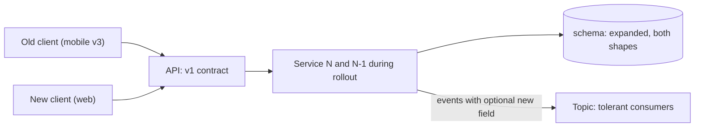

# Backward Compatibility

> [!abstract] In one sentence
> Backward compatibility is the discipline of changing a system so that nothing already depending on it — old clients, old events, old rows, the previous release of your own service — breaks, which is what makes continuous deployment and independent service releases possible at all.

> [!tip] Deeper treatment in your system-design vault
> `system-design/10 Architecture Styles/API Design and Versioning.md` — read it *after* you have written your own explanation below.

**Map:** [[Product Engineering MOC]] → [[HLD MOC]]

## Definition

A change is **backward compatible** if a consumer written against the old contract keeps working against the new one without modification. The contract may be an HTTP API, an event schema, a database schema read by two versions of one service during a rolling deploy, a serialised cache value or a configuration format. The complementary property, **forward compatibility**, is that an old reader tolerates data written by a new writer; you need both whenever two versions coexist, which during any rolling deploy is always.

## Problem solved

Coordinated releases do not scale. A mobile app cannot be force-updated; a partner will not redeploy on your schedule; a Kafka topic has consumers you have never met; a rolling deploy runs N and N+1 side by side by design. If every change required every dependant to move at once, nothing could ship. Compatibility lets each party move on its own schedule and turns "deploy" from a coordinated event into a routine one.

## How it works

1. **Prefer additive changes.** Adding an optional field, a new endpoint, a new enum value handled by a default, or a nullable column is compatible. Renaming, removing, changing a type, tightening validation, changing a default or altering the meaning of an existing value is not — even if the shape looks the same.
2. **Build tolerant readers.** Consumers ignore unknown fields, treat missing optional fields as defaults and handle unknown enum values with a fallback rather than an exception. In Protobuf and Avro this is the schema-evolution model; in JSON it is a code-review rule. Tolerant readers give you forward compatibility for free.
3. **Keep two shapes alive during transitions.** To change a field's meaning, add a new field, write both for a period, migrate readers, then remove the old — the expand–contract sequence that [[Versioning and Migrations]] applies to data and [[Schema Evolution]] to tables. Never flip a semantic in place.
4. **Deprecate, do not delete.** Announce, mark (`Deprecation` and `Sunset` headers, schema annotations), measure usage of the old shape, and remove only when traffic is zero or the announced window has closed. The window is a product decision: internal callers two sprints, partners six months, mobile a year.
5. **Test against old clients.** Keep the previous release's contract tests in CI; replay recorded old-format events; run the N-1 service against the N schema before deploy. Compatibility that is not tested is assumed.

```text
Compatible                         Breaking (needs expand-contract or a new version)
add optional field `memo`          rename `amount` -> `amount_minor`
add enum value, readers default    remove enum value `PENDING`
widen int32 -> int64 in proto      change `amount` from string to number
add endpoint /v1/transfers/{id}    make `currency` required on an existing POST
add nullable column                drop a column the N-1 release still reads
```

## Architecture



> [!example]- Excalidraw version — the same diagram as an editable canvas
> ![[Backward Compatibility.excalidraw]]
> [[Backward Compatibility.excalidraw|Open in Excalidraw]] — needs the Excalidraw plugin (see [[Plugins to Install]]).


## Use cases

- Any public or partner API, any event consumed outside your team, any mobile client — callers you cannot upgrade on demand.
- Rolling or canary deploys, where old and new versions of one service run against one database at the same time.
- Long-lived stored data: serialised cache entries, queued messages, event-sourced histories read by code written years later.
- A requirement phrased as "zero-downtime", "no coordinated release" or "clients must not need to change".

## Limitations

- Compatibility accumulates: every tolerated old shape is code and tests you keep, so a system that never contracts becomes a museum of fields.
- Some changes are inherently breaking (a wrong calculation, a security hole); compatibility then means a new version and a migration path, not pretending the old behaviour was fine.
- Tolerant readers can hide real errors: a consumer that silently defaults an unknown enum value may be processing something it should have rejected.

## Trade-offs

| You gain | You sacrifice |
|---|---|
| Independent release schedules for every caller and service | Clean contracts — old fields and shims linger through the deprecation window |
| Rolling deploys and rollbacks that are safe by construction | The ability to "just fix" a bad field name in one commit |
| Fewer coordinated outages and partner escalations | Engineering time on dual-shape periods, usage telemetry and deprecation communication |

## Failure modes

- **Breaking change shipped as "just a rename"** → old clients fail validation → a 4xx spike from one client version minutes after deploy; blast radius is every user on that version until rollback.
- **Rolling deploy with an incompatible schema change** → N-1 pods throw on a missing column mid-rollout → partial errors that vanish when the rollout completes and reappear on rollback.
- **Strict event consumer meets a new field** → crash loop, lag grows → noticed by consumer-lag alerts; blast radius is every downstream of that consumer group.
- **Deprecation announced, usage never measured** → the removal lands on a client nobody knew existed → noticed by their outage, not yours.

## Performance

Compatibility is mostly free at runtime: an optional field costs bytes, a dual-write period costs one more write per transaction, a translation shim costs microseconds. The real cost is cognitive and in test matrices, not latency.

## Scalability

Compatibility lets the consumer count grow without the coordination cost growing with it: a hundred consumers of a topic each upgrade when they like. It scales badly only when deprecation is never finished — the matrix of supported shapes grows multiplicatively, which is why a deprecation window with a measured end matters more as consumers multiply.

## Operational impact

You need telemetry on contract usage by version and caller (fields sent, enum values seen, version header used) to know when old shapes can go. Deploys become safer and rollbacks routine; the on-call burden shifts from "the release broke a client" to "someone is still on a shape we announced the end of".

## Alternatives

- **Versioned contracts ([[Versioning and Migrations]])** — wins when the change cannot be made additive; a new version runs alongside the old with a migration path.
- **Coordinated big-bang release** — wins only when you control every caller and can afford a maintenance window; rare and getting rarer.
- **Consumer-pinned behaviour** (Stripe's per-account API version with server-side transforms) — wins for large public APIs; expensive to build and maintain.

## Real-world examples

- Protobuf's rules (never reuse field numbers, preserve unknown fields) and the Confluent Schema Registry's compatibility modes (backward, forward, full) are compatibility encoded as tooling.
- Stripe keeps every API version it has ever shipped working through a chain of transformation layers, so a 2015 integration still runs ([[Stripe - API Versioning]]).
- In a stack like yours: a NestJS SQS consumer configured to ignore unknown properties, a Spring Boot service whose Flyway migration adds a nullable column in release N and makes it non-null only in N+2, and a `Sunset` header on a v1 endpoint with a Grafana panel of its remaining callers by client version.

## Practical exercise

1. Take an event schema or API response in your system and list every change made to it in the last year; classify each as compatible or breaking using the table above.
2. Write a consumer test that deserialises a recorded old-format message with current code, and one with an extra unknown field; fix whatever throws.
3. Add `Deprecation` and `Sunset` headers to one endpoint you want gone, plus a metric counting its callers by client identifier.
4. Run the previous release of one service against the current schema in a local Compose stack to prove the last migration was N-1 safe.

## Related concepts

### Prerequisites
- [[Designing APIs and Contracts]] — the contract whose stability is being protected
- [[Event Schemas]] — the asynchronous contract with the same rules
- [[Schema Evolution]] — expand–contract on tables, the same idea one layer down

### Related
- [[Deployment and Rollback Strategies]] — rolling deploys require N and N-1 compatibility
- [[Feature Flags]] — hiding new behaviour behind a flag keeps the contract unchanged until release
- [[Testing Strategies]] — contract and replay tests are how compatibility is verified
- [[Strangler Pattern]] — a migration that depends on keeping the old contract alive

### Builds on this
- [[Event Schema Evolution]] — compatibility rules applied to message schemas over time
- [[Versioning and Migrations]] — what to do when compatibility cannot be preserved

### Design problems where it applies
- [[Design a Webhook Delivery System]]
- [[Design a Feature Flag Service]]
- [[Design a Payment System]]

### Projects where it can be implemented
- [[Webhook Relay]]
- [[Feature Flag Service and SDK]]

### Resources
- [[Stripe - API Versioning]] — compatibility at the extreme
- [[Stripe - Online Migrations at Scale]] — dual-shape periods on live data
- [[Designing Data-Intensive Applications]] — encoding, evolution and schema compatibility

## Personal understanding

> [!question] Explain it without the source
> Write your own explanation here, from memory. Then compare it with the sections above and note what you missed.

### Mastery checklist
- [ ] I can explain it without the original resource
- [ ] I can describe the problem it solves
- [ ] I can compare it with its alternatives
- [ ] I can name its limitations and failure modes
- [ ] I can recognise when it is appropriate in a real system
- [ ] I have applied it in a system design
- [ ] I have validated my assumptions with an experiment or implementation

## Open questions

- [ ] Is tightening validation (rejecting a value you used to accept) ever compatible, and how would you roll it out if the old values are already stored?
- [ ] How long should a deprecation window be for an internal Kafka topic with unknown consumers, and how do you discover them?
- [ ] Where does compatibility for serialised Redis cache values live — in a version prefix on the key, a version field in the value, or a cache flush on deploy?
