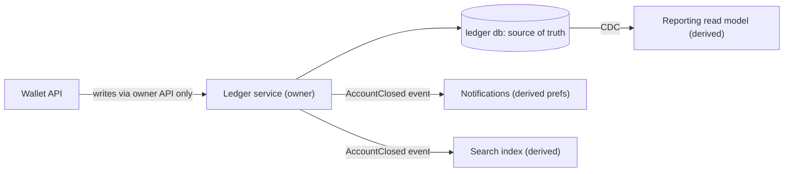

# Data Ownership and Lifecycle

> [!abstract] In one sentence
> Data ownership assigns each fact one source of truth — a service that alone may write it and that is responsible for it from creation to deletion — so that every other copy is a known, refreshable derivative rather than a second truth that silently diverges.

> [!tip] Deeper treatment in your system-design vault
> `system-design/10 Architecture Styles/Database per Service.md` — read it *after* you have written your own explanation below.

**Map:** [[Product Engineering MOC]] → [[HLD MOC]]

## Definition

**Data ownership** is the rule that for each entity (customer, account, transfer) exactly one service is the **source of truth**: it holds the authoritative record, enforces its invariants and is the only writer. Other services may hold **derived copies** — caches, read models, search indexes, warehouse tables — each with a documented origin, refresh mechanism and staleness bound. **Lifecycle** extends ownership across time: the owner defines how the data is created, which states it passes through, how long it is retained and how it is deleted or anonymised, including the obligations that follow personal and financial data.

## Problem solved

When two services write the same table, or a copy is treated as authoritative, the system has two truths that disagree: a balance in the wallet service and a different one in reporting, with no rule for which is right. Shared databases also couple teams — a schema change in one service breaks another's queries — and make deletion impossible because nobody knows where all the copies are. Explicit ownership removes the ambiguity, gives each service a boundary to change behind, and makes "delete this user's data" an answerable request.

## How it works

1. **Draw the ownership map.** For each entity, name the owning service and bounded context ([[Domain-Driven Design]]). An entity with two plausible owners is usually two entities: the `Customer` IAM owns (identity, credentials) is not the `Customer` the ledger owns (accounts, limits).
2. **One writer per fact.** Only the owner writes; everyone else goes through its API or consumes its events. Writes that span owners become a [[Saga Pattern|saga]] or an orchestrated workflow, never a cross-service transaction.
3. **Label every copy as derived.** Each copy records its source, how it is refreshed (synchronous call, [[Change Data Capture]], event subscription, nightly batch) and its staleness bound. A copy with no refresh mechanism is a bug waiting for a reconciliation job.
4. **Define the lifecycle as a state machine.** Created → active → (suspended, closed) → retained → deleted or anonymised. Each transition has an owner; retention periods come from the business and the regulator, not from disk space.
5. **Propagate lifecycle events.** When the owner deletes or anonymises, derived copies must follow: the owner emits the event and each consumer handles its own copy. Deletion that cannot be proven complete across copies is not deletion.

```sql
-- ownership and lifecycle made visible in the schema of the owning service
CREATE TABLE accounts (
  id            UUID PRIMARY KEY,
  owner_service TEXT NOT NULL DEFAULT 'ledger',      -- documentation, enforced by access control
  status        TEXT NOT NULL CHECK (status IN ('active','frozen','closed')),
  closed_at     TIMESTAMPTZ,
  retain_until  TIMESTAMPTZ,                         -- set at close: closed_at + 7 years
  anonymised_at TIMESTAMPTZ
);
-- the reporting service's copy is explicitly derived
COMMENT ON TABLE reporting.accounts_snapshot IS 'derived from ledger.accounts via CDC; staleness <= 60s';
```

## Architecture



> [!example]- Excalidraw version — the same diagram as an editable canvas
> ![[Data Ownership and Lifecycle.excalidraw]]
> [[Data Ownership and Lifecycle.excalidraw|Open in Excalidraw]] — needs the Excalidraw plugin (see [[Plugins to Install]]).


## Use cases

- A requirement that mentions "single source of truth", reconciliation, or "the numbers don't match between X and Y".
- Splitting a [[Monoliths|monolith]] into [[Microservices|services]]: ownership is the first decision, because a service that does not own its data is a distributed monolith.
- Privacy and retention obligations: "delete my account" or "retain records for N years" require knowing every copy.
- Any read model, cache or warehouse table — derived data that needs a stated refresh and staleness bound.

## Limitations

- Strict single-writer ownership turns a simple join into two API calls or a [[CQRS|read model]]; for small systems a shared schema is cheaper and the boundary can be drawn later.
- Ownership is a social contract as much as a technical one; without database access controls it is a convention that erodes under deadline pressure.
- Derived copies lag; a product that insists on immediate consistency across services will not tolerate the staleness ownership implies.

## Trade-offs

| You gain | You sacrifice |
|---|---|
| One answer to "which value is correct" and a team that can change its schema freely | Cross-service joins — every read across owners becomes an API call, an event-fed copy or a read model |
| Deletion and retention that can actually be executed and audited | Immediate consistency across services; derived copies are eventually consistent |
| Service boundaries with a principled basis | The simplicity of a single database for small systems |

## Failure modes

- **Two writers** → records diverge silently → noticed by a reconciliation job or a customer; blast radius is every downstream consumer of the entity.
- **Derived copy promoted to truth** (a cache or warehouse table used for decisions) → decisions on stale data → noticed when owner and copy disagree during an incident.
- **Deletion incomplete** → personal data lingers in a search index or log archive → noticed by an audit or a subject-access request; blast radius is regulatory.
- **Ownership undocumented** → a schema change breaks an unknown consumer → that team's outage after your deploy.

## Performance

Ownership pushes reads that used to be a join into an API hop (a round trip, typically single-digit milliseconds in-cluster) or a locally held derived copy (fast but stale). The usual resolution is a read model fed by CDC or events, which keeps read latency local at the cost of staleness and one more pipeline.

## Scalability

Clear ownership lets services scale independently: the ledger can shard by account while reporting stays columnar, because neither shares a schema. At 10x data the derived-copy pipelines become the bottleneck — CDC lag, index rebuild time — so each copy needs its own capacity plan.

## Operational impact

Every derived copy is a pipeline to monitor: lag, failed refreshes, reconciliation diffs. Lifecycle events add retention jobs and deletion audits. The payoff is that incidents have a first question with an answer — "what does the owner say?" — and privacy requests have a checklist instead of an archaeology project.

## Alternatives

- **Shared database with ownership by convention** — wins for a small team and one deployable; fails once two teams deploy on different schedules.
- **Event-sourced ownership** ([[Event Sourcing]]) — the owner keeps the full history and every copy is a projection; wins for audit-heavy domains, costs projection management.
- **Data mesh** — the analytics-side version of ownership; wins when the warehouse has become the second truth and must be made a derived one.

## Real-world examples

- Amazon's service mandate (each team owns its data and exposes it only through interfaces) is the canonical origin of ownership-based boundaries, as described in [[Martin Fowler - Microservices]].
- Uber's domain-oriented architecture ([[Uber - Domain-Oriented Microservice Architecture]]) groups services into domains with explicit data ownership and gateways to prevent cross-domain data access.
- In a stack like yours: the IAM service owns identity and credentials, the ledger owns accounts and entries, and the notification service holds only a derived copy of contact preferences fed by events — so "close my account" is an owner-side state change that fans out as an event, each consumer confirming its copy is anonymised.

## Practical exercise

1. For one entity (a user or an account), list every table, cache key, index and warehouse column where it appears; name the owner and refresh mechanism for each copy.
2. Mark every copy with no refresh mechanism or staleness bound; those are your reconciliation gaps.
3. Write the lifecycle state machine for the entity, including retention after close and the deletion or anonymisation step.
4. In the [[Double-Entry Ledger Service]], add an `AccountClosed` event and a consumer that anonymises its derived copy; test that no personal field survives in any copy afterwards.

## Related concepts

### Prerequisites
- [[Domain-Driven Design]] — bounded contexts are where ownership lines come from
- [[Data Modeling]] — the entity model ownership is applied to

### Related
- [[Saga Pattern]] — the write that spans owners
- [[Change Data Capture]] — the usual feed for derived copies
- [[Event-Driven Architecture]] — lifecycle events as the propagation mechanism
- [[Recovery Point Objective]] — durability obligations fall on the owner
- [[Data Warehouses]] — the largest derived copy most companies have
- [[Eventual Consistency]] — what derived copies offer

### Builds on this
- [[Microservices]] — a service without data ownership is not a service
- [[Data Retention and Archival]] — lifecycle policy applied to storage
- [[Encryption at Rest and in Transit]] — protection obligations follow ownership
- [[Audit Logs]] — the owner records who changed what

### Design problems where it applies
- [[Design a Payment System]]
- [[Design an Inventory Management System]]
- [[Design File Storage]]
- [[Design an IAM Service]]

### Projects where it can be implemented
- [[Double-Entry Ledger Service]]
- [[Personal Notification Hub]]

### Resources
- [[Martin Fowler - Microservices]] — decentralised data management
- [[Building Microservices]] — data decomposition and ownership chapters
- [[Designing Data-Intensive Applications]] — derived data and dataflow

## Personal understanding

> [!question] Explain it without the source
> Write your own explanation here, from memory. Then compare it with the sections above and note what you missed.

### Mastery checklist
- [ ] I can explain it without the original resource
- [ ] I can describe the problem it solves
- [ ] I can compare it with its alternatives
- [ ] I can name its limitations and failure modes
- [ ] I can recognise when it is appropriate in a real system
- [ ] I have applied it in a system design
- [ ] I have validated my assumptions with an experiment or implementation

## Open questions

- [ ] How do you enforce single-writer ownership technically on a shared PostgreSQL — roles and grants per service, or is a separate database the only reliable boundary?
- [ ] What is the right staleness bound for a reporting read model of a ledger, and who decides it?
- [ ] How do you prove deletion completed across copies you do not control, such as log archives and backups?
