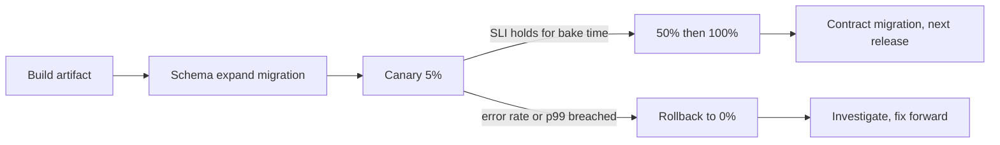

# Deployment and Rollback Strategies

> [!abstract] In one sentence
> A deployment strategy controls how much traffic the new version sees and how fast you can get back — rolling for the default, blue-green for instant switch, canary with metric gates for risky changes, shadow for comparison — and the whole scheme only works if the database and the contracts stay compatible with the version you might roll back to.

> [!tip] Deeper treatment in your system-design vault
> `system-design/13 Observability/Deployment Strategies.md` — read it *after* you have written your own explanation below.

**Map:** [[Product Engineering MOC]] → [[HLD MOC]]

## Definition

A **deployment strategy** is the procedure by which a new version of a service replaces the old one in production: how many instances change at once, how traffic is shifted, what is checked between steps, and how the change is reversed. **Rolling** replaces instances a few at a time; **blue-green** runs a full second environment and switches traffic at once; **canary** sends a small share of traffic to the new version and grows it while watching metrics; **shadow** mirrors traffic to the new version without serving its responses. **Rollback** is the reverse path, and **progressive delivery** automates the step-and-check loop against [[SLI SLO and SLA|SLIs]].

## Problem solved

The deploy is the riskiest routine event in a service's day: most incidents follow a change. Replacing every instance at once turns a bug into a full outage; replacing them unobserved turns a slow leak into a surprise an hour later; an unrehearsed rollback turns a five-minute incident into an hour. Deployment strategies bound the blast radius, shorten detection and make reversal a known, fast, tested action.

## How it works

1. **Rolling (the Kubernetes default).** Pods are replaced in batches governed by `maxSurge` and `maxUnavailable`; a new pod gets traffic only after its [[Health Checks|readiness probe]] passes. Old and new run together, so N and N-1 must be [[Backward Compatibility|compatible]] on every contract and the schema. Rollback is `kubectl rollout undo`.
2. **Blue-green.** Two complete environments; the load balancer or [[Service Discovery|service registry]] points at one. Deploy to the idle one, smoke-test, flip; roll back by flipping back. Costs double capacity and still needs a compatible database, because both colours share it.
3. **Canary.** Route 1%, 5%, 25%, 100% to the new version by pod weight or header. At each step compare the canary's error rate and latency with the baseline for a fixed bake time; advance only if the SLI holds, otherwise shift to 0%. Argo Rollouts and Flagger automate the loop.
4. **Shadow.** Mirror live requests to the new version, discard its responses, diff offline. Good for rewrites; unsafe for non-idempotent writes unless the shadow has its own store.
5. **Keep the database out of the deploy.** Schema changes ship as their own expand step before the code that uses them ([[Versioning and Migrations]]). A deploy is rollback-safe when the previous version runs against the current schema, so the contract step waits until the previous version is gone.
6. **Rehearse the rollback.** Decide the trigger before deploying (error rate above X for Y minutes), make rollback one command with no approval step, and practise it on a routine deploy.

```yaml
# Kubernetes rolling update: two batches of change, zero unavailable
strategy:
  type: RollingUpdate
  rollingUpdate: { maxSurge: 25%, maxUnavailable: 0 }
readinessProbe: { httpGet: { path: /ready, port: 8080 }, periodSeconds: 5 }
# Argo Rollouts canary with a metric gate
steps:
  - setWeight: 5
  - pause: { duration: 10m }
  - analysis: { templates: [{ templateName: error-rate-below-1pct }] }
  - setWeight: 50
  - pause: { duration: 10m }
```

## Architecture



## Use cases

- Every service: the question is which strategy, not whether. Rolling for routine changes; canary for anything touching the hot path or a data format.
- A change best judged by comparison with the current version — a rewrite, a new pricing engine — calls for shadow traffic.
- A hard requirement for instant reversal (a regulated cutover, a vendor switch) points to blue-green.
- A requirement that reads "zero downtime" or "no maintenance window".

## Limitations

- No strategy undoes a data change: a bad write by the new version persists after rollback. The database is the part no deploy strategy protects.
- Canaries need enough traffic to be meaningful; 1% of ten requests a minute tells you nothing for hours.
- Stateful services (databases, brokers) do not fit rolling or blue-green cleanly and need their own upgrade procedure.

## Trade-offs

| You gain | You sacrifice |
|---|---|
| Bounded blast radius and a measured, reversible exposure | Deploy time — a canary with bake times takes an hour, not a minute |
| A rollback path that is fast and rehearsed | Simplicity: two versions in production at once must be reasoned about everywhere |
| Metric-gated releases that need no human on watch | Capacity: blue-green and canaries run extra instances for the duration |

## Failure modes

- **Incompatible schema shipped with the code** → the old version cannot read the new schema → noticed when the rollback makes the incident worse; the whole service has no path back.
- **Readiness passes before the service can serve** (cold caches, unwarmed pools) → noticed as a latency spike on every deploy.
- **Canary compared against the wrong baseline** (global metrics rather than a matched cohort) → a regression hides in the average → noticed after 100% rollout.
- **Rollback trigger undefined** → the on-call debates while the error budget burns → "we waited 40 minutes" in the postmortem.

## Performance

Deploys are a performance event: cold JVMs, empty caches and rebuilt connection pools produce a p99 bump at every rollout. Mitigate with warm-up before readiness, `maxUnavailable: 0` and small batches. Canary analysis must compare percentiles, not means, over a bake time long enough to include GC and cache cycles.

## Scalability

Rolling and canary scale with instance count; the bake time stays constant while the rollout spans more batches. With many services the cost is coordination: a chain where each service canaries for an hour makes a cross-service change a day-long affair — one reason to keep changes independently deployable rather than orchestrated.

## Operational impact

Deploys become routine when automated end to end: artifact, migration, canary, analysis, promote or rollback. On-call needs a dashboard of version per pod and metrics per version, an [[Alerting|alert]] tied to the rollback trigger, and the one-command rollback in the runbook. Track deploy frequency and change failure rate; the [[Error Budgets|error budget]] decides how aggressive the schedule can be.

## Alternatives

- **[[Feature Flags]]** — ship the code with everything, release behaviour by targeting; wins for per-user rollouts and instant kill switches, and complements a deploy strategy rather than replacing it.
- **Maintenance-window deploy** — stop, upgrade, start; wins only for internal tools and stateful components with no online upgrade path.
- **Immutable infrastructure with full re-provision** — every deploy is a new fleet; blue-green at the infrastructure level, where instances cannot be upgraded in place.

## Real-world examples

- Kubernetes' Deployment controller does rolling updates with readiness gating by default; Argo Rollouts and Flagger implement canary analysis against Prometheus queries.
- Netflix's Kayenta popularised automated canary analysis against a matched baseline cluster rather than the whole fleet; [[The Twelve-Factor App]] codifies build, release and run as distinct stages.
- In a stack like yours: a Spring Boot or NestJS service on EKS with `maxUnavailable: 0`, a readiness endpoint that checks the database pool and Redis, Flyway expand migrations as a pre-deploy Job, an Argo Rollouts canary gated on gateway error rate and p99, and the contract migration queued for the release after next.

## Practical exercise

1. Deploy a small service to a local kind cluster with a rolling strategy; run k6 during a rollout and record the p99 bump. Add warm-up before readiness and measure again.
2. Convert the Deployment to an Argo Rollouts canary with a 5% step, a 2-minute pause and an error-rate analysis; deploy a version that returns 5% errors and watch it auto-rollback.
3. Ship a nullable-column migration before a deploy, roll the application back and confirm it still works; repeat with a column drop and observe the failure.
4. Write the rollback trigger and the one-command rollback into the runbook.

## Related concepts

### Prerequisites
- [[Backward Compatibility]] — N and N-1 coexist in every strategy
- [[Versioning and Migrations]] — expand–contract is what makes the database rollback-safe
- [[Testing Strategies]] — the gates before any exposure to traffic
- [[Health Checks]] — readiness decides when a new instance gets traffic

### Related
- [[Error Budgets]] — how much deploy risk the service can afford
- [[Alerting]] — the rollback trigger as an alert
- [[SLI SLO and SLA]] — the metrics a canary is judged against
- [[Service Discovery]] — how blue-green switches traffic
- [[Schema Evolution]] — the table-level mechanics behind compatible migrations
- [[Recovery Time Objective]] — rollback time is part of it

### Builds on this
- [[Feature Flags]] — release decoupled from the deploy described here
- [[Incremental Delivery]] — each slice rides this pipeline

### Design problems where it applies
- [[Design a Payment System]]
- [[Design an API Gateway]]
- [[Design a Feature Flag Service]]

### Projects where it can be implemented
- [[Load Test and Latency Lab]]
- [[Chaos Lab]]

### Resources
- [[The Twelve-Factor App]] — build, release, run
- [[Martin Fowler - Feature Toggles]] — flags alongside deploy strategies
- [[Site Reliability Engineering (Google)]] — release engineering and error budgets

## Personal understanding

> [!question] Explain it without the source
> Write your own explanation here, from memory. Then compare it with the sections above and note what you missed.

### Mastery checklist
- [ ] I can explain it without the original resource
- [ ] I can describe the problem it solves
- [ ] I can compare it with its alternatives
- [ ] I can name its limitations and failure modes
- [ ] I can recognise when it is appropriate in a real system
- [ ] I have applied it in a system design
- [ ] I have validated my assumptions with an experiment or implementation

## Open questions

- [ ] How long should a canary bake for a service whose traffic is bursty, and how do you compare percentiles with so few canary samples?
- [ ] What is the rollback procedure for a Kafka or SQS consumer whose new version has already committed offsets or deleted messages the old version would need?
- [ ] Should the schema expand migration run as a Kubernetes Job before the rollout or inside the application at startup, given multiple replicas?
