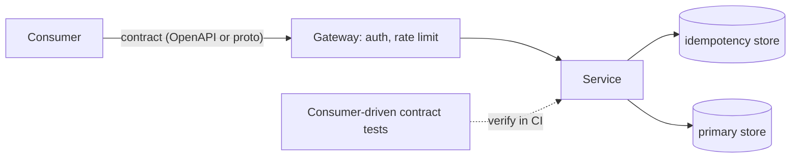

# Designing APIs and Contracts

> [!abstract] In one sentence
> An API contract is the promise a service makes to callers — resources, errors, pagination, idempotency and consistency, written down and tested — and designing it well is what lets the implementation change freely while every consumer keeps working.

> [!tip] Deeper treatment in your system-design vault
> `system-design/10 Architecture Styles/API Design and Versioning.md` — read it *after* you have written your own explanation below.

**Map:** [[Product Engineering MOC]] → [[HLD MOC]]

## Definition

An **API contract** is the complete, documented set of behaviours a caller may rely on: resources and operations, request and response shapes, error semantics, pagination rules, [[Idempotency|idempotency]] guarantees, [[Consistency Models|consistency promises]] (does a read after a write see it?), rate limits and authentication. Designing it is a product activity because the contract *is* the product for every consumer — internal service, mobile app or partner — and it is the one part of a service that cannot be refactored unilaterally.

## Problem solved

Without an explicit contract, the API is whatever the implementation happens to do: field names leak from the database schema, errors are stack traces or bare 500s, retries corrupt data, and consumers code against accidental behaviour (list ordering, null-vs-missing) that breaks when the implementation changes. Every such break is an incident on the consumer's side and a frozen implementation on the provider's. A designed contract makes the stable surface deliberate and small, so everything behind it stays free to change.

## How it works

1. **Model resources around the caller's job**, not your tables. `POST /transfers` with a `status` field beats `PUT /accounts/{id}/balance`: the first expresses intent, the second exposes an implementation and invites races. Nouns for resources, a small set of verbs ([[REST]] or [[gRPC]] methods), one concept per endpoint.
2. **Define the error contract.** A fixed envelope (`code`, `message`, `details`, `request_id`), a stable machine-readable `code` per failure the caller can act on, and HTTP statuses used consistently: 400 for the caller's mistake, 409 for state conflicts, 422 for validation, 429 for [[Rate Limiting|rate limits]], 5xx only for your faults. Document which errors are retryable.
3. **Make writes safe to retry.** Any non-idempotent operation takes an `Idempotency-Key` header; the server stores the key with the first response and replays it on repeats. This is the most important fintech API decision, and it is a contract term.
4. **Paginate deliberately.** Cursor pagination (opaque token, stable under inserts) for feeds and ledgers; offset only for small, static lists. State the maximum page size and the sort order.
5. **State the consistency promise.** "Reads after a successful write reflect it" versus "the list may lag by up to N seconds". Callers design retries and UI around this; leaving it implicit is how "my transfer disappeared" tickets are born.
6. **Write the contract first and test from the consumer side.** An OpenAPI or Protobuf definition is the source of truth; generate clients and stubs from it; add consumer-driven contract tests ([[Testing Strategies]]) so a provider change that breaks a known consumer fails in CI.

```yaml
# OpenAPI fragment: a retry-safe, self-describing write
POST /v1/transfers
headers:
  Idempotency-Key: string (required, UUID, retained 24h)
responses:
  201: { id, status: "pending" | "settled" | "failed", amount, currency, created_at }
  409: { code: "IDEMPOTENCY_KEY_REUSED", message, request_id }   # same key, different body
  422: { code: "INSUFFICIENT_FUNDS", message, request_id }       # not retryable
  429: { code: "RATE_LIMITED", retry_after_ms }                   # retryable after wait
```

## Architecture



> [!example]- Excalidraw version — the same diagram as an editable canvas
> ![[Designing APIs and Contracts.excalidraw]]
> [[Designing APIs and Contracts.excalidraw|Open in Excalidraw]] — needs the Excalidraw plugin (see [[Plugins to Install]]).


## Use cases

- Any endpoint called by a team you do not sit next to, a mobile app you cannot force-update, or an external partner.
- Operations that move money, create orders or send messages — anything where a retried request must not double-apply.
- A service that will be replaced later: the contract is what survives the [[Strangler Pattern|strangler]] migration.
- A design review where "what does the client see when this fails?" has no answer.

## Limitations

- A contract is a commitment: once published, every field and error code is maintained until a deprecation window closes ([[Backward Compatibility]]).
- Over-designed contracts (HATEOAS everywhere, deeply generic envelopes) cost more than they save for internal APIs with two consumers.
- Contracts describe shape and semantics, not performance; a perfectly specified API can still be too slow, and callers will depend on the latency they observe.

## Trade-offs

| You gain | You sacrifice |
|---|---|
| Implementation freedom behind a stable surface | Freedom to change the surface itself — every published field is a promise |
| Safe retries and predictable errors for every caller | Server-side state (idempotency store) and stricter validation work |
| Contract tests that catch breaks before deploy | Up-front design time and a spec kept in sync with code |

## Failure modes

- **Schema leaks into the API** → a column rename breaks three consumers → 4xx/5xx spikes on their side after your deploy; the fix is a shim and a long deprecation.
- **No idempotency on a write** → client timeout plus retry creates two transfers → noticed by reconciliation or the customer; blast radius is financial.
- **Offset pagination on a growing list** → rows skipped or duplicated as inserts shift pages → "missing transactions" reports; changing pagination is itself a breaking change.
- **Error codes as free text** → consumers parse messages → your copy edit becomes their outage.

## Performance

Contract choices set the performance floor: chatty resource models force N+1 round trips, unbounded page sizes let one caller scan a table, synchronous responses for slow operations tie up connections. Design for the caller's job (batch endpoints, `202 Accepted` with a status resource for long work) and cap everything that can be unbounded.

## Scalability

A contract scales with consumers only if it is additive-friendly: optional fields, extensible enums and tolerant readers let dozens of consumers coexist on one version. The idempotency store is the stateful part; it needs a TTL (24 hours is Stripe's documented choice) and a key scoped per caller so it does not become a hot, unbounded table.

## Operational impact

A documented contract with stable error codes is what makes an API supportable: `request_id` in every error joins the caller's report to your [[Distributed Tracing|trace]]; error-code metrics show whether callers or you are failing; contract tests turn "did we break someone?" into a build status. Undocumented APIs produce support load proportional to consumer count.

## Alternatives

- **gRPC with Protobuf** — wins for internal calls where strict typing, streaming and generated clients matter more than browser friendliness.
- **GraphQL** — wins when many clients need different shapes of the same graph; costs query-complexity control and cache simplicity.
- **Event contracts ([[Event Schemas]])** — the asynchronous sibling; wins when the consumer needs facts, not a synchronous answer.

## Real-world examples

- Stripe's API is the reference design: idempotency keys on every POST, a fixed error envelope with stable codes, cursor pagination, and date-based versioning with per-account pinning ([[Stripe - API Versioning]], [[Stripe - Idempotency]]).
- AWS APIs document idempotency per operation and expose `ClientToken` parameters for the same reason ([[AWS Builders Library - Idempotent APIs]]).
- In a stack like yours: a NestJS transfer endpoint behind the gateway, `Idempotency-Key` persisted in Redis with a 24-hour TTL and the first response body, an error envelope shared across services as a library, and a Pact contract test run by the mobile team's suite against your provider on every PR.

## Practical exercise

1. Pick one write endpoint you own with no idempotency key. Add the header, store `(caller, key) -> response` in Redis with a 24-hour TTL, and return the stored response on repeats.
2. Write a test that fires the same request five times concurrently and asserts exactly one side effect.
3. Define the error envelope with three stable codes; make one retryable and one not, and document which.
4. Write a consumer-driven contract test and run it in CI; rename an internal field and confirm the test, not a consumer, catches it.

## Related concepts

### Prerequisites
- [[HTTP and HTTPS]] — the status codes and headers the contract is built from
- [[Idempotency]] — the property that makes writes safe to retry
- [[Translating Product Requirements into Technical Requirements]] — the contract encodes translated requirements

### Related
- [[Rate Limiting]] — a contract term callers must be told about
- [[Backward Compatibility]] — how a published contract evolves
- [[Versioning and Migrations]] — when compatibility cannot be kept
- [[gRPC]] — the typed, binary alternative for internal calls
- [[Data Ownership and Lifecycle]] — the contract exposes only data the service owns
- [[Authentication]] — who the caller is, as part of the contract

### Builds on this
- [[REST]] — one concrete style of contract
- [[Event Schemas]] — contracts for asynchronous messages
- [[Input Validation]] — enforcing the contract at the boundary
- [[Designing for Extensibility]] — contracts designed to grow
- [[API Gateways]] — where cross-cutting contract terms are enforced

### Design problems where it applies
- [[Design a Payment System]]
- [[Design a Webhook Delivery System]]
- [[Design an API Gateway]]
- [[Design a URL Shortener]]

### Projects where it can be implemented
- [[Webhook Relay]]
- [[Double-Entry Ledger Service]]
- [[LLM Gateway]]

### Resources
- [[Stripe - API Versioning]] — contract evolution done well
- [[Stripe - Idempotency]] — idempotency keys as a contract term
- [[AWS Builders Library - Idempotent APIs]] — idempotency at scale
- [[gRPC Core Concepts]] — the typed-contract alternative

## Personal understanding

> [!question] Explain it without the source
> Write your own explanation here, from memory. Then compare it with the sections above and note what you missed.

### Mastery checklist
- [ ] I can explain it without the original resource
- [ ] I can describe the problem it solves
- [ ] I can compare it with its alternatives
- [ ] I can name its limitations and failure modes
- [ ] I can recognise when it is appropriate in a real system
- [ ] I have applied it in a system design
- [ ] I have validated my assumptions with an experiment or implementation

## Open questions

- [ ] Should an idempotency key be scoped per caller, per endpoint, or globally, and what does each choice do to the replay semantics?
- [ ] How do you express a consistency promise in an OpenAPI document so that generated clients actually respect it?
- [ ] At what consumer count does consumer-driven contract testing stop scaling and a provider-owned compatibility suite become the better tool?
