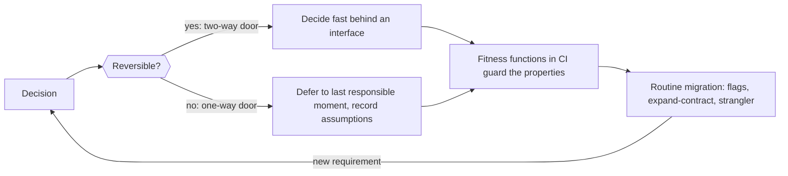

# Designing Systems for Changing Requirements

> [!abstract] In one sentence
> Requirements will change in ways you cannot predict, so the goal is not to guess them but to make change cheap — by deferring irreversible decisions, keeping options open with thin boundaries and compatible contracts, and letting automated fitness functions guard the properties that must survive every change.

> [!tip] Deeper treatment in your system-design vault
> `system-design/10 Architecture Styles/Strangler Fig Migration.md` — read it *after* you have written your own explanation below.

**Map:** [[Product Engineering MOC]] → [[HLD MOC]]

## Definition

**Designing for changing requirements** (evolutionary architecture, in Ford, Parsons and Kua's term) treats the architecture as something revised continuously rather than fixed once. Its tools: classify each decision as **reversible** (a library behind an interface) or **irreversible** (a public API, a data model customers depend on); **defer commitment** on the irreversible ones until the last responsible moment; keep options open cheaply through [[Separation of Concerns|boundaries]], [[Backward Compatibility|compatible contracts]] and [[Designing for Extensibility|extension points]]; and guard the properties a change must not break with **fitness functions** — automated checks on dependency direction, latency budgets, coupling and schema compatibility.

## Problem solved

Big-design-up-front assumes the requirements are known; speculative generality assumes you can guess them. Both are wrong in product companies, where the roadmap changes quarterly. The first produces rigid systems that fight every change; the second produces abstractions nobody uses. Designing for change gives up prediction and optimises the cost of being wrong: the irreversible decisions are few and made late, the reversible ones are cheap to redo, and fitness functions say immediately when a change broke something structural.

## How it works

1. **Sort decisions by reversibility.** Bezos's one-way versus two-way doors: a storage engine behind a repository interface is two-way; the shape of a public event consumed by partners is one-way. Spend design time proportionally — minutes on two-way doors, days on one-way doors.
2. **Defer one-way doors to the last responsible moment** — the point after which deferring further would remove an option. Build the walking skeleton ([[Incremental Delivery]]) with the simplest choice, learn from production, then commit. Do not choose the sharding key or the multi-region topology before you have load data.
3. **Keep options open cheaply.** Thin interfaces at the boundaries you expect to change ([[Hexagonal Architecture]] adapters for datastores, brokers and vendors); additive contracts; [[Feature Flags|flags]] for behaviour you may vary; data models with room (nullable columns, versioned payloads). Cheap is the constraint — an abstraction you never use is the speculative generality you were avoiding.
4. **Guard the properties that must hold with fitness functions.** Encode the rules as CI tests: the domain package imports nothing from infrastructure (ArchUnit in Java, dependency-cruiser in TypeScript); event schemas pass compatibility checks; the p99 of a critical endpoint stays under budget in the load test; no service reads another's tables. A violation fails the build, which is what makes continuous change safe.
5. **Make migration routine.** A system designed for change can run two versions of a contract, migrate data with expand–contract ([[Versioning and Migrations]]) and replace a component slice by slice ([[Strangler Pattern]]). If migrating is a project, change is expensive.
6. **Revisit on triggers.** Record the assumptions behind each one-way door in an ADR with a revisit trigger (scale, customer type, regulation).

```java
// Fitness function: the domain must not depend on infrastructure (ArchUnit, JUnit 5)
@ArchTest
static final ArchRule domainIsPure = noClasses()
    .that().resideInAPackage("..ledger.domain..")
    .should().dependOnClassesThat()
    .resideInAnyPackage("..infra..", "org.springframework..", "javax.persistence..", "jakarta.persistence..");

// Fitness function: a public event stays backward compatible (schema registry check in CI)
// > schema-registry compat --subject transfers-value --schema src/main/avro/Transfer.avsc --level BACKWARD
```

## Architecture



## Use cases

- A product whose roadmap is uncertain beyond a quarter — most of them.
- A design review asking "what if we need multi-tenancy / another region / a second payment provider later?": the answer is which door it is and how you keep it open cheaply.
- A legacy system that must evolve while running, where each change needs a migration path rather than a rewrite.
- A platform shared by several teams, where fitness functions are the only scalable way to keep the structure intact.

## Limitations

- Deferral has a cost when the deferral itself is expensive: a "flexible" data model (everything in JSON) defers decisions by making every query slow; sometimes committing early is cheaper.
- Fitness functions guard known properties; they do not detect that the architecture is wrong for a requirement nobody anticipated.
- Systems with little requirement volatility (a settlement engine implementing a fixed standard) gain more from precise up-front design than from evolvability.

## Trade-offs

| You gain | You sacrifice |
|---|---|
| Cheap response to the requirement you did not predict | Some up-front optimality — the deferred decision runs on the simple choice meanwhile |
| Structural rules enforced automatically rather than by review | CI time and maintenance of the fitness functions themselves |
| Migration as a routine instead of a crisis | Simplicity in the moment: interfaces, flags and compatible contracts are a constant small tax |

## Failure modes

- **Speculative generality** → abstractions for futures that never arrive → noticed as interfaces with one implementation and configuration nobody sets; blast radius is readability and velocity.
- **One-way door walked through early** (public API shape, sharding key) → the "inevitable" change costs a migration with customers → noticed when the roadmap needs it.
- **No fitness functions** → the domain slowly imports the ORM, services read each other's tables → noticed when a local refactor touches everything.
- **Flexibility by schemalessness** → every entity in a JSON column → unindexable queries and validation scattered across services.

## Performance

Evolvability costs little at runtime: an interface call is free after JIT, a flag evaluation is microseconds, a nullable column is bytes. The costly form is deferring data-model decisions with generic structures, where "designed for change" becomes "slow for everyone". Keep the performance budget as a fitness function.

## Scalability

The approach scales with team size through fitness functions, which replace the architect-in-every-review with rules in CI, and with system size through routine migration. Reversibility classification also scales decision-making: most decisions become cheap local calls and only one-way doors need the wider group.

## Operational impact

Changes become smaller and more frequent, which lowers deploy risk; the migration toolkit (flags, expand–contract, traffic splitting) becomes normal operations. The costs are the fitness-function suite and the discipline of recording and revisiting assumptions.

## Alternatives

- **Big design up front** — wins when requirements are genuinely fixed (a standard, a contract) and change is dominated by certification; rare in product work.
- **Rewrite when the architecture no longer fits** — wins almost never; it is what this note exists to avoid.
- **Pure YAGNI with no structural guards** — wins for small teams with strong shared judgement; degrades as the team grows.

## Real-world examples

- Ford, Parsons and Kua's *Building Evolutionary Architectures* introduced fitness functions; ArchUnit and dependency-cruiser are the common implementations in Java and TypeScript.
- Fowler's [[Martin Fowler - Strangler Fig Application]] and Stripe's online migrations ([[Stripe - Online Migrations at Scale]]) show the routine-migration side: systems that change continuously because changing them is a practised capability.
- In a stack like yours: ArchUnit rules forbidding Spring or JPA imports in domain packages; schema-registry compatibility checks on every event PR; a PSP adapter interface so a second provider is a two-way door; and an ADR listing the ledger's sharding key as a deferred one-way door with "revisit at 5x account count" as the trigger.

## Practical exercise

1. List the last ten architectural decisions in a service you own; classify each as a one-way or two-way door and note how long each was deliberated.
2. Add one fitness function to CI — an ArchUnit or dependency-cruiser rule that the domain layer imports no infrastructure — and fix the violations it finds.
3. Find one component (PSP client, broker, cache) with no interface in front of it; add a thin adapter and write the one-paragraph exit path it enables.
4. Record one deferred one-way door in an ADR with its assumptions and a revisit trigger.

## Related concepts

### Prerequisites
- [[Designing for Extensibility]] — the code-level extension points this note builds on
- [[Strangler Pattern]] — routine replacement of a component
- [[Incremental Delivery]] — the delivery style that makes deferral possible
- [[Backward Compatibility]] — contracts that let callers survive change

### Related
- [[Event Schema Evolution]] — compatibility rules for the asynchronous contracts
- [[Versioning and Migrations]] — the migration playbook as a routine
- [[Technical Debt]] — an unrevisited one-way door becomes debt
- [[Hexagonal Architecture]] — adapters as two-way doors
- [[Feature Flags]] — behaviour kept variable at runtime
- [[Prioritizing Reliability Performance Cost and Time to Market]] — the ranking that itself changes with the product

### Builds on this
- [[Modular Monoliths]] — a monolith designed to be split later is this note applied to deployment shape
- [[Build vs Buy Decisions]] — keeping the exit path cheap is keeping a decision reversible

### Design problems where it applies
- [[Design a Payment System]]
- [[Design an IAM Service]]
- [[Design a Workflow Orchestrator]]

### Projects where it can be implemented
- [[Double-Entry Ledger Service]]
- [[LLM Gateway]]

### Resources
- [[Fundamentals of Software Architecture]] — architecture characteristics and fitness functions
- [[Martin Fowler - Strangler Fig Application]] — change as routine replacement
- [[Hexagonal Architecture (Cockburn)]] — ports and adapters as the option-keeping structure

## Personal understanding

> [!question] Explain it without the source
> Write your own explanation here, from memory. Then compare it with the sections above and note what you missed.

### Mastery checklist
- [ ] I can explain it without the original resource
- [ ] I can describe the problem it solves
- [ ] I can compare it with its alternatives
- [ ] I can name its limitations and failure modes
- [ ] I can recognise when it is appropriate in a real system
- [ ] I have applied it in a system design
- [ ] I have validated my assumptions with an experiment or implementation

## Open questions

- [ ] Which decisions in a ledger service are truly one-way doors — the entry schema, the account identifier format, the sharding key — and which only feel that way?
- [ ] How do you keep a fitness-function suite from becoming a list of rules nobody remembers the reason for?
- [ ] When is a flexible data model (JSON columns, schemaless) a legitimate way to defer commitment, and when is it just an unindexed debt?
