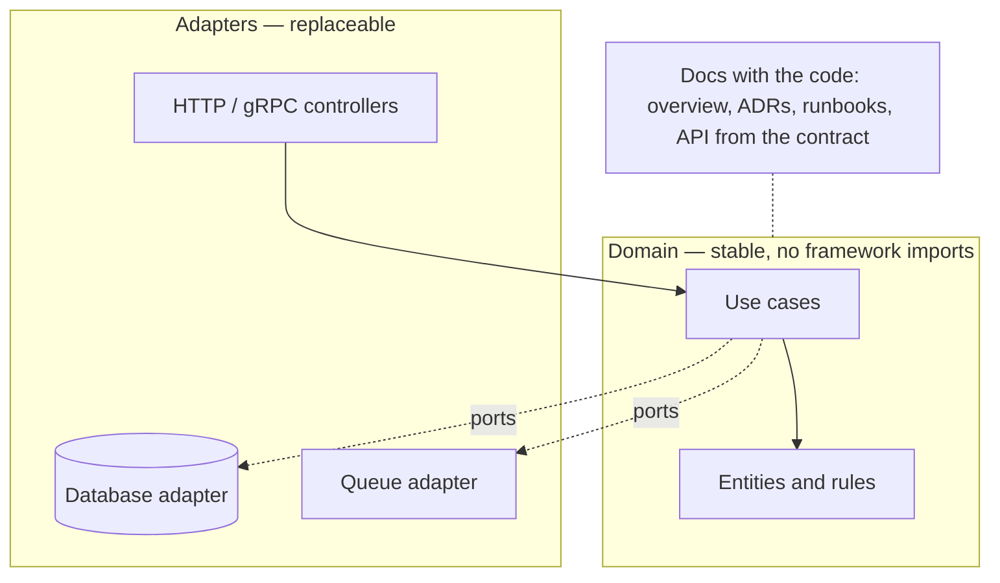

# Designing for Maintainability

> [!abstract] In one sentence
> Most of a system's cost is paid after it ships, by people who did not write it, so designing for maintainability — readable code, small modules, explicit boundaries, docs and operability next to the code — is the highest-leverage optimisation most teams never budget for.

**Map:** [[Product Engineering MOC]] → [[HLD MOC]]

## Definition

**Maintainability** is the ease with which a system can be understood, changed, fixed and operated by someone other than its original author, months or years later. It is a property of code (readability, module size, naming, tests), of architecture (boundaries that match the domain, dependencies that point one way), of documentation (decisions and runbooks beside the code) and of operations (can you tell what it is doing, and change it safely). It differs from [[Operational Simplicity]] (fewer moving parts to run) and [[Evaluating Architectural Complexity|complexity evaluation]] (how much structure the problem justifies): maintainability is how cheap each future change is, given the structure you chose.

## Problem solved

Systems outlive their authors and their original requirements. A service written for speed by one engineer becomes a module five people change, then a system nobody fully understands, where each change takes longer than the last and each fix introduces a regression. The slowdown is not linear: unclear code demands more reading per change and more defensive tests, until velocity is spent on understanding rather than building. Maintainability keeps the cost of the next change close to the cost of the first.

## How it works

1. **Optimise for reading.** Code is read far more often than written. Names say what, not how (`settleTransfer`, not `processData2`); functions fit on a screen; control flow is visible without a debugger. A clever one-liner that saves a minute to write costs a minute on every future read.
2. **Keep modules small and boundaries explicit.** A module exposes a narrow interface and hides its data; dependencies point inward toward the domain ([[Hexagonal Architecture]]) and never form cycles. The test: can you change the inside without touching the outside?
3. **Match the code to the domain.** Concepts carry the names the business uses ([[Domain-Driven Design]]), so a reader who knows the product can find the code for a behaviour by name. Infrastructure (HTTP, SQL, queues) stays out of domain logic ([[Separation of Concerns]]).
4. **Make the system explain itself.** Structured [[Logging|logs]] with request ids, [[Metrics|metrics]] per operation, [[Health Checks|health checks]] and a runbook per alert are maintainability for the person on call. A system you cannot observe is one you cannot safely change.
5. **Keep documentation next to the code and short.** An `ARCHITECTURE.md` with the module map, decision records for the non-obvious choices (why SQS, why no cache here), and comments that explain *why*. Documentation elsewhere rots; documentation in the PR is reviewed.
6. **Leave it better.** Every change that touches confusing code tidies a little; refactors ride along with features rather than waiting for a refactoring sprint that never comes. Tests ([[Testing Strategies]]) make this cheap.

```text
Maintainability review questions for a PR
- Could a new team member find this code from the feature name?
- Does any function need a comment to explain what it does? Rename or split it instead.
- Are there new dependencies between modules, and do they point toward the domain?
- Is the behaviour observable: log line, metric, or trace span for the new path?
- Is the non-obvious decision recorded (ADR or a why-comment)?
```

## Architecture



> [!example]- Excalidraw version — the same diagram as an editable canvas
> ![[Designing for Maintainability.excalidraw]]
> [[Designing for Maintainability.excalidraw|Open in Excalidraw]] — needs the Excalidraw plugin (see [[Plugins to Install]]).


No single diagram captures maintainability; structurally it shows up as a shallow, acyclic dependency graph (adapters depend on the domain, never the reverse), a module map that fits on one page, and documentation versioned with the code: architecture overview, decision records, runbooks and API docs generated from the contract.

## Use cases

- A codebase where estimates keep growing for the same size of change, or every change needs the original author.
- Onboarding: if a new engineer cannot ship a small change in the first week, maintainability is the bottleneck.
- Any component expected to live more than a year — in a product company, nearly all of them.
- A "temporary" solution: temporary code that works becomes permanent.

## Limitations

- Diminishing returns: a throwaway prototype does not need module boundaries and decision records.
- Over-abstraction in the name of maintainability (interfaces with one implementation, layers that only forward calls) makes code harder to read.
- Hard to measure directly; proxies (lead time for changes, change failure rate, time-to-first-PR) are useful but gameable.

## Trade-offs

| You gain | You sacrifice |
|---|---|
| Cheap future changes and faster onboarding | Some speed on the first version — naming, splitting and documenting take time |
| Fewer regressions, because boundaries limit what a change can touch | The thrill of clever code — explicit beats compact |
| A system the on-call engineer can reason about at 3 a.m. | "Just do it quickly" without recording why |

## Failure modes

- **God module** (one service class that does everything) → every change touches it, conflicts and regressions multiply → noticed as a file with hundreds of commits and a long review queue.
- **Documentation drift** → the README describes a design two refactors old → a new joiner builds on the wrong mental model.
- **Cleverness debt** → metaprogramming or implicit behaviour saves lines once → "nobody dares touch this", and the module becomes the team's bottleneck.
- **Unobservable paths** → a change breaks a flow with no logs or metrics → noticed by customers; diagnosis takes days instead of minutes.

## Performance

Maintainable code is not slow code; the readable and the clever version usually compile to the same thing, and where they differ a profiler should drive the exception, documented as such. The performance maintainability affects is the team's: lead time for changes and mean time to diagnose.

## Scalability

Maintainability is what lets a codebase scale with the team: clear boundaries let people work in parallel, a module map lets ownership be assigned, domain vocabulary lets product and engineering talk about the same things. A system maintainable at five engineers can grow to fifty; one that is not stalls at ten regardless of architecture.

## Operational impact

Maintainability and operability are the same discipline at different hours of the day. The runbook, the dashboard and the structured log line are maintainability artifacts for the on-call engineer; the ADR explaining why a retry is disabled stops someone re-enabling it mid-incident. Teams that invest here see fewer, shorter incidents.

## Alternatives

- **Rewrite when it gets bad** — wins almost never; the rewrite inherits the same pressures while the old system keeps changing.
- **Heavy process** (mandatory design docs, architecture boards) — wins in regulated domains; elsewhere it slows change without improving the code that ships.
- **Strict framework conventions** (Rails-style "one way") — wins for teams that accept the constraints; maintainability from uniformity rather than judgement.

## Real-world examples

- Shopify's modular monolith work ([[Shopify - Deconstructing the Monolith]]) is a maintainability programme at scale: enforced module boundaries inside one codebase, with tooling to detect violations.
- Ousterhout's *A Philosophy of Software Design* ([[A Philosophy of Software Design (Talk)]]) argues that complexity accumulates through dependencies and obscurity, and that deep modules with simple interfaces are the countermeasure.
- In a stack like yours: a Spring Boot service organised by domain packages (`transfers`, `ledger`, `settlement`) rather than by layer, each with a public facade and package-private internals; ADRs for the queue choice and the idempotency design; a runbook linked from every alert; a PR template with the review questions above.

## Practical exercise

1. Pick the file in a service you own with the most commits in the last six months. Read it as a new joiner and note every point where you needed context the file does not give.
2. Extract one cohesive piece into its own module with a narrow interface, keeping tests green; record in the PR which review question it answers.
3. Add an `ARCHITECTURE.md` with a module map and one ADR for the least obvious decision in the service.
4. Measure: time a colleague making a small change to that file before and after, or track the next month's review time for it.

## Related concepts

### Prerequisites
- [[Evaluating Architectural Complexity]] — decide how much structure the problem deserves before polishing it
- [[Testing Strategies]] — the safety net that makes continuous tidying cheap

### Related
- [[Operational Simplicity]] — fewer parts to run is maintainability at the system level
- [[Hexagonal Architecture]] — the dependency direction that keeps domain code clean
- [[Domain-Driven Design]] — naming code after the business
- [[Production Incident Analysis]] — incidents reveal where maintainability is missing
- [[Modular Monoliths]] — maintainable boundaries without a network hop

### Builds on this
- [[Separation of Concerns]] — the principle maintainability is applied through
- [[Technical Debt]] — the cost of not doing this, made explicit
- [[Designing for Extensibility]] — a maintainable system is the one worth extending

### Design problems where it applies
- [[Design a Payment System]]
- [[Design an API Gateway]]
- [[Design a Workflow Orchestrator]]

### Projects where it can be implemented
- [[Double-Entry Ledger Service]]
- [[Webhook Relay]]

### Resources
- [[A Philosophy of Software Design (Talk)]] — deep modules, complexity as dependency and obscurity
- [[Shopify - Deconstructing the Monolith]] — enforced boundaries at scale
- [[Martin Fowler - The Practical Test Pyramid]] — the test suite that makes refactoring safe
- [[Simple Made Easy]] — simple versus easy

## Personal understanding

> [!question] Explain it without the source
> Write your own explanation here, from memory. Then compare it with the sections above and note what you missed.

### Mastery checklist
- [ ] I can explain it without the original resource
- [ ] I can describe the problem it solves
- [ ] I can compare it with its alternatives
- [ ] I can name its limitations and failure modes
- [ ] I can recognise when it is appropriate in a real system
- [ ] I have applied it in a system design
- [ ] I have validated my assumptions with an experiment or implementation

## Open questions

- [ ] Which measurable proxy for maintainability (lead time, change failure rate, time-to-first-PR) would a team in a stack like yours actually keep tracking?
- [ ] When is an interface with a single implementation justified — only at a module boundary, or also inside one?
- [ ] How do you keep ADRs from becoming a graveyard — what triggers a revisit?
