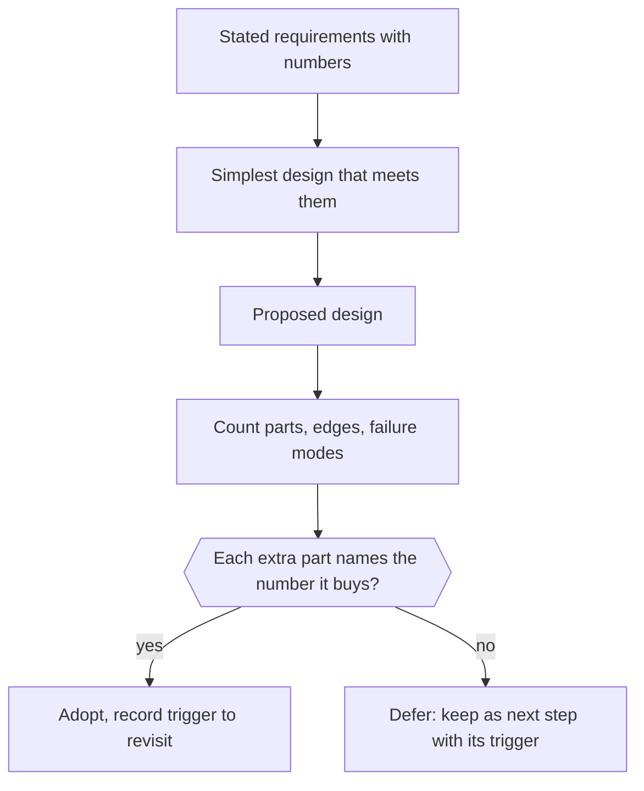

# Evaluating Architectural Complexity

> [!abstract] In one sentence
> Architectural complexity is the count of moving parts, interactions and failure modes you must understand to change or run a system; evaluating it means separating what the problem requires from what the solution added, and spending complexity like a budget — only against a requirement that can state the number it buys.

> [!tip] Deeper treatment in your system-design vault
> `system-design/10 Architecture Styles/The Distributed Monolith Anti-Pattern.md` — read it *after* you have written your own explanation below.

**Map:** [[Product Engineering MOC]] → [[HLD MOC]]

## Definition

**Essential complexity** is inherent in the problem: money must balance, partitions happen. **Accidental complexity** (Brooks) is added by the solution: a second datastore, a network hop where a function call would do, a broker between two services that always deploy together. **Architectural complexity** is the total a team must hold in its head to change the system safely; it grows with the components, the interactions between them and the failure modes those interactions create. A **complexity budget** treats that total as finite and spends it deliberately, each spend tied to a [[Functional vs Non-Functional Requirements|requirement]] with a number.

## Problem solved

Complexity arrives one reasonable decision at a time. Each new service, broker or cache is justified in isolation, and the sum is a system where a simple feature touches six repositories and an incident has a dozen plausible causes. The worst outcome is the **distributed monolith**: services that must deploy together, share a database or call each other in synchronous chains, paying the full cost of distribution with none of its independence. Evaluating complexity explicitly catches the unearned component at the design review, when removing it is a deleted paragraph.

## How it works

1. **Count the parts.** Deployables, datastores, brokers, external dependencies, scheduled jobs, infrastructure. Each has a deploy path, a monitoring surface, an upgrade cycle and a way to fail.
2. **Count the interactions and their failure modes.** For every edge, ask what happens when it is slow, fails halfway or returns twice. A synchronous call adds timeouts, retries and [[Circuit Breakers|breakers]]; a queue adds duplicates, ordering and lag; a second datastore adds a consistency boundary. The failure-mode count is the real cost.
3. **Name what each part buys.** Next to each component, write the requirement and the number: "Redis cache: p99 of `GET /balance` under 50 ms at 2k rps; without it, 180 ms". No number marks a candidate for removal or deferral.
4. **Separate essential from accidental.** Would the simplest solution to the stated requirements still need this part? A [[Saga Pattern|saga]] is essential when a workflow truly spans owners and accidental when the two services could be one module; [[Kafka]] is essential for replay and high throughput and accidental for three events a minute.
5. **Compare against the next-simplest design.** Write down the [[Modular Monoliths|modular monolith]] version, the "PostgreSQL does it" version, the synchronous version. If it meets the numbers, the complex design is not earned yet; keep it as the next step with the trigger that earns it.
6. **Set the budget.** A team can run only so many technologies and services well; name the number (an [[Operational Simplicity|operational]] constraint) and require a design review to say what is removed when something is added.

```text
Proposed: split "orders" into orders, pricing, inventory services on Kafka
Parts added:        +2 deployables, +1 broker, +2 topics, +2 consumer groups, +1 saga
Failure modes added: partial order (pricing done, inventory not), duplicate events,
                     consumer lag, broker outage, cross-service debugging, 3 deploy pipelines
Requirement served: "pricing team deploys independently" -> no number; "inventory at 10x"
                     -> 10x is 300 rps, one Postgres handles it
Simpler design:     modular monolith with orders/pricing/inventory packages, one DB,
                     an outbox for the one external event; meets every stated number
Decision:           not earned; adopt the modular monolith, revisit when pricing deploys
                     block orders more than N times a quarter, or at 50x volume
```

## Architecture



> [!example]- Excalidraw version — the same diagram as an editable canvas
> ![[Evaluating Architectural Complexity.excalidraw]]
> [[Evaluating Architectural Complexity.excalidraw|Open in Excalidraw]] — needs the Excalidraw plugin (see [[Plugins to Install]]).


## Use cases

- A design proposing microservices, Kafka, CQRS or a second datastore for a system with one team and modest load.
- A system where a feature routinely touches many repositories and deploys must be coordinated: the distributed-monolith symptom.
- A greenfield design: choosing the starting point (usually a modular monolith with one database) and the triggers for the next steps.
- An interview answer: the strongest candidates say what they would *not* add yet, and why.

## Limitations

- Some complexity must be bought before the number proves it: a payments ledger needs idempotency and an audit trail from day one, because retrofitting costs far more than carrying them.
- Counting parts is a proxy; one component with a huge internal surface (a 500-table database) can be more complex than five small services.
- Organisational boundaries are requirements too; "two teams must deploy independently" justifies a split without a load number, if stated as the reason.

## Trade-offs

| You gain | You sacrifice |
|---|---|
| A system the team can understand, run and change end to end | Headroom — the simpler design may need the deferred step sooner than hoped |
| Deferred components arrive when their requirement is real, with evidence to design them well | The appeal of a modern architecture on the diagram |
| Fewer failure modes, fewer pipelines, cheaper debugging | Splitting teams along service boundaries before the services exist |

## Failure modes

- **Distributed monolith** → services that must deploy together and call each other synchronously → noticed when a one-line change needs four PRs and an incident spans every dashboard; blast radius is the whole system.
- **Resume-driven architecture** → Kafka for three events a minute → noticed as a broker upgrade incident for a component carrying no load.
- **Complexity never revisited** → the deferred step's trigger fires and nobody notices → the monolith's database saturates with no plan to split.
- **Simplicity past its limit** → PostgreSQL as queue, cache and search beyond what it can carry → noticed as lock contention; the trigger should have been in the ADR.

## Performance

Accidental complexity usually costs latency: every hop is a round trip with a tail, every broker adds queueing, every extra datastore adds a consistency wait. The simplest design is often the fastest at modest scale; the complex one wins only when the simple one's measured limit is reached — the number the ADR should carry.

## Scalability

The budget approach grows complexity with evidence: each order of magnitude in load or team size triggers a review of which deferred step is now earned. A system that bought all its complexity up front often bought the wrong complexity, because it was designed before the load was known.

## Operational impact

Every part is a dashboard, an alert set, an upgrade cycle and a runbook; every interaction is a class of incident. Keeping the count low is the most effective way to reduce on-call load, and the "next step with trigger" list makes growth planned instead of reactive.

## Alternatives

- **Architecture fitness functions** ([[Designing Systems for Changing Requirements]]) — automated checks on coupling and dependency direction; enforce a budget in CI once one has been set.
- **Formal complexity metrics** (cyclomatic, coupling, cohesion) — wins at code level, weak at architecture level where the costly complexity is in interactions.
- **Conway-first design** — shape the architecture to the teams; wins in large organisations, risks splitting a system before the teams exist.

## Real-world examples

- Fowler's "monolith first" guidance and Shopify's modular-monolith programme ([[Shopify - Deconstructing the Monolith]]) are the mainstream statements of the budget approach.
- Uber's domain-oriented architecture ([[Uber - Domain-Oriented Microservice Architecture]]) is the reverse lesson: thousands of microservices created so much interaction complexity that they had to be regrouped into domains with gateways.
- In a stack like yours: one Spring Boot or NestJS deployable per bounded context, PostgreSQL per service, Redis for the two caches with a named latency number, a managed queue for events that truly cross services — and an ADR listing "introduce a stream processor" as the next step, earned when the fraud pipeline's lag exceeds its budget.

## Practical exercise

1. Draw the current architecture of one system you work on and count parts, edges and distinct failure modes.
2. For each part, write the requirement and the number it serves; mark every part with no number.
3. Sketch the next-simplest design (fewer deployables, one datastore, synchronous where latency allows) and check it against the numbers.
4. Write an ADR that justifies each marked part or lists it as a deferred step with its trigger.

## Related concepts

### Prerequisites
- [[Monoliths]] — the simplest starting point and its real limits
- [[Microservices]] — the complexity most often bought before it is earned
- [[Functional vs Non-Functional Requirements]] — the numbers every part must be traced to

### Related
- [[Saga Pattern]] — essential when workflows span owners, accidental when they need not
- [[Performance vs Cost Trade-offs]] — complexity is a cost line too
- [[Modular Monoliths]] — the usual next-simplest design
- [[Event-Driven Architecture]] — powerful and expensive; a frequent unearned spend
- [[Kafka]] — the component most often adopted ahead of its requirement
- [[Redis]] — cheap complexity, but still complexity

### Builds on this
- [[Operational Simplicity]] — the operational consequence of a kept budget
- [[Designing for Maintainability]] — maintainable code assumes an understandable architecture
- [[Technical Debt]] — accidental complexity is architectural debt

### Design problems where it applies
- [[Design a URL Shortener]]
- [[Design a Payment System]]
- [[Design a Notification System]]
- [[Design an Inventory Management System]]

### Projects where it can be implemented
- [[Durable Job Scheduler]]
- [[Double-Entry Ledger Service]]

### Resources
- [[Fundamentals of Software Architecture]] — architecture styles and their trade-offs
- [[Simple Made Easy]] — complexity as entanglement
- [[Uber - Domain-Oriented Microservice Architecture]] — complexity at scale and its correction
- [[Shopify - Deconstructing the Monolith]] — the budgeted alternative

## Personal understanding

> [!question] Explain it without the source
> Write your own explanation here, from memory. Then compare it with the sections above and note what you missed.

### Mastery checklist
- [ ] I can explain it without the original resource
- [ ] I can describe the problem it solves
- [ ] I can compare it with its alternatives
- [ ] I can name its limitations and failure modes
- [ ] I can recognise when it is appropriate in a real system
- [ ] I have applied it in a system design
- [ ] I have validated my assumptions with an experiment or implementation

## Open questions

- [ ] What is the concrete trigger that earns a stream processor over a queue plus workers for a fraud-scoring pipeline — lag, throughput, or the need for replay?
- [ ] How do you count the complexity of a managed service honestly — is MSK one part or several, given its failure modes?
- [ ] Which complexity must a fintech buy up front regardless of scale (idempotency, audit, reconciliation), and how do you argue for it without a number?
