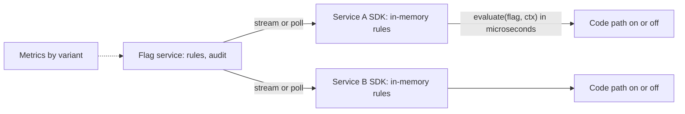

# Feature Flags

> [!abstract] In one sentence
> A feature flag separates *deploy* (code is on the servers) from *release* (users see the behaviour), giving you dark launches, targeted rollouts, instant kill switches and experiments — at the price of two code paths that must both work until the flag is deleted.

> [!tip] Deeper treatment in your system-design vault
> `system-design/13 Observability/Deployment Strategies.md` — read it *after* you have written your own explanation below.

**Map:** [[Product Engineering MOC]] → [[HLD MOC]]

## Definition

A **feature flag** (toggle) is a named condition evaluated at runtime — `if (flags.isEnabled("new-settlement-path", context))` — whose value comes from configuration rather than code and can change without a deploy. The context (user, account, region) lets a flag target a slice rather than everyone. Four types with different lifetimes: **release** flags (ship dark, remove within weeks), **ops** flags (kill switches and load-shedding levers, long-lived), **experiment** flags (A/B tests, removed when the experiment ends) and **permission** flags (entitlements per tier, permanent and really configuration).

## Problem solved

Before flags, a feature was visible the moment its code deployed, so a risky change meant either a long-lived branch merged at the last moment (big-bang release) or a rollback deploy taking minutes to hours while every user was affected. Flags let incomplete work merge to trunk and deploy continuously while invisible, let a release start with 1% of traffic, and turn "roll back" into a config change that takes effect in seconds. They are also the primary lever for [[Graceful Degradation|degrading gracefully]]: a kill switch on a non-critical dependency is a flag.

## How it works

1. **Define the flag** with a type, an owner, a default (off) and, for release and experiment flags, an expiry date. The definition lives in a flag service or config file, never only in code.
2. **Evaluate locally.** The SDK keeps the full rule set in memory and evaluates `flag + context -> variant` in microseconds, refreshing rules by polling or streaming so a network blip never blocks a request. When the service is unreachable, evaluation falls back to the default.
3. **Target.** Rules go from coarse to fine: internal accounts; 5% by a stable hash of the user id; a region; everyone. The hash must be deterministic per user, not per request, or users flicker between behaviours.
4. **Observe by variant.** Error rate, latency and conversion are tagged with the flag variant so you can compare on versus off and decide whether to advance or kill.
5. **Finish.** When the rollout reaches 100% and holds, delete the flag and the old path in a follow-up PR. A flag past its expiry is [[Technical Debt|debt]] with interest paid on every read of that code.

```typescript
// evaluation is local, deterministic per user, and fails to the default
const ctx = { userId: req.user.id, accountTier: req.user.tier, region: req.region };
if (flags.isEnabled("new-settlement-path", ctx, /* default */ false)) {
  return settlementV2.run(transfer);      // tagged: variant=on
}
return settlementV1.run(transfer);         // tagged: variant=off
```

## Architecture



## Use cases

- A change too risky to release to everyone at once: new payment path, new ranking model, new storage backend — "can we try it on 1% first?".
- Trunk-based development where half-finished features merge daily without being visible ([[Incremental Delivery]]).
- Operational levers: disable recommendations under load, switch a provider, cap a batch size — anything you want to change at 3 a.m. without a deploy.
- Experiments and entitlements, where different users should deliberately see different behaviour.

## Limitations

- Two code paths means two things to test; N independent flags have 2^N combinations and you will test a handful.
- Flags do not help with database changes: a flag can switch the read path, but the schema must already be [[Backward Compatibility|compatible]] with both.
- A kill switch only works if the fallback path is exercised; a flag "on" for a year hides a fallback nobody has run since.

## Trade-offs

| You gain | You sacrifice |
|---|---|
| Release decoupled from deploy; rollback in seconds | Two live code paths per flag and the testing burden that implies |
| Targeted rollouts and experiments with per-variant metrics | Code clarity — every flag is a branch the next reader must understand |
| Kill switches without an engineer on the deploy pipeline | A new runtime dependency (the flag service) that must itself be reliable and audited |

## Failure modes

- **Flag service unreachable, SDK blocks or throws** → every request fails → an outage caused by a config system; the SDK must serve cached rules and defaults.
- **Non-deterministic bucketing** → the same user sees both variants across requests → "the UI keeps changing" tickets and corrupted experiment data.
- **Stale flags accumulate** → hundreds of toggles, nobody knows which are live → a flip for one feature changes another; the blast radius is unknowable.
- **Flag flipped without an audit trail** → an incident with no deploy to blame → noticed only if the service logs who changed what and when.

## Performance

Local evaluation costs microseconds and no I/O; rule refresh is a background concern. Avoid remote evaluation per request and context objects that need database lookups to build. Flag definitions are small — tens of kilobytes for hundreds of flags — so caching the whole set in each process is the norm.

## Scalability

Flags scale across services trivially (each SDK holds its own copy) but badly across time: the cost is the growing inventory. A rule such as "release flags expire in 30 days, CI fails on expired flags" keeps the count bounded as the team grows. The flag service must fan out rule updates to thousands of SDK instances; streaming with a polling fallback is the usual design.

## Operational impact

A flag service becomes tier-one infrastructure the moment a kill switch depends on it, so it needs its own SLO, audit log and access control. Dashboards show metrics by variant, and the runbook for any flagged feature starts with "turn it off". The recurring chore is cleanup: a weekly list of expired flags, owned by the team that created them.

## Alternatives

- **Branch by abstraction** — an interface with two implementations switched at build or startup; wins when the switch never needs to happen at runtime.
- **Canary deploys ([[Deployment and Rollback Strategies]])** — route a share of traffic to new pods; wins for infrastructure changes that cannot be flagged in code, loses per-user targeting.
- **Configuration with a restart** — environment variables or ConfigMaps; wins for ops levers where a rolling restart is acceptable.

## Real-world examples

- Fowler's toggle taxonomy is the standard vocabulary ([[Martin Fowler - Feature Toggles]]); LaunchDarkly, Unleash ([[Unleash Feature Flags]]) and Flagsmith implement the streaming-rules, local-evaluation model.
- Facebook's Gatekeeper and Google's experiment frameworks are the large-scale originals: every launch is a gradual rollout by population slice with metrics per variant.
- In a stack like yours: an Unleash or in-house flag service on Kubernetes, SDKs in Spring Boot and NestJS caching rules in memory with a 10-second poll, a `settlement.v2` release flag rolled out by account hash, an ops kill switch on the fraud-scoring call that falls back to rules-only, and a CI check that fails when a flag's expiry has passed.

## Practical exercise

1. In the [[Feature Flag Service and SDK]] project (or Unleash in Docker Compose), create a release flag with a 10% rollout by user-id hash.
2. Write a test proving the same user id always gets the same variant across 1,000 evaluations, and that a random population lands within a few percent of 10%.
3. Stop the flag service under k6 load; verify evaluation continues from cached rules and the default applies for unknown flags.
4. Tag request metrics with the variant, flip to 100%, then delete the flag and the old path in a follow-up PR; measure how long the cycle took.

## Related concepts

### Prerequisites
- [[Deployment and Rollback Strategies]] — flags decouple release from the deploy these describe
- [[Backward Compatibility]] — both code paths share one schema and one contract

### Related
- [[Designing for Extensibility]] — flags as runtime variation points
- [[Technical Debt]] — stale flags are the most common small debt
- [[Strangler Pattern]] — flags control the per-slice traffic shift
- [[Multi-Level Caching]] — the SDK's in-process rule cache is one level of it

### Builds on this
- [[Incremental Delivery]] — trunk-based thin slices depend on dark launches
- [[Graceful Degradation]] — kill switches are the manual degradation lever

### Design problems where it applies
- [[Design a Feature Flag Service]]
- [[Design a Payment System]]
- [[Design a Social Feed]]

### Projects where it can be implemented
- [[Feature Flag Service and SDK]]
- [[LLM Gateway]]

### Resources
- [[Martin Fowler - Feature Toggles]] — the taxonomy and lifecycle
- [[Unleash Feature Flags]] — an open-source implementation to read
- [[The Twelve-Factor App]] — config separated from code

## Personal understanding

> [!question] Explain it without the source
> Write your own explanation here, from memory. Then compare it with the sections above and note what you missed.

### Mastery checklist
- [ ] I can explain it without the original resource
- [ ] I can describe the problem it solves
- [ ] I can compare it with its alternatives
- [ ] I can name its limitations and failure modes
- [ ] I can recognise when it is appropriate in a real system
- [ ] I have applied it in a system design
- [ ] I have validated my assumptions with an experiment or implementation

## Open questions

- [ ] How should a flag SDK behave on cold start when the flag service is down — serve defaults, refuse to start, or load the last snapshot from disk?
- [ ] What is the right way to test a system with 30 flags — pairwise combinations, only the production configuration plus each single flip, or something else?
- [ ] Should permission flags live in the flag service at all, or in the IAM service as entitlements?
