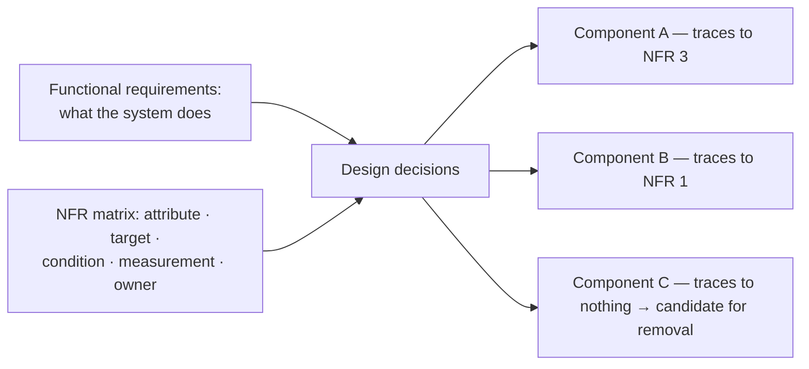

# Functional vs Non-Functional Requirements

> [!abstract] In one sentence
> Functional requirements are the features; non-functional requirements (latency, availability, durability, consistency, cost, compliance) are the quality bar — and since two systems with identical features and different NFRs have completely different architectures, the NFRs are what you actually design for.

> [!tip] Deeper treatment in your system-design vault
> `system-design/15 Interview Playbook/The System Design Interview Framework.md` — read it *after* you have written your own explanation below.

**Map:** [[Product Engineering MOC]] → [[HLD MOC]]

## Definition

A **functional requirement** describes a behaviour the system must exhibit: "a user can transfer money to another wallet", "an admin can export last month's transactions". A **non-functional requirement** (NFR, quality attribute) describes how the system delivers those behaviours: how fast, how available, how durable, how consistent, at what cost, under which regulations. Functional requirements are satisfied or not; NFRs are satisfied to a degree, which is why they need a number and a measurement method. The same feature list with "99.9% available, eventually consistent" versus "99.99% available, strongly consistent, auditable" produces two different systems.

## Problem solved

Teams capture features (visible, demoable, in the PRD) and skip quality attributes (invisible until violated). The result passes every functional test and then fails in production because nobody said it had to survive 2,000 requests per second, a region outage, or a regulator asking for a seven-year audit trail. Naming NFRs separately, early and numerically turns "it's slow" into a defect against a stated target rather than an argument about opinions.

## How it works

1. **Separate the two lists.** Functional requirements as verbs with actors ("customer initiates refund"). NFRs as attribute + number + condition + measurement: "p99 latency of `GET /balance` under 100 ms at 1,000 rps, measured at the gateway".
2. **Cover the standard families.** [[Latency]] (percentiles, not averages), [[Throughput]] (peak, not average), [[Availability]] (an [[SLI SLO and SLA|SLO]] plus what "down" means), durability (acceptable loss — a [[Recovery Point Objective]]), consistency (which reads may be stale, for how long), [[Scalability]] (what must grow 10x without redesign), security and compliance (residency, retention, audit), operability (who runs it, how it is observed) and cost (per month or per transaction).
3. **Attach a measurement.** An NFR that cannot be observed in production is a wish. Latency and availability become SLIs; durability becomes a restore drill; consistency becomes an invariant check.
4. **Find the conflicts and rank them.** Strong consistency fights availability under partition ([[CAP Theorem]]); low latency fights cost; auditability fights deletion obligations. Write down which wins when they collide, because the architecture is the resolution of those conflicts.
5. **Let the NFRs choose the architecture.** Durability and auditability push you to an append-only ledger; a 50 ms read target at scale pushes you to caching; a single-region 99.9% target lets you skip multi-region entirely.

```text
Attribute      Requirement                                   Measured by
latency        p99 < 100 ms for GET /balance at 1k rps       gateway histogram
availability   99.95% monthly, "down" = error rate > 1%      SLO burn-rate alert
durability     no committed transfer lost (RPO = 0)          restore drill, WAL replication
consistency    balance reads reflect own writes immediately  invariant test after write
compliance     transaction records retained 7 years          retention policy + audit
cost           < 0.1 INR per transfer at 10x current volume  monthly cost / transfers
```

## Architecture



> [!example]- Excalidraw version — the same diagram as an editable canvas
> ![[Functional vs Non-Functional Requirements.excalidraw]]
> [[Functional vs Non-Functional Requirements.excalidraw|Open in Excalidraw]] — needs the Excalidraw plugin (see [[Plugins to Install]]).


No runtime component; the structure is a requirements matrix with one row per attribute and columns for target, condition, measurement and owner. The matrix is the input to every later decision: each component in the design should trace to the NFR that justified it, and a component that traces to nothing is a candidate for removal.

## Use cases

- A design review where every argument is about mechanisms (Kafka vs SQS) and nobody has stated the latency or ordering requirement that would settle it.
- A system design interview: the interviewer expects you to ask for scale, latency and consistency before drawing boxes.
- A migration where "at least as good as today" has to become measurable targets.
- Any feature touching money or regulated data, where durability and auditability dominate.

## Limitations

- NFR numbers are often guesses at the start; too strict drives over-engineering, too loose gets ignored. Revisit with real traffic.
- Some qualities resist a single number (maintainability, security); use proxies (lead time, vulnerabilities per release) rather than dropping them.
- A long NFR list with no ranking is as useless as none: when everything is critical, nothing guides the design.

## Trade-offs

| You gain | You sacrifice |
|---|---|
| An architecture justified by stated qualities rather than taste | Time up front to agree numbers with product and operations |
| Objective acceptance: "slow" becomes "p99 is 240 ms against a 100 ms target" | Room to redefine success after the fact |
| Early detection of conflicting goals before they are baked into code | The option of leaving hard trade-offs undecided |

## Failure modes

- **NFR never stated** → system designed for the happy path → noticed at the first traffic spike or outage; blast radius is a redesign under pressure.
- **Average instead of percentile** → p50 looks fine while 5% of users see multi-second responses → noticed through complaints, not dashboards ([[The Tail at Scale]]).
- **Conflicting NFRs left unranked** → one team optimises for consistency, another for availability → discovered in integration as timeouts and partial failures.
- **Targets without measurement** → the requirement exists on paper only → you learn it was violated from a customer or an auditor.

## Performance

NFRs *are* the performance contract. Writing them as percentiles under a stated load, at a stated measurement point (edge vs service), is what makes later load tests meaningful: a test without a target is an observation, not a pass or fail.

## Scalability

The growth NFR ("10x users without re-architecture") decides how much [[Scalability|scalability]] to buy now. Without it, teams build for a scale that never comes or paint themselves into a single-node corner. Revisit scale NFRs at each order of magnitude; the architecture that satisfies 1k rps rarely satisfies 100k rps unchanged.

## Operational impact

Each NFR with a measurement becomes an SLI, a dashboard panel and an alert, so the operational surface of a service is largely defined here. NFRs about operability — deploy frequency, mean time to recover, on-call load — are the ones most often forgotten and most often why a system becomes unpleasant to run.

## Alternatives

- **ISO/IEC 25010 quality model** — a formal taxonomy; wins as a checklist, loses as a working document because of its size.
- **SLO-first design** — define only the user-facing SLOs and derive the rest; wins for services with a clear user journey, weaker for internal platforms.
- **Implicit standards** ("all our services are 99.9%") — wins for speed in a mature org with a platform baseline; fails the first time a service genuinely needs more or less.

## Real-world examples

- Google's SRE books frame reliability as a requirement with a number (the SLO) negotiated with product, and the [[Error Budgets|error budget]] as the enforcement mechanism.
- DynamoDB was designed from an explicit NFR — single-digit-millisecond p99 at any scale — and the [[Dynamo Paper]] shows how that requirement drove the consistency and partitioning choices.
- In a stack like yours: a wallet service whose NFRs say "balance never wrong, transfer p99 under 200 ms, 99.95% monthly" leads directly to a synchronous ledger write, a Redis read cache with write-through invalidation, and multi-AZ PostgreSQL — each component answering a named requirement.

## Practical exercise

1. Pick one service you own. Write its functional requirements as ten verbs with actors.
2. Fill the six-row NFR table above from what you know today; mark every cell you had to guess.
3. Check which NFRs its dashboards actually measure; the unmeasured rows are your first observability tasks.
4. Run a 15-minute k6 test at twice today's peak and compare p50/p99 with the latency row. Was the number a requirement or a hope?

## Related concepts

### Prerequisites
- [[Availability]] — the NFR most teams quote and least often define
- [[Consistency Models]] — the vocabulary for stating what "stale" means

### Related
- [[Translating Product Requirements into Technical Requirements]] — where both lists come from
- [[Prioritizing Reliability Performance Cost and Time to Market]] — resolving NFR conflicts
- [[Reliability]] — correctness over time, the NFR behind durability and consistency
- [[Capacity Planning]] — turning throughput NFRs into infrastructure
- [[Separation of Concerns]] — keeping quality concerns out of feature code

### Builds on this
- [[Latency]] — the percentile-based NFR
- [[Throughput]] — the peak-load NFR
- [[Scalability]] — the growth NFR
- [[SLI SLO and SLA]] — NFRs made measurable and contractual
- [[Back-of-the-Envelope Estimation]] — deriving the numbers NFRs need

### Design problems where it applies
- [[Design a Rate Limiter]]
- [[Design a Chat System]]
- [[Design a Digital Wallet and Ledger]]

### Projects where it can be implemented
- [[Load Test and Latency Lab]]
- [[Double-Entry Ledger Service]]

### Resources
- [[System Design Interview (Alex Xu)]] — requirements gathering as the interview's first step
- [[Site Reliability Engineering (Google)]] — reliability as a negotiated numeric requirement
- [[The Tail at Scale]] — why percentiles, not averages

## Personal understanding

> [!question] Explain it without the source
> Write your own explanation here, from memory. Then compare it with the sections above and note what you missed.

### Mastery checklist
- [ ] I can explain it without the original resource
- [ ] I can describe the problem it solves
- [ ] I can compare it with its alternatives
- [ ] I can name its limitations and failure modes
- [ ] I can recognise when it is appropriate in a real system
- [ ] I have applied it in a system design
- [ ] I have validated my assumptions with an experiment or implementation

## Open questions

- [ ] What is a defensible way to put a number on maintainability or operability for a service, and would the team actually track it?
- [ ] When NFRs are inherited from a platform baseline, how do you detect that one service needs a stricter or looser target?
- [ ] For a ledger, is "consistency" better stated as an isolation level, an invariant, or a read-your-writes guarantee at the API?
