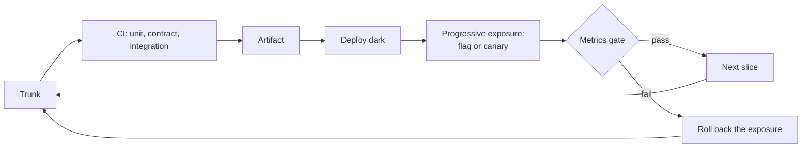

# Incremental Delivery

> [!abstract] In one sentence
> Incremental delivery ships a system as thin vertical slices — each one touching every layer, each one shippable — so that feedback arrives in days, risk is spread across many small releases, and the architecture evolves under real load instead of being guessed up front.

> [!tip] Deeper treatment in your system-design vault
> `system-design/17 Shipping Code/The Deployment Pipeline.md` — read it *after* you have written your own explanation below.

**Map:** [[Product Engineering MOC]] → [[HLD MOC]]

## Definition

**Incremental delivery** builds and releases software as a series of small, complete, end-to-end increments rather than as layers (all the schema, then all the services, then all the UI) or as one large release. Each increment is a **vertical slice**: a narrow path from the user's action through the API, the logic and the storage, deployable and observable on its own. The first slice is the **walking skeleton** — the thinnest implementation of the whole path, wired through every layer and deployed to production, proving the architecture and the pipeline before any real feature is built.

## Problem solved

Big-bang releases fail for structural reasons: integration happens last, when the most code exists and the least time remains; assumptions about scale and user behaviour go unchecked for months; the first deploy exercises the pipeline and the rollback path for the first time, under maximum pressure. Incremental delivery reverses each: integration happens from day one, every assumption is tested by a release, and by the time the risky feature ships the deploy path has run a hundred times.

## How it works

1. **Build the walking skeleton.** Take the simplest end-to-end journey — "create a transfer and read it back" — and implement it with real components (database, queue, deploy to Kubernetes) but trivial logic. Deploy it. You now have a pipeline, a health check, a dashboard and a rollback path that work.
2. **Slice by user outcome, not by layer.** "Transfers with insufficient-funds rejection" is a slice; "the transfers table" is not. A slice ships in days and is complete enough that a user, a tester or a metric can tell whether it works.
3. **Merge to trunk continuously.** Short-lived branches, PRs reviewable in minutes, and [[Feature Flags|flags]] to keep unfinished behaviour dark. Long-lived branches are deferred integration — the big bang in disguise.
4. **Release progressively.** Each slice goes out behind a flag or a canary ([[Deployment and Rollback Strategies]]), is watched against its metric, and is advanced or rolled back. The release is part of the slice, not a separate phase.
5. **Let the architecture follow.** Add the cache when the latency metric demands it, the queue when the synchronous path proves too slow, the service split when the team or the load requires it. Each addition is itself a slice, made with production evidence behind it.

```text
Slice 1  walking skeleton: POST /transfers writes a row, GET reads it; deployed, monitored
Slice 2  validation + insufficient-funds error; contract tests added
Slice 3  idempotency key on POST; replay test
Slice 4  ledger entries written in the same transaction; reconciliation job stub
Slice 5  async notification via outbox + consumer; flagged, 5% of accounts
Slice 6  settlement with the PSP; flagged, internal accounts only
```

## Architecture



> [!example]- Excalidraw version — the same diagram as an editable canvas
> ![[Incremental Delivery.excalidraw]]
> [[Incremental Delivery.excalidraw|Open in Excalidraw]] — needs the Excalidraw plugin (see [[Plugins to Install]]).


The structural shape is the delivery pipeline rather than a runtime component: trunk → CI (unit, contract, integration) → artifact → deploy dark → progressive exposure by flag or canary → metrics gate → next slice. Every slice travels the same path, which is why the path is built first, as the skeleton.

## Use cases

- A new service or product where the biggest risk is not knowing what users or load will look like.
- A large migration that "cannot be done at once" — the [[Strangler Pattern|strangler]] is incremental delivery applied to a legacy system.
- A team whose releases are rare and painful: the cure is smaller, more frequent releases, not more careful large ones.
- A design review asking "what is the first thing you would ship?" — the answer is a skeleton, not a component.

## Limitations

- Some work has a minimum useful size (a regulatory feature useless until complete); slice the delivery and hide the result behind a flag, but do not pretend a third of it is valuable.
- Incrementalism without direction produces a patchwork: slices need a target architecture to converge on.
- Shipping early and often needs the pipeline, test suite and observability first; without them, the first increments are building them.

## Trade-offs

| You gain | You sacrifice |
|---|---|
| Early feedback and early risk reduction; integration is never a surprise | The illusion of a complete design before coding — early slices ship with known gaps |
| A pipeline and rollback path exercised hundreds of times before the risky release | Some rework, since early slices are revised once later ones reveal what was wrong |
| Smaller PRs, faster reviews, fewer merge conflicts | Discipline: flags, compatibility and cleanup are a constant tax |

## Failure modes

- **Horizontal slicing** (schema sprint, then service sprint, then UI sprint) → nothing runs end-to-end until the end → a final integration phase longer than the build; blast radius is the schedule.
- **Skeleton skipped** → the first real deploy discovers the pipeline, secrets and rollback do not work → noticed on release day, under maximum pressure.
- **Flags never cleaned up** → each slice leaves a toggle → the codebase has more branches than features ([[Technical Debt]]).
- **Slices without a metric** → shipped, but nobody can say whether they worked → no usage data to decide the next slice.

## Performance

Incremental delivery changes when performance work happens, not whether: the skeleton gives a production latency and throughput baseline on day one, so each slice is measured against the previous one and regressions are attributed to a small diff. Load testing a slice is cheap; load testing a six-month release is a project.

## Scalability

The practice scales with team size better than big-bang releases because small PRs to trunk reduce coordination and flags let many slices be in flight at once. It scales with system size by making architecture changes themselves incremental — a cache, a queue, a split are each one slice — rather than a re-platforming.

## Operational impact

Deploys become routine and boring, which is the goal: many small deploys with small blast radius instead of a few large ones. On-call learns the system a slice at a time. The costs are a pipeline that must be fast and reliable (a 40-minute CI run kills the cadence) and the hygiene of flag and branch cleanup.

## Alternatives

- **Big-bang release after a full build** — wins only when the release is contractually atomic (a hardware launch, a regulatory cutover), and even then the internals should be delivered incrementally and hidden.
- **Prototype-then-rebuild** — wins for learning about an unknown problem quickly; the prototype must actually be discarded, which teams rarely do.
- **Layer-first with mocks** — wins for a known, stable design where teams work in parallel on separate layers; risks horizontal slicing.

## Real-world examples

- Trunk-based development with feature flags is the documented practice at Google, Facebook and most large web companies; Google's monorepo and Facebook's continuous pushes are the scale version.
- Fowler's strangler-fig migrations ([[Martin Fowler - Strangler Fig Application]]) are incremental delivery for replacement: each routed slice is a shippable increment.
- In a stack like yours: a new NestJS service shipped first as a skeleton with one endpoint, a health check and a Grafana panel, then slices for validation, idempotency, ledger writes and an SQS consumer, each behind a flag and merged from a branch that lived under two days.

## Practical exercise

1. Take one backlog feature estimated at more than two weeks. Write the walking-skeleton slice: the thinnest end-to-end path through API, logic and storage, deployable this week.
2. Split the rest into five or six vertical slices, each with a one-line acceptance check and the metric that proves it.
3. Ship the skeleton behind a flag; confirm the deploy, health check and rollback work before writing slice two.
4. Track PR size and time-to-merge for the slices against the team's recent average.

## Related concepts

### Prerequisites
- [[Feature Flags]] — how unfinished slices ship dark
- [[Deployment and Rollback Strategies]] — the progressive exposure each slice uses
- [[Testing Strategies]] — the fast suite that makes small PRs safe

### Related
- [[Schema Evolution]] — slices that change the schema must be compatible
- [[Backward Compatibility]] — every slice must coexist with the previous one
- [[Versioning and Migrations]] — migrations are slices too
- [[Technical Debt]] — early slices carry deliberate debt with a payback slice

### Builds on this
- [[Designing Systems for Changing Requirements]] — a system delivered incrementally is designed to keep changing
- [[Strangler Pattern]] — incremental delivery applied to replacing a legacy system

### Design problems where it applies
- [[Design a Payment System]]
- [[Design a Notification System]]
- [[Design a Workflow Orchestrator]]

### Projects where it can be implemented
- [[Webhook Relay]]
- [[Double-Entry Ledger Service]]

### Resources
- [[Martin Fowler - Feature Toggles]] — flags as the enabler of trunk-based delivery
- [[Martin Fowler - Strangler Fig Application]] — incremental replacement
- [[The Twelve-Factor App]] — build, release, run as separate stages

## Personal understanding

> [!question] Explain it without the source
> Write your own explanation here, from memory. Then compare it with the sections above and note what you missed.

### Mastery checklist
- [ ] I can explain it without the original resource
- [ ] I can describe the problem it solves
- [ ] I can compare it with its alternatives
- [ ] I can name its limitations and failure modes
- [ ] I can recognise when it is appropriate in a real system
- [ ] I have applied it in a system design
- [ ] I have validated my assumptions with an experiment or implementation

## Open questions

- [ ] How thin can a walking skeleton be for a payments flow and still prove something — is a transfer that writes one row without a ledger entry an honest skeleton?
- [ ] What is the right slice when the requirement is a regulatory report that is worthless until complete?
- [ ] How do you keep a target architecture visible to the team so that slices converge instead of drifting?
