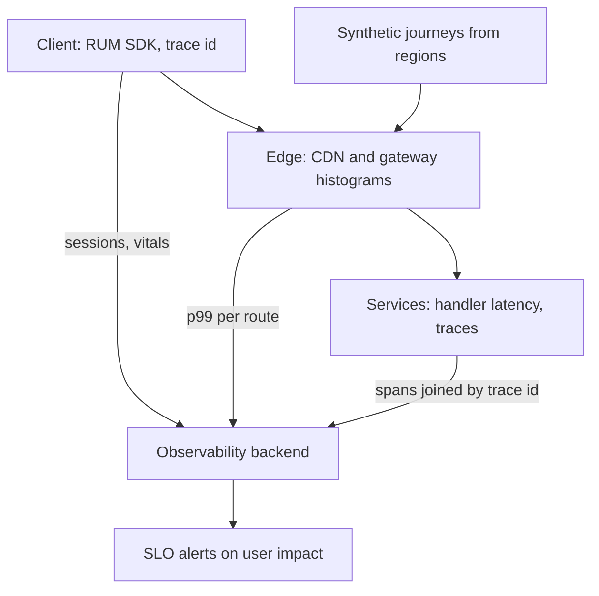

# Monitoring User-Facing Performance

> [!abstract] In one sentence
> User-facing performance monitoring measures what the user actually experienced — the end-to-end time from tap to rendered result, including DNS, TLS, the CDN, the gateway and the client — because a service that reports a 40 ms p99 can still sit behind a journey that takes four seconds.

> [!tip] Deeper treatment in your system-design vault
> `system-design/13 Observability/Logs Metrics and Traces.md` — read it *after* you have written your own explanation below.

**Map:** [[Product Engineering MOC]] → [[HLD MOC]]

## Definition

**User-facing performance monitoring** measures from the user's point of view rather than the server's. **Real-user monitoring (RUM)** instruments the actual client (browser, mobile app) and reports timings per real session: screen load, time to first interaction, API round trips as seen from the device. **Synthetic monitoring** runs scripted journeys from fixed locations on a schedule to catch outages and regressions before users do. Core Web Vitals (Largest Contentful Paint, Interaction to Next Paint, Cumulative Layout Shift) and **Apdex** (the share of requests under a satisfaction threshold) summarise the experience. The backend's contribution is measured at the **edge** — the [[API Gateways|gateway]] or [[CDNs|CDN]] — the outermost point you control.

## Problem solved

Backend dashboards measure the handler's latency, after the request reached it. Everything before and after — DNS, TLS, CDN miss, gateway queueing, the mobile network, client rendering and the six sequential calls the screen makes — is invisible, and that is where the user's four seconds go. Teams argue "the service is fine" while customers churn. Measuring at the user and at the edge turns performance into a product metric with a budget rather than a server metric with a green light.

## How it works

1. **Instrument the client.** A RUM SDK (OpenTelemetry for browsers and mobile, or a vendor agent) records navigation timing, resource timing and custom spans per screen, tagged with app version, device class, network type and region, shipped in batches. Sample by session, so a slow user's whole journey is kept.
2. **Measure at the edge.** Gateway and CDN metrics give latency histograms per route as close to the user as you control, including queueing and TLS. The difference from the service's own histogram is what the infrastructure adds.
3. **Propagate a trace id end to end.** The client sends a `traceparent`, so a slow screen in RUM links to the [[Distributed Tracing|trace]] through the gateway and services — the correlation that says which of the six calls made the screen slow.
4. **Run synthetic journeys.** Scripted checks (log in, open the wallet, start a transfer) from several regions every minute: the canary when real traffic is low, the baseline when it is noisy.
5. **Set budgets as SLIs.** "Wallet screen interactive under 2 s for 90% of sessions on 4G" is an [[SLI SLO and SLA|SLO]]; a per-screen budget (bytes, requests, p75 load) is what the team checks in review. Use p75 for RUM where devices vary widely, p99 at the edge where you control the path.
6. **Alert on user impact, diagnose with backend metrics.** A backend alert with no user impact is noise; a user-impact alert with no backend signal is the case that was previously invisible.

```text
Where the 4 seconds go on a "slow" wallet screen (illustrative, not measured)
DNS + TLS + connect       ~300 ms   mobile network, cold connection
CDN miss -> origin        ~150 ms   static bundle not cached in region
GET /session              ~120 ms   gateway p99 incl. queueing (service sees 40 ms)
GET /wallet, /limits,     ~900 ms   three sequential calls the client could batch
GET /recent-transfers
render + hydrate          ~700 ms   large JSON, main-thread work on a low-end device
Service dashboards: all green.  User: 4 s.
```

## Architecture



## Use cases

- A requirement stated in user terms ("the screen must load in under 2 seconds") rather than service terms.
- Complaints that do not match dashboards — the classic signal that the measurement point is wrong.
- Any client on a slow or variable network (mobile, emerging-market users) where the server is a small fraction of the journey.
- Launches and releases: RUM by app version is how you see a regression that only affects the new build.

## Limitations

- RUM is noisy: device, network and geography dominate, so comparisons need segmentation and a percentile chosen for variance (p75), not the backend's p99.
- Client instrumentation costs bytes and battery and raises privacy questions; collect timings, not content.
- Synthetic checks test the journeys you scripted from the locations you chose; they miss the screen you forgot.

## Trade-offs

| You gain | You sacrifice |
|---|---|
| The number that matches what the user felt, and an end to "the service is fine" | Clean, low-variance metrics — user data is messy and needs segmentation |
| Correlation from a slow screen to the exact backend span | Client SDK weight, data volume and a privacy review |
| Early detection of regressions that only show up at the edge or on the client | A single dashboard — client, edge and service views must be reconciled |

## Failure modes

- **Measuring only at the service** → the gateway queues or the CDN misses and nobody sees it → noticed by users and support; blast radius is every user of that route.
- **Averages instead of percentiles** → p50 looks great while a tenth of sessions are unusable → noticed in churn, not in alerts ([[The Tail at Scale]]).
- **Sampling by request, not session** → slow users' journeys are fragmented → a trace never shows the whole screen.
- **Synthetic checks from one region** → an outage in another CDN region goes unseen for hours → noticed on social media.

## Performance

The RUM SDK must be light (a few kilobytes, batched beacons on idle or page hide) and never block rendering. Edge histograms are cheap because the gateway already has the data. The backend cost is storage: per-session data at scale is large, which is why sampling and aggregation at ingestion matter.

## Scalability

At 10x users RUM volume grows linearly; keep it tractable with session-based sampling, pre-aggregated histograms per route and version, and short raw retention. Synthetic checks scale with journeys and regions, not users. Correlation by trace id works only if the tracing backend keeps the traces RUM points at — align the sampling decisions.

## Operational impact

Alerting shifts from backend thresholds to user-impact SLOs, which reduces noise and increases trust in pages. On-call gets a starting point ("the wallet screen is slow in region X on app version Y") rather than a symptom. The costs are a client release cycle for SDK changes, a RUM pipeline and a privacy owner.

## Alternatives

- **Edge-only monitoring** — gateway and CDN histograms without client instrumentation; wins when you cannot ship an SDK, misses rendering and client-side sequencing.
- **Synthetic-only monitoring** — wins for availability and regression detection on low-traffic systems; blind to real device and network diversity.
- **Backend SLOs only** — wins for internal APIs with no human user; wrong for any user-facing product.

## Real-world examples

- Google's Core Web Vitals define LCP, INP and CLS as the standard user-experience metrics, reported at p75, and feed them into search ranking.
- Dean and Barroso's [[The Tail at Scale]] explains why fan-out makes user-visible latency track the slowest backend call — what edge p99 exposes and service p99 hides.
- In a stack like yours: OpenTelemetry in the mobile app emitting screen spans with a `traceparent` the gateway forwards into Spring Boot and NestJS traces, gateway latency histograms per route in Prometheus, k6 synthetic journeys from two regions every minute, and an SLO on "transfer confirmation screen under 2 s, p75" that pages instead of the service p99.

## Practical exercise

1. For one user journey, list every hop from client to response (DNS, CDN, gateway, services, client render) and mark which hops have a latency metric today.
2. Enable gateway or ingress latency histograms per route and compare the p99 with the service's own p99 for a week; record the gap.
3. Send a `traceparent` header from a k6 script and confirm a slow request can be followed from the edge to the slowest span.
4. Write a synthetic k6 journey for the same flow, run it on a schedule from two locations, and set a p75 budget with an alert.

## Related concepts

### Prerequisites
- [[Latency]] — percentiles and why the tail matters
- [[Monitoring]] — the general practice this specialises
- [[Metrics]] — histograms per route and version
- [[SLI SLO and SLA]] — user-impact targets as SLOs

### Related
- [[Distributed Tracing]] — the correlation from client to backend span
- [[CDNs]] — the edge hop most backend dashboards ignore
- [[Real-Time Systems]] — where user-perceived latency is the whole product
- [[Alerting]] — paging on user impact rather than backend symptoms
- [[Error Budgets]] — how much user-facing degradation is acceptable

### Builds on this
- [[Capacity Planning]] — edge measurements are the demand signal
- [[Production Incident Analysis]] — user-impact timelines come from these measurements

### Design problems where it applies
- [[Design a Metrics and Monitoring System]]
- [[Design a Social Feed]]
- [[Design a Chat System]]

### Projects where it can be implemented
- [[Load Test and Latency Lab]]
- [[Live Ops Dashboard]]

### Resources
- [[The Tail at Scale]] — tail latency and fan-out
- [[Google SRE Book - Monitoring Distributed Systems]] — symptoms versus causes, the four golden signals
- [[OpenTelemetry Observability Primer]] — client-to-backend tracing

## Personal understanding

> [!question] Explain it without the source
> Write your own explanation here, from memory. Then compare it with the sections above and note what you missed.

### Mastery checklist
- [ ] I can explain it without the original resource
- [ ] I can describe the problem it solves
- [ ] I can compare it with its alternatives
- [ ] I can name its limitations and failure modes
- [ ] I can recognise when it is appropriate in a real system
- [ ] I have applied it in a system design
- [ ] I have validated my assumptions with an experiment or implementation

## Open questions

- [ ] How do you choose between p75 and p99 for a user-facing SLO on a mobile-heavy product, and does the answer change by region?
- [ ] What is the minimum RUM data you can collect and still correlate a slow screen to a backend trace, given privacy constraints?
- [ ] For an API consumed by a partner's backend rather than a human, what replaces RUM as the user-facing measurement?
