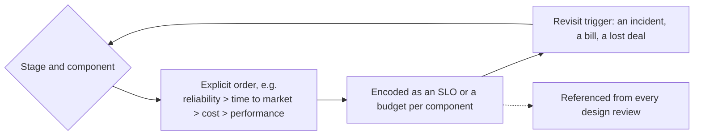

# Prioritizing Reliability Performance Cost and Time to Market

> [!abstract] In one sentence
> You cannot maximise reliability, performance, cost efficiency and speed of delivery at once, so the job is to decide — explicitly, per product stage — which one or two win, which are merely "good enough", and when to revisit.

**Map:** [[Product Engineering MOC]] → [[HLD MOC]]

## Definition

Reliability (the system does the right thing and keeps doing it), performance (fast and at volume), cost (infrastructure and, mostly, engineer time) and time to market (how soon users get it) are the four axes every technical decision moves along. Prioritising means stating an order of preference for a product and stage — "ship in four weeks, never lose a payment, latency and cost are secondary" — and using it to settle the small decisions that would otherwise be argued one by one. It is the counterpart of [[Functional vs Non-Functional Requirements|NFR ranking]]: NFRs say what the targets are, prioritisation says which bends first.

## Problem solved

Without an explicit order, each engineer applies their own: one gold-plates reliability for a feature that may be killed next quarter, another ships a payments path with no idempotency because the deadline was Friday. The result is inconsistent quality, surprise costs and arguments that restart in every design review. Stating the priority once turns "should we add a replica?" into a lookup, and makes the consequences a decision someone made rather than an accident.

## How it works

1. **Name the stage.** A product at validation (does anyone want this?) is optimising for learning: time to market wins, cost next, reliability and performance at "not embarrassing". A product with paying users flips the order: reliability first, then cost or performance depending on the business model.
2. **Classify the component, not just the product.** The money path and the recommendation widget deserve different orders. Reliability is non-negotiable for a ledger; a feed can be stale and occasionally empty.
3. **Write the order down with the reasoning.** One line per component: `payments: reliability > time-to-market > cost > performance (p99 < 1 s is enough)`. Attach the [[SLI SLO and SLA|SLO]] that encodes the reliability choice and the [[Error Budgets|error budget]] that encodes how much reliability you will trade for speed.
4. **Use it to settle decisions.** Add a read replica? If cost ranks above performance and the SLO is met, no. Skip retries to ship sooner? If reliability ranks first, no — without a meeting.
5. **Set a revisit trigger.** The order expires at 10x traffic, the first enterprise customer, the first SLO breach or a fixed date. Revisiting means re-ranking, and often paying down the [[Technical Debt|debt]] the earlier order deliberately took on.

```text
component     stage        order (first wins)                          revisit when
checkout      growth       reliability > TTM > perf > cost             error budget burn > 2x
feed          validation   TTM > cost > perf > reliability             > 100k DAU
reporting     mature       cost > reliability > perf > TTM             finance asks for intraday
```

## Architecture



> [!example]- Excalidraw version — the same diagram as an editable canvas
> ![[Prioritizing Reliability Performance Cost and Time to Market.excalidraw]]
> [[Prioritizing Reliability Performance Cost and Time to Market.excalidraw|Open in Excalidraw]] — needs the Excalidraw plugin (see [[Plugins to Install]]).


No runtime shape; the structure is a decision table keyed by component and stage, kept with the architecture docs and referenced from design reviews. Each row carries the order, the SLO or budget that encodes it, and the revisit trigger. More than a dozen rows means the components are too fine-grained.

## Use cases

- A design review circling between "we need multi-region" and "we need to ship this month" with no agreed basis for choosing.
- A greenfield service where the team instinctively copies the reliability posture of the core system.
- A cost-reduction mandate: which services can lose a replica, a cache or a retention tier without breaking a stated priority.
- The interview question "how would you ship this in two weeks versus six months?" — the answer is a change of order.

## Limitations

- The order is only as good as the stage assessment; teams routinely believe they are at "growth" while still validating, and over-build.
- Trades are not symmetric: reliability lost to speed can be bought back; a reputation lost to a data-loss incident often cannot. Weight irreversible consequences more than the order suggests.
- "Good enough" still has to be defined, usually as an SLO.

## Trade-offs

| You gain | You sacrifice |
|---|---|
| Consistent decisions across engineers and reviews | The option to claim every quality at once — the order makes the sacrifice visible |
| A record of why the system is the way it is, for whoever inherits it | Flexibility in the moment: an engineer who disagrees must change the table, not just the code |
| Deliberate debt with a revisit date instead of accidental debt | Time to agree the order with product and finance, who may not want to choose |

## Failure modes

- **Order never written** → each team optimises differently → noticed when the cheapest service becomes the dependency the most reliable one needs.
- **Order never revisited** → a validated product still runs on a validation-stage architecture → noticed as an outage at the first scale step; the fix is a migration under pressure.
- **Reliability ranked first everywhere** → everything is over-built and nothing ships → a release cadence measured in quarters and a cost line nobody can explain.
- **Irreversible trade treated as reversible** → "we'll add audit logging later" on a money path → noticed when a regulator asks for records that do not exist.

## Performance

Ranking performance explicitly prevents both premature optimisation (it ranks last and the SLO is met) and neglect (it ranks first and nobody owns the p99). The useful question — "what is the cheapest architecture that meets the stated latency at the stated scale?" — only has an answer once cost and performance have an order.

## Scalability

The order shifts with scale. At 10x traffic, cost climbs the ranking because spend becomes visible, and reliability gets harder to hold because rare failure modes become daily. Re-ranking at each order of magnitude is how an architecture is allowed to change rather than ossify.

## Operational impact

The reliability rank sets the on-call posture: a reliability-first component needs an SLO, burn-rate alerting and a runbook; a time-to-market-first one can run with a dashboard and best-effort support, and the table should say so, so nobody is paged for a feature built to be fragile.

## Alternatives

- **SLO and error-budget policy alone** — wins for mature services where reliability is the only axis in dispute; it says nothing about cost or speed.
- **Architecture fitness functions** ([[Designing Systems for Changing Requirements]]) — enforce a chosen priority in CI; they assume it has been chosen.
- **Cost-of-delay modelling** — prices time to market against the others; wins when the business can estimate revenue per week of delay, which most cannot.

## Real-world examples

- Google's error-budget policy is an explicit reliability-versus-velocity contract: ship freely while the budget lasts, freeze features when it is spent.
- AWS publishes SLAs with credits — reliability ranked and priced — while new services typically launch in one region with a narrower feature set, trading breadth for time to market.
- In a stack like yours: ranking a ledger reliability-first justifies synchronous writes, idempotency keys and a daily reconciliation job, while an internal admin dashboard ranked time-to-market-first ships on a single pod with no alerts; the table records both and the date to revisit.

## Practical exercise

1. List the five components you touch most. For each, write the order of the four axes as it is today and as it should be.
2. For every row where the two differ, name the one decision in the codebase that reveals the mismatch (a missing retry, an unnecessary replica, a cache with no invalidation).
3. Fix the cheapest mismatch in a PR; put the order line in the PR description.
4. Add a revisit trigger to each row and commit the table to the repo's docs folder.

## Related concepts

### Prerequisites
- [[SLI SLO and SLA]] — how a reliability rank becomes a number
- [[Error Budgets]] — the mechanism that trades reliability for velocity
- [[Functional vs Non-Functional Requirements]] — the targets this note ranks

### Related
- [[Performance vs Cost Trade-offs]] — the performance-cost edge of the square in detail
- [[Operational Simplicity]] — simplicity usually serves cost and time to market at once
- [[Technical Debt]] — deliberate debt is a priority decision with a revisit date
- [[Incremental Delivery]] — the delivery style that keeps time to market short without abandoning reliability
- [[Capacity Planning]] — where cost and performance meet infrastructure numbers

### Builds on this
- [[Build vs Buy Decisions]] — build-or-buy is a prioritisation question in disguise
- [[Evaluating Architectural Complexity]] — complexity is justified only by a ranked requirement
- [[Designing Systems for Changing Requirements]] — revisiting the order is a change the design must survive

### Design problems where it applies
- [[Design a Payment System]]
- [[Design a URL Shortener]]
- [[Design a Notification System]]

### Projects where it can be implemented
- [[LLM Gateway]]
- [[Personal Notification Hub]]

### Resources
- [[Site Reliability Engineering (Google)]] — error budgets as the reliability-velocity contract
- [[Google SRE Workbook - Implementing SLOs]] — negotiating targets with product
- [[Fundamentals of Software Architecture]] — architecture characteristics and their trade-offs

## Personal understanding

> [!question] Explain it without the source
> Write your own explanation here, from memory. Then compare it with the sections above and note what you missed.

### Mastery checklist
- [ ] I can explain it without the original resource
- [ ] I can describe the problem it solves
- [ ] I can compare it with its alternatives
- [ ] I can name its limitations and failure modes
- [ ] I can recognise when it is appropriate in a real system
- [ ] I have applied it in a system design
- [ ] I have validated my assumptions with an experiment or implementation

## Open questions

- [ ] Which decisions in a payments system are genuinely irreversible, such that the ranking should be overridden regardless of stage?
- [ ] How do you detect that a product has moved from validation to growth before the first outage does it for you?
- [ ] Is engineer time or infrastructure spend the dominant cost term in a stack like yours, and does the ranking change if you swap them?
