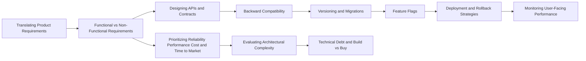

# Product Engineering

> [!abstract] The point of all of this: shipping products that work, change safely and stay cheap to run.
> How requirements become designs, how contracts and data evolve without breaking anyone, how changes reach production safely (flags, canaries, rollbacks), and how to judge complexity and debt. These are the notes that separate an SDE-2 who draws boxes from one who ships.

**Map:** [[HLD MOC]] → this · [[Start Here]] for the reading plan · [[Engineering Dashboard]] for progress

## Start with these

[[Functional vs Non-Functional Requirements]] → [[Designing APIs and Contracts]] → [[Backward Compatibility]] → [[Versioning and Migrations]] → [[Feature Flags]] → [[Deployment and Rollback Strategies]] → [[Testing Strategies]] → [[Evaluating Architectural Complexity]]

## How the ideas connect



## Concepts

### Core — know these cold for SDE-2

- [[Translating Product Requirements into Technical Requirements]] — Turn a product ask into a buildable, testable spec by asking the clarifying questions, walking the user journey into data flows, surfacing the implicit scale, latency…
- [[Functional vs Non-Functional Requirements]] — Functional requirements say what the system does; non-functional requirements say how well
- [[Prioritizing Reliability Performance Cost and Time to Market]] — Every engineering decision sits in a four-way tension between reliability, performance, cost and time to market
- [[Designing APIs and Contracts]] — An API is a contract and a product surface: model resources around the caller's job, define errors, pagination, idempotency and consistency promises explicitly, document…
- [[Backward Compatibility]] — A change is backward compatible when every existing caller, consumer and stored record keeps working unchanged
- [[Versioning and Migrations]] — When a change cannot be made compatible you version the contract and migrate the data in phases
- [[Feature Flags]] — A feature flag is a runtime switch that decouples deploying code from releasing behaviour
- [[Designing for Maintainability]] — Maintainability is designing for the next engineer: small modules with clear boundaries, code that reads like the domain, documentation that lives beside the code…
- [[Testing Strategies]] — A testing strategy decides what to test at which level — unit for logic, integration for real dependencies, contract for service boundaries, a few end-to-end for the…
- [[Deployment and Rollback Strategies]] — Rolling, blue-green, canary and shadow deployments are different ways to expose a new version to traffic while keeping a fast path back
- [[Operational Simplicity]] — Operational simplicity treats on-call load and the number of moving parts as design inputs
- [[Evaluating Architectural Complexity]] — Separate the complexity the problem demands from the complexity the solution added, count the moving parts and the failure modes each one brings

### Important — read once, revisit when a design needs it

- [[Data Ownership and Lifecycle]] — Every piece of data has exactly one owning service that is its source of truth and controls its creation, change and deletion
- [[Incremental Delivery]] — Deliver a system as a sequence of thin, end-to-end slices — a walking skeleton first, then one user-visible increment at a time, each merged to trunk in small PRs…
- [[Monitoring User-Facing Performance]] — Measure performance where the user feels it — real-user monitoring from the client, synthetic checks from outside, p99 at the edge rather than the service — set budgets…
- [[Technical Debt]] — Technical debt is the future cost of a shortcut taken today, deliberate or accidental, prudent or reckless
- [[Build vs Buy Decisions]] — Build what differentiates your product and buy or adopt everything else
- [[Designing Systems for Changing Requirements]] — Assume requirements will change and design so that change is cheap

### Also part of this area

Graceful degradation is a product decision as much as an operational one: [[Graceful Degradation]]

## Where it shows up

**Design problems that lean on this category:** [[Design a Payment System]], [[Design a Notification System]], [[Design a Feature Flag Service]], [[Design an IAM Service]], [[Design a URL Shortener]], [[Design a Webhook Delivery System]], [[Design an API Gateway]], [[Design an Inventory Management System]]

**Projects that exercise it:** [[Double-Entry Ledger Service]], [[Webhook Relay]], [[LLM Gateway]], [[Personal Notification Hub]], [[Load Test and Latency Lab]], [[Feature Flag Service and SDK]]

## Progress in this category

Status and confidence come from each note's properties — update them in the note, the table updates itself (native Bases, no plugin).

```base
filters:
  and:
    - file.hasTag("concept")
    - category == "Product Engineering"
formulas:
  rank: 'if(priority == "high", 1, if(priority == "medium", 2, 3))'
properties:
  file.name:
    displayName: Concept
  formula.rank:
    displayName: "#"
views:
  - type: table
    name: Tracker
    order:
      - file.name
      - priority
      - status
      - confidence
      - last_reviewed
      - next_review
    sort:
      - property: formula.rank
        direction: ASC
      - property: file.name
        direction: ASC
    summaries:
      confidence: Average
```
