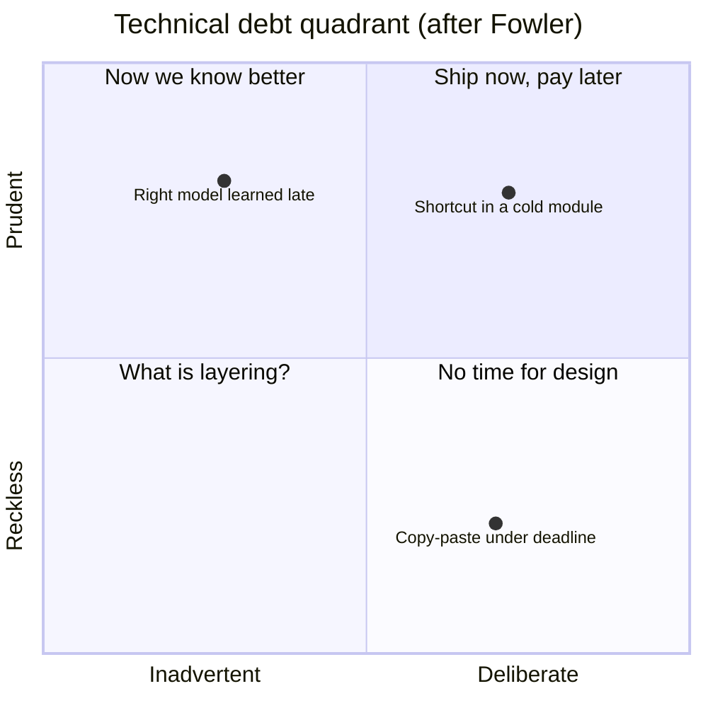

# Technical Debt

> [!abstract] In one sentence
> Technical debt is a loan against future engineering time — taken deliberately to ship sooner or accidentally through ignorance — and like any loan it is fine as long as you know the principal, can see the interest and have a repayment plan.

**Map:** [[Product Engineering MOC]] → [[HLD MOC]]

## Definition

**Technical debt** (Ward Cunningham's metaphor) is the extra future work created by choosing an expedient solution now instead of a better one that would take longer. The **principal** is the gap between what exists and what should; the **interest** is the ongoing cost of that gap — slower changes, more incidents, workarounds on workarounds — until the principal is repaid. Fowler's quadrant classifies debt as **deliberate** or **inadvertent** (did you know?) and **prudent** or **reckless** (was it a reasonable call?). Debt lives in code (duplication, missing tests), architecture (a shared database, a synchronous call that should be a queue), operations (no runbook, manual deploys) and data (a schema nobody dares migrate).

## Problem solved

Without the metaphor, product and engineering have no shared term for "we are slower because of the shortcuts we took": estimates mysteriously grow, every refactor looks like gold-plating, and the only visible option is a rewrite nobody will fund. Framing shortcuts as debt makes the trade explicit when taken ("prudent deliberate: ship without the retry, add it next sprint"), makes interest measurable, and makes repayment a budgeted line item rather than a plea.

## How it works

1. **Classify what you are taking on.** Prudent-deliberate debt is a legitimate tool: ship the thin version, record the ticket, set the repayment trigger. Reckless-deliberate ("no time for tests") is a loan at a rate you did not check. Inadvertent debt is discovered later and needs the same recording once found.
2. **Record it where it will be seen.** A debt register (a tagged backlog, a `DEBT.md`, ADRs marked "known shortcut") with the principal (the fix), the interest (the weekly cost: the workaround, the incident class, the manual step) and the repayment trigger (scale, incident count, next touch of the module).
3. **Measure the interest.** Lead time for changes in the indebted module, change failure rate, incidents attributed to it ([[Production Incident Analysis]]), time on manual operations. Debt with near-zero interest (an ugly but stable internal tool) is not worth repaying; debt in the hot path of change is.
4. **Repay incrementally, alongside features.** Attach repayment to the next feature touching the module, reserve a fixed share of capacity chosen by the team, and ship each repayment as a small change ([[Incremental Delivery]]). The "refactoring quarter" is the rewrite in disguise and fails for the same reasons.
5. **Distinguish architectural from code debt.** Code debt is repaid by refactoring inside a boundary. Architectural debt (wrong boundaries, shared data, missing [[Idempotency|idempotency]] in a payment path) crosses teams, costs more interest, and needs a migration plan ([[Versioning and Migrations]], [[Strangler Pattern]]) rather than a refactor.

```text
Debt register entry
ID:         DEBT-042
Type:       architectural, prudent-deliberate (decided 2026-03, ADR-017)
Principal:  settlement calls the PSP synchronously; should be an outbox + worker
Interest:   PSP latency spikes become our p99 spikes (3 incidents last quarter);
            retries are manual; every settlement change needs a PSP sandbox run
Trigger:    > 2 PSP-related incidents per quarter, or settlement volume > 5x
Repayment:  3 slices: outbox table + publisher; worker with idempotent retry;
            flag-controlled cutover. Est. 2 weeks, ride along with the refund feature
Owner:      payments team
```

## Architecture



> [!example]- Excalidraw version — the same diagram as an editable canvas
> ![[Technical Debt.excalidraw]]
> [[Technical Debt.excalidraw|Open in Excalidraw]] — needs the Excalidraw plugin (see [[Plugins to Install]]).


Debt has no runtime shape; structurally it is the register above, linked from the architecture docs and reviewed monthly, plus the metrics that show its interest: per-module lead time, change failure rate and incident attribution. Architectural debt also appears on the system diagram as the annotated edge or component that "should not be there".

## Use cases

- A deadline forces a shortcut: the deliberate, recorded version is the right tool; the unrecorded version is the failure mode.
- A module where every estimate is double what it should be and nobody can say why.
- An incident review that keeps finding the same root-cause class — the register entry writes itself.
- A team planning a rewrite: the register shows whether the debt is really system-wide or concentrated in two modules.

## Limitations

- The metaphor stretches: financial debt has a known rate; technical interest is uncertain and sometimes zero, which is why measuring beats estimating.
- Not everything ugly is debt; code that never changes and never fails is just old, and repaying it is cost without return.
- Labelling a design disagreement as "debt" hides that it is a difference of opinion; the register needs an agreed "should".

## Trade-offs

| You gain | You sacrifice |
|---|---|
| Faster delivery now, with the cost made explicit and scheduled | Future capacity — interest is paid on every change until the principal is repaid |
| A shared vocabulary that lets product fund repayment | Backlog simplicity — the register is one more thing to maintain and prune |
| Evidence (interest metrics) for where refactoring actually pays | The option of pretending the shortcut was free |

## Failure modes

- **Unrecorded debt** → the shortcut is forgotten and becomes the design → noticed when a new engineer builds on it as if intended; blast radius grows with every dependant.
- **Interest never measured** → repayment is argued on taste → the same debate every quarter, and either nothing is repaid or the wrong thing is.
- **Rewrite as repayment** → the old system keeps changing while the new one chases it → noticed at month nine when neither is finished.
- **Debt in the money path** (missing idempotency, no reconciliation) → interest paid in incidents and customer trust → noticed by reconciliation or a dispute; never deliberate-reckless.

## Performance

Debt often *is* a performance problem deferred: the N+1 query, the synchronous call, the missing index. Its interest is measurable as latency and cost, which makes performance debt the easiest class to justify repaying — the graph makes the argument.

## Scalability

Interest compounds with team size and traffic: a shortcut one engineer understands becomes a trap for ten, and a workaround that holds today breaks at 10x. The register's triggers ("repay before 5x volume") retire debt before scale calls it in.

## Operational impact

Operational debt — manual deploys, missing runbooks, untuned alerts, unowned components ([[Operational Simplicity]]) — is paid in on-call hours and incident duration, and is often the highest-interest debt a team has because it is paid at night.

## Alternatives

- **Zero-debt policy** — wins for safety-critical and money-path code; applied everywhere, it trades speed for perfection on things that may never ship.
- **Periodic rewrite** — wins almost never; occasionally justified when the platform itself is end-of-life.
- **Continuous refactoring with no register** — wins for small, disciplined teams; fails to make the cost visible to product, so repayment loses to features under pressure.

## Real-world examples

- Fowler's quadrant ([[Martin Fowler - Technical Debt Quadrant]]) is the standard classification; Cunningham's original note framed debt as a loan taken knowingly and repaid through refactoring as understanding improves.
- Shopify's monolith modularisation ([[Shopify - Deconstructing the Monolith]]) is architectural debt repaid incrementally with tooling, not a rewrite.
- In a stack like yours: a settlement path that calls the PSP synchronously (prudent-deliberate at launch), interest visible as PSP-induced p99 incidents, repaid in three flagged slices into an outbox and a worker, with the register entry closed when the synchronous path is deleted.

## Practical exercise

1. Tag each incident from the last quarter with the module and the shortcut (if any) behind it. The tally is your interest table.
2. Write register entries for the top three, with principal, interest, trigger and a three-slice repayment plan.
3. Pick the one whose repayment fits in a week and ship it as its own PR alongside the next feature touching that module.
4. After a month, compare lead time and incident count for that module before and after; put the numbers in the register.

## Related concepts

### Prerequisites
- [[Designing for Maintainability]] — the standard debt is measured against
- [[Evaluating Architectural Complexity]] — distinguishing architectural debt from accidental complexity

### Related
- [[Production Incident Analysis]] — where interest becomes visible
- [[Feature Flags]] — the most common small debt, and a tool for repaying larger debt safely
- [[Testing Strategies]] — missing tests are debt with high interest
- [[Incremental Delivery]] — repayment in slices
- [[Operational Simplicity]] — unowned components are operational debt

### Builds on this
- [[Designing Systems for Changing Requirements]] — a system that can repay debt is one that can change
- [[Strangler Pattern]] — the repayment technique for architectural debt

### Design problems where it applies
- [[Design a Payment System]]
- [[Design a Notification System]]
- [[Design an Inventory Management System]]

### Projects where it can be implemented
- [[Double-Entry Ledger Service]]
- [[Webhook Relay]]

### Resources
- [[Martin Fowler - Technical Debt Quadrant]] — the classification
- [[A Philosophy of Software Design (Talk)]] — complexity as the thing debt accumulates
- [[Shopify - Deconstructing the Monolith]] — incremental architectural repayment

## Personal understanding

> [!question] Explain it without the source
> Write your own explanation here, from memory. Then compare it with the sections above and note what you missed.

### Mastery checklist
- [ ] I can explain it without the original resource
- [ ] I can describe the problem it solves
- [ ] I can compare it with its alternatives
- [ ] I can name its limitations and failure modes
- [ ] I can recognise when it is appropriate in a real system
- [ ] I have applied it in a system design
- [ ] I have validated my assumptions with an experiment or implementation

## Open questions

- [ ] Which single metric best approximates interest for a module in a stack like yours — lead time, change failure rate or incident count — and how would you attribute incidents to modules reliably?
- [ ] How do you keep a debt register from becoming a wish list of every engineer's preferred rewrite?
- [ ] Is debt in a money path ever prudent-deliberate, and what guard rails (reconciliation, limits) make it so?
