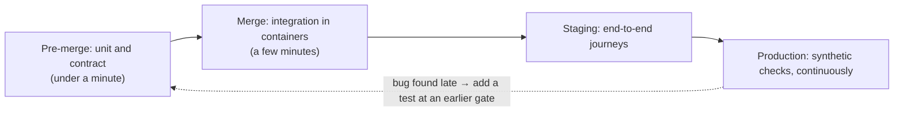

# Testing Strategies

> [!abstract] In one sentence
> A testing strategy is the deliberate allocation of confidence across levels — fast unit tests for logic, integration tests against real dependencies, contract tests at every service boundary, a handful of end-to-end journeys — plus the distributed-systems tests (duplicate delivery, retries, crashes mid-transaction) that catch the bugs unit tests structurally cannot.

**Map:** [[Product Engineering MOC]] → [[HLD MOC]]

## Definition

A **testing strategy** answers, for a given system, which behaviours are verified at which level, with what fidelity, and how fast. The levels are **unit** (one module, dependencies replaced, milliseconds), **integration** (the module with a real database, queue or HTTP client, seconds), **contract** (the agreement between a service and each consumer, verified on both sides independently) and **end-to-end** (a real journey through deployed services, minutes and flaky). The **pyramid** says many unit, fewer integration, few end-to-end; the **trophy** argues integration tests give the most confidence per minute for service code. Both agree that tests must run on every commit and that each bug class belongs at the cheapest level that can catch it.

## Problem solved

Without a strategy, teams either test everything through the UI (slow, flaky, hard to diagnose) or unit-test everything with mocks (fast, green and wrong — the mocks encode the author's assumptions about the database or the partner API). Distributed systems add bug classes no single-process test sees: a message delivered twice, a retry after a timeout that actually succeeded, a crash between the write and the publish. A strategy puts each bug class where it is cheapest to catch.

## How it works

1. **Unit tests for domain logic.** Pure functions and domain objects: fee calculation, state transitions, validation. No I/O, no framework; thousands run in seconds. [[Hexagonal Architecture]] makes this possible — the domain has nothing to mock.
2. **Integration tests against real dependencies.** Repositories against a real PostgreSQL, consumers against a real Kafka or Redis, HTTP clients against a stub server, all in containers (Testcontainers in Java, Docker-backed in TypeScript). These catch SQL errors, serialisation mismatches and transaction boundaries that mocks hide.
3. **Contract tests at each boundary.** The consumer records what it needs; the provider verifies every recorded contract in its own CI. Neither side needs the other running, and a provider change that breaks a consumer fails the provider's build ([[Designing APIs and Contracts]]).
4. **A few end-to-end journeys** in a deployed environment: sign-up, transfer, refund. They prove wiring and configuration, not logic. Keep them to the critical paths and treat flakiness as a bug, never as noise to retry past.
5. **Distributed-behaviour tests.** [[Idempotency|Idempotency]] (send the same request or message N times, assert one effect), retries (time out the first call, assert no double-apply), crash recovery (kill the process between a write and a publish, restart, assert the [[Outbox Pattern|outbox]] delivers) and schema compatibility (deserialise last release's recorded messages with current code).
6. **Failure injection.** Use [[Toxiproxy]] or a fault-injecting stub to add latency, drop connections and return 5xx; assert timeouts, [[Circuit Breakers|breakers]] and fallbacks behave as designed. The [[Chaos Lab]] project is this at environment level.
7. **Test data.** Each test owns its data (unique ids, per-test schema or truncation); shared mutable fixtures are the main source of flakiness. Never copy real customer records into a test environment.

```java
// Integration test: the same message twice must settle once (Testcontainers, JUnit 5)
@Test void duplicateSettlementMessageIsIdempotent() {
    var msg = settlementRequested(transferId);
    consumer.handle(msg);
    consumer.handle(msg);                      // redelivery after a visibility timeout
    assertThat(ledger.entriesFor(transferId)).hasSize(2);   // one debit, one credit, not four
    assertThat(outbox.pendingFor(transferId)).hasSize(1);
}
```

## Architecture



Structurally the strategy is a pipeline of gates: pre-merge runs unit and contract tests (under a minute), merge runs integration tests in containers (a few minutes), staging runs the end-to-end journeys, production runs synthetic checks continuously. A bug found at a later gate prompts a test at an earlier one.

## Use cases

- A service with external dependencies (database, queue, partner API) where mocked tests pass and production fails.
- Any boundary between teams — contract tests replace the integration environment nobody can keep stable.
- Money-moving or message-processing code: idempotency and duplicate-delivery tests are mandatory.
- Safe continuous deployment: the suite is what makes small, frequent releases possible ([[Incremental Delivery]]).

## Limitations

- Tests verify what you thought to test; unknown unknowns are for observability and incident analysis.
- End-to-end suites have a ceiling: beyond a dozen journeys they become the slowest, flakiest part of the pipeline and get ignored.
- Contract tests cover shape and agreed behaviour, not performance; a provider can honour every contract and still be too slow.

## Trade-offs

| You gain | You sacrifice |
|---|---|
| Confidence to deploy on every merge | Build time and infrastructure for containerised integration tests |
| Bugs caught at the level where diagnosis is cheapest | Whole-system coverage — the pyramid deliberately has few end-to-end tests |
| Contracts that let teams release independently | Some duplication: the same behaviour may be touched at two levels |

## Failure modes

- **Mock drift** → mocks model an old version of the dependency → a production failure the suite said could not happen.
- **Flaky end-to-end suite** → retry-until-green becomes policy → real regressions hide in the noise.
- **Shared test data** → tests pass alone and fail together → CI failures that vanish on re-run, eroding trust in the suite.
- **No idempotency test** → a redelivered message double-credits → noticed by reconciliation or the customer; the test would have taken ten lines.

## Performance

Suite speed is a product feature: under ten minutes to a deployable verdict is the common target, and slower erodes trunk-based development. Parallelise integration tests across containers, reuse container instances across a test class, and keep end-to-end journeys out of the merge gate.

## Scalability

As services multiply, contract tests are what scales — per-boundary and local — while shared staging environments and end-to-end suites scale as the square of the service count and collapse. As data grows, keep test datasets small and generated.

## Operational impact

A trustworthy suite reduces on-call load by catching regressions before deploy. The suite itself needs maintenance: flaky-test triage, container image updates, contract versions. Synthetic tests in production ([[Monitoring User-Facing Performance]]) are its extension into operations.

## Alternatives

- **Testing in production with progressive delivery** — canaries and flags as the primary test; wins for behaviour only real traffic reveals, never as the only correctness gate.
- **Property-based testing** — generate inputs and check invariants (a ledger always balances); wins for logic with large input spaces and complements the levels above.
- **Deterministic simulation** (FoundationDB-style) — wins for storage engines and consensus code; out of reach for most product teams.

## Real-world examples

- Fowler's [[Martin Fowler - The Practical Test Pyramid]] is the standard description of the levels and of consumer-driven contract testing with Pact.
- Netflix and Amazon run continuous fault injection against production ([[Netflix - Fault Tolerance in a High Volume Distributed System]]), the environment-level version of failure-injection tests.
- In a stack like yours: JUnit 5 with Testcontainers for PostgreSQL and Kafka in Spring Boot, Jest with Docker-backed Redis in NestJS, Pact contracts between the mobile client and the API, a replay test feeding last release's recorded SQS messages to the current consumer, and Toxiproxy proving the PSP client times out at the configured budget.

## Practical exercise

1. List the last five production bugs in a service you own and the level at which each could have been caught cheapest; count how many had no test there.
2. Add one idempotency test: deliver the same message or request twice and assert a single effect. If it fails, you found a real bug.
3. Convert one mocked repository test into a Testcontainers integration test; note what the mock had wrong.
4. Add Toxiproxy between the service and one dependency; assert the timeout and the fallback. Keep total suite time under ten minutes.

## Related concepts

### Prerequisites
- [[Designing APIs and Contracts]] — contract tests verify a contract that must exist first
- [[Hexagonal Architecture]] — the structure that makes domain logic unit-testable
- [[Idempotency]] — the property the most important distributed test checks

### Related
- [[Production Incident Analysis]] — each incident proposes a missing test
- [[Backward Compatibility]] — replay tests against recorded old messages
- [[Timeouts and Retries]] — behaviour to verify with failure injection
- [[Circuit Breakers]] — likewise
- [[Monitoring User-Facing Performance]] — synthetic checks continue the suite in production

### Builds on this
- [[Deployment and Rollback Strategies]] — gates that assume a trustworthy suite
- [[Incremental Delivery]] — small, frequent merges depend on fast tests
- [[Designing for Maintainability]] — refactoring safely requires the net

### Design problems where it applies
- [[Design a Payment System]]
- [[Design a Webhook Delivery System]]
- [[Design a Message Queue]]

### Projects where it can be implemented
- [[Chaos Lab]]
- [[Double-Entry Ledger Service]]
- [[Webhook Relay]]

### Resources
- [[Martin Fowler - The Practical Test Pyramid]] — levels and contract testing
- [[Toxiproxy]] — failure injection in integration tests
- [[Hexagonal Architecture (Cockburn)]] — testability by design

## Personal understanding

> [!question] Explain it without the source
> Write your own explanation here, from memory. Then compare it with the sections above and note what you missed.

### Mastery checklist
- [ ] I can explain it without the original resource
- [ ] I can describe the problem it solves
- [ ] I can compare it with its alternatives
- [ ] I can name its limitations and failure modes
- [ ] I can recognise when it is appropriate in a real system
- [ ] I have applied it in a system design
- [ ] I have validated my assumptions with an experiment or implementation

## Open questions

- [ ] How do you test "crash between write and publish" deterministically in a Spring Boot or NestJS integration test without sleeping and hoping?
- [ ] At what point does a Pact contract suite with many consumers become slower than a provider-owned compatibility suite, and what replaces it?
- [ ] Is a property-based test that a ledger always balances worth more than the integration tests it would overlap with?
