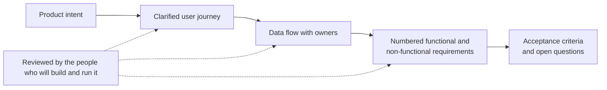

# Translating Product Requirements into Technical Requirements

> [!abstract] In one sentence
> Requirements translation is the discipline of turning "users should be able to pay with UPI" into numbers, contracts, data flows and acceptance tests — so the team builds the right thing once instead of discovering the real requirement in production.

> [!tip] Deeper treatment in your system-design vault
> `system-design/15 Interview Playbook/The System Design Interview Framework.md` — read it *after* you have written your own explanation below.

**Map:** [[Product Engineering MOC]] → [[HLD MOC]]

## Definition

Requirements translation converts a product-level statement of intent (a PRD, a user story, a message from a PM) into a specification engineers can build, test and operate. The output names the actors and journeys, the data created, read and changed, the [[Functional vs Non-Functional Requirements|functional and non-functional requirements]] with numbers attached, the constraints nobody said out loud (compliance, scale, existing systems) and the acceptance criteria that prove each requirement is met. It is the first step of any design, and in an interview it is the first ten minutes.

## Problem solved

Product asks are written in the language of outcomes ("instant refunds", "real-time balance"); engineers hear the language of mechanisms. Without an explicit translation the gaps are filled by assumption: "real-time" becomes a 5-minute batch for one engineer and a WebSocket for another; "instant" becomes a synchronous call to a payment processor that times out under load. The expensive bugs are usually requirements bugs — the system does exactly what was built, and what was built was the wrong thing. Translation moves that discovery from the incident review to the kickoff.

## How it works

1. **Clarify the ask.** Who is the user, what are they trying to achieve, what happens today, what does "done" look like? Ask the uncomfortable questions early: what happens if this fails halfway? Is a duplicate worse than a miss? Correct immediately or eventually? Every answer kills a branch of the design tree.
2. **Walk the journey.** Write the user journey as steps, then annotate each with the data it reads and writes and the service that [[Data Ownership and Lifecycle|owns]] it. The journey becomes a data flow, and the data flow exposes the integration points and where consistency matters.
3. **Surface the implicit requirements.** Product rarely states scale, latency, retention or regulatory constraints. Derive them: users and actions per day → [[Back-of-the-Envelope Estimation|a request rate and storage estimate]]; "shown on the screen" → a [[Latency|latency]] target; "money" → an audit trail and [[Idempotency|idempotent]] operations; "personal data" → retention and deletion obligations.
4. **Write requirements that can be tested.** Replace adjectives with measurements. "Fast" → "p99 under 300 ms at 500 rps". "Reliable" → "no transfer is lost or applied twice under a crash at any step". A requirement that cannot become a test, a metric or an alert is not finished.
5. **Rank and record.** Mark each requirement must / should / later, note the assumption behind every number, and capture open questions with an owner. The list is a living artifact.

```text
Product ask: "Users should see their wallet balance update instantly after a top-up."

Functional:     POST /topups creates a pending top-up; PSP webhook confirms it;
                GET /wallet returns the balance including confirmed top-ups.
Non-functional: balance visible within 2 s (p99) of PSP confirmation;
                a confirmed top-up is never lost or double-credited;
                20k top-ups/day today, plan for 10x.
Implicit:       PSP retries webhooks -> idempotency key per top-up;
                money movement -> append-only ledger entry + audit log;
                PII in PSP payload -> do not log raw bodies.
Acceptance:     replaying the same webhook 5x credits once; killing the service
                mid-handler leaves the balance correct after restart.
```

## Architecture



The shape is a pipeline of documents rather than a system: product intent → clarified journey → data flow with owners → numbered functional and non-functional requirements → acceptance criteria and open questions. Each stage narrows ambiguity and is reviewed by the people who will build and run the system, not only the author.

## Use cases

- A PRD or ticket with adjectives (fast, reliable, real-time, secure) and no numbers.
- A feature touching money, personal data or an external partner, where the failure semantics are the real requirement.
- Any system design interview: the first question is "what are we building, for whom, at what scale".
- A cross-team feature where "done" means different things to each team.

## Limitations

- Translation cannot invent what product does not know; some requirements only become clear after a prototype or a launch, so the spec must be allowed to change.
- Over-specifying freezes decisions that should stay reversible — a 40-page spec for a two-week experiment is waste.
- Derived numbers are estimates; treat them as design inputs, not day-one commitments.

## Trade-offs

| You gain | You sacrifice |
|---|---|
| Fewer rebuilds: the expensive misunderstanding is caught before code exists | Calendar time at the start, when pressure to "just start" is highest |
| Testable acceptance criteria that double as monitoring targets | Flexibility: a written number is harder to walk back than an unspoken one |
| Shared vocabulary between product, engineering and operations | The comfort of ambiguity — explicit trade-offs force explicit decisions |

## Failure modes

- **Unstated scale** → the design works in staging, collapses at launch → noticed as saturation on the first busy day; blast radius is the whole feature.
- **Adjective requirements** ("real-time") → two teams build to different meanings → found in integration or by the user; a redesign of the slower side.
- **Missing failure semantics** → duplicate payments or lost orders after a retry → found by reconciliation or customers; in fintech the most expensive class of bug.
- **Spec drifts from the build** → the document says one thing, the code another → discovered mid-incident when the runbook is wrong.

## Performance

The translation has no runtime cost, but it decides the performance envelope: the latency and throughput numbers written here become the targets that [[Capacity Planning|capacity planning]] and load tests check against. Writing "p99 under 300 ms" forces the conversation about whether the PSP call can be synchronous at all.

## Scalability

A requirements list scales with the product only if kept small and current: a short numbered list with owners survives team growth; a long prose document does not. Deriving scale numbers explicitly also makes the 10x question answerable — you know which requirement breaks first.

## Operational impact

Good translation produces the operational contract for free: every non-functional requirement is a candidate [[SLI SLO and SLA|SLI]], every failure-semantics requirement a candidate alert, and the acceptance tests become the regression suite. Skipped translation shows up as pages for behaviour nobody specified.

## Alternatives

- **Prototype first, specify later** — wins for genuinely uncertain product bets where learning beats precision; the prototype must then be thrown away or translated.
- **Heavyweight requirements engineering** (formal specs, traceability matrices) — wins in regulated or safety-critical domains; too slow for most product work.
- **Build to the ticket as written** — wins only when the author already did the translation; otherwise it is the failure mode.

## Real-world examples

- Amazon's "working backwards" writes the press release and FAQ before any design, forcing the customer-visible requirement to be explicit before mechanisms are chosen.
- Google's SRE practice of defining SLOs with product owners is requirements translation applied to reliability: the requirement is a number both sides agreed on.
- In a stack like yours: "add instant refunds" translated into a refund state machine, an idempotency key on the refund endpoint, a PSP webhook handler that tolerates duplicates, a ledger entry per state change, and a p99 target for the refund API — each with a test.

## Practical exercise

1. Take one ticket from your current sprint that contains an adjective (fast, reliable, real-time) and no number.
2. Write the user journey as five to eight steps; annotate each with data read/written and the owning service.
3. Derive three non-functional requirements with numbers and the assumption behind each (users/day, actions/user, payload size).
4. For each, write one acceptance test you could automate and one metric or alert that would catch a violation in production.
5. Review the sheet with the PM in 15 minutes and count how many assumptions were wrong.

## Related concepts

### Prerequisites
- [[Functional vs Non-Functional Requirements]] — the two categories every translated requirement falls into
- [[Back-of-the-Envelope Estimation]] — how implicit scale becomes an explicit number

### Related
- [[Prioritizing Reliability Performance Cost and Time to Market]] — ranking the requirements you uncover
- [[Data Ownership and Lifecycle]] — the journey walk exposes who owns which data
- [[Threat Modeling]] — the security questions belong in the same clarifying pass
- [[Capacity Planning]] — the derived numbers feed it
- [[SLI SLO and SLA]] — non-functional requirements become SLIs

### Builds on this
- [[Designing APIs and Contracts]] — contracts are translated requirements made concrete
- [[Testing Strategies]] — acceptance criteria written here become the test plan
- [[Evaluating Architectural Complexity]] — you can only judge complexity against stated requirements

### Design problems where it applies
- [[Design a Payment System]]
- [[Design a Notification System]]
- [[Design a Ticket Booking System]]

### Projects where it can be implemented
- [[Webhook Relay]]
- [[Personal Notification Hub]]

### Resources
- [[System Design Interview (Alex Xu)]] — the requirements-first framework
- [[Site Reliability Engineering (Google)]] — turning reliability requirements into SLOs

## Personal understanding

> [!question] Explain it without the source
> Write your own explanation here, from memory. Then compare it with the sections above and note what you missed.

### Mastery checklist
- [ ] I can explain it without the original resource
- [ ] I can describe the problem it solves
- [ ] I can compare it with its alternatives
- [ ] I can name its limitations and failure modes
- [ ] I can recognise when it is appropriate in a real system
- [ ] I have applied it in a system design
- [ ] I have validated my assumptions with an experiment or implementation

## Open questions

- [ ] Which clarifying questions have the highest payoff per minute for a fintech feature — failure semantics, scale, or compliance?
- [ ] How should a requirements sheet record an assumption so that it is revisited when the assumption breaks, not forgotten?
- [ ] Where is the line between a requirement (what) and a design decision (how) for something like "use an idempotency key"?
