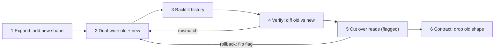

# Versioning and Migrations

> [!abstract] In one sentence
> Versioning lets two incompatible contracts coexist with a declared lifetime; a migration is the staged, reversible process — expand, dual-write, backfill, verify, cut over, contract — that moves callers and data from the old one to the new one without a maintenance window.

> [!tip] Deeper treatment in your system-design vault
> `system-design/13 Observability/Deployment Strategies.md` — read it *after* you have written your own explanation below.

**Map:** [[Product Engineering MOC]] → [[HLD MOC]]

## Definition

**Versioning** publishes more than one contract for the same capability at once — `v1` and `v2` of an API, schema versions 3 and 4 of an event, old and new column layouts of a table — each identified explicitly so a consumer or a row declares which one it uses. A **migration** is the controlled transition from one version to the next: moving callers across, transforming stored records, switching the read and write paths. Versioning is what you reach for when [[Backward Compatibility|compatibility]] cannot be preserved; migrations finish the job so the old version can be deleted.

## Problem solved

Some changes are genuinely breaking: a wrong money representation (floats to minor units), a split of one entity into two, a security fix that changes semantics, a move to another datastore. Without versioning, such a change is a coordinated outage; without a migration playbook, it is an all-night cutover with no way back. Versioning buys time for consumers to move; the phased migration buys the ability to stop or reverse at any step while production keeps running.

## How it works

**Versioning the contract.** Choose one scheme and apply it consistently: a path segment (`/v2/transfers`), a header (`API-Version: 2026-10-01`, Stripe-style dates), or a schema id in every event (Confluent Schema Registry assigns one per version). Keep live versions few — two is normal, three is a warning — and publish the end-of-life date with the new version, not after.

**Migrating the data: expand–contract.**

1. **Expand.** Add the new structure alongside the old: column, table, topic or endpoint. Nothing reads it yet; the deploy is trivially reversible.
2. **Dual-write.** The application writes both shapes in one transaction (or via an [[Outbox Pattern|outbox]] when the targets are different systems). Reads still use the old shape.
3. **Backfill.** A batched, idempotent, rate-limited job copies history into the new shape, in batches small enough not to hurt the primary, recording progress so it can resume.
4. **Verify.** Compare old and new continuously — counts, checksums, sampled diffs — until the mismatch rate is zero for long enough to trust.
5. **Cut over reads** behind a [[Feature Flags|flag]] or canary, with the old shape still written as the rollback path.
6. **Contract.** Stop writing the old shape, wait one more release so the N-1 build is gone, then drop the old column, topic or endpoint. The migration is done when the old code is deleted.

```sql
-- phase 1 expand: amounts move from NUMERIC rupees to BIGINT paise
ALTER TABLE entries ADD COLUMN amount_minor BIGINT;            -- nullable, no default rewrite
-- phase 3 backfill, batched and resumable
UPDATE entries SET amount_minor = ROUND(amount * 100)
 WHERE id > :last_id AND amount_minor IS NULL ORDER BY id LIMIT 5000;
-- phase 6 contract, only after reads have moved and N-1 is gone
ALTER TABLE entries ALTER COLUMN amount_minor SET NOT NULL;
ALTER TABLE entries DROP COLUMN amount;
```

## Architecture



## Use cases

- A change that fails the compatibility test: type change, semantic change, entity split or merge, datastore move.
- Retiring an old API or event format with external consumers still on it.
- Moving a large table or topic to a new structure while the system stays live — "zero-downtime migration" in the ticket.
- A [[Strangler Pattern|strangler]] migration: this playbook with a traffic switch instead of a read-path flag.

## Limitations

- Expand–contract takes calendar time: a week of dual-writing and a release of safety margin cannot be rushed into one deploy.
- Dual-writing to two *systems* (not two columns) is only safe through an outbox or CDC; two unguarded writes drift the moment one fails.
- Every live version is a maintenance surface; a team that versions freely and never contracts supports a decade of contracts.

## Trade-offs

| You gain | You sacrifice |
|---|---|
| A path to make genuinely breaking changes without downtime | Weeks of coexistence, dual-write code and verification jobs |
| Rollback at every phase by flipping a flag or stopping a job | Simplicity — mid-migration the system has two shapes |
| Consumers who move on their own schedule | Pressure on them to move at all; without an end date, versions never die |

## Failure modes

- **Backfill overwhelms the primary** → replication lag, p99 spikes → noticed by database alerts within minutes; smaller batches, sleeps and off-peak scheduling.
- **Dual-write skipped in one code path** (a batch job, an admin tool) → new shape missing rows → noticed in the verify phase if you have one, by customers if not.
- **Contract before N-1 is gone** → an application rollback reintroduces code that reads the dropped column → a failed rollback during an unrelated incident.
- **Version with no sunset date** → both live forever → double test matrices and a security fix applied twice.

## Performance

Dual-writing adds one write per transaction for the migration's duration; backfills are bandwidth-bound and must be throttled against replication lag and the primary's I/O budget. Verification diffs are read-heavy — run them on a [[Read Replicas|replica]]. Version translation layers cost microseconds and are not the bottleneck.

## Scalability

At 10x data the backfill is the problem: a table that backfills in an hour today takes a day, and a job without checkpoints that fails at hour 20 restarts from zero. Make backfills resumable by primary-key range, and consider transforming cold data lazily on read instead of eagerly.

## Operational impact

A migration in progress is an operational state: dashboards for backfill progress, dual-write errors and verification mismatches; a runbook saying which phase you are in and how to roll back from it; an owner. Each live API version needs monitoring by version so you know when the old one is dead. The migration is finished when the old code, the flag and the dashboards are removed.

## Alternatives

- **Compatible (additive) change** — wins whenever the change can be an addition; always try first ([[Backward Compatibility]]).
- **Big-bang migration in a maintenance window** — wins for small datasets and internal tools where an hour of downtime is cheaper than a week of dual writes.
- **Lazy, read-time migration** — transform records when next read, with a version field per record; wins for very large, mostly cold datasets, at the cost of two read paths living a long time.

## Real-world examples

- Stripe's online migrations essay describes exactly this sequence — dual write, backfill, verify, switch reads, remove old — for a core table without downtime ([[Stripe - Online Migrations at Scale]]).
- Stripe's date-based API versioning with per-account pinning is the mature end of contract versioning ([[Stripe - API Versioning]]); Confluent's Schema Registry is the event-side equivalent with enforced compatibility modes.
- In a stack like yours: moving ledger amounts from a decimal column to integer minor units via a Flyway expand migration, a Spring Boot dual-write in the same transaction, a Kubernetes CronJob backfill with a checkpoint table, a nightly diff job, a flag-controlled read switch, and a contract migration two releases later.

## Practical exercise

1. In the [[Double-Entry Ledger Service]] (or a local PostgreSQL), add an `amount_minor BIGINT` column and make the write path populate both columns in one transaction.
2. Write a resumable backfill of 5,000 rows per batch with a checkpoint table; run it under k6 write load and watch p99 and replication lag.
3. Write a verification query that counts mismatches; run it until zero.
4. Put the read path behind a flag, flip it to 10% then 100%, roll back once, then drop the old column and delete the flag.

## Related concepts

### Prerequisites
- [[Backward Compatibility]] — try the compatible change first; versioning is the fallback
- [[Schema Evolution]] — the table-level mechanics of expand–contract
- [[Designing APIs and Contracts]] — what is being versioned

### Related
- [[Strangler Pattern]] — the same playbook with a traffic switch
- [[Change Data Capture]] — the safe way to dual-write across systems
- [[Event Schema Evolution]] — versioning for message schemas
- [[Outbox Pattern]] — transactional dual-write to a queue
- [[Feature Flags]] — the read-path switch and the rollback lever

### Builds on this
- [[Deployment and Rollback Strategies]] — database-safe rollbacks assume expand–contract
- [[Designing Systems for Changing Requirements]] — a system that can migrate is a system that can change

### Design problems where it applies
- [[Design a Payment System]]
- [[Design an IAM Service]]
- [[Design a Feature Flag Service]]

### Projects where it can be implemented
- [[Double-Entry Ledger Service]]
- [[Durable Job Scheduler]]

### Resources
- [[Stripe - Online Migrations at Scale]] — the canonical playbook
- [[Stripe - API Versioning]] — contract versioning at scale
- [[Designing Data-Intensive Applications]] — schema evolution and dataflow

## Personal understanding

> [!question] Explain it without the source
> Write your own explanation here, from memory. Then compare it with the sections above and note what you missed.

### Mastery checklist
- [ ] I can explain it without the original resource
- [ ] I can describe the problem it solves
- [ ] I can compare it with its alternatives
- [ ] I can name its limitations and failure modes
- [ ] I can recognise when it is appropriate in a real system
- [ ] I have applied it in a system design
- [ ] I have validated my assumptions with an experiment or implementation

## Open questions

- [ ] How do you verify a migration whose new shape is not a pure function of the old one (for example, a split entity with new identifiers)?
- [ ] What batch size and sleep interval keep a backfill under a given replication-lag budget on a multi-AZ PostgreSQL, and how would you find it empirically?
- [ ] For events, is it better to version the topic (`transfers.v2`) or the schema inside one topic, given consumer-group semantics?
