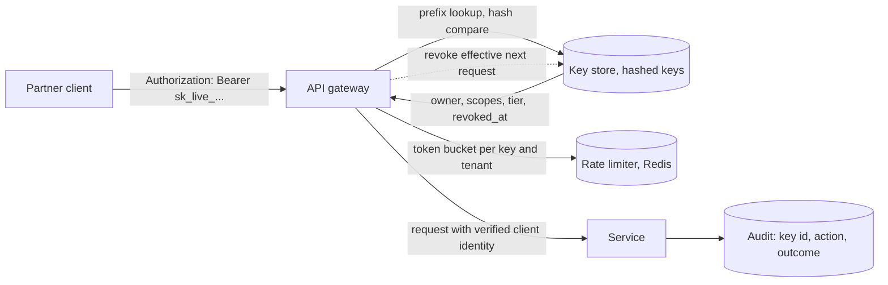

# API Keys

> [!abstract] In one sentence
> An API key is the simplest machine credential — a random string the client presents and the server looks up — and it is perfectly adequate when generated with real entropy, stored hashed, scoped narrowly, rate-limited per key, rotated with an overlap window and revocable instantly; it becomes a liability the moment it is long-lived, shared, logged or trusted for anything a signed, short-lived credential should do.

> [!tip] Deeper treatment in your system-design vault
> `system-design/11 Auth and IAM/API Security Essentials.md` — read it *after* you have written your own explanation below.

**Map:** [[Security MOC]] → [[HLD MOC]]

## Definition

An **API key** is a static, opaque secret issued to a client (a partner, a merchant integration, an internal service, a CLI) and presented on each request, typically in an `Authorization` header. The server hashes it, finds the matching key record, and treats the request as coming from that key's owner with that key's scopes and limits. Unlike an [[OAuth]] access token it is not signed, carries no claims, and does not expire unless you make it; unlike a password it is machine-generated with full entropy and never typed by a human. It is a bearer credential: whoever holds it can use it.

## Problem solved

Machine clients need to authenticate without a browser, a user or an interactive login, and operators need to answer "which client made this call", "how much may this client call", and "how do we cut this client off now". A key per client, stored hashed, gives identification, per-client [[Rate Limiting]], instant revocation and an [[Audit Logs|audit trail]] with a few dozen lines of code and no token infrastructure. The alternatives — client-credentials OAuth, mutual [[TLS]], signed requests — buy stronger properties (short lifetimes, non-bearer identity, non-repudiation) at the cost of key management and protocol work; the API key is the right floor, and knowing when the floor is not enough is the skill.

## How it works

1. **Generation.** Draw 32 bytes from a cryptographically secure random source and encode them (base62 or base64url). Add a recognisable **prefix** — `sk_live_`, `pk_test_`, your own `acme_` — so secret scanners (GitHub, gitleaks) can recognise leaked keys and so operators can tell environments apart at a glance. An optional checksum suffix lets scanners drop false positives.
2. **Storage.** Store only a hash. Because the key has full entropy, a fast hash (SHA-256) is sufficient — slow password hashes exist to resist guessing of low-entropy secrets, which does not apply here. Store a short, non-secret **lookup prefix** (first 8 characters) in a separate indexed column so the record can be found without scanning, then compare the full hash in constant time. Show the plaintext key exactly once at creation; never store or email it.
3. **Presentation.** `Authorization: Bearer <key>` or a dedicated header (`X-API-Key`) over TLS only. Never in query strings: they land in access logs, browser history, referrer headers and proxies.
4. **Scoping.** Every key record carries what it may do: owner (tenant, user or service), environment (live/test), permissions or scopes, optional IP allow-list, optional expiry, and rate-limit tier. Keys for reading should not be able to write; a key for the webhook configuration endpoint should not move money ([[Least Privilege]], [[Authorization]]).
5. **Rate limits and quotas per key.** The key is the natural limiter identity: token bucket per key at the gateway, with a per-tenant aggregate above it so one tenant with many keys cannot exceed its plan ([[API Gateways]]).
6. **Rotation.** Allow two active keys per client, so the client can add the new one, switch, and delete the old with no downtime. Record `last_used_at` so unused keys can be found and retired. Set a maximum age for sensitive scopes and alert when a key approaches it. On suspected leak: revoke immediately (one row update, effective on the next request because lookup is per request), issue a replacement, audit the key's recent use.
7. **Stronger variants.** Signed requests — an HMAC over method, path, body hash and a timestamp with the key as the secret (AWS SigV4, webhook signatures) — mean the key itself never travels and replays are bounded by the timestamp window; this is the standard for outbound webhooks ([[Design a Webhook Delivery System]]). When clients need short-lived credentials, scopes negotiated per call, or non-bearer identity, move to OAuth client credentials with a private key or to mutual TLS.

```sql
CREATE TABLE api_keys (
    id            uuid PRIMARY KEY,
    tenant_id     bigint NOT NULL,
    lookup_prefix char(8) NOT NULL,            -- first chars after 'sk_live_', indexed, non-secret
    key_hash      bytea NOT NULL,              -- sha256(full key), compared in constant time
    scopes        text[] NOT NULL,
    environment   text NOT NULL CHECK (environment IN ('live', 'test')),
    rate_tier     text NOT NULL,
    ip_allowlist  cidr[],
    expires_at    timestamptz,
    last_used_at  timestamptz,
    revoked_at    timestamptz,
    created_by    text NOT NULL
);
CREATE INDEX ON api_keys (lookup_prefix) WHERE revoked_at IS NULL;
```

## Architecture



> [!example]- Excalidraw version — the same diagram as an editable canvas
> ![[API Keys.excalidraw]]
> [[API Keys.excalidraw|Open in Excalidraw]] — needs the Excalidraw plugin (see [[Plugins to Install]]).


## Use cases

- "Merchants and partners integrate with our API from their servers" — per-key scopes, environments, rate tiers and instant revocation ([[Design an API Gateway]]).
- "Internal batch jobs and CLIs need to call services" — keys scoped to one service and one purpose, with expiry; or workload identity if the platform provides it.
- "Outbound webhooks must be verifiable by the receiver" — per-endpoint signing secrets with HMAC and a timestamp window, not a bearer key.
- "We need per-client usage metering and billing" — the key is the metering identity ([[Design a Rate Limiter]]).
- "A third party needs read-only access to one dataset" — a read-scoped, IP-restricted key with an expiry date.

## Limitations

- Bearer semantics: possession is proof, so leakage through logs, repositories, CI output or screenshots is total compromise until revocation.
- No built-in expiry or claims; every property must be looked up per request, so the key store is on the hot path (cache it, but then revocation latency equals the cache TTL).
- Weak identity for anything non-repudiable: a key does not prove *which* process used it, and shared keys among a partner's many systems are common.
- Not a delegation mechanism: it cannot express "on behalf of user X with their consent"; that is [[OAuth]].
- Rotation depends on client cooperation; keys issued years ago tend to live forever unless `last_used_at` and expiry are enforced.

## Trade-offs

| You gain | You sacrifice |
|---|---|
| Trivial client integration: one header, no token dance | Bearer secrets that must be protected end to end by every client |
| Instant revocation and per-key limits via one lookup | A lookup on every request, or a cache that delays revocation |
| Easy metering, auditing and scoping per client | No short-lived credentials, no claims, no delegation |
| Cheap to build and operate | Key-hygiene burden pushed onto partners and onto your secret scanning |

## Failure modes

- **Key leaked in a public repository or log** → used within minutes by scanners-for-hire; you notice from unusual source IPs or secret-scanning alerts; blast radius is everything the key's scopes allow until revoked — bounded only by scoping and limits.
- **Keys stored in plaintext** → one database read exposure hands out every client's credential; you notice during an incident; blast radius is all clients, all of whom must rotate.
- **Keys in query strings** → they appear in gateway, CDN and application logs and in the partner's browser history; discovered by a log review; blast radius is every key ever passed that way.
- **No per-key rate limit** → one partner's runaway retry loop consumes the API's capacity for all tenants ([[Retry Storms]]); blast radius is the platform.
- **Cached key records without invalidation** → a revoked key keeps working for the cache TTL; you notice when revocation "did not work" during an incident; design the cache with explicit invalidation on revoke.

## Performance

Verification is a hash and one indexed lookup — sub-millisecond against PostgreSQL, faster from a cache keyed by the lookup prefix with short TTL and explicit invalidation. Constant-time comparison is required to avoid timing leaks. Per-key rate limiting adds a Redis operation (around 100 µs to 1 ms). HMAC-signed requests add a hash of the body on both sides, negligible for typical payloads. The key store's write load is tiny (creation, rotation, `last_used_at` updates — batch those or sample them to avoid a write per request).

## Scalability

Key lookup scales with the cache; the store itself holds one row per key and is never large. Rate limiting per key scales with the limiter ([[Rate Limiting]]). At 10x partners the operational surface is onboarding, rotation reminders and support for leaked keys — process, not throughput. At 10x sensitivity (money-moving scopes), the design should migrate those scopes to signed requests or OAuth client credentials with private keys, leaving API keys for read and configuration access.

## Operational impact

Own: a key management UI or API with create, scope, rotate, revoke; secret-scanning on your own repositories and CI; detection of leaked keys in the wild (prefix registration with GitHub's secret-scanning partner programme is common for platforms); audit of key use per client; expiry enforcement and `last_used_at` reports; an incident runbook for leaked keys with revocation, replacement and customer communication. On-call sees spikes from a single key (limit and contact), 401 storms after a partner's rotation went wrong, and the occasional key in a log line that triggers a rotation.

## Alternatives

- **OAuth client credentials with `private_key_jwt` or mTLS** — win when you need short-lived tokens, scopes per call and no bearer secret on the wire ([[OAuth]]).
- **Mutual TLS** — wins for a bounded set of high-trust integrations (banks, internal services in a mesh); certificate lifecycle replaces key lifecycle.
- **HMAC-signed requests** — win when the secret must never be transmitted and replays must be bounded; the standard for webhooks and for cloud APIs.
- **Platform workload identity (IRSA, Pod Identity, SPIFFE)** — wins for internal services on Kubernetes: no distributed secret at all ([[Secrets Management]]).

## Real-world examples

- Stripe's `sk_live_`/`pk_test_` prefixes, show-once secret keys, restricted keys with scopes and rolling rotation are the widely copied reference design; GitHub's `ghp_`-style prefixes exist for the same scanning reason.
- AWS Signature Version 4 is the signed-request variant at the largest scale: the access key id identifies, the secret signs, the signature travels.
- GitHub's secret-scanning partner programme lets platforms register key formats so leaked keys in public repositories are reported and can be auto-revoked.
- In a stack like yours: partner-facing keys issued by the IAM service with prefix, hashed storage, scopes and per-key limits enforced at the gateway; HMAC signatures with timestamps on outbound webhooks; and internal NestJS and Spring services using IRSA or client credentials rather than static keys, so that the only bearer secrets in the system belong to partners and have a rotation date ([[Webhook Relay]] exercises the signing side).

## Practical exercise

1. Add an `api_keys` table and a key-issuing endpoint to a NestJS or Spring Boot gateway: generate 32 random bytes, prefix `acme_live_`, store SHA-256 and the lookup prefix, return the plaintext once.
2. Implement a verification middleware with constant-time comparison, scope checks and a per-key token bucket in Redis; load-test with k6 and measure the per-request overhead.
3. Implement rotation with two active keys per tenant and `last_used_at`; script a client that rotates with zero failed requests.
4. Commit a key to a throwaway repository with gitleaks in CI and confirm it is caught; then revoke it and confirm the next request fails even with a warm cache (explicit invalidation).
5. Add HMAC request signing for one endpoint (method, path, body hash, timestamp, 5-minute window) and replay a captured request to show it is rejected.

## Related concepts

### Prerequisites
- [[Authentication]] — API keys are one form of machine authentication
- [[HTTP and HTTPS]] — headers, logging and why query strings leak
- [[Least Privilege]] — the principle that decides how narrowly each key is scoped

### Related
- [[OAuth]] — the client-credentials alternative with short-lived tokens
- [[Secrets Management]] — how clients and you store and rotate the secret side
- [[API Gateways]] — where verification and limits usually run
- [[Authorization]] — scopes on a key are coarse permissions the service still refines per object

### Builds on this
- [[Audit Logs]] — key id as the actor in machine-initiated events
- [[Rate Limiting]] — per-key and per-tenant limits assume a key registry exists

### Design problems where it applies
- [[Design an API Gateway]]
- [[Design a Webhook Delivery System]]
- [[Design a Rate Limiter]]
- [[Design a Feature Flag Service]]

### Projects where it can be implemented
- [[Webhook Relay]]
- [[LLM Gateway]]
- [[Rate Limiter Library]]

### Resources
- [[OWASP Secrets Management Cheat Sheet]] — generation, storage and rotation of secrets including keys
- [[OAuth 2.0 RFC 6749]] — the client-credentials grant that replaces keys when you need more
- [[OWASP Threat Modeling Cheat Sheet]] — spoofing and information-disclosure threats around credentials

## Personal understanding

> [!question] Explain it without the source
> Write your own explanation here, from memory. Then compare it with the sections above and note what you missed.

### Mastery checklist
- [ ] I can explain it without the original resource
- [ ] I can describe the problem it solves
- [ ] I can compare it with its alternatives
- [ ] I can name its limitations and failure modes
- [ ] I can recognise when it is appropriate in a real system
- [ ] I have applied it in a system design
- [ ] I have validated my assumptions with an experiment or implementation

## Open questions

- [ ] Which API keys in your platform can move money or change payout details, and should those scopes require signed requests or OAuth client credentials instead?
- [ ] How many issued keys have never been used in the last 90 days, and is there a process that expires them?
- [ ] If a partner's key appeared in a public repository tonight, how many minutes would pass between the leak, detection, revocation and the partner being told?
