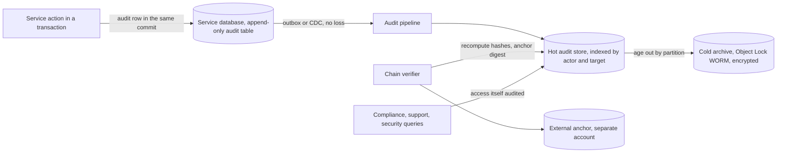

# Audit Logs

> [!abstract] In one sentence
> An audit log answers "who did what, when, to what, and was it allowed" with evidence that cannot be quietly edited — which means it is written in the same unit of work as the action, stored where nobody including the application can update or delete it, chained or anchored so tampering is detectable, retained for as long as regulators and disputes require, and never confused with the debug logs that get sampled, dropped and expired.

> [!tip] Deeper treatment in your system-design vault
> `system-design/11 Auth and IAM/Designing an IAM Service.md` — read it *after* you have written your own explanation below.

**Map:** [[Security MOC]] → [[HLD MOC]]

## Definition

An **audit log** (audit trail) is a chronological, append-only record of security- and business-relevant events: authentication events, authorization decisions, administrative changes, access to sensitive data, and every state change to regulated objects such as accounts, payments, limits and beneficiaries. Each record identifies the **actor** (principal and, where relevant, who they acted on behalf of), the **action**, the **target** resource, the **time**, the **origin** (IP, device, service, request and trace ids), the **outcome** (success, failure, denied) and, for changes, the **before and after** state or a diff. It differs from application [[Logging]] in purpose (evidence, not debugging), guarantees (reliable and immutable, not best-effort), retention, and access control.

## Problem solved

Three questions arrive after the fact and cannot be answered from ordinary logs: a customer disputes a transfer ("I never approved that"); a regulator asks for every change to a limit and who made it over three years; a security team asks what a compromised account did in the hour before detection. Debug logs are sampled, rotated after days, searchable only by luck, editable by anyone with write access to the log store, and emitted on a best-effort path that drops under load — exactly when something interesting is happening. An audit log is designed for those questions: complete for the events it covers, immutable, queryable by actor and resource, retained for years, and protected from the people whose actions it records. In payments it is also a product feature (account activity, statements, approval history) and an explicit compliance requirement (PCI DSS requirement 10, SOC 2 logging criteria, local financial regulation).

## How it works

1. **Decide what is audited.** Authentication (login, logout, MFA, token refresh, failures), authorization decisions on sensitive actions (both allows and denies), administrative and configuration changes (roles, limits, feature flags, keys), access to sensitive data (viewing a document, exporting a report), and every state transition of money-moving objects. Define this as a list owned by security and compliance, not left to each team ([[Threat Modeling]] feeds it).
2. **Capture the right fields.** `event_id` (unique), `occurred_at` (UTC, from a trusted clock), `actor` (`sub`, actor type, `on_behalf_of` for impersonation and support actions), `action` (verb from a controlled vocabulary), `target_type` and `target_id`, `tenant`, `outcome`, `reason` or policy version for denials, `request_id` and `trace_id` for correlation ([[Distributed Tracing]]), `source_ip`, `user_agent` or service name, `session_id`, and a `before`/`after` or diff for changes. Never include secrets, full card numbers, tokens or passwords; hash or truncate identifiers that are themselves sensitive.
3. **Write it reliably.** For actions in a database transaction, insert the audit row in the **same transaction** — if the audit write fails, the action fails ([[Transactions]]). To ship it to a central store, use the [[Outbox Pattern]] or [[Change Data Capture]] so no event is lost between the database and the audit system. For actions without a local transaction (reads of sensitive data, authentication in the IAM service), write synchronously to the audit store before returning, and fail the request if the write fails for the highest-sensitivity actions. Audit writes are never fire-and-forget and never sampled.
4. **Make it immutable and tamper-evident.** Append-only table with `REVOKE UPDATE, DELETE` from every application role, enforced by triggers that raise on modification; a separate database or account for the long-term store so a compromised application cannot reach it ([[Least Privilege]]); object storage with Object Lock in compliance mode (WORM) for archives; and a **hash chain** — each record includes the hash of the previous record, with the chain head periodically anchored somewhere external (a signed digest, a separate account, a timestamping service) so deletion or edit of any record breaks verification. CloudTrail's log-file validation is the same idea applied by AWS to its own audit logs.
5. **Store and query.** Partition by time ([[Partitioning]]), index by actor and by target, and keep hot data in the database and cold data in encrypted object storage with the same schema; a search path that answers "everything this principal did between t1 and t2" and "every change to this account" in seconds is the acceptance test. Access to the audit store is itself audited.
6. **Retain and protect.** Retention is set by regulation and dispute windows — commonly years for financial records, with specific minimums per jurisdiction that you should take from your compliance team, not from a note — with legal hold overriding deletion ([[Data Retention and Archival]]). Audit records contain personal data, so they need encryption, access control and a documented basis under privacy law; erasure requests are usually handled by pseudonymising the actor reference rather than deleting records.
7. **Keep it separate.** Different pipeline, different store, different retention and different access from debug logs; debug logs may reference an audit `event_id` but never substitute for it. When the logging pipeline is under [[Backpressure]], debug logs are dropped and audit records are not.

```sql
CREATE TABLE audit_events (
    seq           bigint GENERATED ALWAYS AS IDENTITY PRIMARY KEY,
    event_id      uuid NOT NULL UNIQUE,
    occurred_at   timestamptz NOT NULL,
    actor_sub     text NOT NULL,
    actor_type    text NOT NULL,                     -- user, service, support, system
    on_behalf_of  text,
    action        text NOT NULL,                     -- payout.approve, limit.update, document.view
    target_type   text NOT NULL,
    target_id     text NOT NULL,
    tenant_id     bigint NOT NULL,
    outcome       text NOT NULL,                     -- success, failure, denied
    reason        text,
    request_id    text, trace_id text, session_id text, source_ip inet,
    before_state  jsonb, after_state jsonb,
    prev_hash     bytea NOT NULL,
    this_hash     bytea NOT NULL                     -- sha256(prev_hash || canonical json of this row)
) PARTITION BY RANGE (occurred_at);
REVOKE UPDATE, DELETE, TRUNCATE ON audit_events FROM PUBLIC, payments_rw, iam_rw;
-- A verifier job recomputes the chain nightly and anchors the latest this_hash in a separate account.
```

## Architecture



## Use cases

- "Every change to limits, beneficiaries, roles and payout approvals must be attributable" → audited in-transaction with before/after state and the approver's principal ([[Authorization]] maker-checker evidence).
- "Customers can see their account activity and dispute items" → the audit trail is the data behind the activity screen and the dispute process ([[Design a Digital Wallet and Ledger]]).
- "Support can act on behalf of customers" → `on_behalf_of` recorded on every impersonated action, with a reason.
- "Security needs to reconstruct an account takeover" → login, MFA, token refresh, device and IP history per session ([[Authentication]]).
- "Auditors require evidence that access to production data is controlled" → audited reads of sensitive data and audited access to the audit store itself.

## Limitations

- An audit log records what the system saw; actions outside the instrumented paths (a direct database edit by an administrator) are invisible unless the database itself is audited (`pgaudit`, CloudTrail for the control plane).
- Synchronous audit writes add latency and a dependency to sensitive actions; the trade is deliberate but must be designed for the audit store's availability.
- Tamper evidence is not tamper proof: an attacker with enough access can rewrite the chain and the anchor unless the anchor lives somewhere they cannot reach.
- Volume: auditing every read of every record is expensive; scope reads to sensitive data classes and keep the schema compact.
- Privacy and retention pull against each other; the resolution needs legal input and pseudonymisation strategies, not engineering guesses.

## Trade-offs

| You gain | You sacrifice |
|---|---|
| Attributable, defensible evidence for disputes, regulators and incidents | Write cost and latency on every audited action, and a store that must be highly available |
| Tamper evidence through immutability and hash chains | Verifier jobs, anchoring infrastructure and the discipline of never "fixing" a record |
| A clean separation from debug logs with its own guarantees | Two logging pipelines to run, with different retention and access controls |
| A product feature (activity history) and compliance evidence from one source | Years of storage, partition management and privacy handling for personal data |

## Failure modes

- **Audit write is fire-and-forget** and the queue drops under load → the busiest, most interesting hour has gaps; you notice during an investigation; blast radius is the credibility of the whole trail.
- **Application role can update or delete audit rows** → an insider or a compromised service erases its tracks; you notice only if a chain verifier exists; blast radius is legal and regulatory.
- **Secrets or card numbers in audit payloads** → the most protected store becomes the biggest leak; you notice from a compliance review; blast radius is every record containing them.
- **Clock drift or wrong time zone** → events misordered across services, disputes unresolvable; you notice when a sequence makes no sense; fix with NTP, UTC and the sequence number alongside the timestamp ([[Clocks and Time]]).
- **Retention too short or deletion by a cleanup job** → records required for a dispute are gone; you notice when the regulator asks; blast radius is the fine.

## Performance

One extra indexed insert per audited action — comparable to the [[Outbox Pattern]] row, small relative to the business write. Synchronous writes to a remote audit store cost a network round trip and should be limited to the highest-sensitivity actions, with the rest flowing through the outbox. Hash chaining adds a SHA-256 per record; verification is a sequential scan per partition, done offline. Query performance depends on partitioning by time and indexes on `(actor_sub, occurred_at)` and `(target_type, target_id, occurred_at)`. Storage grows linearly with audited actions; compact schemas and compression in the cold tier keep multi-year retention affordable ([[Object Storage]]).

## Scalability

The write path scales with the services producing events; the pipeline (outbox or CDC into a central store) scales like any event stream ([[Kafka]]). The hot store partitions by time and scales out by tenant or by time range; the cold archive is object storage and effectively unbounded. At 10x events, auditing policy matters more than infrastructure — which reads to audit, how much state to capture — and chain verification shifts from per-record to per-batch Merkle roots. At 10x teams, a shared audit library with a fixed schema and vocabulary is what keeps the trail queryable.

## Operational impact

Own: the audited-action catalogue, the shared client library, the pipeline's no-loss guarantee and its monitoring (outbox lag, pipeline lag, verifier results), partition and retention jobs, the cold archive's Object Lock configuration, access control and audit of the audit store, and the query tooling support and compliance use. On-call signals: verifier failures (treat as a security incident), pipeline lag, audit-store unavailability affecting sensitive actions. Make the trail part of product and incident runbooks so it is used routinely, not only under duress.

## Alternatives

- **[[Event Sourcing]]** — wins when the domain's full history is the primary model; the event store is the audit trail, with the same immutability and retention needs.
- **Database-level auditing (`pgaudit`, CloudTrail data events, DynamoDB streams)** — wins for catching access that bypasses the application; coarser semantics, no business vocabulary.
- **Ledger databases and append-only services** — win when tamper evidence must be a managed property rather than something you build; fewer options since the retirement of some managed ledger products, but the pattern (hash-chained, WORM-backed) is implementable on any store.
- **Plain application logs with longer retention** — win only for low-stakes systems; they lack reliability, immutability and structure the moment a dispute or regulator appears.

## Real-world examples

- PCI DSS requirement 10 mandates logging of access to cardholder data and system components, with retention and integrity controls; SOC 2 and ISO 27001 require comparable evidence; these are why fintech audit logs are a product requirement.
- AWS CloudTrail's log-file integrity validation signs digests of delivered log files so tampering is detectable, and S3 Object Lock provides WORM retention for archives — the managed versions of hash chaining and immutability.
- Stripe's and Square's public descriptions of their ledgers and audit trails stress append-only records and reconcilable history; Google's Zanzibar paper notes authorization decisions being logged as part of the system's guarantees.
- In a stack like yours: an `audit_events` table in each service written in the same transaction as the action, relayed through the outbox to Kafka and into a dedicated audit account's store, hash-chained and anchored nightly, with `REVOKE UPDATE, DELETE` on every writer role, `on_behalf_of` for support actions, policy versions on every authorization decision, and a seven-figure-row-per-day retention plan agreed with compliance ([[Design an IAM Service]] and [[Design a Payment System]] both include this component).

## Practical exercise

1. Add the `audit_events` table above to a NestJS or Spring Boot payouts service; write an audit row inside the same transaction as `approvePayout`, and an outbox row to relay it.
2. Implement the hash chain on insert (via a trigger or in the service) and a verifier CLI that recomputes it; edit a historical row with a superuser and watch the verifier fail.
3. Attempt `UPDATE`/`DELETE` with the application role and confirm the revoke and trigger block it.
4. Run k6 at 500 approvals per second; measure the latency added by the audit insert and the outbox relay lag into a second "audit" PostgreSQL instance.
5. Archive a closed monthly partition to MinIO (or S3) with object locking enabled and demonstrate that deletion is refused during the retention period.
6. Write the three queries — everything by one actor in a window, every change to one target, every denial for one policy — and make them return in under a second on ten million rows.

## Related concepts

### Prerequisites
- [[Logging]] — what audit logs are *not*, and the pipeline concepts they borrow
- [[Authentication]] and [[Authorization]] — the events most worth recording

### Related
- [[Event Sourcing]] — the model where the audit trail is the primary store
- [[Data Retention and Archival]] — multi-year retention, legal hold and cold tiers
- [[Outbox Pattern]] — the no-loss path from the action's transaction to the audit store
- [[Encryption at Rest and in Transit]] — protecting records that contain personal data
- [[Object Storage]] — WORM archives with Object Lock
- [[Least Privilege]] — access reviews use audit evidence to prune permissions

### Builds on this
- [[Production Incident Analysis]] — the trail is the evidence incident reviews rely on

### Design problems where it applies
- [[Design an IAM Service]]
- [[Design a Digital Wallet and Ledger]]
- [[Design a Payment System]]
- [[Design a Feature Flag Service]]

### Projects where it can be implemented
- [[Double-Entry Ledger Service]]
- [[Feature Flag Service and SDK]]
- [[Webhook Relay]]

### Resources
- [[Martin Fowler - Event Sourcing]] — the relationship between event history and audit
- [[OpenTelemetry Observability Primer]] — trace and request ids used for correlation
- [[OWASP Threat Modeling Cheat Sheet]] — repudiation threats and the logging controls that counter them

## Personal understanding

> [!question] Explain it without the source
> Write your own explanation here, from memory. Then compare it with the sections above and note what you missed.

### Mastery checklist
- [ ] I can explain it without the original resource
- [ ] I can describe the problem it solves
- [ ] I can compare it with its alternatives
- [ ] I can name its limitations and failure modes
- [ ] I can recognise when it is appropriate in a real system
- [ ] I have applied it in a system design
- [ ] I have validated my assumptions with an experiment or implementation

## Open questions

- [ ] For payout approvals and limit changes in your stack, is the audit record written in the same transaction as the change, and what happens to the action if the audit write fails?
- [ ] Which roles can update or delete audit rows today, and is there any job that would detect a modified record?
- [ ] What retention period does your compliance team actually require for each audited event class, and does the current cleanup job respect it?
