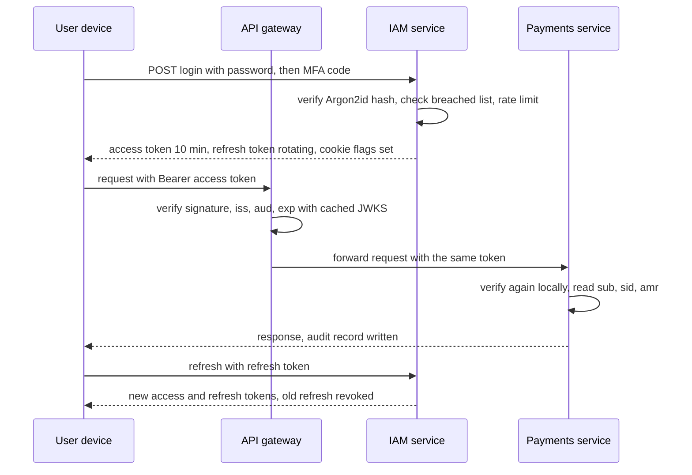

# Authentication

> [!abstract] In one sentence
> Authentication turns a claim ("I am user 42", "I am the payments service") into a verified identity attached to a request, using something the caller knows, has or is — and the design decisions that matter are how the credential is stored, how long the resulting proof lives, how it is revoked, and which component is allowed to believe it.

> [!tip] Deeper treatment in your system-design vault
> `system-design/11 Auth and IAM/Sessions vs Tokens.md` — read it *after* you have written your own explanation below.

**Map:** [[Security MOC]] → [[HLD MOC]]

## Definition

**Authentication (AuthN)** is the process of verifying that a principal — a person, a device or a workload — is who it claims to be. It produces an identity that [[Authorization]] then uses to decide what the principal may do. For people it combines factors: knowledge (password, PIN), possession (phone, hardware key, device) and inherence (biometrics); for services it uses cryptographic identity (mutual [[TLS]] certificates, signed tokens from an identity provider, cloud workload identity). The result is carried as a **session** (server-side state referenced by an opaque cookie) or a **token** (a self-contained, signed assertion such as a [[JWT]]).

## Problem solved

Every request to a system arrives as bytes claiming to come from someone. Without authentication, authorisation has nothing to decide on, audit has nobody to record, and rate limits have no subject. The hard parts are not the login form but what surrounds it: storing credentials so a database leak does not expose them, resisting credential stuffing and phishing, keeping the proof short-lived enough that theft is bounded yet long enough that users are not logged out hourly, revoking it when a device is lost or an employee leaves, and — in a service mesh of dozens of services — deciding which component verifies the proof so that an internal service never trusts a header that any caller could have written. In fintech the stakes are regulatory: strong customer authentication for payments, step-up for high-risk operations, and an audit trail of who authenticated how.

## How it works

1. **Passwords.** Never store them; store a slow, salted hash: Argon2id (OWASP's current recommendation; minimum of roughly 19 MiB memory, 2 iterations, 1 degree of parallelism), or bcrypt with a cost around 10 or higher, or scrypt. Per-user salts stop rainbow tables; an optional server-side pepper from a secret store stops offline cracking of a leaked table. Follow NIST SP 800-63B: minimum length, screen against breached-password lists, no forced composition rules, no periodic rotation. Rate-limit and lock out per account *and* per source to blunt credential stuffing ([[Rate Limiting]]).
2. **Sessions.** On login, create a server-side session record (user id, created, expires, device, last seen) in a shared store such as [[Redis]] and hand the browser an opaque id in a cookie flagged `HttpOnly; Secure; SameSite=Lax` (or `Strict`). Regenerate the id at login to defeat fixation. Revocation is trivial — delete the record — and every request costs one store lookup.
3. **Tokens.** On login, the identity provider signs a short-lived access token (5–15 minutes is typical) and issues a longer-lived **refresh token**. Services verify the access token locally with the provider's public key and never call the provider per request ([[JWT]]). Refresh tokens are stored hashed, bound to the client and device, and **rotated** on every use with reuse detection: presenting an already-used refresh token revokes the whole family, because it means theft. Revocation of access tokens is approximate (wait for expiry) unless you add a denylist or a per-user session version checked on sensitive calls.
4. **Multi-factor and step-up.** TOTP (RFC 6238) is phishable but widely supported; SMS one-time codes are weak against SIM swap; WebAuthn/FIDO2 passkeys are phishing-resistant and bound to the origin. Treat MFA as a property of the *session*: record which factors were satisfied (`amr` claim) and when (`auth_time`), and require **step-up** — re-proving a stronger factor — for high-risk actions such as adding a beneficiary, changing limits or large transfers, regardless of how long ago login happened.
5. **Device and service identity.** Bind sessions and refresh tokens to a device identifier; alert on new-device login. For workloads, prefer identity that needs no distributed secret: mutual TLS with short-lived certificates (SPIFFE/SPIRE, service mesh), cloud workload identity (IAM roles for service accounts or Pod Identity on EKS), or OAuth client credentials with keys in a secret store ([[OAuth]], [[Secrets Management]]).
6. **Where it lives.** Terminate at the edge ([[API Gateways]]): the gateway validates the token's signature, issuer, audience and expiry and rejects garbage before it reaches services. Then **re-verify in every service** — a local signature check costs microseconds — rather than trusting an `X-User-Id` header that any pod on the network could forge. Propagate the verified token (or a gateway-minted internal token) downstream; never a bare user id. This is the zero-trust posture: the network is not the boundary, the signature is.
7. **Session lifecycle.** Idle timeout and absolute timeout, logout that revokes server-side state, "log out everywhere" that bumps a session version, and an [[Audit Logs|audit record]] for login success, failure, MFA challenge, token refresh and logout, keyed by principal, device and source address.

```typescript
// NestJS guard: verify locally, never trust upstream headers for identity
@Injectable()
export class JwtGuard implements CanActivate {
  async canActivate(ctx: ExecutionContext) {
    const req = ctx.switchToHttp().getRequest();
    const token = req.headers.authorization?.replace(/^Bearer /, '');
    if (!token) throw new UnauthorizedException();
    const { payload } = await jwtVerify(token, this.jwks, {   // jwks: cached remote key set
      algorithms: ['ES256'], issuer: 'https://iam.internal', audience: 'payments-api',
      clockTolerance: 30,
    });
    if (payload.amr?.includes('mfa') !== true && req.path.startsWith('/transfers')) {
      throw new ForbiddenException('step-up required');
    }
    req.principal = { sub: payload.sub, sid: payload.sid, amr: payload.amr };
    return true;
  }
}
```

## Architecture



> [!example]- Excalidraw version — the same diagram as an editable canvas
> ![[Authentication.excalidraw]]
> [[Authentication.excalidraw|Open in Excalidraw]] — needs the Excalidraw plugin (see [[Plugins to Install]]).


## Use cases

- "Users log in with email and password" → Argon2id hashing, breached-password screening, per-account and per-IP rate limits, MFA enrolment, and a session or token design chosen with revocation in mind.
- "High-value operations need stronger assurance" → step-up authentication recorded in the session with `amr` and `auth_time`, enforced per endpoint, not per login.
- "Dozens of services behind one gateway" → edge validation plus local re-verification in each service; identity propagated as a signed token.
- "Service A must call service B with no human present" → workload identity (mTLS or cloud IAM) or client credentials; never a long-lived shared password ([[API Keys]]).
- "Customers connect over WebSockets" → authenticate at the handshake with the same token, re-validate on reconnect, and close the socket when the token's session is revoked ([[WebSockets]], [[Client State and Reconnection]]).

## Limitations

- Authentication proves who is calling, not what they may do; an authenticated attacker with someone's role is an [[Authorization]] problem.
- Tokens trade revocation latency for scalability; if instant revocation is a hard requirement, you need sessions or a denylist in the hot path.
- MFA raises the bar but TOTP and SMS are phishable; only origin-bound factors (passkeys) resist real-time phishing.
- Edge-only validation creates a soft interior: any service reachable without the gateway, or any pod that can write headers, becomes an identity oracle.
- Password policies cannot fix reuse across sites; breached-password screening and MFA are the real mitigations.

## Trade-offs

| You gain | You sacrifice |
|---|---|
| Sessions: instant revocation, small cookies, no claims to go stale | A shared session store on every request's path and its availability |
| Tokens: stateless verification in every service, no central lookup | Revocation delayed until expiry, token size, key-rotation discipline |
| Short access-token lifetimes: bounded damage from theft | Refresh traffic to the IAM service and rotation logic on every client |
| Edge plus local verification: no trusted headers, defence in depth | Public-key distribution to every service and a few microseconds per request |

## Failure modes

- **Credential-stuffing wave** → login failures spike from many IPs with valid-looking emails; you notice from failure rate and new-device logins; blast radius is every account that reused a breached password, unless MFA is on.
- **Trusted internal header** — a service believes `X-User-Id` set by anyone on the network → full account takeover from one compromised pod; you notice only from audit anomalies; blast radius is every account.
- **Refresh token leaked without rotation or reuse detection** → the attacker mints access tokens indefinitely; you notice from parallel activity on one session; blast radius is that account until revocation.
- **IAM service down with session-based auth** → every request fails at the lookup; with tokens, existing access tokens keep working until expiry and only refreshes fail — a deliberate [[Graceful Degradation]] property of tokens.
- **Clock skew between IAM and services** → tokens rejected as not-yet-valid or accepted past expiry; you notice from a burst of 401s after a deploy; blast radius is every request, fixed by NTP and a small `clockTolerance` ([[Clocks and Time]]).

## Performance

A password verification is deliberately slow — tens to hundreds of milliseconds of CPU and memory for Argon2id — so login endpoints need their own capacity and rate limits. A session lookup is one Redis round trip, around 100 µs to 1 ms. A token signature check is microseconds for HMAC, tens to hundreds of microseconds for RSA, less for ECDSA/EdDSA, with the public key cached locally. Refresh calls hit the IAM service once per access-token lifetime per client, which sets the IAM service's steady-state load. MFA adds a round trip to the user, not the system.

## Scalability

Token-based authentication scales horizontally with no shared state on the request path; the IAM service's load is logins and refreshes, not requests. Session-based authentication scales with the session store, which is usually Redis and usually fine, but makes the store a dependency of every request ([[Distributed Caching]]). At 10x services, key distribution ([[JWT|JWKS]] caching) and consistent validation libraries become the problem; at 10x users, login capacity (slow hashing) and abuse controls do.

## Operational impact

You operate an identity provider (in-house IAM or a vendor), a secret or key store, MFA enrolment and recovery flows, abuse controls, and the audit trail. On-call sees: lockout storms, IAM latency propagating to every login, key-rotation mistakes that invalidate every token at once, and clock skew. Recovery flows (lost phone, lost passkey) are where most account takeovers happen and deserve the same rigour as login. Test the revocation path end to end — "log out everywhere" that does not actually end sessions is a common audit finding.

## Alternatives

- **Delegating to an external identity provider ([[OAuth]] / OIDC with Auth0, Cognito, Keycloak)** — wins when you do not want to own password storage and MFA; costs integration and per-user pricing.
- **Passwordless (magic links, passkeys only)** — wins for phishing resistance and support load; costs recovery design and device-loss handling.
- **Mutual TLS for every client** — wins for machine clients and regulated B2B integrations; impractical for consumer browsers.
- **Sessions only, no tokens** — wins for a single web application with one backend; the simplest correct design when there is no service fan-out.

## Real-world examples

- NIST SP 800-63B defines the password and authenticator guidance above; OWASP's password-storage guidance names Argon2id with concrete parameters.
- OAuth 2.0 Security Best Current Practice and OAuth 2.1 mandate refresh-token rotation or sender-constraining for public clients; GitHub, Google and Auth0 implement rotation with reuse detection.
- Large consumer platforms report that credential stuffing dominates login abuse, which is why breached-password screening and MFA prompts on new devices are now standard.
- In a stack like yours: an in-house IAM service issuing ES256-signed access tokens with `sid`, `amr` and `auth_time`, an API gateway validating at the edge, every NestJS and Spring service re-verifying with a cached JWKS, refresh tokens hashed in PostgreSQL and rotated with family revocation, step-up MFA on beneficiary and limit changes, and login events written to the audit store ([[Design an IAM Service]] is this system).

## Practical exercise

1. Build a small IAM service (NestJS or Spring Boot) with Argon2id password hashing, a breached-password check against a local list, per-account and per-IP rate limits, and TOTP enrolment.
2. Issue ES256 access tokens (10 min) with `sid`, `amr`, `auth_time`, and rotating refresh tokens stored hashed with a family id; implement reuse detection that revokes the family.
3. Put two resource services behind a gateway; validate at the edge and locally; then try to call a service directly with a forged `X-User-Id` header and confirm it is ignored.
4. Load-test login with k6 and measure CPU per Argon2id verification; tune parameters and record login throughput per core.
5. Simulate a stolen refresh token: use it from a second client after the first has rotated it, and verify that both sessions are revoked and an audit event is recorded.
6. Stop the IAM service and observe that existing access tokens keep working until expiry while refreshes fail.

## Related concepts

### Prerequisites
- [[HTTP and HTTPS]] — cookies, headers and the request lifecycle the proof travels through
- [[TLS]] — the channel that keeps credentials and tokens confidential in transit

### Related
- [[Authorization]] — what the verified identity is then allowed to do
- [[JWT]] — the token format and its validation rules
- [[OAuth]] — delegated authentication and authorisation flows
- [[API Keys]] — the simpler credential for machine clients
- [[Rate Limiting]] — the first defence against credential stuffing
- [[Audit Logs]] — recording who authenticated, how and from where

### Builds on this
- [[API Gateways]] — edge validation as a gateway responsibility
- [[Client State and Reconnection]] — re-authenticating long-lived connections
- [[WebSockets]] — authenticating at the handshake

### Design problems where it applies
- [[Design an IAM Service]]
- [[Design an API Gateway]]
- [[Design a Chat System]]
- [[Design a Payment System]]

### Projects where it can be implemented
- [[Presence and Chat Service]]
- [[LLM Gateway]]

### Resources
- [[OAuth 2.0 RFC 6749]] — the delegated flows that most modern authentication is built on
- [[JWT Best Current Practices RFC 8725]] — validation rules for token-based authentication
- [[OWASP Threat Modeling Cheat Sheet]] — spoofing threats and their mitigations

## Personal understanding

> [!question] Explain it without the source
> Write your own explanation here, from memory. Then compare it with the sections above and note what you missed.

### Mastery checklist
- [ ] I can explain it without the original resource
- [ ] I can describe the problem it solves
- [ ] I can compare it with its alternatives
- [ ] I can name its limitations and failure modes
- [ ] I can recognise when it is appropriate in a real system
- [ ] I have applied it in a system design
- [ ] I have validated my assumptions with an experiment or implementation

## Open questions

- [ ] In your services, does any endpoint read a user identity from a header without verifying a signature, and could a pod inside the cluster reach it directly?
- [ ] How long does "log out everywhere" take to actually stop a stolen access token in your stack, and is that number written down anywhere?
- [ ] Which operations in your payment flows should require step-up MFA, and is the factor recorded in the session so services can enforce it without calling IAM?
