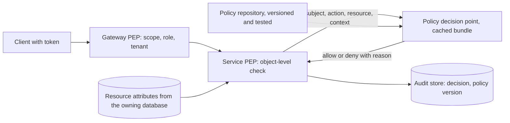

# Authorization

> [!abstract] In one sentence
> Authorization answers "may *this* principal do *this* action to *this* resource right now" — and because the resource and the principal's rights both change after the token was minted, the only safe design puts coarse facts in the token, makes object-level decisions at request time, denies by default, and records every decision that touches money.

> [!tip] Deeper treatment in your system-design vault
> `system-design/11 Auth and IAM/RBAC vs ABAC.md` — read it *after* you have written your own explanation below.

**Map:** [[Security MOC]] → [[HLD MOC]]

## Definition

**Authorization (AuthZ)** is the decision, after [[Authentication]] has established identity, of whether a request is permitted. The decision takes a subject (user, service, with its roles and attributes), an action (read, transfer, approve), a resource (account 42, document X, with its owner and state) and context (time, IP, MFA level, amount). Models for expressing the rule: **RBAC** (roles map to permissions), **ABAC** (policies over attributes of subject, resource, action and environment), **ReBAC** (permissions derived from relationships such as owner, member, parent — Google's Zanzibar model). A **policy decision point** (PDP) evaluates; **policy enforcement points** (PEPs) in gateways and services ask it and enforce the answer.

## Problem solved

Broken access control is the most common serious web vulnerability class: an endpoint that checks you are logged in but not that the account id in the URL is *yours* (object-level authorization, "BOLA/IDOR"), an admin function reachable by any authenticated user (function-level), a role that accumulated permissions nobody meant to grant. These bugs are quiet — the request succeeds — and in fintech they are the shortest path to reading other customers' statements or moving their money. Authorization as a designed system, rather than `if (user.isAdmin)` scattered through handlers, gives one place to express rules, one place to test them, one place to audit, and the ability to answer "who can do what" without reading every controller.

## How it works

1. **Choose the model for each kind of rule.** RBAC for coarse organisational permissions (`support-agent` may view, `ops-lead` may refund); roles should be few and permissions explicit, or you get role explosion. ABAC when context matters (`amount < limit`, `resource.region == subject.region`, `mfa_level >= 2`). ReBAC when access follows a graph (document sharing, account ownership, team membership) — OpenFGA, SpiceDB and Ory Keto implement Zanzibar's relation tuples. Most real systems combine them: roles decide *what kinds* of actions, relationships decide *which objects*, attributes decide *under which conditions*.
2. **Token claims versus request-time checks.** Put in the token only what is coarse and slow-changing: tenant, roles, scopes, MFA level ([[JWT]], [[OAuth]]). Do not put object lists ("accounts the user owns") in the token: they go stale the moment ownership changes, they bloat the token, and they turn revocation into a token-lifetime problem. Object-level checks — does this account belong to this customer, is this payment still in `PENDING_APPROVAL` — are made at request time against the current data, inside the same transaction that performs the action where possible ([[Transactions]]).
3. **Evaluate with a policy engine or a well-tested library.** Externalised engines (Open Policy Agent with Rego, Cedar, Casbin) separate policy from code and can be tested as data; in-process evaluation with a cached policy bundle keeps latency in microseconds. The PDP needs policy information (PIP): resource attributes fetched by the service and passed in, not looked up by the engine over the network per request.
4. **Deny by default and check at the right layer.** The gateway enforces coarse rules (scope, role, tenant) and strips what it cannot verify; each service enforces fine-grained rules for its own resources — the gateway cannot know whether account 42 belongs to the caller. A missing policy is a deny. Function-level and object-level checks are separate and both required.
5. **Maker-checker (four-eyes).** For sensitive operations, the principal who *creates* a request (maker) must differ from the one who *approves* it (checker), enforced by the server: store the maker's principal on the request, reject approval when `approver == maker`, require the checker to hold the approve permission and, for large amounts, a stronger MFA level; carry the request's version so the checker approves exactly what was proposed ([[Optimistic and Pessimistic Locking]]). Segregation of duties extends this to roles: nobody holds both `create-payout` and `approve-payout`.
6. **Scopes and consent for delegated access.** When a third party acts for a user, OAuth scopes narrow what the token may do, and the resource server intersects scope with the user's own permissions — the token cannot grant more than the user has.
7. **Audit every decision that matters.** Log allows and denies for sensitive actions with subject, action, resource, policy version and decision reason; denies are the security signal, allows are the compliance record ([[Audit Logs]]).

```typescript
// Object-level check at request time, inside the service that owns the resource
async approvePayout(principal: Principal, payoutId: string, expectedVersion: number) {
  return this.db.transaction(async (tx) => {
    const payout = await tx.payouts.findForUpdate(payoutId);           // row lock
    if (!payout || payout.tenantId !== principal.tenantId) throw new NotFound();      // no leak of existence
    if (payout.status !== 'PENDING_APPROVAL' || payout.version !== expectedVersion) throw new Conflict();
    if (payout.makerId === principal.sub) throw new Forbidden('maker cannot approve');
    const decision = this.pdp.evaluate({                               // in-process policy bundle
      subject: principal, action: 'payout:approve',
      resource: { type: 'payout', amountMinor: payout.amountMinor, currency: payout.currency },
      context: { mfaLevel: principal.amr?.includes('mfa') ? 2 : 1 },
    });
    if (!decision.allow) { await this.audit.deny(principal, 'payout:approve', payoutId, decision.reason); throw new Forbidden(); }
    await tx.payouts.approve(payoutId, principal.sub, expectedVersion);
    await this.audit.allow(principal, 'payout:approve', payoutId, decision.policyVersion, tx);
  });
}
```

## Architecture



> [!example]- Excalidraw version — the same diagram as an editable canvas
> ![[Authorization.excalidraw]]
> [[Authorization.excalidraw|Open in Excalidraw]] — needs the Excalidraw plugin (see [[Plugins to Install]]).


## Use cases

- "Customers may see only their own accounts" → object-level ownership check in the account service, on every read and write, never derived from the token alone.
- "Support agents can view but not move money; ops leads can refund up to a limit" → RBAC for the verb, ABAC for the limit, audit for both.
- "Payouts above a threshold need a second approver" → maker-checker with server-enforced distinct principals and step-up MFA.
- "Partners access customer data via our API with consent" → OAuth scopes intersected with the user's permissions, consent recorded.
- "Documents shared with teams and individuals" → ReBAC: relation tuples and a graph check ([[Design File Storage]]).

## Limitations

- Authorization cannot fix identity: a stolen session passes every check as the victim ([[Authentication]], MFA and anomaly detection are the counters).
- Externalised policy adds a dependency and a latency budget; a PDP called over the network on every request is a new single point of failure and must be cached or in-process.
- Fine-grained rules need data the gateway does not have; pushing all authorization to the edge produces either leaks or a gateway that knows every domain ([[API Gateways]]).
- Role explosion and permission creep are social problems; without periodic review and [[Least Privilege]] discipline any model decays.
- Caching decisions trades correctness for speed: a revoked permission stays effective for the cache TTL.

## Trade-offs

| You gain | You sacrifice |
|---|---|
| RBAC: simple to explain, easy to audit "who has what" | Context-free rules and role explosion as exceptions accumulate |
| ABAC: rich, contextual policies in one language | Harder to answer "who can do X" and policies that need many attributes fetched |
| ReBAC: natural model for ownership and sharing graphs | A graph store on the request path and consistency questions on relation updates |
| Centralised policy engine: tested, versioned, consistent across services | Another runtime component, a policy language to learn, and bundle distribution |

## Failure modes

- **Missing object-level check** → any customer reads or acts on any account by changing an id; you notice from a pentest, a bug bounty or an audit anomaly, rarely from monitoring; blast radius is every record behind that endpoint.
- **Stale claims in long-lived tokens** → a demoted or offboarded user keeps rights until expiry; you notice from an access review; blast radius is whatever those rights allow for the token lifetime.
- **PDP outage treated as allow** → a fail-open misconfiguration silently grants everything; you notice from audit records with no decision or from an incident; blast radius is total — authorization must fail closed.
- **Maker-checker bypass** through a second channel (bulk import, admin API, migration script) that skips the approval check → segregation of duties violated; you notice from reconciliation or regulators; blast radius is legal.
- **Policy deployed without tests** → a rule inversion denies every customer or allows every agent; you notice from error rates or, worse, from nothing; blast radius is global, which is why policy changes need the same review and rollout as code ([[Deployment and Rollback Strategies]]).

## Performance

An in-process policy evaluation over cached rules costs microseconds; a network call to a PDP costs a round trip (hundreds of microseconds to milliseconds) and should be reserved for rare decisions or batched. The real cost is data: object-level checks need the resource's owner and state, which the service already fetches for the action — do the check on that row inside the transaction rather than a second lookup. ReBAC graph checks (Zanzibar-style) are designed for millisecond answers with heavy caching and consistency tokens; self-hosted engines need the same care. Decision caching with short TTLs (seconds) smooths load but bounds revocation latency.

## Scalability

RBAC scales to thousands of services trivially; the scaling problem is organisational — role definitions and reviews. ABAC and ReBAC scale with attribute and relation data volume; Zanzibar handles trillions of tuples with a dedicated service, and the open-source implementations follow its design. At 10x services, consistency of enforcement is the risk: a shared library or sidecar PEP with a versioned policy bundle keeps every service on the same rules; without it, each team re-implements and one of them forgets the object-level check.

## Operational impact

Own the policy lifecycle: policies in version control, unit tests per rule (allow and deny cases, including maker-checker), staged rollout, and a dashboard of deny rates per policy and per endpoint. Periodic access reviews with evidence from audit logs. On-call signals: deny-rate spikes after a deploy (policy bug), PDP latency or errors (must fail closed), unusual allow patterns (compromised credential). Debuggability means every decision log carries the policy version and reason; "why was I denied" must be answerable in minutes.

## Alternatives

- **Hard-coded checks in handlers** — win only for a single small application; they become untestable and inconsistent at the second service.
- **Database-enforced row-level security** (PostgreSQL RLS with session variables) — wins when the database is the only path to the data and tenancy is the main rule; weaker for action-level rules ([[Least Privilege]]).
- **Capability tokens** (signed, narrowly scoped, short-lived tokens per resource) — win for delegation to third parties or pre-signed access to one object, as with pre-signed object-storage URLs.
- **Gateway-only authorization** — wins when every rule is coarse (tenant, role) and there is no object-level nuance; rare outside internal tools.

## Real-world examples

- Google's Zanzibar paper describes the relationship-based authorization system behind Drive, YouTube and Calendar; OpenFGA and SpiceDB are its open-source descendants.
- Open Policy Agent and AWS Cedar (used by Amazon Verified Permissions) are the widely deployed policy engines; Netflix and Pinterest have described OPA for service authorization.
- The OWASP API Security Top 10 has listed broken object-level authorization as the number one API risk since its first edition, which is the empirical case for request-time object checks.
- In a stack like yours: an in-house IAM service that issues tokens with tenant, roles and MFA level; a gateway that enforces scope and tenant; each NestJS or Spring service checking ownership and state inside its own transaction; maker-checker on payouts with distinct principals and version-carrying approvals; and every allow or deny on money-moving actions written to the audit store with the policy version ([[Design an IAM Service]]).

## Practical exercise

1. Build a payouts service (NestJS or Spring Boot) with three roles (agent, ops-lead, admin) and endpoints to create, view and approve payouts; store the maker on each payout.
2. Write authorization tests as a matrix: every role times every endpoint times own/other tenant times amount below/above the limit; make the suite fail on any missing object-level check.
3. Add maker-checker: reject approval by the maker, require `amr` containing `mfa` above the limit, and carry the payout version; test the bypass via a bulk-import endpoint and close it.
4. Externalise the rules into OPA or Cedar, load the bundle in-process, and measure decision latency with k6 at 1,000 requests per second; then move the PDP to a network call and compare.
5. Simulate a PDP outage and verify the service fails closed; simulate a policy bug that inverts a rule and confirm the deny-rate alert fires within a minute.

## Related concepts

### Prerequisites
- [[Authentication]] — there is no subject to authorize without it
- [[JWT]] — the carrier for the coarse claims the first check uses

### Related
- [[OAuth]] — scopes as delegated, consent-bound authorization
- [[Audit Logs]] — the record of every sensitive decision
- [[Input Validation]] — ids and parameters must be validated before they reach a policy check
- [[Data Ownership and Lifecycle]] — ownership is the data behind most object-level checks

### Builds on this
- [[API Gateways]] — the first enforcement point for coarse rules
- [[Least Privilege]] — the principle that keeps roles and policies narrow assumes a decision model exists

### Design problems where it applies
- [[Design an IAM Service]]
- [[Design File Storage]]
- [[Design a Payment System]]
- [[Design a Feature Flag Service]]

### Projects where it can be implemented
- [[Feature Flag Service and SDK]]
- [[LLM Gateway]]
- [[Double-Entry Ledger Service]]

### Resources
- [[OAuth 2.0 RFC 6749]] — scopes and the resource-server side of delegated authorization
- [[OWASP Threat Modeling Cheat Sheet]] — elevation-of-privilege threats and mitigations
- [[JWT Best Current Practices RFC 8725]] — what claims may be trusted and when

## Personal understanding

> [!question] Explain it without the source
> Write your own explanation here, from memory. Then compare it with the sections above and note what you missed.

### Mastery checklist
- [ ] I can explain it without the original resource
- [ ] I can describe the problem it solves
- [ ] I can compare it with its alternatives
- [ ] I can name its limitations and failure modes
- [ ] I can recognise when it is appropriate in a real system
- [ ] I have applied it in a system design
- [ ] I have validated my assumptions with an experiment or implementation

## Open questions

- [ ] For each endpoint that takes an account, payment or customer id in your services, where exactly is the ownership check, and is there a test that would fail if it were deleted?
- [ ] Which rights in your tokens are object lists or permissions that can change before the token expires, and what is the worst case for a demoted user?
- [ ] Is maker-checker enforced in one place that every channel (API, admin UI, batch jobs) goes through, or re-implemented per channel?
