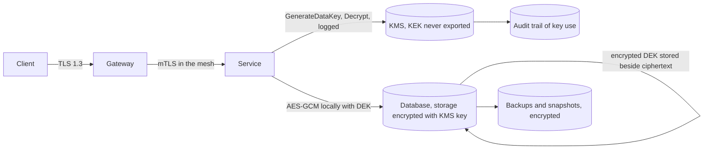

# Encryption at Rest and in Transit

> [!abstract] In one sentence
> Encryption converts a data-protection problem into a key-protection problem: TLS keeps bytes private and intact between two endpoints, storage encryption keeps a stolen disk, snapshot or bucket unreadable, and envelope encryption with a KMS makes "who can decrypt" an auditable access-control decision — while doing nothing about a service, user or query that is legitimately allowed to read.

> [!tip] Deeper treatment in your system-design vault
> `system-design/18 AWS Services/Secrets Manager Parameter Store and KMS.md` — read it *after* you have written your own explanation below.

**Map:** [[Security MOC]] → [[HLD MOC]]

## Definition

**Encryption in transit** protects data moving between processes, almost always with [[TLS]]: confidentiality, integrity and server (optionally mutual) authentication for the connection. **Encryption at rest** protects stored data: at the volume level (EBS, disk encryption), the database level (transparent data encryption, encrypted RDS storage), the object level (S3 server-side encryption) or the **field level** (the application encrypts specific columns before writing). **Envelope encryption** encrypts each piece of data with a unique **data encryption key (DEK)** and encrypts the DEK with a **key encryption key (KEK)** held in a **key management service (KMS)** or hardware security module, which never releases the KEK and logs every use.

## Problem solved

Data lives in many places you do not fully control: cloud disks and snapshots, database backups in a bucket, log archives, replicas in another region, laptops with database dumps, network paths through load balancers and proxies. Without encryption, every one of those is a copy of your customers' card numbers, identity documents and balances in the clear, readable by anyone who obtains the medium. Encryption at rest with keys outside the storage layer means a leaked snapshot or decommissioned disk is noise; encryption in transit means a compromised network segment yields nothing. Regulators (PCI DSS, GDPR, local banking rules) require both, and field-level encryption plus tokenisation is how a payments stack keeps card data out of most of its systems. The limit is as important as the benefit: encryption does not help when the attacker is a bug in your own service that reads through the legitimate path.

## How it works

1. **Transit.** TLS 1.2 or 1.3 everywhere, including inside the cluster: a service mesh or sidecars give mutual TLS between pods with short-lived certificates issued automatically; database and cache connections use TLS with certificate verification (`sslmode=verify-full`, not `require`); internal load balancers terminate and re-encrypt rather than forwarding plaintext. What TLS protects: the bytes on the wire and the identity of the server. What it does not: the endpoints, the logs the endpoints write, or a client talking to the wrong server because verification was turned off.
2. **Volume and database encryption.** EBS encryption, RDS/Aurora storage encryption (set at creation; cannot be enabled on an existing unencrypted instance without a snapshot-copy migration) and S3 SSE-KMS encrypt data as it is written to the medium using keys from KMS. This defeats theft of physical media, snapshot exposure and misconfigured bucket copies; it is transparent to the database and application, which read plaintext as usual — so a SQL injection or an over-privileged service reads plaintext too.
3. **Envelope encryption.** For each record or file: ask the KMS for a data key (`GenerateDataKey` returns the plaintext DEK and the DEK encrypted under the KEK); encrypt the data locally with the plaintext DEK using an AEAD cipher (AES-256-GCM with a unique 96-bit nonce per encryption, never reused under the same key); store the ciphertext together with the *encrypted* DEK; discard the plaintext DEK. To read: send the encrypted DEK to the KMS (`Decrypt`), which checks the caller's permission, logs the call and returns the plaintext DEK; decrypt locally. The KEK never leaves the KMS; data of any size is encrypted locally; KMS calls are per key, not per byte. Cache plaintext DEKs briefly and per key to bound KMS latency and cost.
4. **Key hierarchy and rotation.** Rotating the KEK (KMS does this yearly by default, keeping old versions for decryption) means new DEKs are wrapped with the new version; existing encrypted DEKs can be re-wrapped cheaply without touching the data. Rotating a DEK requires re-encrypting its data, which is why DEKs are per record, per file or per time window — small blast radius, small re-encryption units. **Crypto-shredding**: delete a customer's DEK and their data is irrecoverable, which is how erasure requests are honoured in immutable or backed-up stores ([[Data Retention and Archival]]).
5. **Field-level encryption.** Encrypt specific fields (PAN, account numbers, document numbers) in the application before they reach the database, with **additional authenticated data** binding the ciphertext to its row (the record id, the field name) so a ciphertext cannot be moved to another row. Randomised encryption hides equality but cannot be searched; deterministic encryption (or a separate blind index — an HMAC of the value) permits equality lookups at the cost of revealing which rows share a value. For card data, **tokenisation** replaces the PAN with a token from a vault service so most systems never see the PAN and drop out of PCI scope.
6. **Access control on keys.** The KMS key policy and IAM are the real gate: a service that can call `Decrypt` on a key can read everything under it ([[Least Privilege]]). Separate keys per environment, per data class and per service; grant decrypt only to the service that owns the data; alert on `Decrypt` from unexpected principals ([[Audit Logs]]).
7. **Backups, replicas and logs.** Encrypted at the source, backups stay encrypted; restoring in another account needs the key shared or re-encrypted — a [[Disaster Recovery]] and [[Backups and Restoration]] dependency on KMS that must be rehearsed. Logs and caches hold whatever the application wrote; keep sensitive fields out of them, because no storage encryption helps once a PAN is in a log line.

```text
Envelope encryption of a field (pseudocode)
write:
  (dekPlain, dekWrapped) = kms.generateDataKey(keyId = "alias/customer-pii", context = {table: "kyc", id: rowId})
  nonce = random(12 bytes)
  ciphertext = AES_256_GCM.encrypt(key = dekPlain, nonce, plaintext, aad = rowId + "|" + "document_number")
  store(rowId, ciphertext, nonce, dekWrapped, keyVersion)   ; zero dekPlain from memory
read:
  dekPlain = kms.decrypt(dekWrapped, context = {table: "kyc", id: rowId})   ; permission checked and logged by KMS
  plaintext = AES_256_GCM.decrypt(dekPlain, nonce, ciphertext, aad = rowId + "|" + "document_number")
```

## Architecture



## Use cases

- "Card numbers, identity documents or account numbers are stored" → field-level envelope encryption or tokenisation, separate keys per data class, decrypt permission limited to one service ([[Design a Payment System]]).
- "Backups and snapshots are copied across accounts or regions" → storage encryption with keys that are shared or re-encrypted deliberately and tested in a restore drill.
- "Services talk to each other across nodes and zones" → mesh mTLS and verified TLS to every datastore.
- "A regulator or customer requires proof of erasure" → per-customer DEKs and crypto-shredding.
- "Compliance requires encryption at rest" — the volume-level checkbox is necessary and cheap; the question that follows is which threats it actually addresses.

## Limitations

- Encryption does not protect against authorised readers: an injected query, an over-privileged service, an insider with decrypt rights, or a bug that logs plaintext all bypass it entirely ([[Input Validation]], [[Least Privilege]]).
- Keys are now the crown jewels; losing them loses the data, and over-sharing them loses the protection.
- Field-level encryption removes the database's ability to index, sort, range-scan or constrain the field; blind indexes restore only equality.
- KMS calls add latency and a hard dependency; caching DEKs trades some of the auditability for performance.
- Transparent storage encryption gives no protection between tenants of the same database or against anyone with a valid connection.

## Trade-offs

| You gain | You sacrifice |
|---|---|
| Stolen media, snapshots and buckets become unreadable | A dependency on the KMS for every start-up, restore and decrypt |
| Decryption as an auditable, revocable permission rather than a property of storage | Latency and cost per key operation, and DEK caching that must be bounded |
| Field-level protection against the database and its backups themselves | Searchability, indexing and constraints on the encrypted field |
| Erasure by key deletion even from immutable archives | Irrecoverable data if a key is lost or deleted by mistake |

## Failure modes

- **Key policy too broad** → every service and operator can decrypt the PII key; you notice from a KMS audit or not at all; blast radius is the whole data class, with the audit trail as the only evidence.
- **KMS unavailable or permission removed** → services cannot decrypt DEKs, requests fail, restores fail; you notice immediately as errors on every read; blast radius is every encrypted path — design DEK caching and a documented fallback.
- **Nonce reuse under the same key** (a counter reset, a cloned VM, a bad random source) → AES-GCM confidentiality and integrity break for those messages; you notice only through cryptanalysis; use random nonces with per-record keys or counters tied to the key's lifetime.
- **Plaintext leaking around the encryption** — card numbers in logs, traces, error messages, caches or analytics exports → the encrypted column is irrelevant; you notice from a log review or a breach; blast radius is the leaked copies.
- **Key deleted or rotation misapplied** → data encrypted under an old version cannot be read; you notice during a restore; blast radius is everything under that version — keep old versions, use scheduled deletion windows and test restores.

## Performance

TLS adds a handshake (one round trip in 1.3, resumable) and a few percent of CPU for symmetric crypto; with connection reuse it is negligible ([[Keep-Alive Connections]], [[Connection Pooling]]). AES-GCM with hardware acceleration runs at gigabytes per second per core; the cost of field encryption is dominated by KMS calls — a few milliseconds each — so DEK caching per key with a short TTL keeps the hot path local. Storage-level encryption on cloud volumes and S3 is effectively free in throughput terms. Blind-index lookups cost one HMAC and an index scan.

## Scalability

Envelope encryption scales because the KMS sees key operations, not data volume: one `GenerateDataKey` per record or per batch, one `Decrypt` per cache miss. KMS services have request-rate quotas, so a service decrypting per request without caching will hit them at scale; per-key DEK caches and batch key derivation (a DEK per time window per tenant) keep calls bounded. Key counts also scale: per-tenant keys for isolation and crypto-shredding are manageable in the thousands and need automation beyond that.

## Operational impact

Own: key inventory (which key, which data class, which principals), rotation schedules, KMS alerts on unusual decrypt activity, restore drills that include key access in a second account or region, incident runbooks for suspected key compromise (re-wrap DEKs under a new KEK, re-encrypt data under new DEKs for the affected class), and certificate lifecycle for mTLS. Debugging encrypted fields is harder by design; build tooling that decrypts only through the audited path with a recorded reason. Compliance evidence (PCI, SOC 2) comes largely from KMS and TLS configuration and their audit trails.

## Alternatives

- **Tokenisation via a vault** — wins for card data: most systems never hold the PAN, scope shrinks dramatically; costs a vault service on the path.
- **Not storing the data** — wins more often than expected: collect less, retain less, derive what you need (last four digits, a hash) ([[Data Retention and Archival]]).
- **Database-native encryption features** (TDE, pgcrypto, Always Encrypted) — win when the application should stay unaware; weaker separation between the database and the keys in some designs.
- **Client-side end-to-end encryption** — wins when the server must never be able to read the data (messaging, password managers); the server loses all ability to process it.

## Real-world examples

- AWS KMS documentation describes envelope encryption, `GenerateDataKey`/`Decrypt`, encryption context and automatic KEK rotation; Google Cloud KMS and Azure Key Vault offer the same model, and HashiCorp Vault's transit engine is the self-hosted equivalent.
- PCI DSS requires card data to be rendered unreadable wherever stored and strong cryptography in transit over open networks; tokenisation providers exist specifically to shrink that scope for merchants and fintechs.
- Service meshes (Istio, Linkerd) and SPIFFE/SPIRE made automatic mutual TLS between workloads standard on Kubernetes.
- In a stack like yours: Aurora and S3 encrypted with per-environment KMS keys, mesh mTLS between NestJS and Spring services on EKS, `verify-full` TLS to PostgreSQL and Redis, field-level envelope encryption for KYC document numbers with a per-customer DEK and a blind index for lookup, card PANs tokenised at the edge so the ledger never stores them, and KMS `Decrypt` alerts wired to the security channel.

## Practical exercise

1. In Docker Compose, run PostgreSQL with TLS and a LocalStack KMS (or HashiCorp Vault's transit engine); write a NestJS or Spring Boot service that stores a `document_number` field with envelope encryption, AES-256-GCM, AAD bound to the row id, and a blind index (HMAC) for equality lookup.
2. Measure p99 for writes and reads with and without a DEK cache; count KMS calls per 1,000 requests.
3. Copy a ciphertext from one row to another and show the AAD check rejects it; reuse a nonce deliberately and read about what that enables.
4. Rotate the KEK: re-wrap all stored DEKs without touching ciphertexts and verify reads still work; then delete one customer's DEK and demonstrate crypto-shredding.
5. Connect to PostgreSQL with `sslmode=require` via a Toxiproxy that presents a different certificate, then with `verify-full`, and observe the difference.
6. Grep the service's logs and traces for the plaintext value after running the test suite; fix every place it appears.

## Related concepts

### Prerequisites
- [[Data Ownership and Lifecycle]] — classifying which data is sensitive, who owns it and how long it lives decides what to encrypt and under which key

### Related
- [[Least Privilege]] — decrypt permission is the real access control
- [[Secrets Management]] — keys and credentials share custody mechanisms
- [[TLS]] — the transport protocol that implements the in-transit half, with certificate verification done properly
- [[Object Storage]] — server-side encryption and bucket key policies
- [[Backups and Restoration]] — restores need the keys too
- [[Audit Logs]] — every key use is an auditable event

### Builds on this
- [[Data Retention and Archival]] — crypto-shredding as deletion
- [[Disaster Recovery]] — key availability across regions and accounts
- [[JWT]] — signing keys follow the same custody and rotation rules

### Design problems where it applies
- [[Design a Payment System]]
- [[Design File Storage]]
- [[Design an IAM Service]]
- [[Design a Digital Wallet and Ledger]]

### Projects where it can be implemented
- [[Double-Entry Ledger Service]]
- [[Streaming Fraud Rules Engine]]

### Resources
- [[OWASP Secrets Management Cheat Sheet]] — key custody, rotation and the blast radius of leaks
- [[OWASP Threat Modeling Cheat Sheet]] — information-disclosure threats and where encryption helps
- [[The Twelve-Factor App]] — configuration and credentials kept outside the code and image

## Personal understanding

> [!question] Explain it without the source
> Write your own explanation here, from memory. Then compare it with the sections above and note what you missed.

### Mastery checklist
- [ ] I can explain it without the original resource
- [ ] I can describe the problem it solves
- [ ] I can compare it with its alternatives
- [ ] I can name its limitations and failure modes
- [ ] I can recognise when it is appropriate in a real system
- [ ] I have applied it in a system design
- [ ] I have validated my assumptions with an experiment or implementation

## Open questions

- [ ] Which principals can call `Decrypt` on the keys protecting your most sensitive data class today, and would an alert fire if a new one appeared?
- [ ] Do your database and Redis clients verify the server certificate (`verify-full`), or only require encryption?
- [ ] If the KMS were unreachable for ten minutes, which of your services would keep serving and which would fail, and is that the intended behaviour?
