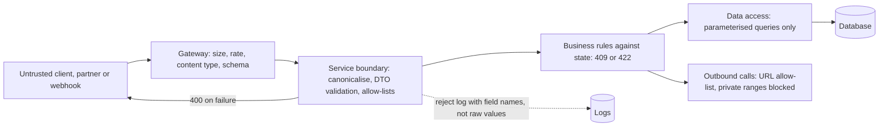

# Input Validation

> [!abstract] In one sentence
> Every byte that arrives from outside a trust boundary is data, never instructions: validate it against an allow-list schema at the boundary, keep it as data all the way down with parameterised queries and typed deserialisation, bound its size and rate, and separate the stateless "is this well-formed" check from the stateful business rule so each fails with the right status and the right blast radius.

> [!tip] Deeper treatment in your system-design vault
> `system-design/11 Auth and IAM/API Security Essentials.md` — read it *after* you have written your own explanation below.

**Map:** [[Security MOC]] → [[HLD MOC]]

## Definition

**Input validation** is the practice of checking all externally supplied data — request bodies, query and path parameters, headers, file uploads, message payloads, webhook calls, configuration from other systems — against an explicit definition of what is acceptable before it is used. **Syntactic validation** checks type, length, range, format and membership of an allow-list; **semantic validation** (business rules) checks meaning against state. **Injection** is the family of attacks where input is interpreted as code by a downstream interpreter — SQL, NoSQL query operators, shell commands, LDAP, templates, log formats, LLM prompts — and its primary defence is not validation but keeping data and code separate (parameterisation). **Sanitisation** transforms input to remove or encode dangerous parts; it is weaker than rejection and belongs mainly to output encoding.

## Problem solved

Injection has been near the top of every OWASP list for two decades because the pattern is general: a string from a user ends up concatenated into something an interpreter executes. SQL injection reads or alters the database; operator injection in MongoDB (`{"$gt": ""}` where a string was expected) bypasses a login; a path from a request escapes the upload directory; a URL supplied for a webhook makes the server fetch cloud metadata credentials (server-side request forgery, the Capital One vector); a deserialised Java object executes a gadget chain; a format string in a log line triggers remote code execution (Log4Shell). A second family is resource exhaustion: a 2 GB body, a deeply nested JSON document, a regular expression that backtracks for minutes, ten thousand ids in one `IN` list. Validation at the boundary plus safe handling below it is what makes an API robust to both, and in fintech it is also where amounts, currencies and account identifiers are checked before they can do damage.

## How it works

1. **Define the trust boundary.** Anything from a client, a partner, a webhook sender, a file, or another team's service is untrusted. Internal data that originated outside and was stored is still untrusted when it reaches a new interpreter (stored XSS, second-order SQL injection).
2. **Validate against a schema at the boundary.** Declare the expected shape — fields, types, lengths, ranges, patterns, enumerations — and reject anything else, including unknown fields. NestJS: `ValidationPipe({ whitelist: true, forbidNonWhitelisted: true, transform: true })` with `class-validator` decorators; Spring: Bean Validation (`@Valid`, `@NotNull`, `@Size`, `@Pattern`) with Jackson configured to fail on unknown properties; or JSON Schema / OpenAPI validation at the [[API Gateways|gateway]]. Allow-lists over deny-lists: define what *is* valid (`^[A-Z]{3}$` for a currency code, an enumeration of ISO 4217 values) rather than what is forbidden. Anchor regular expressions and avoid catastrophic backtracking (nested quantifiers) — use RE2-style engines or length caps first.
3. **Canonicalise before validating.** Decode once (URL, base64), normalise Unicode (NFC), resolve paths, reject null bytes and control characters, then validate the canonical form; validating before decoding is how `..%2F` gets past a path check.
4. **Keep data as data.** Parameterised queries or prepared statements everywhere; ORMs are safe until someone interpolates request data into a template-literal query string or writes `createQueryBuilder().where("name = '" + name + "'")`. For MongoDB, validate that operator fields are not objects where strings are expected and strip `$`-prefixed keys. For shell commands, use argument arrays, never a shell string. For paths, resolve and check the result is under the allowed root. For outbound URLs (webhooks, fetches), allow-list schemes and ports, resolve DNS and reject private, link-local and metadata ranges — then re-check at connect time to defeat DNS rebinding. For templates and logs, use structured logging and never pass user input as the format string.
5. **Safe deserialisation.** Never deserialise untrusted bytes into polymorphic or arbitrary types: no Java `ObjectInputStream` on external data (or an `ObjectInputFilter` allow-list), no Jackson default typing, no YAML `load` without a safe loader, no `pickle`. Typed DTOs with explicit fields are the pattern.
6. **Bound everything.** Maximum body size (frameworks default to around 100 KB for JSON in Express and NestJS, a few megabytes in Spring — set them deliberately), maximum array length and nesting depth, maximum string lengths, upload size and type (checked by content, not extension), request timeouts, and per-client [[Rate Limiting]]. Reject early at the gateway so a flood costs the cheapest tier.
7. **Validation versus business rules.** Validation is stateless and fails fast with `400`: "amount must be a positive integer in minor units", "currency must be a known code". Business rules need state and fail with `409`/`422`: "insufficient balance", "beneficiary not verified", "limit exceeded today". Keep them in separate layers; the first protects the system, the second protects the business, and both are logged — but never by echoing the raw input into a log line (log injection) or an error message (information disclosure).
8. **Money-specific checks.** Amounts as integers in minor units (or decimal strings parsed with a decimal library), never floating point; currency from an allow-list with the right exponent; account and reference identifiers matched against strict formats and then [[Authorization|authorised]] for ownership; idempotency keys with bounded length and charset ([[Idempotency]]).

```typescript
// NestJS: strict DTO validation at the boundary, data kept as data below it
export class CreateTransferDto {
  @IsUUID('4') idempotencyKey!: string;
  @Matches(/^[0-9]{1,16}$/) fromAccountId!: string;          // digits only, bounded
  @Matches(/^[0-9]{1,16}$/) toAccountId!: string;
  @IsInt() @Min(1) @Max(1_000_000_000_00) amountMinor!: number;   // integer minor units
  @IsIn(['INR', 'USD', 'SGD']) currency!: 'INR' | 'USD' | 'SGD';
  @IsOptional() @IsString() @MaxLength(140) @Matches(/^[\p{L}\p{N} .,'-]*$/u) note?: string;
}
// main.ts
app.useGlobalPipes(new ValidationPipe({ whitelist: true, forbidNonWhitelisted: true, transform: true }));
app.use(json({ limit: '64kb' }));
// repository: parameterised, never concatenated
await db.query('SELECT id, balance_minor FROM accounts WHERE id = $1 AND tenant_id = $2', [dto.fromAccountId, tenantId]);
```

## Architecture



> [!example]- Excalidraw version — the same diagram as an editable canvas
> ![[Input Validation.excalidraw]]
> [[Input Validation.excalidraw|Open in Excalidraw]] — needs the Excalidraw plugin (see [[Plugins to Install]]).


## Use cases

- "Partners post transfer requests to our API" → strict DTOs, bounded sizes, idempotency-key format, currency and amount rules, then authorisation and business checks.
- "Merchants configure webhook URLs" → scheme, port and host validation with private-range and metadata-endpoint blocking, re-resolved at connect time ([[Design a Webhook Delivery System]]).
- "Users upload documents for KYC" → size and content-type checks by magic bytes, storage under generated names, virus scanning, never served from the original filename.
- "A search box accepts free text" → length caps, a parameterised full-text query, and a regex engine without catastrophic backtracking ([[Full-Text Search]]).
- "Our RAG assistant takes questions and retrieves documents" → treat retrieved content and user text as data for the model, with tool permissions scoped and outputs validated before actions ([[Design a RAG Knowledge Assistant]]).

## Limitations

- Validation cannot know business intent: a well-formed transfer to the wrong account passes; that is [[Authorization]] and business rules.
- Deny-lists and sanitisation are brittle — attackers enumerate encodings faster than you do; prefer rejection and parameterisation.
- Over-strict validation breaks legitimate input (names with apostrophes, non-Latin scripts, long addresses) and pushes teams to loosen rules globally; validate what matters, with Unicode-aware patterns.
- Validation at the edge does not help internal callers that bypass the edge; every service validates its own inputs ([[Microservices]]).
- Some interpreters cannot be parameterised (dynamic column names, `ORDER BY` fields); those take allow-lists of identifiers, not escaping.

## Trade-offs

| You gain | You sacrifice |
|---|---|
| Injection made structurally impossible on the parameterised paths | Discipline across every query, command and template in every service |
| Resource exhaustion bounded before it costs anything | Limits that must be tuned per endpoint and revisited as payloads grow |
| Clear contracts and fast, specific `400` errors for clients | Schema maintenance alongside every API change ([[Backward Compatibility]]) |
| A single place to audit what a service accepts | Edge and service validation partly duplicated, by design |

## Failure modes

- **String-built query slips through review** → full database read or write via one parameter; you notice from a pentest, a bug bounty or exfiltration alerts; blast radius is the database the service's credential reaches ([[Least Privilege]]).
- **SSRF via a user-supplied URL** → the service fetches instance metadata or internal admin endpoints; you notice from unusual egress; blast radius is whatever credentials and internal services the pod can reach.
- **Unbounded payload or regex** → one request pins a CPU for minutes or exhausts memory; you notice as latency and OOM restarts; blast radius is the whole deployment, repeatable by one client ([[Backpressure]]).
- **Unknown fields accepted and bound to entities** (mass assignment) → a client sets `isVerified: true` or `role: admin`; you notice from an audit of privileged records; blast radius is privilege escalation.
- **Floating-point amount accepted** → rounding differences accumulate into ledger mismatches; you notice from reconciliation; blast radius is every transaction through that path ([[Data Modeling]]).

## Performance

Schema validation costs microseconds per field; a few hundred fields per request is still well under a millisecond. Regular expressions are the hazard — a backtracking pattern on a long string can cost seconds, which is why length caps precede pattern checks. Parameterised queries are *faster* than string-built ones because plans are cached ([[Query Execution and Optimization]]). Body-size limits and gateway-level rejection keep the cost of floods at the cheapest tier. Deserialisation into typed DTOs is cheaper than reflective, polymorphic deserialisation.

## Scalability

Validation scales linearly with requests and is stateless, so it belongs as early as possible: at the gateway for size, rate and shape, in the service for semantics. At 10x partners, contract-first schemas (OpenAPI, protobuf) with generated validators keep behaviour consistent across services and languages ([[Designing APIs and Contracts]], [[gRPC]]). At 10x teams, shared validation libraries and lint rules (no raw query strings, no default typing) matter more than any single check.

## Operational impact

Own: the shared DTO and validation conventions, body and rate limits per endpoint, SSRF-safe HTTP client wrappers, deserialisation configuration, static analysis for injection patterns, and a dependency-update cadence for parsers and ORMs (most deserialisation incidents are library CVEs). Monitor `400` rates by endpoint and reason — a spike is either a client bug or a probe — and `413`/`429` rates for floods. Debugging needs field-level reasons in responses and logs without raw values. Fuzzing and a periodic injection test suite are the regression guard.

## Alternatives

- **Output encoding only** — wins for XSS in rendered HTML, where context-aware escaping at render time is the correct control; it is a complement to, not a substitute for, input validation.
- **Web application firewall** — wins as a blunt first filter against known payloads; easily bypassed, never sufficient alone.
- **Typed contracts end to end (protobuf, strongly typed clients)** — win by making many malformed inputs unrepresentable; still need size, range and semantic checks.
- **Capability-scoped execution** (sandboxing, least-privileged database users) — wins by limiting what a successful injection can do; the second line, not the first ([[Least Privilege]]).

## Real-world examples

- OWASP's Input Validation and Injection Prevention cheat sheets and the OWASP Top 10 (injection has ranked in the top three in every edition) are the reference guidance; the OWASP API Security Top 10 adds mass assignment and unrestricted resource consumption.
- The Capital One (2019) breach combined SSRF with an over-privileged role; Log4Shell (2021) showed input reaching an interpreter through a logging library; both are standard case studies in boundary thinking.
- NestJS's `ValidationPipe` and Spring's Bean Validation are the mainstream mechanisms in your two stacks; Jackson's history of default-typing CVEs is why typed DTOs are mandatory in the Java ecosystem.
- In a stack like yours: a gateway enforcing 64 KB bodies and per-key limits, NestJS DTOs with `whitelist` and `forbidNonWhitelisted`, Spring `@Valid` with `FAIL_ON_UNKNOWN_PROPERTIES`, amounts as integer minor units with currency allow-lists, webhook URLs validated against private ranges and re-resolved on connect, TypeORM and JPA used without raw string queries, and a CI rule that fails on template-literal interpolation inside raw `query(...)` calls.

## Practical exercise

1. Build a transfer endpoint in NestJS or Spring Boot without validation and with a string-built query; use a few classic payloads to read another tenant's accounts; then add the DTO validation and parameterisation above and repeat.
2. Send a 50 MB JSON body, a 10,000-deep nested object and an `IN` list of 100,000 ids; observe memory and latency; add body, depth and array limits and repeat.
3. Add a webhook-URL field; point it at `http://169.254.169.254/` and a hostname that resolves to a private address; implement the allow-list and re-resolution and confirm both are blocked.
4. Add a `note` field with the Unicode-aware pattern above; test names with apostrophes, Devanagari and emoji to see what is rejected and decide deliberately.
5. Write a regex with nested quantifiers for an email field, send a 30 KB string, time it, then replace it with a bounded pattern.
6. Run a fuzzer (such as a small property-based test generating random DTOs) against the endpoint for ten minutes and triage every non-400 failure.

## Related concepts

### Prerequisites
- [[HTTP and HTTPS]] — where bodies, headers and parameters arrive
- [[REST]] — status codes and resource shapes that validation reports against
- [[Designing APIs and Contracts]] — the schema is the contract being enforced

### Related
- [[Threat Modeling]] — tampering and denial-of-service threats this control mitigates
- [[Authorization]] — the check that follows validation on every identifier
- [[Rate Limiting]] — bounding volume as validation bounds shape
- [[Event Schemas]] — the same discipline for messages consumed from a broker
- [[API Gateways]] — the first, coarse validation tier

### Builds on this
- [[Audit Logs]] — rejected inputs as security signals, logged without raw values
- [[Full-Text Search]] — query inputs that must be parameterised and bounded

### Design problems where it applies
- [[Design an API Gateway]]
- [[Design a Payment System]]
- [[Design a Webhook Delivery System]]
- [[Design a RAG Knowledge Assistant]]

### Projects where it can be implemented
- [[Webhook Relay]]
- [[LLM Gateway]]
- [[Vault RAG Assistant]]

### Resources
- [[OWASP Threat Modeling Cheat Sheet]] — tampering and injection threats in context
- [[AWS Builders Library - Idempotent APIs]] — validating and bounding idempotency keys and request shapes

## Personal understanding

> [!question] Explain it without the source
> Write your own explanation here, from memory. Then compare it with the sections above and note what you missed.

### Mastery checklist
- [ ] I can explain it without the original resource
- [ ] I can describe the problem it solves
- [ ] I can compare it with its alternatives
- [ ] I can name its limitations and failure modes
- [ ] I can recognise when it is appropriate in a real system
- [ ] I have applied it in a system design
- [ ] I have validated my assumptions with an experiment or implementation

## Open questions

- [ ] Does any service you own build a query, a shell command or a URL from request data by string interpolation, and would a grep in CI catch a new one?
- [ ] What are the body-size, nesting-depth and array-length limits on your public endpoints today, and who chose them?
- [ ] For user-supplied URLs (webhooks, callbacks, imports), is the resolved address checked against private and metadata ranges at connect time, or only at validation time?
