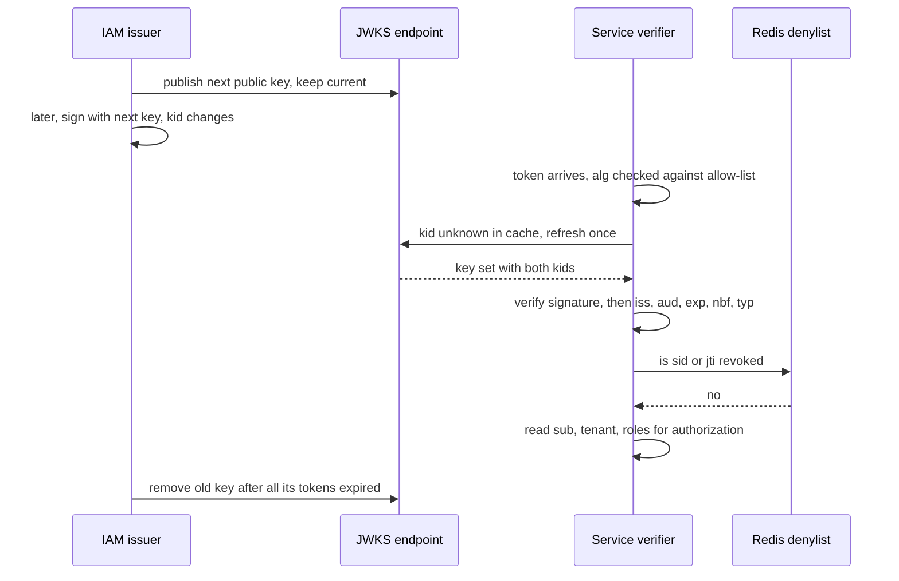

# JWT

> [!abstract] In one sentence
> A JSON Web Token carries who you are and what you may do in a signed envelope that every service can check in microseconds without asking the issuer — which is exactly why the verifier must pin the algorithm, resolve the key by id from a cached key set, verify the signature *before* reading a single claim, check issuer, audience and time, and only then let the claims influence anything.

> [!tip] Deeper treatment in your system-design vault
> `system-design/11 Auth and IAM/How JWT Works.md` — read it *after* you have written your own explanation below.

**Map:** [[Security MOC]] → [[HLD MOC]]

## Definition

A **JSON Web Token** (RFC 7519) is three base64url segments — `header.payload.signature` — where the header names the algorithm and key (`alg`, `kid`, `typ`), the payload is a JSON object of **claims**, and the signature is a JWS (RFC 7515) over the first two segments. Registered claims: `iss` (issuer), `sub` (subject), `aud` (audience), `exp` (expiry), `nbf` (not before), `iat` (issued at), `jti` (token id). A **JWKS** (JSON Web Key Set, RFC 7517) is the issuer's published set of public keys, each with a `kid`, from which verifiers fetch and cache the key named in a token's header. JWTs are typically *signed, not encrypted*: anyone can read the payload; only the issuer can produce a valid signature.

## Problem solved

Session-based [[Authentication]] makes every service call a session store on every request — a shared dependency, a round trip, and a scaling and availability concern across dozens of services. A JWT moves the trust into cryptography: the identity service signs once, and any service holding the public key verifies independently. That decoupling is the entire value, and it creates the entire difficulty: a token that is valid everywhere without asking anyone is also a token nobody can quickly take back, whose claims are frozen at issue time, and whose verification code must be correct in every service rather than in one. The design task is to keep the benefit while bounding those three costs.

## How it works

1. **Issuance.** The identity provider builds claims — `iss`, `sub`, `aud` (the APIs this token is for), `exp` (short: 5–15 minutes for access tokens), `iat`, `jti`, plus coarse application claims such as `tenant`, `roles`, `scope`, `sid` (session id), `amr` (factors) — and signs with its current private key, placing that key's `kid` in the header and `typ: at+jwt` for access tokens (RFC 9068).
2. **Algorithms.** `HS256` is an HMAC with a shared secret: every verifier can also *mint* tokens, so it belongs only inside one trust domain. `RS256`/`PS256` (RSA) and `ES256` (ECDSA P-256) or `EdDSA` are asymmetric: verifiers hold only public keys. Prefer ES256 or EdDSA for small tokens and fast verification. `none` is never acceptable.
3. **Validation order in the verifier** — each step before the next, and no claim is read for any purpose before step 5 succeeds:
   1. Parse the three segments; reject malformed input and oversized tokens.
   2. Read `alg` from the header and compare it with the verifier's **configured allow-list** (for example exactly `['ES256']`); reject anything else, including `none` and any symmetric algorithm when an asymmetric one is expected — this kills the alg-confusion attack where an RSA public key is used as an HMAC secret.
   3. Read `kid`; look it up in the locally cached JWKS; if absent, refresh the JWKS at most once (rate-limited) and reject if still absent.
   4. Check `typ` if your profile requires it (`at+jwt`), so an ID token cannot be used as an access token.
   5. Verify the signature with that key. Fail closed.
   6. Check `iss` equals the expected issuer string exactly.
   7. Check `aud` contains this service's identifier; a token for another API is rejected even though it is validly signed.
   8. Check `exp` and `nbf` against the current time with a small leeway (30–60 s) for clock skew ([[Clocks and Time]]); optionally cap `iat` age.
   9. For sensitive operations, check `jti` or `sid` against a revocation list ([[Redis]]) or compare a `session_version` claim with the user's current version.
   10. Only now extract `sub`, `tenant`, `roles` and pass them to [[Authorization]].
4. **Key rotation via JWKS.** The issuer keeps at least two keys published: the *current* signing key and the *next* one. Rotation: (a) publish the new public key in the JWKS while still signing with the old; wait at least the verifiers' JWKS cache TTL (and longer than the longest-lived token if you want zero refresh-on-miss); (b) switch signing to the new key; (c) keep the old public key published until every token signed with it has expired; (d) remove it. Verifiers cache the JWKS with a TTL (minutes to hours) and refresh on an unknown `kid`, with a rate limit so a flood of bad tokens cannot be turned into a flood of fetches. Compromise rotation is the same sequence compressed, plus revocation of everything signed by the old key.
5. **Expiry and revocation.** The honest statement is that a signed token is valid until `exp` unless the verifier consults state. Options, in increasing cost: short lifetimes with refresh-token rotation so theft is bounded; a denylist of `jti` or `sid` in Redis with TTL equal to the token's remaining life, checked on sensitive endpoints or on all; a per-user `session_version` (bump to "log out everywhere") checked against a cached user record; or opaque tokens plus introspection, which is no longer "stateless" ([[OAuth]]).
6. **What goes in a token.** Only what every verifier needs and that changes slowly: identity, tenant, coarse roles, scopes, session id, factors. Not PII beyond what is required, never secrets, never object lists, never anything the verifier should fetch fresh. Tokens travel in headers and logs; keep them under a kilobyte or two (proxies commonly cap headers at 8–16 KB).
7. **Transport and storage.** `Authorization: Bearer` over [[TLS]]; in browsers, prefer an `HttpOnly` cookie set by a backend-for-frontend over `localStorage`; never in URLs.

```typescript
// jose (Node): the allow-list, cached JWKS, issuer, audience and leeway in one call
import { createRemoteJWKSet, jwtVerify } from 'jose';
const JWKS = createRemoteJWKSet(new URL('https://iam.internal/.well-known/jwks.json'),
  { cooldownDuration: 30_000, cacheMaxAge: 600_000 });     // refresh on unknown kid, rate-limited

export async function verifyAccessToken(token: string) {
  const { payload, protectedHeader } = await jwtVerify(token, JWKS, {
    algorithms: ['ES256'],              // never trust alg from the header
    issuer: 'https://iam.internal',
    audience: 'payments-api',
    typ: 'at+jwt',
    clockTolerance: 30,
    maxTokenAge: '15m',
  });
  if (await redis.exists(`revoked:sid:${payload.sid}`)) throw new Error('session revoked');
  return { sub: payload.sub, tenant: payload.tenant, roles: payload.roles, sid: payload.sid, kid: protectedHeader.kid };
}
```

## Architecture



> [!example]- Excalidraw version — the same diagram as an editable canvas
> ![[JWT.excalidraw]]
> [[JWT.excalidraw|Open in Excalidraw]] — needs the Excalidraw plugin (see [[Plugins to Install]]).


## Use cases

- "Many services must authenticate requests without calling IAM each time" — the canonical case; access tokens verified locally, refresh traffic to IAM only.
- "Identity must cross a trust boundary" — gateway to services, service to service, or to a partner — carried as a signed token rather than trusted headers ([[API Gateways]]).
- "Short-lived capability for one purpose" — a token with a narrow `aud` and `scope` for a file download, a webhook callback or a WebSocket handshake ([[WebSockets]]).
- "Identity assertion from a login provider" — the OIDC ID token, validated with the same rules plus `nonce`.
- "Per-subject rate limits at the edge" — the verified `sub` or `tenant` claim keys the limiter without a lookup ([[Rate Limiting]]).

## Limitations

- Revocation is delayed by design; instant revocation needs state on the request path, which erodes the stateless benefit.
- Claims are a snapshot: role changes, offboarding and ownership changes are invisible until re-issue.
- The payload is readable by anyone who sees the token; confidentiality needs JWE (RFC 7516) or simply not putting the data in the token.
- Every verifier is a security boundary; a single service with a permissive library configuration (accepting `alg` from the header, skipping `aud`) undermines the whole system.
- Token size grows with claims and is paid on every request and in every log line.

## Trade-offs

| You gain | You sacrifice |
|---|---|
| Verification in microseconds with no call to the issuer | Revocation delayed until expiry unless you add state |
| Horizontal scale and availability independent of the identity service | Key distribution, caching and rotation discipline across every verifier |
| Signed claims that cross service and partner boundaries safely | Claims that go stale; tokens that leak whatever they contain |
| Standard libraries and formats in every language | Library misconfiguration as the dominant vulnerability class |

## Failure modes

- **Algorithm confusion or `none` accepted** — a verifier takes `alg` from the header → an attacker forges tokens using the public key as an HMAC secret; you notice from a breach or a pentest; blast radius is every account on every service with that library configuration.
- **Audience not checked** → a token issued for the notifications API is replayed against the payments API; you notice from audit anomalies; blast radius is every API sharing the issuer.
- **Key rotation without pre-publication** → the issuer signs with a key verifiers have not cached; every request fails until caches refresh, or verifiers hammer the JWKS endpoint; you notice as a 401 storm at rotation time; blast radius is all traffic.
- **Old key removed too early** → tokens signed minutes ago fail verification; same symptom, shorter window.
- **Revocation assumed but not implemented** → "log out everywhere" and account lockouts do nothing for up to the access-token lifetime; you notice during an incident; blast radius is whatever a stolen token can do in that window.
- **PII or secrets in claims** → appear in every proxy log and browser devtools; you notice from a compliance review; blast radius is a data exposure.

## Performance

ES256 verification is of the order of tens to a hundred microseconds; RS256 a few hundred; HMAC a few microseconds. JWKS fetches are rare (cache TTL of minutes to hours). A denylist check is one Redis round trip (sub-millisecond) and can be limited to sensitive endpoints or batched with other lookups. Token size — typically 400 bytes to 2 KB — is paid on every request and should be watched as claims accumulate. Issuance signing is similar in cost to verification; the IAM service's load is logins and refreshes, not API calls.

## Scalability

Verification scales with the services, not with the issuer; the JWKS endpoint serves a cacheable document, trivially scalable behind a CDN. Revocation state is the scaling concern: a denylist of `jti` with TTLs stays small (only revoked tokens, expiring naturally); a per-user `session_version` lookup can be cached per service. At 10x services the problem is uniformity — a shared verification library with pinned configuration, or a sidecar/gateway that verifies and re-signs an internal token.

## Operational impact

Own: key generation in a secret store or HSM ([[Secrets Management]]), a rotation schedule with pre-publication, JWKS availability and caching, token-lifetime policy, the revocation mechanism and its tests, and a verification library baseline enforced across services. Monitor 401 rates by reason (bad signature, expired, wrong audience, unknown kid), JWKS fetch rates, token sizes and clock skew. Rehearse compromise rotation. Debug with the `kid` and `jti` logged (never the token) so a rejected request can be traced to a key or session.

## Alternatives

- **Opaque tokens with introspection** — win when instant revocation and central visibility matter more than per-request independence; the authorization server's introspection endpoint becomes the hot path ([[OAuth]]).
- **Server-side sessions with an opaque cookie** — win for a single application tier with a shared session store; revocation is a delete ([[Authentication]]).
- **Mutual TLS identity** — wins for service-to-service inside a mesh; identity is the certificate, no token to rotate or revoke separately.
- **Macaroons or PASETO** — win when you want a format that makes algorithm confusion impossible by design; less ecosystem support.

## Real-world examples

- RFC 7519 (JWT), 7515 (JWS), 7517 (JWK), 7518 (JWA) and the Best Current Practices in RFC 8725 define the validation rules above, including the explicit instruction to pin algorithms and to validate signatures before using any claim.
- The 2015 wave of library vulnerabilities around `alg: none` and RSA-to-HMAC confusion, affecting several popular JWT libraries, is the empirical reason the allow-list rule exists.
- Google, Auth0, Okta and Keycloak all publish JWKS endpoints with overlapping keys during rotation; their documentation describes the pre-publish, switch, retire sequence.
- In a stack like yours: an in-house IAM signing ES256 access tokens with `sid`, `tenant`, `roles`, `amr` and `typ: at+jwt`, two keys published in the JWKS at all times, a shared NestJS guard and Spring Security resource-server configuration pinning `ES256`, issuer and per-service audience, a Redis denylist keyed by `sid` consulted on money-moving endpoints, and `kid`/`jti` in every audit record ([[Design an IAM Service]]).

## Practical exercise

1. Build a tiny issuer (NestJS or Spring Boot) with an ES256 key pair, a JWKS endpoint and a `/token` endpoint issuing 10-minute access tokens with `sid`, `jti`, `aud` and `typ: at+jwt`.
2. Build a verifier service using `jose` or Spring Security with the pinned configuration; measure verification latency with k6 at 2,000 requests per second.
3. Attack it: craft a token with `alg: none`; craft an HS256 token using the public key as the secret; replay a token with a different `aud`; shift the clock by 5 minutes. Each must be rejected, and the rejection reason must appear in metrics.
4. Rotate keys the wrong way (sign with a key not yet published) and observe the 401 storm; then implement pre-publish, switch, retire and show zero failures.
5. Implement a `sid` denylist in Redis with TTL and "log out everywhere" via `session_version`; measure the added latency and verify that a stolen token stops working within one request of revocation.

## Related concepts

### Prerequisites
- [[Authentication]] — what the token is proof of
- [[Encryption at Rest and in Transit]] — signatures, hashes and key handling underneath

### Related
- [[OAuth]] — the flows that issue and refresh these tokens
- [[Authorization]] — what the claims may and may not decide
- [[Secrets Management]] — where signing keys live and how they rotate
- [[Redis]] — the usual home of denylists and session versions
- [[Clocks and Time]] — why `exp` needs leeway and NTP
- [[API Gateways]] — the first verifier on the path

### Builds on this
- [[Rate Limiting]] — limits keyed by verified subject or tenant
- [[Client State and Reconnection]] — re-presenting a fresh token on reconnect

### Design problems where it applies
- [[Design an IAM Service]]
- [[Design an API Gateway]]
- [[Design a Chat System]]
- [[Design a Feature Flag Service]]

### Projects where it can be implemented
- [[LLM Gateway]]
- [[Presence and Chat Service]]
- [[Feature Flag Service and SDK]]

### Resources
- [[JWT Best Current Practices RFC 8725]] — the validation and algorithm rules, with the attacks they prevent
- [[OAuth 2.0 RFC 6749]] — the issuing side
- [[OWASP Secrets Management Cheat Sheet]] — signing-key custody and rotation

## Personal understanding

> [!question] Explain it without the source
> Write your own explanation here, from memory. Then compare it with the sections above and note what you missed.

### Mastery checklist
- [ ] I can explain it without the original resource
- [ ] I can describe the problem it solves
- [ ] I can compare it with its alternatives
- [ ] I can name its limitations and failure modes
- [ ] I can recognise when it is appropriate in a real system
- [ ] I have applied it in a system design
- [ ] I have validated my assumptions with an experiment or implementation

## Open questions

- [ ] In each of your services, is the accepted algorithm list configured explicitly, is `aud` checked with a per-service value, and is there a test that a token for another audience is rejected?
- [ ] What is your IAM's key-rotation procedure, how long is the pre-publication window relative to the verifiers' JWKS cache TTL, and when was it last exercised?
- [ ] Which endpoints consult revocation state today, and what is the maximum time a stolen access token remains usable on the ones that do not?
