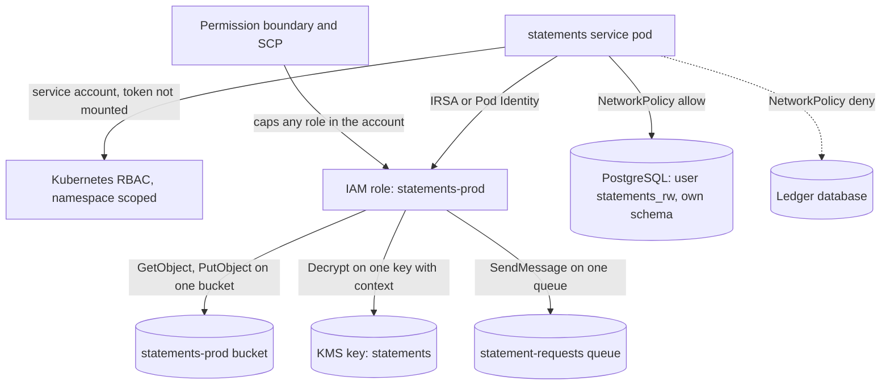

# Least Privilege

> [!abstract] In one sentence
> Least privilege is blast-radius engineering: by scoping each service's cloud role, Kubernetes service account, network reach and database grants to the minimum its function needs, you decide in advance how far an attacker gets after the first compromise — and because permissions only ever accumulate, the principle is as much a review process as a configuration.

> [!tip] Deeper treatment in your system-design vault
> `system-design/18 AWS Services/IAM.md` — read it *after* you have written your own explanation below.

**Map:** [[Security MOC]] → [[HLD MOC]]

## Definition

The **principle of least privilege** states that every principal — a user, a service, a job, a pod — should hold only the permissions required to perform its intended function, for only as long as it needs them. It applies at every layer: cloud IAM policies (which API actions on which resources), Kubernetes RBAC and service accounts (which cluster objects), network policy (which services may talk to which), database grants (which tables, which statements), KMS key policies (who may decrypt), and human access (which roles, with what approval and expiry). It is the structural complement to [[Authorization]]: authorization decides per request; least privilege bounds what any decision could ever allow.

## Problem solved

Breaches rarely end at the first foothold. A compromised pod with a wildcard IAM role reads every bucket; a service account with cluster-admin reads every secret in the cluster; a database user with superuser drops the ledger; an engineer's standing admin rights are the attacker's rights after a phishing email. Capital One's 2019 breach is the standard example: a server-side request forgery reached instance credentials whose role could list and read far more storage than the application needed. Least privilege turns "one compromise, everything lost" into "one compromise, one service's data" — and it makes the audit question "could this component have done that?" answerable with a policy rather than a hope. In a regulated stack it is also an explicit control auditors test.

## How it works

1. **Cloud IAM per workload.** One IAM role per service (never per cluster or per team), bound to the pod through IAM Roles for Service Accounts or EKS Pod Identity. Policies name specific actions on specific resource ARNs — `s3:GetObject` on `arn:aws:s3:::statements-prod/*`, `kms:Decrypt` on one key, `sqs:SendMessage` on one queue — with conditions (source VPC, encryption context, tag-based access) where they help. No `*` in actions or resources outside break-glass policies. Permission boundaries and service control policies cap what any role in an account can be granted, so a mistake in one policy cannot exceed the guardrail.
2. **Kubernetes.** A dedicated service account per deployment with `automountServiceAccountToken: false` unless the pod actually calls the API server; RBAC roles scoped to the namespace and to the verbs needed; no pod runs as root or privileged; admission policies enforce it. `NetworkPolicy` defaults to deny-all ingress and egress per namespace, with explicit allows: payments may call the ledger and the database, nothing may call the admin API except the gateway ([[Bulkheads]]).
3. **Database.** One database user per service with grants on its own schema; read-only users for replicas, analytics and support tools; no superuser for applications; `REVOKE UPDATE, DELETE` on append-only tables like ledger entries and audit records; row-level security for multi-tenant tables where the database is a shared path ([[Data Modeling]], [[Audit Logs]]).
4. **Keys and secrets.** KMS key policies grant decrypt to the owning service only; secret-store policies grant each secret to its consumer; signing keys are readable by the issuer alone ([[Secrets Management]], [[Encryption at Rest and in Transit]]).
5. **Humans.** No standing production access. Single sign-on with MFA, roles assumed just in time with an approval and an expiry (minutes to hours), read-only by default, a **break-glass** role for emergencies that alerts and is reviewed afterwards, and separation of duties so the person who can deploy cannot also approve their own change to the payout policy ([[Authentication]]).
6. **Keeping it from decaying.** Permissions grow: a feature needs one more action, a debugging session adds a wildcard "for now", a migration script runs as admin. Counter-measures: policies in code with review; linting that rejects wildcards and over-broad resources; last-accessed data (IAM Access Analyzer, unused-access findings) to prune what nobody uses; quarterly access reviews with the audit log as evidence; the same policies in staging as in production so "permission denied" is found before release; and generating policies from observed access in a test environment rather than guessing.
7. **Measure the blast radius.** For each service, write down what its identity can reach — buckets, tables, queues, secrets, other services. If the answer for any service includes "the ledger" and the service is not the ledger, that is the next thing to fix ([[Threat Modeling]]).

```json
{
  "Version": "2012-10-17",
  "Statement": [
    { "Effect": "Allow", "Action": ["s3:GetObject", "s3:PutObject"],
      "Resource": "arn:aws:s3:::statements-prod/*",
      "Condition": { "StringEquals": { "s3:x-amz-server-side-encryption-aws-kms-key-id":
                     "arn:aws:kms:ap-south-1:111122223333:key/statements" } } },
    { "Effect": "Allow", "Action": ["kms:Decrypt", "kms:GenerateDataKey"],
      "Resource": "arn:aws:kms:ap-south-1:111122223333:key/statements",
      "Condition": { "StringEquals": { "kms:EncryptionContext:service": "statements" } } },
    { "Effect": "Allow", "Action": "sqs:SendMessage",
      "Resource": "arn:aws:sqs:ap-south-1:111122223333:statement-requests" }
  ]
}
```

## Architecture



## Use cases

- "A new service is being deployed" → its own IAM role, service account, database user and network policy from day one; the template is the control.
- "An incident post-mortem asks what the compromised pod could have reached" → the answer should be its policy, and the policy should be small ([[Production Incident Analysis]]).
- "Support staff need to look at customer accounts" → read-only role, time-boxed, audited, with PII masked where not needed.
- "Analytics wants database access" → a read-only replica user with column-level grants, not the application credential ([[Read Replicas]]).
- "An engineer needs to run a one-off fix in production" → break-glass with approval, expiry and a recorded reason, not a standing admin role.

## Limitations

- It is slow to get right: each service needs an inventory of what it touches, and under-scoping produces "permission denied" pages at the worst time.
- Permissions are not the only path: a service allowed to call another service inherits that service's reach through the API — least privilege must be applied at the API layer too ([[Authorization]]).
- Managed services and third-party operators often require broader permissions than you would like; document the exception and bound it with a permission boundary.
- Human factors dominate decay; without reviews and tooling the policies drift back to wildcards within a year.
- Least privilege bounds the damage of a compromise; it does not prevent the compromise ([[Input Validation]], [[Authentication]]).

## Trade-offs

| You gain | You sacrifice |
|---|---|
| A bounded blast radius for every identity, knowable in advance | Up-front inventory work and policies that must change when the service does |
| Clear answers for auditors and incident responders | On-call friction from permission errors when a dependency was missed |
| Isolation between services at the network, data and key layers | More roles, users, policies and network rules to maintain as code |
| Just-in-time human access with evidence | Slower emergency response unless break-glass is designed and rehearsed |

## Failure modes

- **Wildcard role shared by many services** → one SSRF or dependency compromise reads every bucket and secret; you notice during the incident; blast radius is the account.
- **Service account token mounted and RBAC too broad** → a compromised pod lists secrets across namespaces; you notice from audit logs of the API server, if anyone reads them; blast radius is the cluster.
- **Application database user with superuser or DDL rights** → a SQL injection becomes a dropped table or an edited ledger; you notice from data loss; blast radius is the database.
- **Permission added "temporarily" during an incident and never removed** → the next review finds it a year later, or an attacker finds it first; blast radius grows silently.
- **Under-scoped policy in production only** → a release fails at 2 a.m. with `AccessDenied` because staging had broader rights; blast radius is the deployment and the trust in least privilege itself — keep environments identical.

## Performance

Permission checks are performed by the platforms (IAM, the API server, the database, the network layer) and add negligible latency. The real cost is engineering time: writing precise policies, generating them from observed access, and handling denials. Network policies have a small data-plane cost in some CNIs; row-level security adds a predicate to queries that must be indexed. None of these appear on a latency dashboard; all appear on a sprint board.

## Scalability

At 10x services, least privilege survives only as code: role, policy, service account, network policy and database user generated from one service definition (Terraform modules, Helm charts), reviewed in pull requests and linted for wildcards. Access reviews must be automated with unused-access findings and expiry on human roles. Guardrails (SCPs, permission boundaries, admission policies) scale better than per-policy review because they cap what a mistake can grant.

## Operational impact

Own: the templates that give every new service its scoped identities, the linting and review of policy changes, quarterly reviews with audit evidence, break-glass procedures with alerts, and the on-call runbook for `AccessDenied` (how to diagnose, how to grant narrowly, how to remove afterwards). Debugging a denial requires the audit log (CloudTrail, API server audit, database logs) to show which principal was denied which action — invest in making that query fast. The payoff is visible in incident reviews: "the compromised component could only reach X" is the sentence this work exists to produce.

## Alternatives

- **Perimeter security only** (trusted network, broad internal permissions) — wins on convenience and loses the moment anything inside is compromised; the model most breaches exploit.
- **Coarse roles per team** — win on simplicity for small teams; acceptable until one service handles money, at which point the team's role is too broad for the rest.
- **Capability-based access** (short-lived, narrowly scoped tokens per operation) — wins for cross-boundary delegation; complements rather than replaces identity scoping.
- **Zero standing access with everything just-in-time** — wins for human access in high-assurance environments; heavier process, strongest evidence.

## Real-world examples

- AWS's documentation on IAM best practices, IAM Access Analyzer's unused-access findings, permission boundaries and service control policies are the reference tooling for the cloud layer; Kubernetes' RBAC and NetworkPolicy documentation cover the cluster layer.
- The Capital One (2019) incident report is the widely studied case where an over-privileged instance role turned an SSRF into a mass data exposure.
- Google's BeyondCorp papers describe replacing network-perimeter trust with per-request, per-identity access decisions — least privilege at the access layer for humans and devices.
- In a stack like yours: one IAM role per NestJS and Spring service via IRSA with resource-scoped policies and KMS encryption-context conditions, namespace-scoped service accounts with tokens unmounted, default-deny network policies with explicit allows between payments, ledger and IAM, per-service PostgreSQL users with `REVOKE UPDATE, DELETE` on ledger and audit tables, and SSO-based just-in-time production access with a break-glass role that pages the security channel.

## Practical exercise

1. In a kind cluster with LocalStack, deploy two services (payments, ledger) with a shared wildcard IAM policy and default-allow networking; from a shell in the payments pod, read the ledger bucket and the ledger database — record what you could reach.
2. Rewrite as per-service roles with resource ARNs and conditions, per-service database users with schema grants, and `NetworkPolicy` default deny; repeat the probe and record the denials.
3. Generate the payments policy from observed access (CloudTrail in LocalStack or a proxy log) and compare it with the hand-written one.
4. Add a `REVOKE UPDATE, DELETE` on the ledger entries table and show that the application's own credential cannot alter history.
5. Implement a break-glass role with a 30-minute expiry that posts to a channel on assumption; use it, let it expire, and verify access is gone.
6. Add a policy linter to CI that rejects `"Resource": "*"` and run the pull request that would have shipped the wildcard.

## Related concepts

### Prerequisites
- [[Authorization]] — the per-request decision that least privilege bounds
- [[Authentication]] — identities must be established before they can be scoped

### Related
- [[Secrets Management]] — scoping who may read which credential
- [[Threat Modeling]] — the exercise that finds which permissions matter
- [[Audit Logs]] — the evidence for reviews and investigations
- [[Bulkheads]] — isolation of failure domains, applied to permissions
- [[Encryption at Rest and in Transit]] — key policies as the sharpest least-privilege tool

### Builds on this
- [[Microservices]] — one identity per service is a precondition for safe service boundaries
- [[API Keys]] — scoped keys as least privilege for external clients

### Design problems where it applies
- [[Design an IAM Service]]
- [[Design File Storage]]
- [[Design a Payment System]]
- [[Design an API Gateway]]

### Projects where it can be implemented
- [[Webhook Relay]]
- [[Double-Entry Ledger Service]]

### Resources
- [[OWASP Threat Modeling Cheat Sheet]] — elevation-of-privilege threats and the mitigations least privilege provides
- [[OWASP Secrets Management Cheat Sheet]] — scoping access to secrets and keys

## Personal understanding

> [!question] Explain it without the source
> Write your own explanation here, from memory. Then compare it with the sections above and note what you missed.

### Mastery checklist
- [ ] I can explain it without the original resource
- [ ] I can describe the problem it solves
- [ ] I can compare it with its alternatives
- [ ] I can name its limitations and failure modes
- [ ] I can recognise when it is appropriate in a real system
- [ ] I have applied it in a system design
- [ ] I have validated my assumptions with an experiment or implementation

## Open questions

- [ ] For the service you know best, what exactly could its identity reach if the pod were compromised tonight — which buckets, tables, queues, keys and other services?
- [ ] Which application database users in your stack can `UPDATE` or `DELETE` ledger or audit rows, and is there a reason?
- [ ] When was the last access review of IAM roles with evidence from last-accessed data, and how many wildcards did it find?
