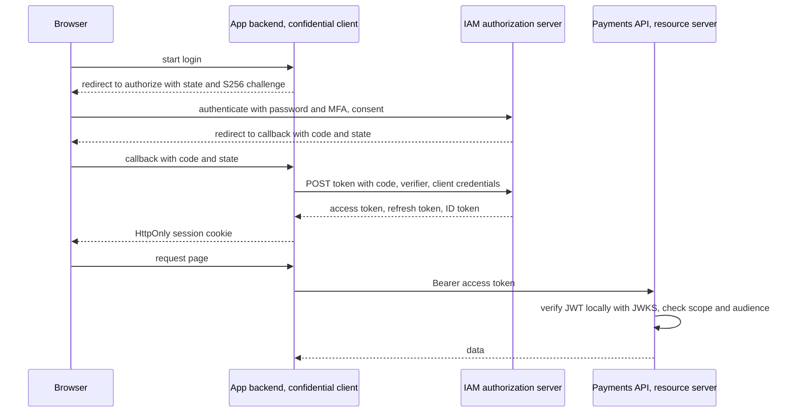

# OAuth

> [!abstract] In one sentence
> OAuth 2.0 is a delegation protocol: a client redirects the user to an authorization server, gets back a short-lived code, exchanges it for an access token limited by scopes, and presents that token to resource servers — so passwords never reach third parties, access is narrow and revocable, and with OpenID Connect the same dance also tells the client who logged in.

> [!tip] Deeper treatment in your system-design vault
> `system-design/11 Auth and IAM/OAuth 2 and OpenID Connect.md` — read it *after* you have written your own explanation below.

**Map:** [[Security MOC]] → [[HLD MOC]]

## Definition

**OAuth 2.0** (RFC 6749) is an authorization framework with four roles: the **resource owner** (usually a user), the **client** (the application wanting access), the **authorization server** (which authenticates the owner and issues tokens) and the **resource server** (the API that accepts tokens). A **grant** is the way a client obtains an **access token**; the token carries **scopes** that bound what it may do. **OpenID Connect (OIDC)** layers identity on OAuth: an **ID token** ([[JWT]]) asserting who authenticated, a `userinfo` endpoint, and discovery metadata. **PKCE** (RFC 7636) binds the authorization code to the client instance that requested it, which is mandatory for public clients and recommended for all.

## Problem solved

Before OAuth, letting an app read your calendar meant giving it your password — full access, no scoping, no revocation short of changing the password, and the app storing it forever. OAuth separates authentication (done once, by the authorization server, with whatever factors it wants) from access (a token with limited scope and lifetime that can be revoked). For service-to-service calls it replaced ad-hoc shared secrets with a standard credential exchange. OIDC solved the next mistake: people were using OAuth access tokens as proof of login, which they are not — an access token says "the bearer may call this API", not "this is user 42". In a stack like yours, OAuth and OIDC are the vocabulary your in-house IAM service speaks to web and mobile clients, to partner integrations, and between services.

## How it works

1. **Authorization code flow with PKCE (browsers, mobile, SPAs via a backend).** The client generates a random `code_verifier`, hashes it (`S256`) into a `code_challenge`, and redirects the user to the authorization endpoint with `client_id`, `redirect_uri`, `scope`, a random `state` (CSRF protection) and the challenge. The user authenticates and consents; the server redirects back to the registered `redirect_uri` (exact string match) with a one-time `code` and the `state`. The client posts `code`, `redirect_uri` and `code_verifier` to the token endpoint; the server checks `SHA-256(verifier) == challenge` and returns an access token, usually a refresh token, and with the `openid` scope an ID token. A stolen code is useless without the verifier.
2. **Client credentials (service to service).** No user: the client authenticates to the token endpoint with its own credentials — a client secret from a [[Secrets Management|secret store]], or better a private key (`private_key_jwt`) or mutual TLS (RFC 8705) — and receives an access token scoped to what that service may do. The identity in the token is the service, and the resource server authorises by service identity and scope.
3. **Refresh.** Access tokens are short-lived (minutes); the refresh token obtains new ones from the token endpoint. Public clients must use rotation with reuse detection; confidential clients may hold long-lived refresh tokens but should still rotate ([[Authentication]]).
4. **Tokens and scopes.** Access tokens may be opaque (resource servers call the introspection endpoint, RFC 7662, to learn validity and scope — central, revocable, one network call per request) or self-contained JWTs (RFC 9068 profile; verified locally with the server's published keys). Scopes are coarse capabilities (`payments:read`, `payouts:approve`); the resource server intersects the token's scopes with the user's actual permissions — a scope never grants more than the user has ([[Authorization]]).
5. **OIDC specifics.** The ID token is a JWT with `iss`, `sub`, `aud` (the client id), `exp`, `iat`, `nonce` (echoed from the request to bind the token to the session), `auth_time` and `amr`; the client validates it like any JWT and uses it to establish *its own* session. Discovery at `/.well-known/openid-configuration` publishes endpoints and the `jwks_uri` for keys, which is how clients and resource servers rotate keys without redeploys.
6. **Deprecated and dangerous.** The implicit grant (tokens in the URL fragment) and the resource owner password credentials grant are removed in OAuth 2.1; both leak credentials or tokens. Tokens in browser `localStorage` are readable by any injected script; the safer pattern for SPAs is a **backend-for-frontend** that holds tokens server-side and gives the browser an `HttpOnly` session cookie. Bearer tokens are usable by whoever holds them; sender-constrained tokens (mTLS-bound or DPoP, RFC 9449) bind a token to a key the client proves possession of.
7. **Revocation and logout.** RFC 7009 revokes refresh (and sometimes access) tokens; OIDC defines front- and back-channel logout to end sessions across relying parties. Access tokens issued as JWTs remain valid until expiry unless the resource server checks a denylist ([[JWT]]).

```text
Authorization code + PKCE, condensed
1 client:  verifier = random(43..128 chars); challenge = base64url(sha256(verifier))
2 browser: GET /authorize?response_type=code&client_id=app&redirect_uri=https://app/cb
           &scope=openid payments:read&state=R1&code_challenge=C&code_challenge_method=S256
3 user:    authenticates at IAM (password + MFA), consents
4 IAM:     302 https://app/cb?code=K&state=R1            (code single-use, ~1 minute)
5 client:  POST /token grant_type=authorization_code&code=K&redirect_uri=https://app/cb
           &client_id=app&code_verifier=verifier            (+ client auth if confidential)
6 IAM:     { access_token, token_type: Bearer, expires_in: 600, refresh_token, id_token }
7 client:  validate id_token (iss, aud, nonce, exp, signature); call APIs with Bearer access_token
```

## Architecture



## Use cases

- "Users sign in to our web and mobile apps through our IAM" → authorization code with PKCE and OIDC; a backend-for-frontend holding tokens for the web app.
- "Partners call our API on behalf of our customers with consent" → authorization code with narrow scopes, consent recorded, tokens revocable per partner ([[Design a Payment System]], open-banking style).
- "Service A calls service B" → client credentials with a private key or mTLS, scopes per service, no shared passwords.
- "Sign in with Google / corporate SSO" → OIDC as the relying party; the ID token establishes the local session, the IdP owns the credentials.
- "Our internal tools need SSO and role claims" → OIDC with roles or groups delivered as claims and mapped to local [[Authorization]].

## Limitations

- OAuth is a framework, not a protocol: two compliant implementations can differ in token format, lifetimes, PKCE support and error behaviour; interoperability needs profiles (FAPI for financial-grade APIs).
- Bearer tokens are only as safe as the channel and the client's storage; without sender-constraining, a leaked token is a usable token until expiry.
- Complexity: redirects, state, nonce, PKCE, token endpoints, discovery, key rotation — it is easy to implement a subtly broken flow, which is why libraries and certified servers exist.
- Scopes are coarse; object-level authorization still belongs to the resource server at request time ([[Authorization]]).
- Opaque tokens centralise revocation but put the introspection endpoint on every request path; JWTs decentralise verification but delay revocation ([[JWT]]).

## Trade-offs

| You gain | You sacrifice |
|---|---|
| Passwords never leave the authorization server; third-party access is scoped and revocable | A multi-step redirect flow with several places to get wrong |
| Standard client libraries and a certified server for every stack | Dependence on correct configuration: exact redirect URIs, PKCE, short code lifetimes |
| Client credentials with asymmetric keys: no shared secrets between services | Key management and rotation for every client |
| OIDC: identity assertions with signed, verifiable claims | ID-token validation rules that must be followed to the letter (nonce, audience, issuer) |

## Failure modes

- **Open or loosely matched redirect URI** → the authorization code is sent to an attacker-controlled page; you notice from security research or a breach; blast radius is every user who clicks a crafted link.
- **Missing or unchecked `state`** → login CSRF: a victim is logged into the attacker's account and their later actions land there; subtle, discovered by audit.
- **Access token used as proof of identity** (no ID token, no audience check) → a token issued for a different client or API is accepted as login; you notice from a pentest; blast radius is account takeover across relying parties.
- **Long-lived access tokens with no revocation path** → a leaked token works for days; you notice from anomalous API use; blast radius is the scope of the token for its lifetime.
- **Client secret in a mobile app or SPA bundle** → extracted and used by anyone; you notice from unexpected clients at the token endpoint; blast radius is every grant that secret could perform — the reason public clients use PKCE and no secret.

## Performance

The user-facing flow is two or three redirects plus a token exchange, typically a few hundred milliseconds on top of authentication itself. Per API request the cost depends on token type: JWT verification is microseconds locally; opaque-token introspection is a network round trip to the authorization server, usually cached for seconds. Refresh traffic is one call per client per access-token lifetime. The authorization server's load is logins, refreshes and introspection; design it as a tier with its own capacity and caching ([[Design an IAM Service]]).

## Scalability

Client-credentials tokens cached by each service until near expiry keep the token endpoint's load proportional to services times lifetime, not to request rate. JWT access tokens let resource servers scale without any call to the issuer; key rotation via the JWKS endpoint scales to any number of verifiers with HTTP caching. Introspection-based designs scale with the introspection endpoint and its cache. At 10x clients and partners, consent and client registration (dynamic client registration, per-client policies) become the operational surface.

## Operational impact

You run or rent an authorization server: client registry, consent screens, key rotation, token lifetimes, revocation, logout propagation, audit of grants, and FAPI-level hardening if partners move money. Monitor token-endpoint latency and error rates, refresh-failure spikes (often a rotation or clock problem), and unusual client behaviour. Client onboarding — exact redirect URIs, PKCE enforcement, allowed grants and scopes per client — is a security-reviewed process, not a config change. Certified libraries (Spring Security, NestJS with `openid-client`/`jose`) and conformance tests prevent most home-grown mistakes.

## Alternatives

- **[[API Keys]]** — win for simple machine clients where scoping and rotation are handled by the key registry; weaker identity and no delegation.
- **Mutual TLS alone** — wins inside a mesh where workload identity is already certificate-based; no tokens, no scopes, authorization by certificate identity.
- **SAML** — wins only where enterprise customers require it; OIDC covers the same ground with simpler mechanics.
- **Sessions issued by your own backend after a local login** — win for a single first-party app with no third parties and no service fan-out ([[Authentication]]).

## Real-world examples

- RFC 6749 (OAuth 2.0), RFC 7636 (PKCE), RFC 6750 (bearer tokens), RFC 7662 (introspection), RFC 7009 (revocation), RFC 9068 (JWT access tokens) and the OpenID Connect Core specification define the mechanics above; the OAuth 2.0 Security Best Current Practice and OAuth 2.1 drafts consolidate the hardening.
- Google, Microsoft, GitHub and Apple sign-in are OIDC providers; open banking regimes (UK Open Banking, PSD2) standardised on FAPI, an OAuth/OIDC profile for financial-grade APIs with mTLS or private-key client authentication and sender-constrained tokens.
- Keycloak and ORY Hydra are widely used open-source authorization servers; AWS Cognito and Auth0 are the managed equivalents.
- In a stack like yours: an in-house IAM acting as authorization server and OIDC provider, authorization code with PKCE for the apps via a backend-for-frontend, client credentials with `private_key_jwt` between NestJS and Spring services on EKS, ES256 JWT access tokens verified locally against the IAM's JWKS, scopes per service intersected with per-object checks, and FAPI-style constraints for partner integrations.

## Practical exercise

1. Run Keycloak in Docker Compose; register a confidential client (web backend), a public client (SPA, PKCE required) and a service client (client credentials with a generated key pair).
2. Implement the authorization code flow with PKCE in a NestJS backend-for-frontend using `openid-client`; validate the ID token's `nonce`, `iss`, `aud`, `exp` and signature; issue an `HttpOnly` session cookie.
3. Build a Spring Boot resource server that validates JWT access tokens via the JWKS URI and enforces `payments:read` and `payouts:approve` scopes; call it from the BFF and from the service client.
4. Break things deliberately: register a wildcard redirect URI and demonstrate code theft to a second page; remove the `state` check and perform a login CSRF; swap the audience and confirm the resource server rejects the token.
5. Rotate the Keycloak signing key and measure how long each verifier takes to pick it up; then revoke a refresh token and observe when access actually stops.

## Related concepts

### Prerequisites
- [[Authentication]] — the authorization server authenticates the user; OAuth only delegates
- [[HTTP and HTTPS]] — redirects, cookies and bearer headers are the transport
- [[TLS]] — every endpoint in the flow must be protected in transit

### Related
- [[Authorization]] — scopes are coarse grants that resource servers refine
- [[JWT]] — the usual access and ID token format and its validation rules
- [[API Keys]] — the simpler alternative for machine clients
- [[API Gateways]] — the usual first validator of access tokens
- [[Secrets Management]] — client secrets and private keys

### Builds on this
- [[Least Privilege]] — scopes per client as a least-privilege mechanism
- [[Audit Logs]] — grants, consents and revocations as audit events

### Design problems where it applies
- [[Design an IAM Service]]
- [[Design an API Gateway]]
- [[Design File Storage]]
- [[Design a Payment System]]

### Projects where it can be implemented
- [[LLM Gateway]]
- [[Personal Notification Hub]]
- [[Feature Flag Service and SDK]]

### Resources
- [[OAuth 2.0 RFC 6749]] — the framework itself, roles, grants and endpoints
- [[JWT Best Current Practices RFC 8725]] — how to validate the tokens OAuth hands out
- [[OWASP Secrets Management Cheat Sheet]] — handling client secrets and keys

## Personal understanding

> [!question] Explain it without the source
> Write your own explanation here, from memory. Then compare it with the sections above and note what you missed.

### Mastery checklist
- [ ] I can explain it without the original resource
- [ ] I can describe the problem it solves
- [ ] I can compare it with its alternatives
- [ ] I can name its limitations and failure modes
- [ ] I can recognise when it is appropriate in a real system
- [ ] I have applied it in a system design
- [ ] I have validated my assumptions with an experiment or implementation

## Open questions

- [ ] Which clients registered with your IAM still use a client secret rather than a private key or mTLS, and which of those secrets live in a browser or mobile bundle?
- [ ] Do your resource servers check `aud` so a token issued for one API cannot be replayed against another, and is there a test for it?
- [ ] If a partner integration had to meet FAPI, which parts of the current flow (sender-constrained tokens, PAR, signed requests) would be missing?
