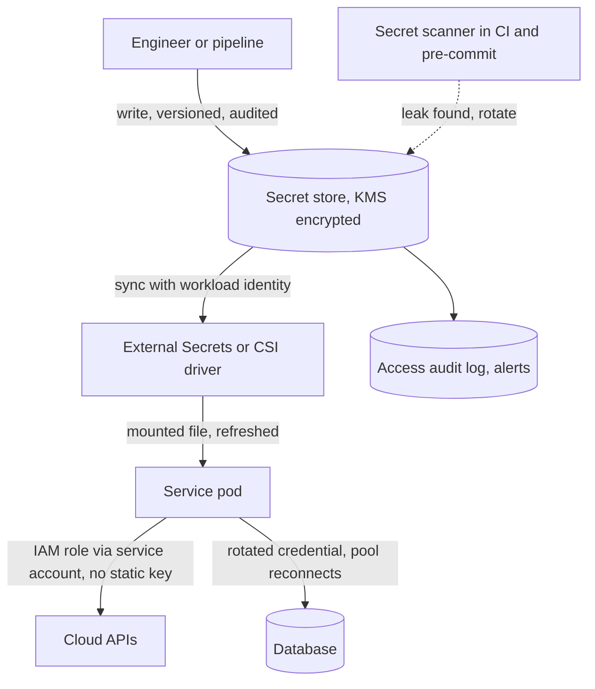

# Secrets Management

> [!abstract] In one sentence
> A secret is any value whose exposure grants access — database passwords, API keys, signing keys, TLS private keys — and managing them well means they exist in exactly one authoritative place, reach a process only at run time through an audited path, change on a schedule and on demand without an outage, and are replaced by workload identity wherever a platform can vouch for a process instead.

> [!tip] Deeper treatment in your system-design vault
> `system-design/18 AWS Services/Secrets Manager Parameter Store and KMS.md` — read it *after* you have written your own explanation below.

**Map:** [[Security MOC]] → [[HLD MOC]]

## Definition

**Secrets management** is the set of practices and tooling for storing, distributing, rotating, revoking and auditing credentials. A **secret store** (AWS Secrets Manager, Parameter Store with SecureString, HashiCorp Vault, Kubernetes Secrets backed by envelope encryption) holds secrets encrypted at rest with access controlled per principal and every read logged ([[Encryption at Rest and in Transit]]). **Injection** delivers a secret to a workload at start or on demand — mounted file, environment variable, or an SDK call — rather than baking it into source or an image. **Rotation** replaces a secret's value while both old and new remain valid for an overlap. **Dynamic secrets** are generated per workload with a short time to live, so there is nothing long-lived to leak.

## Problem solved

Secrets leak through every channel that is convenient: committed to a repository "temporarily", baked into a Docker layer, pasted into a ticket or chat, printed in a crash dump or `docker inspect`, exported in a CI log, copied to a laptop. A leaked secret is usable until someone notices and rotates it, and rotation is terrifying when nobody knows which services use the secret or whether they reload it without a restart. Centralising secrets with access control and audit answers "who can read this" and "who did read this"; injection at run time removes the copies in code and images; rotation with overlap makes replacement routine; and workload identity removes the static secret altogether for the service-to-cloud and service-to-service cases. In fintech the audit of secret access is itself a compliance requirement.

## How it works

1. **Inventory and classification.** List every secret, its owner, the systems that use it, its rotation period and its blast radius if leaked. Database credentials per service, third-party API keys, JWT signing keys ([[JWT]]), TLS keys, webhook signing secrets, encryption keys. Scope each to one environment and one consumer: the payments service's database user is not the notifications service's.
2. **Store.** Secrets live in a store with its own encryption (KMS-backed), fine-grained access policies, versioning and an access log. Kubernetes `Secret` objects are base64, not encryption, unless the cluster enables envelope encryption of etcd with a KMS provider (EKS supports this) and RBAC restricts `get secrets` — treat them as a delivery mechanism, not the system of record.
3. **Inject.** On Kubernetes, the Secrets Store CSI driver or External Secrets Operator syncs from the cloud store into mounted files or `Secret` objects; the application reads a file at start (and watches it for rotation) or calls the store's SDK with its workload identity. Prefer files or direct SDK reads over environment variables: environment variables are visible in `/proc/<pid>/environ`, inherited by child processes, printed by debugging tools, and captured by crash reporters. Never log them; redact them in error handlers ([[Logging]]).
4. **Workload identity instead of secrets.** On EKS, IAM Roles for Service Accounts or EKS Pod Identity give a pod short-lived AWS credentials from its Kubernetes service account — no access key to store. The same idea applies to service-to-service calls (mutual TLS via a mesh, [[OAuth]] client credentials with a key the platform provisions) and to databases (IAM database authentication for RDS, Vault dynamic database credentials with a TTL of hours). Every static secret you can replace with identity is one that cannot leak.
5. **Rotate.** Two-phase: create the new version while the old remains valid (two database users, two API keys, two signing keys in the JWKS), roll consumers to the new one, verify, then revoke the old. Applications must reload without restart — watch the mounted file, subscribe to a change notification, or fetch with a short cache — and connection pools must reconnect with the new credential ([[Connection Pooling]]). Secrets Manager's rotation functions automate this for RDS; Vault leases expire on their own.
6. **Audit and detect.** Every read of a secret produces an audit event (CloudTrail `GetSecretValue`, Vault audit log) with principal, secret and time; alert on reads by unexpected principals or at unusual rates. Run secret scanners on repositories and CI (gitleaks, trufflehog, GitHub secret scanning) with pre-commit hooks so a leak is caught before it is pushed. Treat a scanner hit as a rotation, not a deletion of the commit ([[Audit Logs]]).
7. **Incident path.** When a secret is suspected leaked: rotate (not just revoke, or the service dies), revoke the old version, search the audit log for its use, assess the blast radius from the inventory, and record the incident ([[Production Incident Analysis]]).

```yaml
# External Secrets Operator: the cluster pulls from AWS Secrets Manager using the pod's IAM role
apiVersion: external-secrets.io/v1beta1
kind: ExternalSecret
metadata: { name: payments-db, namespace: payments }
spec:
  refreshInterval: 5m                      # picks up rotated versions without a redeploy
  secretStoreRef: { name: aws-secrets-manager, kind: ClusterSecretStore }
  target: { name: payments-db, creationPolicy: Owner }
  data:
    - secretKey: DB_PASSWORD
      remoteRef: { key: prod/payments/db, property: password }
# In the Deployment: mount as a file, not an env var; the app watches the file and reconnects the pool
```

## Architecture



## Use cases

- "Services need database passwords, third-party API keys and signing keys in production" → a central store, per-service scoping, file-based injection, rotation with overlap.
- "Pods call AWS APIs" → IRSA or Pod Identity; no access keys anywhere.
- "A key was committed to the repository" → scanner catches it, rotation runbook executes, audit log reviewed for use.
- "Auditors ask who can read the payments database password" → the store's policy and access log answer it.
- "We must rotate every credential within N days" → scheduled rotation per secret class with reload-without-restart verified in staging.

## Limitations

- A secret store is a dependency: if it is unreachable at pod start, pods cannot start; cache safely and design for store outages ([[Graceful Degradation]]).
- Secrets still exist in memory and in the processes that use them; a compromised pod can read its own secrets — scoping limits what it can read, nothing prevents it.
- Rotation only works if every consumer reloads; one forgotten batch job with a hard-coded credential breaks at the first rotation.
- Kubernetes-native secrets without envelope encryption and strict RBAC are readable by anyone who can read the namespace.
- Workload identity replaces secrets only where the platform supports it; third-party APIs still need a key you must store.

## Trade-offs

| You gain | You sacrifice |
|---|---|
| One authoritative, encrypted, audited place for every credential | A critical dependency with its own availability and access-policy surface |
| Rotation that is routine instead of an incident | Reload-without-restart logic in every consumer and two-phase rotation discipline |
| Workload identity with nothing long-lived to leak | Platform coupling and identity configuration per workload |
| Detection of leaks before they reach production | Scanner noise and an inventory that must be kept current |

## Failure modes

- **Secret in a repository or image layer** → scanned and used within minutes by automated attackers; you notice from scanner alerts or anomalous access; blast radius is everything the secret grants until rotation ([[API Keys]]).
- **Rotation without overlap or reload** → every service using the old value fails at once; you notice as an outage at rotation time; blast radius is all consumers of that secret — the reason teams stop rotating.
- **Over-broad store policy** → any pod or engineer can read every secret; you notice from an access review or a breach; blast radius is every environment.
- **Secrets in environment variables captured by a crash reporter or log aggregator** → credentials in a third-party SaaS; you notice from a vendor incident or never; blast radius is every secret in the environment.
- **Store outage at scale-up** → new pods cannot fetch credentials and fail readiness; you notice when autoscaling stalls during an incident; blast radius is capacity when you most need it.

## Performance

Secret reads are rare — at start and on rotation — so latency is irrelevant on the request path; what matters is start-up dependency and caching. Dynamic credentials with short TTLs add periodic renewal traffic to the store, small in absolute terms. Workload identity token exchange (IRSA) is a cached STS call per pod per hour. The measurable cost is operational: rotation jobs, scanners in CI (seconds per build) and audit-log volume.

## Scalability

At 10x services, the inventory, per-service scoping and rotation automation must be code (Terraform or CDK definitions of secrets and policies) rather than console clicks, or the store degrades into a shared bag of credentials with a wildcard policy. Dynamic secrets and workload identity scale better than static ones because they need no per-service rotation runbook. Audit volume scales with reads and is small; alerting rules need per-service baselines to stay useful.

## Operational impact

Own: the store and its policies as code, rotation schedules and automation per secret class, scanner configuration across repositories, the leak runbook, and periodic access reviews. On-call sees failed rotations, pods failing to start when the store or IAM is misconfigured, and scanner alerts that require immediate rotation. Make "does it reload on rotation" a test in staging for every service, and run a rotation on a schedule so the first real one is not during an incident.

## Alternatives

- **Workload identity everywhere it exists** — wins over any store for cloud and in-mesh calls; nothing to rotate or leak.
- **Sealed or SOPS-encrypted secrets in git** — win for small teams with GitOps and no cloud store; the decryption key becomes the one secret to protect.
- **Configuration service with encryption (Parameter Store SecureString)** — wins for simple, low-rotation secrets where a full secrets manager is more than needed.
- **Keeping secrets in the deployment platform's native secret feature** — wins for simplicity when the platform encrypts, scopes and audits them properly; verify each of those three before relying on it.

## Real-world examples

- HashiCorp Vault popularised dynamic secrets with leases and the transit engine; AWS Secrets Manager's rotation functions and EKS Pod Identity are the managed-platform counterparts.
- The Twelve-Factor App's "config in the environment" was written before environment-variable leakage was well understood; current guidance (OWASP) prefers files or direct retrieval for secrets while keeping non-secret config in the environment.
- GitHub's secret scanning and partner programme auto-revokes leaked tokens for participating providers; major incidents at several companies have started from a credential committed to a public repository.
- In a stack like yours: secrets defined in Terraform in AWS Secrets Manager with per-service policies, synced into EKS by External Secrets Operator into mounted files, NestJS and Spring services watching the mount and rebuilding their database pools on change, IRSA for every AWS call, JWT signing keys in KMS with two active versions published to the JWKS, gitleaks in pre-commit and CI, and a quarterly rotation drill ([[Design an IAM Service]] and [[Design a Webhook Delivery System]] both depend on this layer).

## Practical exercise

1. Run LocalStack (Secrets Manager) and a local Kubernetes (kind) with External Secrets Operator; store a PostgreSQL password and sync it to a mounted file in a NestJS or Spring Boot pod.
2. Implement reload-without-restart: watch the file, rebuild the connection pool on change, and verify zero failed requests during a rotation under k6 load.
3. Rotate without overlap (change the database password first) and record the outage; then do the two-user overlap rotation and record zero errors.
4. Add gitleaks as a pre-commit hook and in CI; commit a fake `AKIA...` key and confirm the push is blocked; write the rotation runbook you would follow.
5. Dump the pod's environment via `/proc` and a crash-handler stack trace with secrets in env vars versus files; confirm the file-based approach leaks nothing into logs.
6. Replace a static AWS key with IRSA (or a local equivalent) and delete the key; verify the service still works.

## Related concepts

### Prerequisites
- [[Encryption at Rest and in Transit]] — the store's own protection and the KMS underneath
- [[Least Privilege]] — scoping who may read which secret

### Related
- [[API Keys]] — one of the main secret classes, with its own rotation story
- [[Audit Logs]] — every secret read is an event worth keeping
- [[Deployment and Rollback Strategies]] — injection happens at deploy and must survive rollbacks
- [[Connection Pooling]] — pools must reconnect with rotated credentials

### Builds on this
- [[Disaster Recovery]] — restoring a region means restoring access to its secrets
- [[Microservices]] — every service identity and credential multiplies with the service count

### Design problems where it applies
- [[Design an IAM Service]]
- [[Design a Webhook Delivery System]]
- [[Design a Payment System]]
- [[Design an API Gateway]]

### Projects where it can be implemented
- [[Webhook Relay]]
- [[LLM Gateway]]
- [[Feature Flag Service and SDK]]

### Resources
- [[OWASP Secrets Management Cheat Sheet]] — storage, injection, rotation and detection guidance
- [[The Twelve-Factor App]] — the config-outside-code principle this discipline refines
- [[OWASP Threat Modeling Cheat Sheet]] — modelling the leak paths

## Personal understanding

> [!question] Explain it without the source
> Write your own explanation here, from memory. Then compare it with the sections above and note what you missed.

### Mastery checklist
- [ ] I can explain it without the original resource
- [ ] I can describe the problem it solves
- [ ] I can compare it with its alternatives
- [ ] I can name its limitations and failure modes
- [ ] I can recognise when it is appropriate in a real system
- [ ] I have applied it in a system design
- [ ] I have validated my assumptions with an experiment or implementation

## Open questions

- [ ] Which services you own would fail at the next database-password rotation because they read the secret once at start-up and never reload?
- [ ] Are there static AWS access keys in any of your deployments that IRSA or Pod Identity could replace, and who last used them?
- [ ] If the secret store were unavailable during an autoscaling event, would new pods start from a cache or fail readiness?
