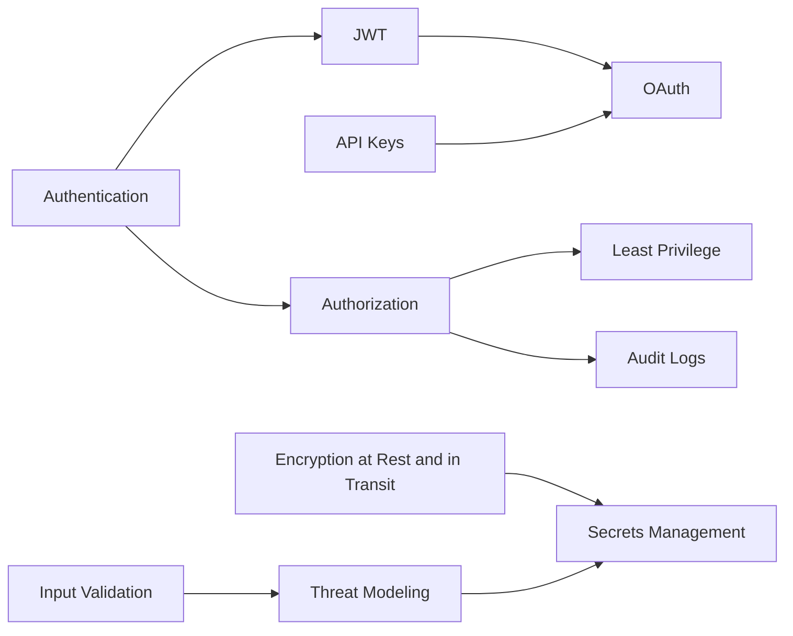

# Security

> [!abstract] Who you are, what you may do, and how secrets and data stay protected.
> Authentication and authorization first (your JWT + IAM world), OAuth as the delegation protocol, then the hygiene topics every design review asks about: encryption, secrets, least privilege, input validation, audit logs, threat modelling.

**Map:** [[HLD MOC]] → this · [[Start Here]] for the reading plan · [[Engineering Dashboard]] for progress

## Start with these

[[Authentication]] → [[Authorization]] → [[JWT]] → [[OAuth]] → [[Secrets Management]] → [[Audit Logs]]

## How the ideas connect

*Every node is a link — click to open the note. Arrows mean "read this first".*



## Concepts

### Core — know these cold for SDE-2

- [[Authentication]] — Authentication establishes who is calling, for people with hashed passwords, MFA and sessions or tokens
- [[Authorization]] — Authorization decides whether an authenticated principal may perform an action on a resource, using roles, attributes or relationships evaluated by a policy decision…
- [[OAuth]] — OAuth 2.0 lets a client obtain a scoped access token from an authorization server on behalf of a resource owner without ever seeing their password, OpenID Connect adds a…
- [[JWT]] — A JWT is a signed, self-contained set of claims that any service can verify locally with the issuer's public key

### Important — read once, revisit when a design needs it

- [[API Keys]] — An API key is a high-entropy shared secret that identifies a machine client, stored only as a hash, scoped and rate-limited per key, rotated with overlap
- [[Encryption at Rest and in Transit]] — Encryption in transit (TLS) protects data between endpoints and encryption at rest (volumes, databases, objects, fields) protects stored data from whoever gets the…
- [[Secrets Management]] — Secrets management keeps credentials out of code, images and tickets by storing them in an encrypted, access-controlled store, injecting them into workloads at run time…
- [[Least Privilege]] — Least privilege gives every identity, human or workload, exactly the permissions its job needs and nothing more, across cloud IAM, Kubernetes, the network and the…
- [[Input Validation]] — Input validation rejects everything that crosses a trust boundary unless it matches an explicit schema of type, size, format and allowed values
- [[Audit Logs]] — An audit log is an append-only, tamper-evident record of who did what to which resource, when, from where and with what outcome, written reliably as part of the action…
- [[Threat Modeling]] — Threat modelling is the structured habit of drawing the system with its trust boundaries, asking what can go wrong at each crossing using a checklist such as STRIDE…

### Also part of this area

Rate limiting is also a security control: [[Rate Limiting]]

## Where it shows up

**Design problems that lean on this category:** [[Design an IAM Service]], [[Design a Payment System]], [[Design an API Gateway]], [[Design File Storage]], [[Design a Feature Flag Service]], [[Design a Webhook Delivery System]], [[Design a Chat System]], [[Design a Digital Wallet and Ledger]]

**Projects that exercise it:** [[LLM Gateway]], [[Webhook Relay]], [[Feature Flag Service and SDK]], [[Double-Entry Ledger Service]], [[Presence and Chat Service]], [[Personal Notification Hub]]

## Progress in this category

Status and confidence come from each note's properties — update them in the note, the table updates itself (native Bases, no plugin).

```base
filters:
  and:
    - file.hasTag("concept")
    - category == "Security"
formulas:
  rank: 'if(priority == "high", 1, if(priority == "medium", 2, 3))'
properties:
  file.name:
    displayName: Concept
  formula.rank:
    displayName: "#"
views:
  - type: table
    name: Tracker
    order:
      - file.name
      - priority
      - status
      - confidence
      - last_reviewed
      - next_review
    sort:
      - property: formula.rank
        direction: ASC
      - property: file.name
        direction: ASC
    summaries:
      confidence: Average
```
