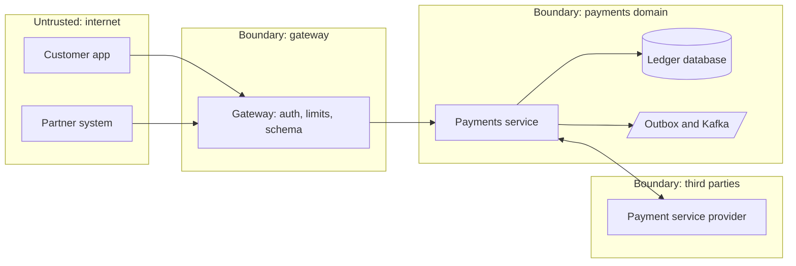

# Threat Modeling

> [!abstract] In one sentence
> Threat modelling is four questions asked over a diagram — what are we building, what can go wrong, what will we do about it, did we do enough — with STRIDE as the prompt list at every trust boundary, so that security controls are chosen for the threats a specific design actually has rather than copied from a checklist after the fact.

> [!tip] Deeper treatment in your system-design vault
> `system-design/11 Auth and IAM/API Security Essentials.md` — read it *after* you have written your own explanation below.

**Map:** [[Security MOC]] → [[HLD MOC]]

## Definition

**Threat modelling** is a structured analysis of a system's design to identify what an attacker could do, how likely and damaging each possibility is, and which mitigations to apply. The common method starts from a data-flow diagram with **trust boundaries** (where data crosses from one level of trust to another: internet to gateway, gateway to service, service to database, service to third party) and applies a threat taxonomy per element or boundary. **STRIDE** names six categories: **S**poofing (pretending to be someone), **T**ampering (modifying data or code), **R**epudiation (denying an action), **I**nformation disclosure, **D**enial of service, and **E**levation of privilege. The **attack surface** is the set of points where an attacker can interact with the system — every endpoint, queue, file input, admin tool and dependency.

## Problem solved

Security review done at the end finds the expensive problems: an unauthenticated internal endpoint, a webhook receiver that trusts its caller, a job that runs with admin rights, a token that lives in a URL. Each is cheap to fix on a whiteboard and costly after launch. Checklists catch the generic issues but miss the ones specific to the design — the maker-checker that can be bypassed through a batch import, the replayable payment request, the reconciliation job that reads from a replica and acts on stale balances. Threat modelling puts the design and the attacker in the same room before code exists, produces a ranked list of threats with owners, and records the decisions so the next reviewer does not start from zero. In a payments stack it is also the artefact that maps controls to regulatory expectations and makes "why do we have this control" answerable.

## How it works

1. **What are we working on?** Draw a data-flow diagram of the feature or system: external entities (users, partners, PSPs), processes (gateway, services, jobs), data stores (databases, queues, caches, buckets) and the flows between them, with the data each flow carries. Draw trust boundaries as dashed lines wherever the level of trust changes — and treat a boundary between two of your own services as real when they have different owners or different privileges ([[Microservices]]).
2. **What can go wrong?** For each element and especially each boundary crossing, walk STRIDE: *Spoofing* — can the caller lie about who it is? (unverified headers, missing mutual TLS, weak [[Authentication]]). *Tampering* — can data be altered in transit, at rest or in a queue? (unsigned webhooks, writable audit tables, unchecked message schemas). *Repudiation* — can an actor deny acting? (no [[Audit Logs]], no request ids). *Information disclosure* — can data leak? (verbose errors, PII in logs, tokens in URLs, missing [[Encryption at Rest and in Transit]]). *Denial of service* — can a caller exhaust something? (no limits, unbounded inputs, retry amplification). *Elevation of privilege* — can a caller do more than permitted? (missing object-level [[Authorization]], over-broad roles, injection). Add abuse cases specific to the domain: replay of a transfer request, race between two approvals, rounding manipulation, enumeration of account ids, insider misuse of support tools.
3. **What are we going to do about it?** For each threat choose: mitigate (a control, with a named owner and a ticket), eliminate (remove the feature or the flow), transfer (a vendor, insurance, a contractual control), or accept (with a written justification and an expiry date). Rank with a simple likelihood × impact scale (high/medium/low each) rather than elaborate scoring; the goal is ordering, not precision. Map mitigations to the control notes: [[Input Validation]], [[Least Privilege]], [[Secrets Management]], [[Rate Limiting]], [[Idempotency]].
4. **Did we do a good job?** Review the model against the built system before launch and after incidents; keep it with the design document or ADR and update it when the architecture changes. A model nobody updates is a historical artefact.
5. **A lightweight routine for design reviews.** Thirty minutes, as part of every non-trivial design review: one diagram with boundaries drawn; list the assets (money, PII, credentials, availability of the payment path); for each boundary, two minutes of STRIDE; write down the top five threats with their mitigation or acceptance; record it in the ADR. For larger systems, attack trees (goal at the root, ways to achieve it as branches) and the OWASP Threat Dragon or Microsoft Threat Modeling Tool help, but the habit matters more than the tool.
6. **Attack surface management.** Keep an inventory of everything exposed: endpoints (including the undocumented ones), queues and topics consumed, scheduled jobs, admin interfaces, third-party dependencies, and their authentication. Reduce it deliberately — remove endpoints nobody calls, put admin tools behind separate authentication, pin and scan dependencies ([[Operational Simplicity]]).

| Boundary crossing | STRIDE threat | Mitigation |
|---|---|---|
| Partner to gateway: transfer request | Spoofing, tampering, replay | Signed requests or OAuth client credentials, TLS, idempotency key, timestamp window |
| Gateway to payments service: identity headers | Spoofing, elevation | Forward the signed token, re-verify in the service, no trusted headers |
| Payments to ledger database: ledger entries | Tampering, repudiation | Append-only grants, audit row in the same transaction, hash-chained audit |
| PSP webhook to receiver | Spoofing, replay, DoS | HMAC with timestamp, per-sender limits, idempotent handling |
| Support tool to customer data | Disclosure, elevation, repudiation | Just-in-time access, field masking, on-behalf-of audit |

## Architecture

## Use cases

- "A new feature moves money, changes limits or exposes a new endpoint" → thirty-minute model in the design review, top threats recorded in the ADR.
- "We are integrating a third party (PSP, KYC vendor, webhook consumer)" → model the boundary: their identity, our identity, replay, data shared.
- "An incident happened" → re-run the model on the affected flow; the gap is usually a boundary that was never drawn ([[Production Incident Analysis]]).
- "Compliance asks for a risk assessment of the payment flow" → the threat model with ranked threats and mapped controls is most of the answer.
- "We are deciding between two architectures" → model both; the one with fewer boundaries carrying sensitive data usually wins ([[Evaluating Architectural Complexity]]).

## Limitations

- A model is only as good as the diagram: missing flows (the admin API, the batch job, the replica) are missing threats.
- STRIDE is a prompt list, not a guarantee; domain-specific abuse (financial logic, race conditions, business-rule bypass) needs people who know the domain in the room.
- Ranking is subjective; the value is in the ordering and the conversation, not the numbers.
- Models decay as systems change; without a trigger (design review, ADR, incident) they are not revisited.
- It does not replace testing: a mitigation on paper needs a test that proves it ([[Testing Strategies]]).

## Trade-offs

| You gain | You sacrifice |
|---|---|
| Threats specific to your design found before code exists | Half an hour to a few hours per design, and a diagram that must be kept honest |
| A ranked, owned list instead of a generic checklist | Subjective ranking and debates about likelihood |
| Decisions and accepted risks recorded with reasons | Documents that must be updated or they mislead |
| A shared vocabulary (STRIDE, boundaries) across engineers and security | Training time and the discipline to run the routine every time |

## Failure modes

- **Model done once, system changed** → the new admin endpoint or batch path was never modelled; you notice at the incident; blast radius is whatever the unmodelled path reaches.
- **Boundaries drawn only at the internet edge** → internal services trust each other by network position; one compromised pod talks to everything; you notice during lateral movement ([[Least Privilege]]).
- **Threats listed, mitigations unowned** → the document exists, the controls do not; you notice when an auditor or attacker checks.
- **Accepted risks without expiry** → "temporary" acceptances become permanent; discovered years later.
- **Modelling by the security team alone** → domain-specific abuse (approval races, rounding, replay) is missed because nobody in the room knew the money flow; blast radius is the business logic.

## Performance

Threat modelling costs engineering time, not system resources: thirty minutes for a feature, a day for a new system, hours per quarter to keep models current. Its return is measured in incidents avoided and in controls that are proportionate — fewer blanket controls that slow every request, more targeted ones where the threats are. Where a mitigation does add latency (synchronous audit writes, signature verification, step-up authentication) the model is what justifies it for that path and not for others.

## Scalability

At 10x features, the routine must be embedded in the process (a section in the design template, a question in the pull-request template for boundary changes) and supported by reusable models for shared components (the gateway, the IAM service, the audit pipeline) so each team models only its deltas. At 10x teams, a small security function cannot attend every review; the method must be learnable by engineers in an afternoon — which is the point of four questions and six letters.

## Operational impact

Own: the design-review template with the threat-modelling section, a library of reference models for shared infrastructure, a register of accepted risks with owners and review dates, and the link between models and incident reviews. The operational burden is light; the cultural burden — making it normal to ask "what can go wrong here" in every review — is the real work. Debugging benefits too: a model is a map of where to look when something unexpected happens.

## Alternatives

- **Security checklists (OWASP ASVS, cloud benchmarks)** — win for baseline hygiene across many systems; they do not find design-specific threats and work best as inputs to a model.
- **Penetration testing** — wins for validating built systems against real attackers; late, expensive and sampling-based, so it complements rather than replaces modelling.
- **Attack trees and PASTA** — win for high-assurance systems that need deeper, attacker-centric analysis; heavier than STRIDE for routine reviews.
- **Privacy-specific modelling (LINDDUN)** — wins when the primary asset is personal data and the threats are about linkability and identifiability rather than access.

## Real-world examples

- Microsoft introduced STRIDE and made threat modelling part of its Security Development Lifecycle; Adam Shostack's "four questions" framing and the OWASP Threat Modeling Cheat Sheet and Threat Dragon tool are the widely used open descriptions.
- The Threat Modeling Manifesto (2020) codifies the values and principles — do it early and often, keep it collaborative, value the outcome over the document.
- Large organisations publish reference models for common components (OWASP's own examples, cloud providers' shared-responsibility threat guidance) that teams adapt rather than rebuild.
- In a stack like yours: a thirty-minute STRIDE pass on every payments or IAM design review, with the gateway, token verification, outbox, Kafka consumers, PSP webhooks and support tooling as the standing boundaries; a register of accepted risks reviewed quarterly; and the top threats for each flow mapped to concrete controls — signed webhooks, re-verified tokens, append-only ledgers, scoped IAM roles, idempotency keys — recorded in the ADR beside the architecture ([[Design a Payment System]], [[Design a Webhook Delivery System]]).

## Practical exercise

1. Draw the data-flow diagram for a webhook delivery system (your [[Webhook Relay]] project): customer configures an endpoint, events flow from Kafka, a worker signs and delivers, retries and a DLQ exist, customers view delivery logs.
2. Mark every trust boundary; for each crossing, spend two minutes per STRIDE letter and write the threats in a table.
3. Rank them high/medium/low on likelihood and impact; pick the top five and assign a mitigation (HMAC with timestamp, SSRF-safe URL validation, per-endpoint rate limits, audit of configuration changes, least-privilege worker identity) or an acceptance with a date.
4. Implement two of the mitigations in the project and write a test that fails without each.
5. Add a batch "re-deliver all" admin endpoint to the design and repeat the exercise; note which new threats appear and how the model changed.
6. Record the whole thing as an ADR using the vault's decision template and schedule a review in three months.

## Related concepts

### Prerequisites
- [[Authentication]] — spoofing threats assume you know how identity is established
- [[Authorization]] — elevation-of-privilege threats are authorization gaps

### Related
- [[Least Privilege]] — the mitigation for most elevation and disclosure threats
- [[Input Validation]] — the mitigation for tampering and injection at boundaries
- [[Secrets Management]] — credentials as assets in the model
- [[Encryption at Rest and in Transit]] — the mitigation for disclosure in transit and at rest
- [[Audit Logs]] — the mitigation for repudiation

### Builds on this
- [[Production Incident Analysis]] — incidents feed back into the model
- [[Disaster Recovery]] — availability threats extend into recovery planning

### Design problems where it applies
- [[Design an IAM Service]]
- [[Design a Payment System]]
- [[Design a Webhook Delivery System]]
- [[Design File Storage]]
- [[Design a Real-Time Fraud Detection Pipeline]]

### Projects where it can be implemented
- [[Webhook Relay]]
- [[LLM Gateway]]
- [[Double-Entry Ledger Service]]

### Resources
- [[OWASP Threat Modeling Cheat Sheet]] — the method, STRIDE and worked guidance
- [[OWASP Secrets Management Cheat Sheet]] — credential threats and their controls

## Personal understanding

> [!question] Explain it without the source
> Write your own explanation here, from memory. Then compare it with the sections above and note what you missed.

### Mastery checklist
- [ ] I can explain it without the original resource
- [ ] I can describe the problem it solves
- [ ] I can compare it with its alternatives
- [ ] I can name its limitations and failure modes
- [ ] I can recognise when it is appropriate in a real system
- [ ] I have applied it in a system design
- [ ] I have validated my assumptions with an experiment or implementation

## Open questions

- [ ] For the last feature you designed that touched money, which trust boundaries did it cross, and was a STRIDE pass recorded anywhere?
- [ ] Which internal boundaries in your platform (gateway to service, service to service, service to support tooling) are currently enforced by network position rather than by verified identity?
- [ ] Is there a register of accepted security risks with owners and review dates, and when did an acceptance last expire and get re-decided?
